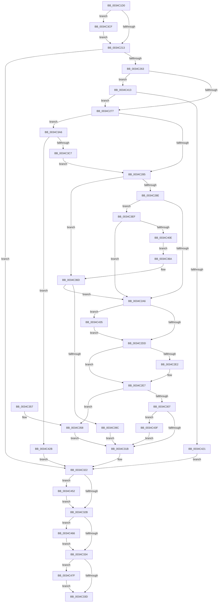

# SMKM_STORE_MGR&lt;SM_TRAITS&gt;::SmPageRead

- RVA: `0x0034C1D0`–`0x0034C48E` (길이 `702` bytes)
- VA: `0x000000014034C1D0`
- 실행 섹션: `.text`
- PDB 이름 있음: `예`; PDB Function 태그: `아니요`
- unwind 정보 RVA: `0x000786EC`
- 디코드: `175`개 명령, `702/702` bytes 표시
- 미해석 바이트: `0` (있으면 어셈블리에 `.byte`로 보존)

> 이 문서는 커널 이미지의 기계어와 PDB 기호를 분석해 생성했습니다. 4번과 5번은 함수 원형과 자료형을 바이너리 사용 방식에서 추정한 C 해석이며 원본 소스 복구 결과는 아닙니다.

## 1. Dependencies

- 직접 호출 지점: **9**; 고유 호출 대상: **8**
- 직접 호출자로 확인된 함수: **1**
- RIP 상대 이미지 참조: **0**

### Outgoing calls
- `0x0034C24F` → [SMKM_STORE_MGR<SM_TRAITS>::SmReadPickStore](SMKM_STORE_MGR_SM_TRAITS_SmReadPickStore_function_0034C494.md) (function, `0x0034C494`)
- `0x0034C295` → [ExpInterlockedPopEntrySList](../6B/ExpInterlockedPopEntrySList_function_006BA570.md) (function, `0x006BA570`)
- `0x0034C2FE` → [SMKM_STORE_MGR<SM_TRAITS>::SmIoCtxQueueWork](../31/SMKM_STORE_MGR_SM_TRAITS_SmIoCtxQueueWork_function_00317440.md) (function, `0x00317440`)
- `0x0034C38B` → [SmFpAllocate](../31/SmFpAllocate_function_00317D10.md) (function, `0x00317D10`)
- `0x0034C3B2` → [SmAcquireReleaseResAvailForRead](../28/SmAcquireReleaseResAvailForRead_function_0028AD20.md) (function, `0x0028AD20`)
- `0x0034C3FD` → [ExAllocatePool2](../../poolcode/B8/ExAllocatePool2_function_00B820F0.md) (function, `0x00B820F0`)
- `0x0034C448` → [SMKM_STORE_MGR<SM_TRAITS>::SmWorkItemFreeResource](../31/SMKM_STORE_MGR_SM_TRAITS_SmWorkItemFreeResource_function_003179B4.md) (function, `0x003179B4`)
- `0x0034C45C` → [SmKmStoreDereference](../20/SmKmStoreDereference_function_00206574.md) (function, `0x00206574`)
- `0x0034C475` → [SmAcquireReleaseResAvailForRead](../28/SmAcquireReleaseResAvailForRead_function_0028AD20.md) (function, `0x0028AD20`)

### Direct callers
- [SmPageRead](SmPageRead_function_0034C1A0.md) at `0x0034C1BD`

### Static image references
- 디코드된 RIP-relative 메모리 참조가 없습니다.

## 2. Other-region calls and transfers

- 다른 실행 섹션으로 향하는 call: **1**
  - `0x0034C3FD` → [ExAllocatePool2](../../poolcode/B8/ExAllocatePool2_function_00B820F0.md) (`.text` → `POOLCODE`)
- 별도 외부 분기/꼬리 이동을 확인하지 못했습니다.

## 3. Assembly (complete function range)

```asm
0034C1D0  48 8B C4                        mov rax, rsp
0034C1D3  48 89 58 08                     mov qword ptr [rax + 8], rbx
0034C1D7  48 89 50 10                     mov qword ptr [rax + 0x10], rdx
0034C1DB  55                              push rbp
0034C1DC  56                              push rsi
0034C1DD  57                              push rdi
0034C1DE  41 54                           push r12
0034C1E0  41 55                           push r13
0034C1E2  41 56                           push r14
0034C1E4  41 57                           push r15
0034C1E6  48 83 EC 40                     sub rsp, 0x40
0034C1EA  4C 8B B4 24 A0 00 00 00         mov r14, qword ptr [rsp + 0xa0]
0034C1F2  45 33 FF                        xor r15d, r15d
0034C1F5  44 89 78 20                     mov dword ptr [rax + 0x20], r15d
0034C1F9  4D 8B E8                        mov r13, r8
0034C1FC  4C 89 78 B8                     mov qword ptr [rax - 0x48], r15
0034C200  4C 8B D2                        mov r10, rdx
0034C203  48 8B E9                        mov rbp, rcx
0034C206  41 8B DF                        mov ebx, r15d
0034C209  41 F6 C0 03                     test r8b, 3
0034C20D  0F 85 BC 01 00 00               jne 0x14034c3cf
0034C213  4D 89 7E 08                     mov qword ptr [r14 + 8], r15
0034C217  48 8D 84 24 98 00 00 00         lea rax, [rsp + 0x98]
0034C21F  4D 89 0E                        mov qword ptr [r14], r9
0034C222  4C 8D 84 24 90 00 00 00         lea r8, [rsp + 0x90]
0034C22A  41 8B 75 28                     mov esi, dword ptr [r13 + 0x28]
0034C22E  4C 8D 4C 24 30                  lea r9, [rsp + 0x30]
0034C233  C1 EE 0C                        shr esi, 0xc
0034C236  49 8B D2                        mov rdx, r10
0034C239  89 B4 24 A0 00 00 00            mov dword ptr [rsp + 0xa0], esi
0034C240  4D 8B E6                        mov r12, r14
0034C243  89 B4 24 90 00 00 00            mov dword ptr [rsp + 0x90], esi
0034C24A  48 89 44 24 20                  mov qword ptr [rsp + 0x20], rax
0034C24F  E8 40 02 00 00                  call 0x14034c494
0034C254  4C 8B 7C 24 30                  mov r15, qword ptr [rsp + 0x30]
0034C259  8B F8                           mov edi, eax
0034C25B  85 C0                           test eax, eax
0034C25D  0F 88 BF 00 00 00               js 0x14034c322
0034C263  8B BC 24 90 00 00 00            mov edi, dword ptr [rsp + 0x90]
0034C26A  49 89 7E 08                     mov qword ptr [r14 + 8], rdi
0034C26E  83 FB 02                        cmp ebx, 2
0034C271  0F 83 9C 01 00 00               jae 0x14034c413
0034C277  8B 85 D0 07 00 00               mov eax, dword ptr [rbp + 0x7d0]
0034C27D  A8 10                           test al, 0x10
0034C27F  0F 85 21 01 00 00               jne 0x14034c3a6
0034C285  F6 C3 01                        test bl, 1
0034C288  0F 84 DF 00 00 00               je 0x14034c36d
0034C28E  48 8D 8D E0 04 00 00            lea rcx, [rbp + 0x4e0]
0034C295  E8 D6 E2 36 00                  call 0x1406ba570
0034C29A  48 8B F0                        mov rsi, rax
0034C29D  48 85 C0                        test rax, rax
0034C2A0  0F 84 49 01 00 00               je 0x14034c3ef
0034C2A6  F6 84 24 98 00 00 00 01         test byte ptr [rsp + 0x98], 1
0034C2AE  0F 57 C0                        xorps xmm0, xmm0
0034C2B1  48 8B 84 24 88 00 00 00         mov rax, qword ptr [rsp + 0x88]
0034C2B9  0F 11 06                        movups xmmword ptr [rsi], xmm0
0034C2BC  0F 11 46 10                     movups xmmword ptr [rsi + 0x10], xmm0
0034C2C0  8B 00                           mov eax, dword ptr [rax]
0034C2C2  89 46 18                        mov dword ptr [rsi + 0x18], eax
0034C2C5  C7 06 02 00 00 00               mov dword ptr [rsi], 2
0034C2CB  4C 89 6E 10                     mov qword ptr [rsi + 0x10], r13
0034C2CF  40 88 7E 08                     mov byte ptr [rsi + 8], dil
0034C2D3  4C 89 76 20                     mov qword ptr [rsi + 0x20], r14
0034C2D7  0F 85 58 01 00 00               jne 0x14034c435
0034C2DD  F6 C3 01                        test bl, 1
0034C2E0  74 05                           je 0x14034c2e7
0034C2E2  0F BA 6E 08 1A                  bts dword ptr [rsi + 8], 0x1a
0034C2E7  45 8B 87 90 1A 00 00            mov r8d, dword ptr [r15 + 0x1a90]
0034C2EE  4C 8B CE                        mov r9, rsi
0034C2F1  41 81 E0 FF 03 00 00            and r8d, 0x3ff
0034C2F8  48 8B D5                        mov rdx, rbp
0034C2FB  49 8B CE                        mov rcx, r14
0034C2FE  E8 3D B1 FC FF                  call 0x140317440
0034C303  85 C0                           test eax, eax
0034C305  79 51                           jns 0x14034c358
0034C307  BF 9A 00 00 C0                  mov edi, 0xc000009a
0034C30C  49 8B C6                        mov rax, r14
0034C30F  44 8B EB                        mov r13d, ebx
0034C312  48 85 F6                        test rsi, rsi
0034C315  0F 85 24 01 00 00               jne 0x14034c43f
0034C31B  8B B4 24 A0 00 00 00            mov esi, dword ptr [rsp + 0xa0]
0034C322  4D 85 FF                        test r15, r15
0034C325  0F 85 27 01 00 00               jne 0x14034c452
0034C32B  F6 C3 04                        test bl, 4
0034C32E  0F 85 32 01 00 00               jne 0x14034c466
0034C334  4D 85 E4                        test r12, r12
0034C337  0F 85 42 01 00 00               jne 0x14034c47f
0034C33D  48 8B 9C 24 80 00 00 00         mov rbx, qword ptr [rsp + 0x80]
0034C345  8B C7                           mov eax, edi
0034C347  48 83 C4 40                     add rsp, 0x40
0034C34B  41 5F                           pop r15
0034C34D  41 5E                           pop r14
0034C34F  41 5D                           pop r13
0034C351  41 5C                           pop r12
0034C353  5F                              pop rdi
0034C354  5E                              pop rsi
0034C355  5D                              pop rbp
0034C356  C3                              ret
0034C357  CC                              int3
0034C358  45 33 E4                        xor r12d, r12d
0034C35B  BB FB FF FF FF                  mov ebx, 0xfffffffb
0034C360  45 33 FF                        xor r15d, r15d
0034C363  BF 03 01 00 00                  mov edi, 0x103
0034C368  EB B1                           jmp 0x14034c31b
0034C36A  83 E3 FE                        and ebx, 0xfffffffe
0034C36D  8B 85 D0 07 00 00               mov eax, dword ptr [rbp + 0x7d0]
0034C373  48 8D 8D A8 06 00 00            lea rcx, [rbp + 0x6a8]
0034C37A  45 33 C9                        xor r9d, r9d
0034C37D  83 E0 01                        and eax, 1
0034C380  4D 8B C6                        mov r8, r14
0034C383  89 44 24 20                     mov dword ptr [rsp + 0x20], eax
0034C387  41 8D 51 01                     lea edx, [r9 + 1]
0034C38B  E8 80 B9 FC FF                  call 0x140317d10
0034C390  48 8B F0                        mov rsi, rax
0034C393  48 85 C0                        test rax, rax
0034C396  0F 85 0A FF FF FF               jne 0x14034c2a6
0034C39C  BF 9A 00 00 C0                  mov edi, 0xc000009a
0034C3A1  E9 75 FF FF FF                  jmp 0x14034c31b
0034C3A6  44 8B C6                        mov r8d, esi
0034C3A9  45 33 C9                        xor r9d, r9d
0034C3AC  49 8B D6                        mov rdx, r14
0034C3AF  48 8B CD                        mov rcx, rbp
0034C3B2  E8 69 E9 F3 FF                  call 0x14028ad20
0034C3B7  83 E0 01                        and eax, 1
0034C3BA  8D 0C C5 00 00 00 00            lea ecx, [rax*8]
0034C3C1  0B D9                           or ebx, ecx
0034C3C3  85 C0                           test eax, eax
0034C3C5  74 64                           je 0x14034c42b
0034C3C7  83 CB 04                        or ebx, 4
0034C3CA  E9 B6 FE FF FF                  jmp 0x14034c285
0034C3CF  49 8B C5                        mov rax, r13
0034C3D2  41 8B D5                        mov edx, r13d
0034C3D5  83 E2 01                        and edx, 1
0034C3D8  83 E0 02                        and eax, 2
0034C3DB  8B DA                           mov ebx, edx
0034C3DD  49 83 E5 FC                     and r13, 0xfffffffffffffffc
0034C3E1  83 CB 02                        or ebx, 2
0034C3E4  48 85 C0                        test rax, rax
0034C3E7  0F 44 DA                        cmove ebx, edx
0034C3EA  E9 24 FE FF FF                  jmp 0x14034c213
0034C3EF  BA 58 00 00 00                  mov edx, 0x58
0034C3F4  41 B8 73 6D 57 61               mov r8d, 0x61576d73
0034C3FA  8D 4A E8                        lea ecx, [rdx - 0x18]
0034C3FD  E8 EE 5C 83 00                  call 0x140b820f0
0034C402  48 8B F0                        mov rsi, rax
0034C405  48 85 C0                        test rax, rax
0034C408  0F 85 98 FE FF FF               jne 0x14034c2a6
0034C40E  E9 57 FF FF FF                  jmp 0x14034c36a
0034C413  41 80 BF 94 1A 00 00 00         cmp byte ptr [r15 + 0x1a94], 0
0034C41B  0F 85 56 FE FF FF               jne 0x14034c277
0034C421  BF 21 00 00 C0                  mov edi, 0xc0000021
0034C426  E9 F7 FE FF FF                  jmp 0x14034c322
0034C42B  BF 9A 00 00 C0                  mov edi, 0xc000009a
0034C430  E9 ED FE FF FF                  jmp 0x14034c322
0034C435  0F BA 6E 08 18                  bts dword ptr [rsi + 8], 0x18
0034C43A  E9 9E FE FF FF                  jmp 0x14034c2dd
0034C43F  4C 8B C0                        mov r8, rax
0034C442  48 8B D6                        mov rdx, rsi
0034C445  48 8B CD                        mov rcx, rbp
0034C448  E8 67 B5 FC FF                  call 0x1403179b4
0034C44D  E9 C9 FE FF FF                  jmp 0x14034c31b
0034C452  41 8B 97 90 1A 00 00            mov edx, dword ptr [r15 + 0x1a90]
0034C459  48 8B CD                        mov rcx, rbp
0034C45C  E8 13 A1 EB FF                  call 0x140206574
0034C461  E9 C5 FE FF FF                  jmp 0x14034c32b
0034C466  44 8B C6                        mov r8d, esi
0034C469  41 B9 01 00 00 00               mov r9d, 1
0034C46F  49 8B D4                        mov rdx, r12
0034C472  48 8B CD                        mov rcx, rbp
0034C475  E8 A6 E8 F3 FF                  call 0x14028ad20
0034C47A  E9 B5 FE FF FF                  jmp 0x14034c334
0034C47F  0F 57 C0                        xorps xmm0, xmm0
0034C482  41 0F 11 06                     movups xmmword ptr [r14], xmm0
0034C486  41 89 3E                        mov dword ptr [r14], edi
0034C489  E9 AF FE FF FF                  jmp 0x14034c33d
```

## 4. C-style interpretation (structured pseudocode)

```c
__int64 __fastcall SMKM_STORE_MGR_SM_TRAITS___SmPageRead(__int64 a1, __int64 a2, __int64 a3, __int64 a4, unsigned int a5)
{
    __int64 result;
    __int64 v_r12;
    __int64 v_r13;
    __int64 v_r15;
    __int64 v_rbx;
    __int64 v_rsi;
    __int64 v_rsp;
    unsigned __int64 v_stack_m48;
    unsigned __int64 v_stack_m58;
    unsigned __int64 v_stack_p10;
    unsigned __int64 v_stack_p18;
    unsigned __int64 v_stack_p20;
    unsigned int v_stack_p28;
    unsigned __int64 v_stack_p8;

    *(unsigned __int64 *)(v_rsp + 8) = v_rbx;
    *(unsigned __int64 *)(v_rsp + 16) = a2;
    v_rsp = (v_rsp) - (64);
    v_r15 = 0;
    *(unsigned int *)(v_rsp + 32) = 0;
    *(unsigned __int64 *)(v_rsp - 72) = 0;
    if ((((unsigned __int8)(a3)) & (3)) != 0) goto loc_0034C3CF;
loc_0034C213:
    *(unsigned __int64 *)(a5 + 8) = 0;
    *(unsigned __int64 *)(a5) = a4;
    v_rsi = (unsigned int)(((unsigned int)(*(unsigned int *)(a3 + 40))) >> (12));
    v_stack_p28 = (unsigned int)(v_rsi);
    v_stack_p18 = (unsigned int)(v_rsi);
    v_stack_m58 = v_stack_p20;
    result = SMKM_STORE_MGR_SM_TRAITS___SmReadPickStore(a1, a2, v_stack_p18, v_stack_m48);
    if (sign_flag) goto loc_0034C322;
    *(unsigned __int64 *)(a5 + 8) = (unsigned int)(v_stack_p18);
    if (0 >= 2) goto loc_0034C413;
loc_0034C277:
    if ((((unsigned __int8)((unsigned int)(*(unsigned int *)(a1 + 2000)))) & (16)) != 0) goto loc_0034C3A6;
loc_0034C285:
    if (((0) & (1)) == 0) goto loc_0034C36D;
    result = ExpInterlockedPopEntrySList(a1 + 1248, a2, v_stack_p18, v_stack_m48);
    if (result == 0) goto loc_0034C3EF;
loc_0034C2A6:
    *(unsigned __int64 *)(result) = v_xmm0;
    *(unsigned __int64 *)(result + 16) = v_xmm0;
    *(unsigned int *)(result + 24) = (unsigned int)((unsigned int)(*(unsigned int *)(v_stack_p10)));
    *(unsigned int *)(result) = 2;
    *(unsigned __int64 *)(result + 16) = a3;
    *(unsigned __int8 *)(result + 8) = (unsigned __int8)((unsigned int)(v_stack_p18));
    *(unsigned __int64 *)(result + 32) = a5;
    if (((v_stack_p20) & (1)) != 0) goto loc_0034C435;
loc_0034C2DD:
    if (((0) & (1)) != 0) {
    }
    a3 = (unsigned int)(((unsigned int)(*(unsigned int *)(v_stack_m48 + 6800))) & (0x3FFULL));
    result = SMKM_STORE_MGR_SM_TRAITS___SmIoCtxQueueWork(a5, a1, a3, result);
    if (!sign_flag) goto loc_0034C358;
    if (result != 0) goto loc_0034C43F;
loc_0034C31B:
loc_0034C322:
    if (v_stack_m48 != 0) goto loc_0034C452;
loc_0034C32B:
    if (((0) & (4)) != 0) goto loc_0034C466;
loc_0034C334:
    if (a5 != 0) goto loc_0034C47F;
loc_0034C33D:
    v_rsp = (v_rsp) + (64);
    return (unsigned int)((unsigned int)((unsigned int)(0xC000009AULL)));
loc_0034C358:
    v_r12 = 0;
    v_r15 = 0;
    goto loc_0034C31B;
loc_0034C36A:
    v_rbx = (unsigned int)(((unsigned int)(0xFFFFFFFBULL)) & (0xFFFFFFFEULL));
loc_0034C36D:
    a4 = 0;
    result = (unsigned int)(((unsigned int)(*(unsigned int *)(a1 + 2000))) & (1));
    v_stack_p20 = (unsigned int)(result);
    result = SmFpAllocate(a1 + 1704, a4 + 1, a5, a4);
    if (result != 0) goto loc_0034C2A6;
    goto loc_0034C31B;
loc_0034C3A6:
    a4 = 0;
    result = SmAcquireReleaseResAvailForRead(a1, a5, (unsigned int)((unsigned int)(result)), a4);
    result = (unsigned int)((result) & (1));
    v_rbx = (unsigned int)((v_rbx) | ((unsigned int)(result * 8)));
    if ((unsigned int)(result) == 0) goto loc_0034C42B;
    v_rbx = (unsigned int)((v_rbx) | (4));
    goto loc_0034C285;
loc_0034C3CF:
    a2 = (unsigned int)((0) & (1));
    result = (unsigned int)((0) & (2));
    v_r13 = (0) & (-4);
    v_rbx = (unsigned int)(((unsigned int)((unsigned int)(a2))) | (2));
    if (result == 0) { v_rbx = (unsigned int)(a2); }
    goto loc_0034C213;
loc_0034C3EF:
    result = ExAllocatePool2(88 - 24, 88, (unsigned int)(0x61576D73ULL), a4);
    if (result != 0) goto loc_0034C2A6;
    goto loc_0034C36A;
loc_0034C413:
    if ((*(unsigned __int8 *)(v_r15 + 6804)) != 0) goto loc_0034C277;
    goto loc_0034C322;
loc_0034C42B:
    goto loc_0034C322;
loc_0034C435:
    goto loc_0034C2DD;
loc_0034C43F:
    result = SMKM_STORE_MGR_SM_TRAITS___SmWorkItemFreeResource(a1, result, result, a4);
    goto loc_0034C31B;
loc_0034C452:
    result = SmKmStoreDereference(a1, (unsigned int)(*(unsigned int *)(v_r15 + 6800)), result, a4);
    goto loc_0034C32B;
loc_0034C466:
    result = SmAcquireReleaseResAvailForRead(a1, 0, (unsigned int)((unsigned int)(result)), 1);
    goto loc_0034C334;
loc_0034C47F:
    *(unsigned __int64 *)(a5) = v_xmm0;
    *(unsigned int *)(a5) = (unsigned int)((unsigned int)(0xC000009AULL));
    goto loc_0034C33D;
}
```

## 5. (Beta) C Style

```c
int64_t SMKM_STORE_MGR_SM_TRAITS___SmPageRead(void *Arg1, int64_t Arg2, void *Arg3, int64_t Arg4, void *Arg5)
{
    uint8_t *arg1 = (uint8_t *)Arg1;
    uint8_t *arg3 = (uint8_t *)Arg3;
    uint8_t *arg5 = (uint8_t *)Arg5;

    int64_t result;
    int64_t local_r12;
    int64_t local_r13;
    int64_t local_r15;
    int64_t local_rbx;
    int64_t local_rsi;
    int64_t local_rsp;
    uint64_t v_stack_m48;
    uint64_t v_stack_m58;
    uint64_t v_stack_p10;
    uint64_t v_stack_p18;
    uint64_t v_stack_p20;
    uint32_t v_stack_p28;
    uint64_t v_stack_p8;

    *(uint64_t *)(local_rsp + 0x8) = local_rbx;
    *(uint64_t *)(local_rsp + 0x10) = Arg2;
    local_rsp = (local_rsp) - (64);
    local_r15 = 0;
    *(uint32_t *)(local_rsp + 0x20) = 0;
    *(uint64_t *)(local_rsp - 0x48) = 0;
    if ((((uint8_t)(Arg3)) & (3)) != 0) goto loc_0034C3CF;
loc_0034C213:
    *(uint64_t *)(arg5 + 0x8) = 0;
    *(uint64_t *)(arg5) = Arg4;
    local_rsi = (uint32_t)(((uint32_t)(*(uint32_t *)(arg3 + 0x28))) >> (12));
    v_stack_p28 = (uint32_t)(local_rsi);
    v_stack_p18 = (uint32_t)(local_rsi);
    v_stack_m58 = v_stack_p20;
    result = SMKM_STORE_MGR_SM_TRAITS___SmReadPickStore(Arg1, Arg2, v_stack_p18, v_stack_m48);
    if (sign_flag) goto loc_0034C322;
    *(uint64_t *)(arg5 + 0x8) = (uint32_t)(v_stack_p18);
    if (0 >= 2) goto loc_0034C413;
loc_0034C277:
    if ((((uint8_t)((uint32_t)(*(uint32_t *)(arg1 + 0x7D0)))) & (16)) != 0) goto loc_0034C3A6;
loc_0034C285:
    if (((0) & (1)) == 0) goto loc_0034C36D;
    result = ExpInterlockedPopEntrySList(Arg1 + 1248, Arg2, v_stack_p18, v_stack_m48);
    if (result == 0) goto loc_0034C3EF;
loc_0034C2A6:
    *(uint64_t *)(result) = v_xmm0;
    *(uint64_t *)(result + 0x10) = v_xmm0;
    *(uint32_t *)(result + 0x18) = (uint32_t)((uint32_t)(*(uint32_t *)(v_stack_p10)));
    *(uint32_t *)(result) = 2;
    *(void **)(result + 0x10) = Arg3;
    *(uint8_t *)(result + 0x8) = (uint8_t)((uint32_t)(v_stack_p18));
    *(void **)(result + 0x20) = Arg5;
    if (((v_stack_p20) & (1)) != 0) goto loc_0034C435;
loc_0034C2DD:
    if (((0) & (1)) != 0) {
    }
    Arg3 = (uint32_t)(((uint32_t)(*(uint32_t *)(v_stack_m48 + 0x1A90))) & (0x3FFULL));
    result = SMKM_STORE_MGR_SM_TRAITS___SmIoCtxQueueWork(Arg5, Arg1, Arg3, result);
    if (!sign_flag) goto loc_0034C358;
    if (result != 0) goto loc_0034C43F;
loc_0034C31B:
loc_0034C322:
    if (v_stack_m48 != 0) goto loc_0034C452;
loc_0034C32B:
    if (((0) & (4)) != 0) goto loc_0034C466;
loc_0034C334:
    if (Arg5 != NULL) goto loc_0034C47F;
loc_0034C33D:
    local_rsp = (local_rsp) + (64);
    return (uint32_t)((uint32_t)((uint32_t)(0xC000009AULL)));
loc_0034C358:
    local_r12 = 0;
    local_r15 = 0;
    goto loc_0034C31B;
loc_0034C36A:
    local_rbx = (uint32_t)(((uint32_t)(0xFFFFFFFBULL)) & (0xFFFFFFFEULL));
loc_0034C36D:
    Arg4 = 0;
    result = (uint32_t)(((uint32_t)(*(uint32_t *)(arg1 + 0x7D0))) & (1));
    v_stack_p20 = (uint32_t)(result);
    result = SmFpAllocate(Arg1 + 1704, Arg4 + 1, Arg5, Arg4);
    if (result != 0) goto loc_0034C2A6;
    goto loc_0034C31B;
loc_0034C3A6:
    Arg4 = 0;
    result = SmAcquireReleaseResAvailForRead(Arg1, Arg5, (uint32_t)((uint32_t)(result)), Arg4);
    result = (uint32_t)((result) & (1));
    local_rbx = (uint32_t)((local_rbx) | ((uint32_t)(result * 8)));
    if ((uint32_t)(result) == 0) goto loc_0034C42B;
    local_rbx = (uint32_t)((local_rbx) | (4));
    goto loc_0034C285;
loc_0034C3CF:
    Arg2 = (uint32_t)((0) & (1));
    result = (uint32_t)((0) & (2));
    local_r13 = (0) & (-4);
    local_rbx = (uint32_t)(((uint32_t)((uint32_t)(Arg2))) | (2));
    if (result == 0) { local_rbx = (uint32_t)(Arg2); }
    goto loc_0034C213;
loc_0034C3EF:
    result = ExAllocatePool2(88 - 24, 88, (uint32_t)(0x61576D73ULL), Arg4);
    if (result != 0) goto loc_0034C2A6;
    goto loc_0034C36A;
loc_0034C413:
    if ((*(uint8_t *)(local_r15 + 0x1A94)) != 0) goto loc_0034C277;
    goto loc_0034C322;
loc_0034C42B:
    goto loc_0034C322;
loc_0034C435:
    goto loc_0034C2DD;
loc_0034C43F:
    result = SMKM_STORE_MGR_SM_TRAITS___SmWorkItemFreeResource(Arg1, result, result, Arg4);
    goto loc_0034C31B;
loc_0034C452:
    result = SmKmStoreDereference(Arg1, (uint32_t)(*(uint32_t *)(local_r15 + 0x1A90)), result, Arg4);
    goto loc_0034C32B;
loc_0034C466:
    result = SmAcquireReleaseResAvailForRead(Arg1, 0, (uint32_t)((uint32_t)(result)), 1);
    goto loc_0034C334;
loc_0034C47F:
    *(uint64_t *)(arg5) = v_xmm0;
    *(uint32_t *)(arg5) = (uint32_t)((uint32_t)(0xC000009AULL));
    goto loc_0034C33D;
}
```

### 관측된 메모리 오프셋

구조체 형식이 확인되지 않은 접근은 인자 기준의 오프셋으로만 기록했습니다.

| 기준 인자 | 오프셋 표현 | 폭 (bit) | 접근 |
|---|---:|---:|---|
| `Arg1` | `+ 0x4E0` | `64` | `R` |
| `Arg1` | `+ 0x6A8` | `64` | `R` |
| `Arg1` | `+ 0x7D0` | `32` | `R` |
| `Arg3` | `+ 0x28` | `32` | `R` |
| `Arg5` | `+ 0x0` | `32` | `W` |
| `Arg5` | `+ 0x0` | `64` | `W` |
| `Arg5` | `+ 0x0` | `128` | `R` |
| `Arg5` | `+ 0x8` | `64` | `W` |

## 6. Execution-region graph

[열기: 2D/3D 그래프와 함수 탐색 컨트롤 패널](../../../control-panel.html?section=text&rva=0x0034C1D0&view=graph)

- 2D 그래프는 위에서 아래로 흐르고, 3D 그래프는 빈 공간을 드래그해 회전합니다. Shift+드래그는 이동, 휠은 확대·축소, 함수 노드 선택은 대상 보고서 이동입니다.

### Static fallback


