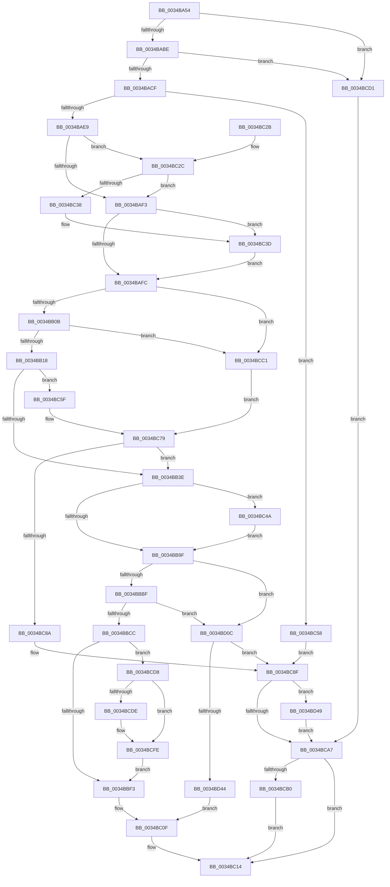

# SMKM_STORE_MGR&lt;SM_TRAITS&gt;::SmPageWrite

- RVA: `0x0034BA54`–`0x0034BD58` (길이 `772` bytes)
- VA: `0x000000014034BA54`
- 실행 섹션: `.text`
- PDB 이름 있음: `예`; PDB Function 태그: `아니요`
- unwind 정보 RVA: `0x00078624`
- 디코드: `190`개 명령, `772/772` bytes 표시
- 미해석 바이트: `0` (있으면 어셈블리에 `.byte`로 보존)

> 이 문서는 커널 이미지의 기계어와 PDB 기호를 분석해 생성했습니다. 4번과 5번은 함수 원형과 자료형을 바이너리 사용 방식에서 추정한 C 해석이며 원본 소스 복구 결과는 아닙니다.

## 1. Dependencies

- 직접 호출 지점: **10**; 고유 호출 대상: **10**
- 직접 호출자로 확인된 함수: **1**
- RIP 상대 이미지 참조: **0**

### Outgoing calls
- `0x0034BABE` → [SmKmStoreReferenceEx](SmKmStoreReferenceEx_function_0034BDF0.md) (function, `0x0034BDF0`)
- `0x0034BADC` → [ST_STORE<SM_TRAITS>::StSufficientSpaceForAdd](ST_STORE_SM_TRAITS_StSufficientSpaceForAdd_function_0034BED4.md) (function, `0x0034BED4`)
- `0x0034BB2D` → [ExpInterlockedPopEntrySList](../6B/ExpInterlockedPopEntrySList_function_006BA570.md) (function, `0x006BA570`)
- `0x0034BBD6` → [memset](../6C/memset_function_006C6C40.md) (function, `0x006C6C40`)
- `0x0034BC40` → [SMKM_STORE_MGR<SM_TRAITS>::SmHighMemPriorityTimerStart](SMKM_STORE_MGR_SM_TRAITS_SmHighMemPriorityTimerStart_function_0034BF50.md) (function, `0x0034BF50`)
- `0x0034BC79` → [SmAllocEx](SmAllocEx_function_0034C794.md) (function, `0x0034C794`)
- `0x0034BC99` → [SmKmStoreDereference](../20/SmKmStoreDereference_function_00206574.md) (function, `0x00206574`)
- `0x0034BCF9` → [SMKM_STORE_MGR<SM_TRAITS>::SmCompressCtxQueueEntries](../4A/SMKM_STORE_MGR_SM_TRAITS_SmCompressCtxQueueEntries_function_004A11CC.md) (function, `0x004A11CC`)
- `0x0034BD35` → [SMKM_STORE_MGR<SM_TRAITS>::SmFeAddInitiate](../26/SMKM_STORE_MGR_SM_TRAITS_SmFeAddInitiate_function_0026618C.md) (function, `0x0026618C`)
- `0x0034BD4E` → [ExFreePoolWithTag](../../poolcode/B8/ExFreePoolWithTag_function_00B82870.md) (function, `0x00B82870`)

### Direct callers
- [SmPageWrite](SmPageWrite_function_0034B864.md) at `0x0034B978`

### Static image references
- 디코드된 RIP-relative 메모리 참조가 없습니다.

## 2. Other-region calls and transfers

- 다른 실행 섹션으로 향하는 call: **1**
  - `0x0034BD4E` → [ExFreePoolWithTag](../../poolcode/B8/ExFreePoolWithTag_function_00B82870.md) (`.text` → `POOLCODE`)
- 별도 외부 분기/꼬리 이동을 확인하지 못했습니다.

## 3. Assembly (complete function range)

```asm
0034BA54  48 89 5C 24 08                  mov qword ptr [rsp + 8], rbx
0034BA59  4C 89 4C 24 20                  mov qword ptr [rsp + 0x20], r9
0034BA5E  48 89 54 24 10                  mov qword ptr [rsp + 0x10], rdx
0034BA63  55                              push rbp
0034BA64  56                              push rsi
0034BA65  57                              push rdi
0034BA66  41 54                           push r12
0034BA68  41 55                           push r13
0034BA6A  41 56                           push r14
0034BA6C  41 57                           push r15
0034BA6E  48 83 EC 30                     sub rsp, 0x30
0034BA72  4C 8B A4 24 98 00 00 00         mov r12, qword ptr [rsp + 0x98]
0034BA7A  33 FF                           xor edi, edi
0034BA7C  48 8B 84 24 90 00 00 00         mov rax, qword ptr [rsp + 0x90]
0034BA84  41 8B D0                        mov edx, r8d
0034BA87  48 8B B4 24 A0 00 00 00         mov rsi, qword ptr [rsp + 0xa0]
0034BA8F  81 E2 FF 07 00 00               and edx, 0x7ff
0034BA95  49 8B D8                        mov rbx, r8
0034BA98  4C 8B F1                        mov r14, rcx
0034BA9B  49 21 7C 24 08                  and qword ptr [r12 + 8], rdi
0034BAA0  49 89 04 24                     mov qword ptr [r12], rax
0034BAA4  41 8B 41 28                     mov eax, dword ptr [r9 + 0x28]
0034BAA8  C1 E8 0C                        shr eax, 0xc
0034BAAB  89 84 24 98 00 00 00            mov dword ptr [rsp + 0x98], eax
0034BAB2  81 FA 00 04 00 00               cmp edx, 0x400
0034BAB8  0F 84 13 02 00 00               je 0x14034bcd1
0034BABE  E8 2D 03 00 00                  call 0x14034bdf0
0034BAC3  4C 8B F8                        mov r15, rax
0034BAC6  48 85 C0                        test rax, rax
0034BAC9  0F 84 02 02 00 00               je 0x14034bcd1
0034BACF  8B EB                           mov ebp, ebx
0034BAD1  48 8B C8                        mov rcx, rax
0034BAD4  C1 ED 0D                        shr ebp, 0xd
0034BAD7  83 E5 07                        and ebp, 7
0034BADA  8B D5                           mov edx, ebp
0034BADC  E8 F3 03 00 00                  call 0x14034bed4
0034BAE1  85 C0                           test eax, eax
0034BAE3  0F 84 6F 01 00 00               je 0x14034bc58
0034BAE9  0F BA E3 11                     bt ebx, 0x11
0034BAED  0F 82 39 01 00 00               jb 0x14034bc2c
0034BAF3  83 FD 06                        cmp ebp, 6
0034BAF6  0F 84 41 01 00 00               je 0x14034bc3d
0034BAFC  41 8B 86 D0 07 00 00            mov eax, dword ptr [r14 + 0x7d0]
0034BB03  A8 20                           test al, 0x20
0034BB05  0F 84 B6 01 00 00               je 0x14034bcc1
0034BB0B  41 F7 07 00 04 00 00            test dword ptr [r15], 0x400
0034BB12  0F 85 A9 01 00 00               jne 0x14034bcc1
0034BB18  48 8B CB                        mov rcx, rbx
0034BB1B  48 C1 E9 12                     shr rcx, 0x12
0034BB1F  83 E1 3F                        and ecx, 0x3f
0034BB22  48 C1 E1 04                     shl rcx, 4
0034BB26  49 03 8E 10 05 00 00            add rcx, qword ptr [r14 + 0x510]
0034BB2D  E8 3E EA 36 00                  call 0x1406ba570
0034BB32  48 8B F8                        mov rdi, rax
0034BB35  48 85 C0                        test rax, rax
0034BB38  0F 84 21 01 00 00               je 0x14034bc5f
0034BB3E  48 83 67 04 00                  and qword ptr [rdi + 4], 0
0034BB43  8B D3                           mov edx, ebx
0034BB45  83 67 0C 00                     and dword ptr [rdi + 0xc], 0
0034BB49  83 67 1C 00                     and dword ptr [rdi + 0x1c], 0
0034BB4D  48 8B 84 24 88 00 00 00         mov rax, qword ptr [rsp + 0x88]
0034BB55  44 8B 47 08                     mov r8d, dword ptr [rdi + 8]
0034BB59  4C 8B 4C 24 78                  mov r9, qword ptr [rsp + 0x78]
0034BB5E  41 83 E0 F8                     and r8d, 0xfffffff8
0034BB62  83 27 00                        and dword ptr [rdi], 0
0034BB65  44 0B C5                        or r8d, ebp
0034BB68  C1 EA 12                        shr edx, 0x12
0034BB6B  48 89 47 10                     mov qword ptr [rdi + 0x10], rax
0034BB6F  8B C2                           mov eax, edx
0034BB71  45 8B 09                        mov r9d, dword ptr [r9]
0034BB74  83 E0 3F                        and eax, 0x3f
0034BB77  89 84 24 88 00 00 00            mov dword ptr [rsp + 0x88], eax
0034BB7E  8B 47 0C                        mov eax, dword ptr [rdi + 0xc]
0034BB81  8B C8                           mov ecx, eax
0034BB83  33 CA                           xor ecx, edx
0034BB85  44 89 4F 18                     mov dword ptr [rdi + 0x18], r9d
0034BB89  83 E1 3F                        and ecx, 0x3f
0034BB8C  44 89 47 08                     mov dword ptr [rdi + 8], r8d
0034BB90  33 C8                           xor ecx, eax
0034BB92  89 4F 0C                        mov dword ptr [rdi + 0xc], ecx
0034BB95  0F BA E3 10                     bt ebx, 0x10
0034BB99  0F 82 AB 00 00 00               jb 0x14034bc4a
0034BB9F  4C 89 67 20                     mov qword ptr [rdi + 0x20], r12
0034BBA3  41 8B 8F 90 1A 00 00            mov ecx, dword ptr [r15 + 0x1a90]
0034BBAA  41 8B 86 D0 07 00 00            mov eax, dword ptr [r14 + 0x7d0]
0034BBB1  81 E1 FF 03 00 00               and ecx, 0x3ff
0034BBB7  A8 20                           test al, 0x20
0034BBB9  0F 84 4D 01 00 00               je 0x14034bd0c
0034BBBF  41 F7 07 00 04 00 00            test dword ptr [r15], 0x400
0034BBC6  0F 85 40 01 00 00               jne 0x14034bd0c
0034BBCC  33 D2                           xor edx, edx
0034BBCE  48 8D 4F 28                     lea rcx, [rdi + 0x28]
0034BBD2  44 8D 42 58                     lea r8d, [rdx + 0x58]
0034BBD6  E8 65 B0 37 00                  call 0x1406c6c40
0034BBDB  8B 84 24 88 00 00 00            mov eax, dword ptr [rsp + 0x88]
0034BBE2  48 89 7F 78                     mov qword ptr [rdi + 0x78], rdi
0034BBE6  4C 89 7F 68                     mov qword ptr [rdi + 0x68], r15
0034BBEA  3B 46 10                        cmp eax, dword ptr [rsi + 0x10]
0034BBED  0F 85 E5 00 00 00               jne 0x14034bcd8
0034BBF3  48 8B 46 08                     mov rax, qword ptr [rsi + 8]
0034BBF7  48 8D 57 70                     lea rdx, [rdi + 0x70]
0034BBFB  48 8B 08                        mov rcx, qword ptr [rax]
0034BBFE  48 FF C1                        inc rcx
0034BC01  48 89 0A                        mov qword ptr [rdx], rcx
0034BC04  48 8B 46 08                     mov rax, qword ptr [rsi + 8]
0034BC08  48 89 10                        mov qword ptr [rax], rdx
0034BC0B  48 89 56 08                     mov qword ptr [rsi + 8], rdx
0034BC0F  BB 03 01 00 00                  mov ebx, 0x103
0034BC14  8B C3                           mov eax, ebx
0034BC16  48 8B 5C 24 70                  mov rbx, qword ptr [rsp + 0x70]
0034BC1B  48 83 C4 30                     add rsp, 0x30
0034BC1F  41 5F                           pop r15
0034BC21  41 5E                           pop r14
0034BC23  41 5D                           pop r13
0034BC25  41 5C                           pop r12
0034BC27  5F                              pop rdi
0034BC28  5E                              pop rsi
0034BC29  5D                              pop rbp
0034BC2A  C3                              ret
0034BC2B  CC                              int3
0034BC2C  8D 45 FB                        lea eax, [rbp - 5]
0034BC2F  83 F8 01                        cmp eax, 1
0034BC32  0F 87 BB FE FF FF               ja 0x14034baf3
0034BC38  BD 06 00 00 00                  mov ebp, 6
0034BC3D  49 8B CE                        mov rcx, r14
0034BC40  E8 0B 03 00 00                  call 0x14034bf50
0034BC45  E9 B2 FE FF FF                  jmp 0x14034bafc
0034BC4A  41 0F BA E8 1F                  bts r8d, 0x1f
0034BC4F  44 89 47 08                     mov dword ptr [rdi + 8], r8d
0034BC53  E9 47 FF FF FF                  jmp 0x14034bb9f
0034BC58  BB CA 02 00 C0                  mov ebx, 0xc00002ca
0034BC5D  EB 30                           jmp 0x14034bc8f
0034BC5F  44 8B C3                        mov r8d, ebx
0034BC62  BA 73 6D 57 77                  mov edx, 0x77576d73
0034BC67  41 C1 E8 12                     shr r8d, 0x12
0034BC6B  B9 00 10 00 00                  mov ecx, 0x1000
0034BC70  41 83 E0 3F                     and r8d, 0x3f
0034BC74  41 0F BA E8 1F                  bts r8d, 0x1f
0034BC79  E8 16 0B 00 00                  call 0x14034c794
0034BC7E  48 8B F8                        mov rdi, rax
0034BC81  48 85 C0                        test rax, rax
0034BC84  0F 85 B4 FE FF FF               jne 0x14034bb3e
0034BC8A  BB 9A 00 00 C0                  mov ebx, 0xc000009a
0034BC8F  41 8B 97 90 1A 00 00            mov edx, dword ptr [r15 + 0x1a90]
0034BC96  49 8B CE                        mov rcx, r14
0034BC99  E8 D6 A8 EB FF                  call 0x140206574
0034BC9E  48 85 FF                        test rdi, rdi
0034BCA1  0F 85 A2 00 00 00               jne 0x14034bd49
0034BCA7  4D 85 E4                        test r12, r12
0034BCAA  0F 84 64 FF FF FF               je 0x14034bc14
0034BCB0  0F 57 C0                        xorps xmm0, xmm0
0034BCB3  41 0F 11 04 24                  movups xmmword ptr [r12], xmm0
0034BCB8  41 89 1C 24                     mov dword ptr [r12], ebx
0034BCBC  E9 53 FF FF FF                  jmp 0x14034bc14
0034BCC1  BA 73 6D 57 69                  mov edx, 0x69576d73
0034BCC6  41 83 C8 FF                     or r8d, 0xffffffff
0034BCCA  B9 28 00 00 00                  mov ecx, 0x28
0034BCCF  EB A8                           jmp 0x14034bc79
0034BCD1  BB 0D 00 00 C0                  mov ebx, 0xc000000d
0034BCD6  EB CF                           jmp 0x14034bca7
0034BCD8  48 39 76 08                     cmp qword ptr [rsi + 8], rsi
0034BCDC  74 20                           je 0x14034bcfe
0034BCDE  48 8B C3                        mov rax, rbx
0034BCE1  48 8B D6                        mov rdx, rsi
0034BCE4  48 C1 E8 12                     shr rax, 0x12
0034BCE8  83 E0 3F                        and eax, 0x3f
0034BCEB  48 69 C8 B0 00 00 00            imul rcx, rax, 0xb0
0034BCF2  49 03 8E 00 05 00 00            add rcx, qword ptr [r14 + 0x500]
0034BCF9  E8 CE 54 15 00                  call 0x1404a11cc
0034BCFE  C1 EB 12                        shr ebx, 0x12
0034BD01  83 E3 3F                        and ebx, 0x3f
0034BD04  89 5E 10                        mov dword ptr [rsi + 0x10], ebx
0034BD07  E9 E7 FE FF FF                  jmp 0x14034bbf3
0034BD0C  8B 84 24 98 00 00 00            mov eax, dword ptr [rsp + 0x98]
0034BD13  48 8D 54 24 20                  lea rdx, [rsp + 0x20]
0034BD18  66 89 4C 24 2E                  mov word ptr [rsp + 0x2e], cx
0034BD1D  41 B8 01 00 00 00               mov r8d, 1
0034BD23  49 8B CE                        mov rcx, r14
0034BD26  44 89 4C 24 28                  mov dword ptr [rsp + 0x28], r9d
0034BD2B  66 89 44 24 2C                  mov word ptr [rsp + 0x2c], ax
0034BD30  48 89 7C 24 20                  mov qword ptr [rsp + 0x20], rdi
0034BD35  E8 52 A4 F1 FF                  call 0x14026618c
0034BD3A  8B D8                           mov ebx, eax
0034BD3C  85 C0                           test eax, eax
0034BD3E  0F 88 4B FF FF FF               js 0x14034bc8f
0034BD44  E9 C6 FE FF FF                  jmp 0x14034bc0f
0034BD49  33 D2                           xor edx, edx
0034BD4B  48 8B CF                        mov rcx, rdi
0034BD4E  E8 1D 6B 83 00                  call 0x140b82870
0034BD53  E9 4F FF FF FF                  jmp 0x14034bca7
```

## 4. C-style interpretation (structured pseudocode)

```c
__int64 __fastcall SMKM_STORE_MGR_SM_TRAITS___SmPageWrite(__int64 a1, __int64 a2, __int64 a3, __int64 a4, __int64 a5, unsigned int a6, __int64 a7)
{
    __int64 result;
    __int64 v_rbp;
    __int64 v_rbx;
    __int64 v_rdi;
    __int64 v_rsp;
    unsigned __int64 v_stack_p10;
    unsigned __int64 v_stack_p20;
    unsigned int v_stack_p28;
    unsigned __int16 v_stack_p2C;
    unsigned __int16 v_stack_p2E;
    unsigned int v_stack_p30;
    unsigned __int64 v_stack_p8;

    v_stack_p8 = v_rbx;
    v_stack_p20 = a4;
    v_stack_p10 = a2;
    v_rsp = (v_rsp) - (48);
    v_rdi = 0;
    a2 = (unsigned int)(((unsigned int)((unsigned int)(a3))) & (0x7FFULL));
    *(unsigned __int64 *)(a6) = a5;
    result = (unsigned int)(((unsigned int)(*(unsigned int *)(a4 + 40))) >> (12));
    v_stack_p30 = (unsigned int)(result);
    if (((unsigned int)(a2)) == 0x400ULL) goto loc_0034BCD1;
    result = SmKmStoreReferenceEx(a1, a2, a3, a4);
    if (result == 0) goto loc_0034BCD1;
    v_rbp = (unsigned int)(((unsigned int)((unsigned int)(a3))) >> (13));
    v_rbp = (unsigned int)((v_rbp) & (7));
    result = ST_STORE_SM_TRAITS___StSufficientSpaceForAdd(result, (unsigned int)((unsigned int)(v_rbp)), a3, a4);
    if ((unsigned int)(result) == 0) goto loc_0034BC58;
    if (condition_is_below) goto loc_0034BC2C;
loc_0034BAF3:
    if (((unsigned int)(v_rbp)) == 6) goto loc_0034BC3D;
loc_0034BAFC:
    if ((((unsigned __int8)((unsigned int)(*(unsigned int *)(a1 + 2000)))) & (32)) == 0) goto loc_0034BCC1;
    if (((*(unsigned int *)(result)) & (0x400ULL)) != 0) goto loc_0034BCC1;
    a1 = (a3) >> (18);
    a1 = (unsigned int)((a1) & (63));
    a1 = (a1) << (4);
    a1 = (a1) + (*(unsigned __int64 *)(a1 + 1296));
    result = ExpInterlockedPopEntrySList(a1, (unsigned int)((unsigned int)(v_rbp)), a3, a4);
    if (result == 0) goto loc_0034BC5F;
loc_0034BB3E:
    a3 = (unsigned int)(((unsigned int)(*(unsigned int *)(result + 8))) & (0xFFFFFFF8ULL));
    a3 = (unsigned int)((a3) | ((unsigned int)(v_rbp)));
    a2 = (unsigned int)(((unsigned int)((unsigned int)(a3))) >> (18));
    *(unsigned __int64 *)(result + 16) = v_stack_p20;
    result = (unsigned int)(((unsigned int)((unsigned int)(a2))) & (63));
    v_stack_p20 = (unsigned int)(result);
    a1 = (unsigned int)(((unsigned int)((unsigned int)((unsigned int)(*(unsigned int *)(result + 12))))) ^ ((unsigned int)(a2)));
    *(unsigned int *)(result + 24) = (unsigned int)((unsigned int)(*(unsigned int *)(v_stack_p10)));
    a1 = (unsigned int)((a1) & (63));
    *(unsigned int *)(result + 8) = (unsigned int)(a3);
    a1 = (unsigned int)((a1) ^ ((unsigned int)((unsigned int)(*(unsigned int *)(result + 12)))));
    *(unsigned int *)(result + 12) = (unsigned int)(a1);
    if (condition_is_below) goto loc_0034BC4A;
loc_0034BB9F:
    *(unsigned __int64 *)(result + 32) = a6;
    a1 = (unsigned int)(((unsigned int)(*(unsigned int *)(result + 6800))) & (0x3FFULL));
    if ((((unsigned __int8)((unsigned int)(*(unsigned int *)(a1 + 2000)))) & (32)) == 0) goto loc_0034BD0C;
    if (((*(unsigned int *)(result)) & (0x400ULL)) != 0) goto loc_0034BD0C;
    a2 = 0;
    result = memset(result + 40, a2, a2 + 88, (unsigned int)(*(unsigned int *)(v_stack_p10)));
    *(unsigned __int64 *)(result + 120) = result;
    *(unsigned __int64 *)(result + 104) = result;
    if (((unsigned int)((unsigned int)(v_stack_p20))) != (*(unsigned int *)(a7 + 16))) goto loc_0034BCD8;
loc_0034BBF3:
    a1 = (*(unsigned __int64 *)(*(unsigned __int64 *)(a7 + 8))) + 1;
    *(unsigned __int64 *)(result + 112) = a1;
    *(unsigned __int64 *)(*(unsigned __int64 *)(a7 + 8)) = result + 112;
    *(unsigned __int64 *)(a7 + 8) = result + 112;
loc_0034BC0F:
loc_0034BC14:
    v_rsp = (v_rsp) + (48);
    return 259;
loc_0034BC2C:
    if (((unsigned int)(v_rbp - 5)) > 1) goto loc_0034BAF3;
loc_0034BC3D:
    result = SMKM_STORE_MGR_SM_TRAITS___SmHighMemPriorityTimerStart(a1, result + 112, a2 + 88, (unsigned int)(*(unsigned int *)(v_stack_p10)));
    goto loc_0034BAFC;
loc_0034BC4A:
    *(unsigned int *)(result + 8) = (unsigned int)(a2 + 88);
    goto loc_0034BB9F;
loc_0034BC58:
    goto loc_0034BC8F;
loc_0034BC5F:
    a3 = (unsigned int)(((unsigned int)((unsigned int)((unsigned int)(0xC00002CAULL)))) >> (18));
    a3 = (unsigned int)((a3) & (63));
loc_0034BC79:
    result = SmAllocEx((unsigned int)(0x1000ULL), (unsigned int)(0x77576D73ULL), a3, (unsigned int)(*(unsigned int *)(v_stack_p10)));
    if (result != 0) goto loc_0034BB3E;
loc_0034BC8F:
    result = SmKmStoreDereference(a1, (unsigned int)(*(unsigned int *)(result + 6800)), a3, (unsigned int)(*(unsigned int *)(v_stack_p10)));
    if (result != 0) goto loc_0034BD49;
loc_0034BCA7:
    if (a6 == 0) goto loc_0034BC14;
    *(unsigned __int64 *)(a6) = v_xmm0;
    *(unsigned int *)(a6) = (unsigned int)((unsigned int)(0xC000009AULL));
    goto loc_0034BC14;
loc_0034BCC1:
    a3 = (unsigned int)((a3) | (0xFFFFFFFFULL));
    goto loc_0034BC79;
loc_0034BCD1:
    goto loc_0034BCA7;
loc_0034BCD8:
    if ((*(unsigned __int64 *)(a7 + 8)) != a7) {
        result = (unsigned int)(0xC000000DULL);
        a2 = a7;
        result = (result) >> (18);
        result = (unsigned int)((result) & (63));
        a1 = (40) * (result);
        a1 = (a1) + (*(unsigned __int64 *)(a1 + 1280));
        result = SMKM_STORE_MGR_SM_TRAITS___SmCompressCtxQueueEntries(a1, a2, a3, (unsigned int)(*(unsigned int *)(v_stack_p10)));
    }
    v_rbx = (unsigned int)(((unsigned int)(0xC000000DULL)) >> (18));
    v_rbx = (unsigned int)((v_rbx) & (63));
    *(unsigned int *)(a7 + 16) = (unsigned int)(v_rbx);
    goto loc_0034BBF3;
loc_0034BD0C:
    v_stack_p2E = (unsigned __int16)(a1);
    v_stack_p28 = (unsigned int)((unsigned int)(*(unsigned int *)(v_stack_p10)));
    v_stack_p2C = (unsigned __int16)((unsigned int)(a6));
    v_stack_p20 = result;
    result = SMKM_STORE_MGR_SM_TRAITS___SmFeAddInitiate(a1, v_stack_p20, 1, (unsigned int)(*(unsigned int *)(v_stack_p10)));
    if (sign_flag) goto loc_0034BC8F;
    goto loc_0034BC0F;
loc_0034BD49:
    a2 = 0;
    result = ExFreePoolWithTag(result, a2, 1, (unsigned int)(*(unsigned int *)(v_stack_p10)));
    goto loc_0034BCA7;
}
```

## 5. (Beta) C Style

```c
int64_t SMKM_STORE_MGR_SM_TRAITS___SmPageWrite(void *Arg1, int64_t Arg2, int64_t Arg3, void *Arg4, int64_t Arg5, void *Arg6, void *Arg7)
{
    uint8_t *arg1 = (uint8_t *)Arg1;
    uint8_t *arg4 = (uint8_t *)Arg4;
    uint8_t *arg6 = (uint8_t *)Arg6;
    uint8_t *arg7 = (uint8_t *)Arg7;

    int64_t result;
    int64_t local_rbp;
    int64_t local_rbx;
    int64_t local_rdi;
    int64_t local_rsp;
    uint64_t v_stack_p10;
    uint64_t v_stack_p20;
    uint32_t v_stack_p28;
    uint16_t v_stack_p2C;
    uint16_t v_stack_p2E;
    uint32_t v_stack_p30;
    uint64_t v_stack_p8;

    v_stack_p8 = local_rbx;
    v_stack_p20 = Arg4;
    v_stack_p10 = Arg2;
    local_rsp = (local_rsp) - (48);
    local_rdi = 0;
    Arg2 = (uint32_t)(((uint32_t)((uint32_t)(Arg3))) & (0x7FFULL));
    *(uint64_t *)(arg6) = Arg5;
    result = (uint32_t)(((uint32_t)(*(uint32_t *)(arg4 + 0x28))) >> (12));
    v_stack_p30 = (uint32_t)(result);
    if (((uint32_t)(Arg2)) == 0x400ULL) goto loc_0034BCD1;
    result = SmKmStoreReferenceEx(Arg1, Arg2, Arg3, Arg4);
    if (result == 0) goto loc_0034BCD1;
    local_rbp = (uint32_t)(((uint32_t)((uint32_t)(Arg3))) >> (13));
    local_rbp = (uint32_t)((local_rbp) & (7));
    result = ST_STORE_SM_TRAITS___StSufficientSpaceForAdd(result, (uint32_t)((uint32_t)(local_rbp)), Arg3, Arg4);
    if ((uint32_t)(result) == 0) goto loc_0034BC58;
    if (condition_is_below) goto loc_0034BC2C;
loc_0034BAF3:
    if (((uint32_t)(local_rbp)) == 6) goto loc_0034BC3D;
loc_0034BAFC:
    if ((((uint8_t)((uint32_t)(*(uint32_t *)(arg1 + 0x7D0)))) & (32)) == 0) goto loc_0034BCC1;
    if (((*(uint32_t *)(result)) & (0x400ULL)) != 0) goto loc_0034BCC1;
    Arg1 = (Arg3) >> (18);
    Arg1 = (uint32_t)((Arg1) & (63));
    Arg1 = (Arg1) << (4);
    Arg1 = (Arg1) + (*(uint64_t *)(arg1 + 0x510));
    result = ExpInterlockedPopEntrySList(Arg1, (uint32_t)((uint32_t)(local_rbp)), Arg3, Arg4);
    if (result == 0) goto loc_0034BC5F;
loc_0034BB3E:
    Arg3 = (uint32_t)(((uint32_t)(*(uint32_t *)(result + 0x8))) & (0xFFFFFFF8ULL));
    Arg3 = (uint32_t)((Arg3) | ((uint32_t)(local_rbp)));
    Arg2 = (uint32_t)(((uint32_t)((uint32_t)(Arg3))) >> (18));
    *(uint64_t *)(result + 0x10) = v_stack_p20;
    result = (uint32_t)(((uint32_t)((uint32_t)(Arg2))) & (63));
    v_stack_p20 = (uint32_t)(result);
    Arg1 = (uint32_t)(((uint32_t)((uint32_t)((uint32_t)(*(uint32_t *)(result + 0xC))))) ^ ((uint32_t)(Arg2)));
    *(uint32_t *)(result + 0x18) = (uint32_t)((uint32_t)(*(uint32_t *)(v_stack_p10)));
    Arg1 = (uint32_t)((Arg1) & (63));
    *(uint32_t *)(result + 0x8) = (uint32_t)(Arg3);
    Arg1 = (uint32_t)((Arg1) ^ ((uint32_t)((uint32_t)(*(uint32_t *)(result + 0xC)))));
    *(uint32_t *)(result + 0xC) = (uint32_t)(Arg1);
    if (condition_is_below) goto loc_0034BC4A;
loc_0034BB9F:
    *(void **)(result + 0x20) = Arg6;
    Arg1 = (uint32_t)(((uint32_t)(*(uint32_t *)(result + 0x1A90))) & (0x3FFULL));
    if ((((uint8_t)((uint32_t)(*(uint32_t *)(arg1 + 0x7D0)))) & (32)) == 0) goto loc_0034BD0C;
    if (((*(uint32_t *)(result)) & (0x400ULL)) != 0) goto loc_0034BD0C;
    Arg2 = 0;
    result = memset(result + 40, Arg2, Arg2 + 88, (uint32_t)(*(uint32_t *)(v_stack_p10)));
    *(uint64_t *)(result + 0x78) = result;
    *(uint64_t *)(result + 0x68) = result;
    if (((uint32_t)((uint32_t)(v_stack_p20))) != (*(uint32_t *)(arg7 + 0x10))) goto loc_0034BCD8;
loc_0034BBF3:
    Arg1 = (*(uint64_t *)(*(uint64_t *)(arg7 + 0x8))) + 1;
    *(void **)(result + 0x70) = Arg1;
    *(uint64_t *)(*(uint64_t *)(arg7 + 0x8)) = result + 112;
    *(uint64_t *)(arg7 + 0x8) = result + 112;
loc_0034BC0F:
loc_0034BC14:
    local_rsp = (local_rsp) + (48);
    return 259;
loc_0034BC2C:
    if (((uint32_t)(local_rbp - 5)) > 1) goto loc_0034BAF3;
loc_0034BC3D:
    result = SMKM_STORE_MGR_SM_TRAITS___SmHighMemPriorityTimerStart(Arg1, result + 112, Arg2 + 88, (uint32_t)(*(uint32_t *)(v_stack_p10)));
    goto loc_0034BAFC;
loc_0034BC4A:
    *(uint32_t *)(result + 0x8) = (uint32_t)(Arg2 + 88);
    goto loc_0034BB9F;
loc_0034BC58:
    goto loc_0034BC8F;
loc_0034BC5F:
    Arg3 = (uint32_t)(((uint32_t)((uint32_t)((uint32_t)(0xC00002CAULL)))) >> (18));
    Arg3 = (uint32_t)((Arg3) & (63));
loc_0034BC79:
    result = SmAllocEx((uint32_t)(0x1000ULL), (uint32_t)(0x77576D73ULL), Arg3, (uint32_t)(*(uint32_t *)(v_stack_p10)));
    if (result != 0) goto loc_0034BB3E;
loc_0034BC8F:
    result = SmKmStoreDereference(Arg1, (uint32_t)(*(uint32_t *)(result + 0x1A90)), Arg3, (uint32_t)(*(uint32_t *)(v_stack_p10)));
    if (result != 0) goto loc_0034BD49;
loc_0034BCA7:
    if (Arg6 == NULL) goto loc_0034BC14;
    *(uint64_t *)(arg6) = v_xmm0;
    *(uint32_t *)(arg6) = (uint32_t)((uint32_t)(0xC000009AULL));
    goto loc_0034BC14;
loc_0034BCC1:
    Arg3 = (uint32_t)((Arg3) | (0xFFFFFFFFULL));
    goto loc_0034BC79;
loc_0034BCD1:
    goto loc_0034BCA7;
loc_0034BCD8:
    if ((*(uint64_t *)(arg7 + 0x8)) != Arg7) {
        result = (uint32_t)(0xC000000DULL);
        Arg2 = Arg7;
        result = (result) >> (18);
        result = (uint32_t)((result) & (63));
        Arg1 = (40) * (result);
        Arg1 = (Arg1) + (*(uint64_t *)(arg1 + 0x500));
        result = SMKM_STORE_MGR_SM_TRAITS___SmCompressCtxQueueEntries(Arg1, Arg2, Arg3, (uint32_t)(*(uint32_t *)(v_stack_p10)));
    }
    local_rbx = (uint32_t)(((uint32_t)(0xC000000DULL)) >> (18));
    local_rbx = (uint32_t)((local_rbx) & (63));
    *(uint32_t *)(arg7 + 0x10) = (uint32_t)(local_rbx);
    goto loc_0034BBF3;
loc_0034BD0C:
    v_stack_p2E = (uint16_t)(Arg1);
    v_stack_p28 = (uint32_t)((uint32_t)(*(uint32_t *)(v_stack_p10)));
    v_stack_p2C = (uint16_t)((uint32_t)(Arg6));
    v_stack_p20 = result;
    result = SMKM_STORE_MGR_SM_TRAITS___SmFeAddInitiate(Arg1, v_stack_p20, 1, (uint32_t)(*(uint32_t *)(v_stack_p10)));
    if (sign_flag) goto loc_0034BC8F;
    goto loc_0034BC0F;
loc_0034BD49:
    Arg2 = 0;
    result = ExFreePoolWithTag(result, Arg2, 1, (uint32_t)(*(uint32_t *)(v_stack_p10)));
    goto loc_0034BCA7;
}
```

### 관측된 메모리 오프셋

구조체 형식이 확인되지 않은 접근은 인자 기준의 오프셋으로만 기록했습니다.

| 기준 인자 | 오프셋 표현 | 폭 (bit) | 접근 |
|---|---:|---:|---|
| `Arg1` | `+ 0x500` | `64` | `R` |
| `Arg1` | `+ 0x510` | `64` | `R` |
| `Arg1` | `+ 0x7D0` | `32` | `R` |
| `Arg4` | `+ 0x28` | `32` | `R` |
| `Arg6` | `+ 0x0` | `64` | `W` |
| `Arg6` | `+ 0x8` | `64` | `R/W` |
| `Arg7` | `+ 0x8` | `64` | `R` |
| `Arg7` | `+ 0x8` | `64` | `W` |
| `Arg7` | `+ 0x10` | `32` | `R` |
| `Arg7` | `+ 0x10` | `32` | `W` |

## 6. Execution-region graph

[열기: 2D/3D 그래프와 함수 탐색 컨트롤 패널](../../../control-panel.html?section=text&rva=0x0034BA54&view=graph)

- 2D 그래프는 위에서 아래로 흐르고, 3D 그래프는 빈 공간을 드래그해 회전합니다. Shift+드래그는 이동, 휠은 확대·축소, 함수 노드 선택은 대상 보고서 이동입니다.

### Static fallback


