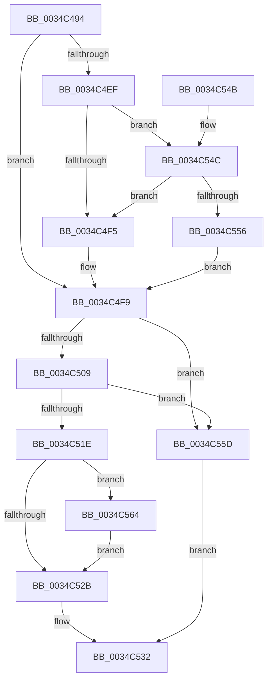

# SMKM_STORE_MGR&lt;SM_TRAITS&gt;::SmReadPickStore

- RVA: `0x0034C494`–`0x0034C56C` (길이 `216` bytes)
- VA: `0x000000014034C494`
- 실행 섹션: `.text`
- PDB 이름 있음: `예`; PDB Function 태그: `아니요`
- unwind 정보 RVA: `0x00078708`
- 디코드: `67`개 명령, `216/216` bytes 표시
- 미해석 바이트: `0` (있으면 어셈블리에 `.byte`로 보존)

> 이 문서는 커널 이미지의 기계어와 PDB 기호를 분석해 생성했습니다. 4번과 5번은 함수 원형과 자료형을 바이너리 사용 방식에서 추정한 C 해석이며 원본 소스 복구 결과는 아닙니다.

## 1. Dependencies

- 직접 호출 지점: **4**; 고유 호출 대상: **4**
- 직접 호출자로 확인된 함수: **1**
- RIP 상대 이미지 참조: **0**

### Outgoing calls
- `0x0034C4CC` → [StLockAcquireShared](StLockAcquireShared_function_0034C728.md) (function, `0x0034C728`)
- `0x0034C4E1` → [SMKM_STORE_MGR<SM_TRAITS>::SmFeCheckPresent](SMKM_STORE_MGR_SM_TRAITS_SmFeCheckPresent_function_0034C574.md) (function, `0x0034C574`)
- `0x0034C4FC` → [StLockReleaseShared](../2E/StLockReleaseShared_function_002E0320.md) (function, `0x002E0320`)
- `0x0034C514` → [SmKmStoreReferenceEx](SmKmStoreReferenceEx_function_0034BDF0.md) (function, `0x0034BDF0`)

### Direct callers
- [SMKM_STORE_MGR&lt;SM_TRAITS&gt;::SmPageRead](SMKM_STORE_MGR_SM_TRAITS_SmPageRead_function_0034C1D0.md) at `0x0034C24F`

### Static image references
- 디코드된 RIP-relative 메모리 참조가 없습니다.

## 2. Other-region calls and transfers

- 다른 실행 섹션으로 향하는 call: **0**
- 별도 외부 분기/꼬리 이동을 확인하지 못했습니다.

## 3. Assembly (complete function range)

```asm
0034C494  48 8B C4                        mov rax, rsp
0034C497  48 89 58 10                     mov qword ptr [rax + 0x10], rbx
0034C49B  48 89 68 20                     mov qword ptr [rax + 0x20], rbp
0034C49F  56                              push rsi
0034C4A0  57                              push rdi
0034C4A1  41 54                           push r12
0034C4A3  41 56                           push r14
0034C4A5  41 57                           push r15
0034C4A7  48 83 EC 20                     sub rsp, 0x20
0034C4AB  41 8B 28                        mov ebp, dword ptr [r8]
0034C4AE  4C 8D B1 B8 01 00 00            lea r14, [rcx + 0x1b8]
0034C4B5  48 8B F1                        mov rsi, rcx
0034C4B8  89 68 08                        mov dword ptr [rax + 8], ebp
0034C4BB  33 FF                           xor edi, edi
0034C4BD  49 8B CE                        mov rcx, r14
0034C4C0  4D 8B E1                        mov r12, r9
0034C4C3  89 78 18                        mov dword ptr [rax + 0x18], edi
0034C4C6  4D 8B F8                        mov r15, r8
0034C4C9  48 8B DA                        mov rbx, rdx
0034C4CC  E8 57 02 00 00                  call 0x14034c728
0034C4D1  4C 8D 4C 24 60                  lea r9, [rsp + 0x60]
0034C4D6  48 8B D3                        mov rdx, rbx
0034C4D9  4C 8D 44 24 50                  lea r8, [rsp + 0x50]
0034C4DE  48 8B CE                        mov rcx, rsi
0034C4E1  E8 8E 00 00 00                  call 0x14034c574
0034C4E6  8B D8                           mov ebx, eax
0034C4E8  3D 00 04 00 00                  cmp eax, 0x400
0034C4ED  74 0A                           je 0x14034c4f9
0034C4EF  39 6C 24 50                     cmp dword ptr [rsp + 0x50], ebp
0034C4F3  75 57                           jne 0x14034c54c
0034C4F5  8B 6C 24 50                     mov ebp, dword ptr [rsp + 0x50]
0034C4F9  49 8B CE                        mov rcx, r14
0034C4FC  E8 1F 3E F9 FF                  call 0x1402e0320
0034C501  81 FB 00 04 00 00               cmp ebx, 0x400
0034C507  74 54                           je 0x14034c55d
0034C509  FF 86 F4 07 00 00               inc dword ptr [rsi + 0x7f4]
0034C50F  8B D3                           mov edx, ebx
0034C511  48 8B CE                        mov rcx, rsi
0034C514  E8 D7 F8 FF FF                  call 0x14034bdf0
0034C519  48 85 C0                        test rax, rax
0034C51C  74 3F                           je 0x14034c55d
0034C51E  48 8B 4C 24 70                  mov rcx, qword ptr [rsp + 0x70]
0034C523  89 39                           mov dword ptr [rcx], edi
0034C525  39 7C 24 60                     cmp dword ptr [rsp + 0x60], edi
0034C529  75 39                           jne 0x14034c564
0034C52B  41 89 2F                        mov dword ptr [r15], ebp
0034C52E  49 89 04 24                     mov qword ptr [r12], rax
0034C532  48 8B 5C 24 58                  mov rbx, qword ptr [rsp + 0x58]
0034C537  8B C7                           mov eax, edi
0034C539  48 8B 6C 24 68                  mov rbp, qword ptr [rsp + 0x68]
0034C53E  48 83 C4 20                     add rsp, 0x20
0034C542  41 5F                           pop r15
0034C544  41 5E                           pop r14
0034C546  41 5C                           pop r12
0034C548  5F                              pop rdi
0034C549  5E                              pop rsi
0034C54A  C3                              ret
0034C54B  CC                              int3
0034C54C  8B 86 D0 07 00 00               mov eax, dword ptr [rsi + 0x7d0]
0034C552  A8 08                           test al, 8
0034C554  75 9F                           jne 0x14034c4f5
0034C556  BB 00 04 00 00                  mov ebx, 0x400
0034C55B  EB 9C                           jmp 0x14034c4f9
0034C55D  BF 25 02 00 C0                  mov edi, 0xc0000225
0034C562  EB CE                           jmp 0x14034c532
0034C564  C7 01 01 00 00 00               mov dword ptr [rcx], 1
0034C56A  EB BF                           jmp 0x14034c52b
```

## 4. C-style interpretation (structured pseudocode)

```c
__int64 __fastcall SMKM_STORE_MGR_SM_TRAITS___SmReadPickStore(__int64 a1, __int64 a2, __int64 a3, __int64 a4, __int64 a5)
{
    __int64 result;
    __int64 v_rdi;
    __int64 v_rsp;
    unsigned __int64 v_stack_p10;
    unsigned __int64 v_stack_p18;
    unsigned __int64 v_stack_p20;
    unsigned __int64 v_stack_p8;

    *(unsigned __int64 *)(v_rsp + 16) = v_rbx;
    *(unsigned __int64 *)(v_rsp + 32) = v_rbp;
    v_rsp = (v_rsp) - (32);
    *(unsigned int *)(v_rsp + 8) = (unsigned int)((unsigned int)(*(unsigned int *)(a3)));
    v_rdi = 0;
    *(unsigned int *)(v_rsp + 24) = 0;
    result = StLockAcquireShared(a1 + 440, a2, a3, a4);
    result = SMKM_STORE_MGR_SM_TRAITS___SmFeCheckPresent(a1, a2, v_stack_p8, v_stack_p18);
    if (((unsigned int)(result)) == 0x400ULL) goto loc_0034C4F9;
    if (v_stack_p8 != ((unsigned int)((unsigned int)(*(unsigned int *)(a3))))) goto loc_0034C54C;
loc_0034C4F5:
loc_0034C4F9:
    result = StLockReleaseShared(a1 + 440, a2, v_stack_p8, v_stack_p18);
    if (((unsigned int)((unsigned int)((unsigned int)(result)))) == 0x400ULL) goto loc_0034C55D;
    result = SmKmStoreReferenceEx(a1, (unsigned int)((unsigned int)((unsigned int)((unsigned int)(result)))), v_stack_p8, v_stack_p18);
    if (result == 0) goto loc_0034C55D;
    *(unsigned int *)(a5) = 0;
    if (v_stack_p18 != 0) goto loc_0034C564;
loc_0034C52B:
    *(unsigned int *)(a3) = (unsigned int)((unsigned int)(v_stack_p8));
    *(unsigned __int64 *)(a4) = result;
loc_0034C532:
    v_rsp = (v_rsp) + (32);
    return 0;
loc_0034C54C:
    if ((((unsigned __int8)((unsigned int)(*(unsigned int *)(a1 + 2000)))) & (8)) != 0) goto loc_0034C4F5;
    goto loc_0034C4F9;
loc_0034C55D:
    goto loc_0034C532;
loc_0034C564:
    *(unsigned int *)(a5) = 1;
    goto loc_0034C52B;
}
```

## 5. (Beta) C Style

```c
int64_t SMKM_STORE_MGR_SM_TRAITS___SmReadPickStore(void *Arg1, int64_t Arg2, void *Arg3, void *Arg4, void *Arg5)
{
    uint8_t *arg1 = (uint8_t *)Arg1;
    uint8_t *arg3 = (uint8_t *)Arg3;
    uint8_t *arg4 = (uint8_t *)Arg4;
    uint8_t *arg5 = (uint8_t *)Arg5;

    int64_t result;
    int64_t local_rdi;
    int64_t local_rsp;
    uint64_t v_stack_p10;
    uint64_t v_stack_p18;
    uint64_t v_stack_p20;
    uint64_t v_stack_p8;

    *(uint64_t *)(local_rsp + 0x10) = local_rbx;
    *(uint64_t *)(local_rsp + 0x20) = local_rbp;
    local_rsp = (local_rsp) - (32);
    *(uint32_t *)(local_rsp + 0x8) = (uint32_t)((uint32_t)(*(uint32_t *)(arg3)));
    local_rdi = 0;
    *(uint32_t *)(local_rsp + 0x18) = 0;
    result = StLockAcquireShared(Arg1 + 440, Arg2, Arg3, Arg4);
    result = SMKM_STORE_MGR_SM_TRAITS___SmFeCheckPresent(Arg1, Arg2, v_stack_p8, v_stack_p18);
    if (((uint32_t)(result)) == 0x400ULL) goto loc_0034C4F9;
    if (v_stack_p8 != ((uint32_t)((uint32_t)(*(uint32_t *)(arg3))))) goto loc_0034C54C;
loc_0034C4F5:
loc_0034C4F9:
    result = StLockReleaseShared(Arg1 + 440, Arg2, v_stack_p8, v_stack_p18);
    if (((uint32_t)((uint32_t)((uint32_t)(result)))) == 0x400ULL) goto loc_0034C55D;
    result = SmKmStoreReferenceEx(Arg1, (uint32_t)((uint32_t)((uint32_t)((uint32_t)(result)))), v_stack_p8, v_stack_p18);
    if (result == 0) goto loc_0034C55D;
    *(uint32_t *)(arg5) = 0;
    if (v_stack_p18 != 0) goto loc_0034C564;
loc_0034C52B:
    *(uint32_t *)(arg3) = (uint32_t)((uint32_t)(v_stack_p8));
    *(uint64_t *)(arg4) = result;
loc_0034C532:
    local_rsp = (local_rsp) + (32);
    return 0;
loc_0034C54C:
    if ((((uint8_t)((uint32_t)(*(uint32_t *)(arg1 + 0x7D0)))) & (8)) != 0) goto loc_0034C4F5;
    goto loc_0034C4F9;
loc_0034C55D:
    goto loc_0034C532;
loc_0034C564:
    *(uint32_t *)(arg5) = 1;
    goto loc_0034C52B;
}
```

### 관측된 메모리 오프셋

구조체 형식이 확인되지 않은 접근은 인자 기준의 오프셋으로만 기록했습니다.

| 기준 인자 | 오프셋 표현 | 폭 (bit) | 접근 |
|---|---:|---:|---|
| `Arg1` | `+ 0x1B8` | `64` | `R` |
| `Arg1` | `+ 0x7D0` | `32` | `R` |
| `Arg1` | `+ 0x7F4` | `32` | `R/W` |
| `Arg3` | `+ 0x0` | `32` | `R` |
| `Arg3` | `+ 0x0` | `32` | `W` |
| `Arg4` | `+ 0x0` | `64` | `W` |
| `Arg5` | `+ 0x0` | `32` | `W` |

## 6. Execution-region graph

[열기: 2D/3D 그래프와 함수 탐색 컨트롤 패널](../../../control-panel.html?section=text&rva=0x0034C494&view=graph)

- 2D 그래프는 위에서 아래로 흐르고, 3D 그래프는 빈 공간을 드래그해 회전합니다. Shift+드래그는 이동, 휠은 확대·축소, 함수 노드 선택은 대상 보고서 이동입니다.

### Static fallback


