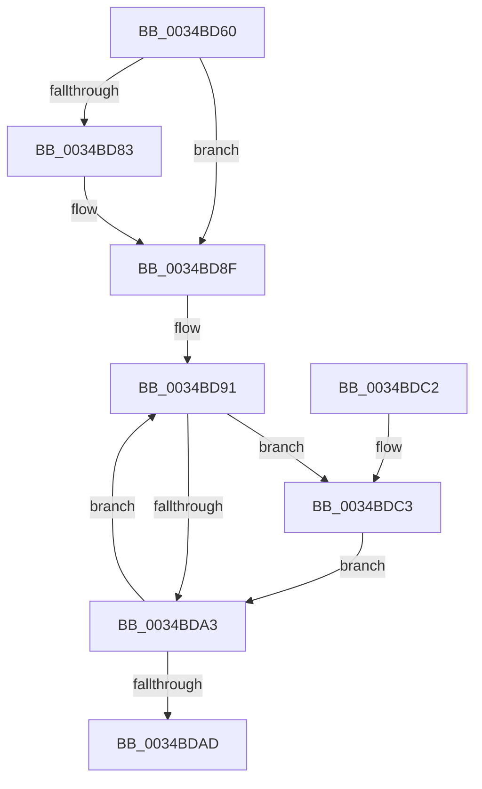

# SMKM_STORE_MGR&lt;SM_TRAITS&gt;::SmUpdateMemoryConditions

- RVA: `0x0034BD60`–`0x0034BDDD` (길이 `125` bytes)
- VA: `0x000000014034BD60`
- 실행 섹션: `.text`
- PDB 이름 있음: `예`; PDB Function 태그: `아니요`
- unwind 정보 RVA: `0x00078640`
- 디코드: `36`개 명령, `125/125` bytes 표시
- 미해석 바이트: `0` (있으면 어셈블리에 `.byte`로 보존)

> 이 문서는 커널 이미지의 기계어와 PDB 기호를 분석해 생성했습니다. 4번과 5번은 함수 원형과 자료형을 바이너리 사용 방식에서 추정한 C 해석이며 원본 소스 복구 결과는 아닙니다.

## 1. Dependencies

- 직접 호출 지점: **4**; 고유 호출 대상: **4**
- 직접 호출자로 확인된 함수: **1**
- RIP 상대 이미지 참조: **0**

### Outgoing calls
- `0x0034BD8A` → [SMKM_STORE_MGR<SM_TRAITS>::SmCompressManagerUpdateMemoryCondition](../4C/SMKM_STORE_MGR_SM_TRAITS_SmCompressManagerUpdateMemoryCondition_function_004C0040.md) (function, `0x004C0040`)
- `0x0034BD96` → [SmKmStoreReferenceEx](SmKmStoreReferenceEx_function_0034BDF0.md) (function, `0x0034BDF0`)
- `0x0034BDC8` → [SMKM_STORE<SM_TRAITS>::SmStUpdateMemoryCondition](../3C/SMKM_STORE_SM_TRAITS_SmStUpdateMemoryCondition_function_003C34D0.md) (function, `0x003C34D0`)
- `0x0034BDD6` → [SmKmStoreDereference](../20/SmKmStoreDereference_function_00206574.md) (function, `0x00206574`)

### Direct callers
- [MiStoreUpdateMemoryConditions](MiStoreUpdateMemoryConditions_function_0034CF3C.md) at `0x0034D06F`

### Static image references
- 디코드된 RIP-relative 메모리 참조가 없습니다.

## 2. Other-region calls and transfers

- 다른 실행 섹션으로 향하는 call: **0**
- 별도 외부 분기/꼬리 이동을 확인하지 못했습니다.

## 3. Assembly (complete function range)

```asm
0034BD60  48 89 5C 24 08                  mov qword ptr [rsp + 8], rbx
0034BD65  48 89 6C 24 10                  mov qword ptr [rsp + 0x10], rbp
0034BD6A  48 89 74 24 18                  mov qword ptr [rsp + 0x18], rsi
0034BD6F  57                              push rdi
0034BD70  48 83 EC 20                     sub rsp, 0x20
0034BD74  8B 81 D0 07 00 00               mov eax, dword ptr [rcx + 0x7d0]
0034BD7A  8B EA                           mov ebp, edx
0034BD7C  48 8B F9                        mov rdi, rcx
0034BD7F  A8 20                           test al, 0x20
0034BD81  74 0C                           je 0x14034bd8f
0034BD83  48 81 C1 F0 04 00 00            add rcx, 0x4f0
0034BD8A  E8 B1 42 17 00                  call 0x1404c0040
0034BD8F  33 DB                           xor ebx, ebx
0034BD91  8B D3                           mov edx, ebx
0034BD93  48 8B CF                        mov rcx, rdi
0034BD96  E8 55 00 00 00                  call 0x14034bdf0
0034BD9B  48 8B F0                        mov rsi, rax
0034BD9E  48 85 C0                        test rax, rax
0034BDA1  75 20                           jne 0x14034bdc3
0034BDA3  FF C3                           inc ebx
0034BDA5  81 FB 00 04 00 00               cmp ebx, 0x400
0034BDAB  72 E4                           jb 0x14034bd91
0034BDAD  48 8B 5C 24 30                  mov rbx, qword ptr [rsp + 0x30]
0034BDB2  48 8B 6C 24 38                  mov rbp, qword ptr [rsp + 0x38]
0034BDB7  48 8B 74 24 40                  mov rsi, qword ptr [rsp + 0x40]
0034BDBC  48 83 C4 20                     add rsp, 0x20
0034BDC0  5F                              pop rdi
0034BDC1  C3                              ret
0034BDC2  CC                              int3
0034BDC3  8B D5                           mov edx, ebp
0034BDC5  48 8B CE                        mov rcx, rsi
0034BDC8  E8 03 77 07 00                  call 0x1403c34d0
0034BDCD  8B 96 90 1A 00 00               mov edx, dword ptr [rsi + 0x1a90]
0034BDD3  48 8B CF                        mov rcx, rdi
0034BDD6  E8 99 A7 EB FF                  call 0x140206574
0034BDDB  EB C6                           jmp 0x14034bda3
```

## 4. C-style interpretation (structured pseudocode)

```c
__int64 __fastcall SMKM_STORE_MGR_SM_TRAITS___SmUpdateMemoryConditions(__int64 a1, int a2)
{
    __int64 result;
    __int64 v_rbx;
    __int64 v_rsp;
    unsigned __int64 v_stack_p10;
    unsigned __int64 v_stack_p18;
    unsigned __int64 v_stack_p8;

    v_stack_p8 = v_rbx;
    v_stack_p10 = v_rbp;
    v_stack_p18 = v_rsi;
    v_rsp = (v_rsp) - (32);
    result = (unsigned int)(*(unsigned int *)(a1 + 2000));
    if ((((unsigned __int8)((unsigned int)(*(unsigned int *)(a1 + 2000)))) & (32)) != 0) {
        a1 = (a1) + (0x4F0ULL);
        result = SMKM_STORE_MGR_SM_TRAITS___SmCompressManagerUpdateMemoryCondition(a1, a2, a3, a4);
    }
    v_rbx = 0;
loc_0034BD91:
    result = SmKmStoreReferenceEx(a1, 0, a3, a4);
    if (result != 0) goto loc_0034BDC3;
loc_0034BDA3:
    v_rbx = (unsigned int)((v_rbx) + 1);
    if (((unsigned int)(v_rbx)) < 0x400ULL) goto loc_0034BD91;
    v_rsp = (v_rsp) + (32);
    return result;
loc_0034BDC3:
    result = SMKM_STORE_SM_TRAITS___SmStUpdateMemoryCondition(v_stack_p18, (unsigned int)((unsigned int)(v_stack_p10)), a3, a4);
    result = SmKmStoreDereference(a1, (unsigned int)(*(unsigned int *)(v_stack_p18 + 6800)), a3, a4);
    goto loc_0034BDA3;
}
```

## 5. (Beta) C Style

```c
int64_t SMKM_STORE_MGR_SM_TRAITS___SmUpdateMemoryConditions(void *Arg1, int32_t Arg2)
{
    uint8_t *arg1 = (uint8_t *)Arg1;

    int64_t result;
    int64_t local_rbx;
    int64_t local_rsp;
    uint64_t v_stack_p10;
    uint64_t v_stack_p18;
    uint64_t v_stack_p8;

    v_stack_p8 = local_rbx;
    v_stack_p10 = local_rbp;
    v_stack_p18 = local_rsi;
    local_rsp = (local_rsp) - (32);
    result = (uint32_t)(*(uint32_t *)(arg1 + 0x7D0));
    if ((((uint8_t)((uint32_t)(*(uint32_t *)(arg1 + 0x7D0)))) & (32)) != 0) {
        Arg1 = (Arg1) + (0x4F0ULL);
        result = SMKM_STORE_MGR_SM_TRAITS___SmCompressManagerUpdateMemoryCondition(Arg1, Arg2, a3, a4);
    }
    local_rbx = 0;
loc_0034BD91:
    result = SmKmStoreReferenceEx(Arg1, 0, a3, a4);
    if (result != 0) goto loc_0034BDC3;
loc_0034BDA3:
    local_rbx = (uint32_t)((local_rbx) + 1);
    if (((uint32_t)(local_rbx)) < 0x400ULL) goto loc_0034BD91;
    local_rsp = (local_rsp) + (32);
    return result;
loc_0034BDC3:
    result = SMKM_STORE_SM_TRAITS___SmStUpdateMemoryCondition(v_stack_p18, (uint32_t)((uint32_t)(v_stack_p10)), a3, a4);
    result = SmKmStoreDereference(Arg1, (uint32_t)(*(uint32_t *)(v_stack_p18 + 0x1A90)), a3, a4);
    goto loc_0034BDA3;
}
```

### 관측된 메모리 오프셋

구조체 형식이 확인되지 않은 접근은 인자 기준의 오프셋으로만 기록했습니다.

| 기준 인자 | 오프셋 표현 | 폭 (bit) | 접근 |
|---|---:|---:|---|
| `Arg1` | `+ 0x7D0` | `32` | `R` |

## 6. Execution-region graph

[열기: 2D/3D 그래프와 함수 탐색 컨트롤 패널](../../../control-panel.html?section=text&rva=0x0034BD60&view=graph)

- 2D 그래프는 위에서 아래로 흐르고, 3D 그래프는 빈 공간을 드래그해 회전합니다. Shift+드래그는 이동, 휠은 확대·축소, 함수 노드 선택은 대상 보고서 이동입니다.

### Static fallback


