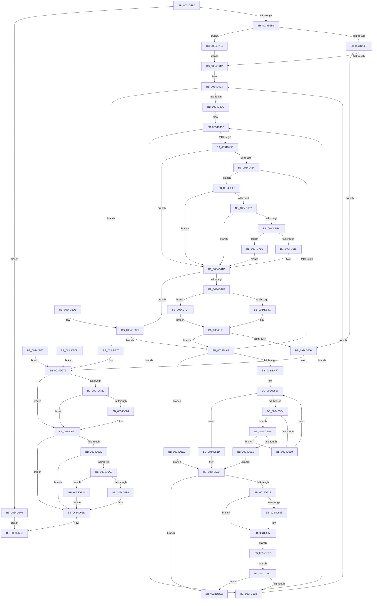

# SMKM_STORE&lt;SM_TRAITS&gt;::SmStCompareRegionDataCallback

- RVA: `0x0034D390`–`0x0034D731` (길이 `929` bytes)
- VA: `0x000000014034D390`
- 실행 섹션: `.text`
- PDB 이름 있음: `예`; PDB Function 태그: `아니요`
- unwind 정보 RVA: `0x00078960`
- 디코드: `213`개 명령, `929/929` bytes 표시
- 미해석 바이트: `0` (있으면 어셈블리에 `.byte`로 보존)

> 이 문서는 커널 이미지의 기계어와 PDB 기호를 분석해 생성했습니다. 4번과 5번은 함수 원형과 자료형을 바이너리 사용 방식에서 추정한 C 해석이며 원본 소스 복구 결과는 아닙니다.

## 1. Dependencies

- 직접 호출 지점: **12**; 고유 호출 대상: **8**
- 직접 호출자로 확인된 함수: **1**
- RIP 상대 이미지 참조: **0**

### Outgoing calls
- `0x0034D3FB` → [SMKM_STORE<SM_TRAITS>::SmStMapVirtualRegion](SMKM_STORE_SM_TRAITS_SmStMapVirtualRegion_function_0034D770.md) (function, `0x0034D770`)
- `0x0034D4EA` → [MmQueryVirtualMemory](../../page/9D/MmQueryVirtualMemory_function_009D9280.md) (function, `0x009D9280`)
- `0x0034D53A` → [memcmp](../6C/memcmp_function_006C6B10.md) (function, `0x006C6B10`)
- `0x0034D616` → [SMKM_STORE<SM_TRAITS>::SmStUnmapVirtualRegion](SMKM_STORE_SM_TRAITS_SmStUnmapVirtualRegion_function_0034CCA0.md) (function, `0x0034CCA0`)
- `0x0034D64C` → [SMKM_STORE<SM_TRAITS>::SmStMapVirtualRegion](SMKM_STORE_SM_TRAITS_SmStMapVirtualRegion_function_0034D770.md) (function, `0x0034D770`)
- `0x0034D692` → [SMKM_STORE<SM_TRAITS>::SmStUnmapVirtualRegion](SMKM_STORE_SM_TRAITS_SmStUnmapVirtualRegion_function_0034CCA0.md) (function, `0x0034CCA0`)
- `0x0034D6B8` → [SMKM_STORE<SM_TRAITS>::SmStUnmapVirtualRegion](SMKM_STORE_SM_TRAITS_SmStUnmapVirtualRegion_function_0034CCA0.md) (function, `0x0034CCA0`)
- `0x0034D6FB` → [ExFreePoolWithTag](../../poolcode/B8/ExFreePoolWithTag_function_00B82870.md) (function, `0x00B82870`)
- `0x0034D704` → [SMKM_STORE<SM_TRAITS>::SmStGetRegionVA](../4E/SMKM_STORE_SM_TRAITS_SmStGetRegionVA_function_004EAE34.md) (function, `0x004EAE34`)
- `0x0034D716` → [SMKM_STORE<SM_TRAITS>::SmStUnmapPhysicalRegion](../3E/SMKM_STORE_SM_TRAITS_SmStUnmapPhysicalRegion_function_003E76E0.md) (function, `0x003E76E0`)
- `0x0034D720` → [SMKM_STORE<SM_TRAITS>::SmStUnmapPhysicalRegion](../3E/SMKM_STORE_SM_TRAITS_SmStUnmapPhysicalRegion_function_003E76E0.md) (function, `0x003E76E0`)
- `0x0034D727` → [SMKM_STORE<SM_TRAITS>::SmStMapPhysicalRegion](../60/SMKM_STORE_SM_TRAITS_SmStMapPhysicalRegion_function_0060CB6C.md) (function, `0x0060CB6C`)

### Direct callers
- [ST_STORE&lt;SM_TRAITS&gt;::StDmCombineBufferProcess](../4E/ST_STORE_SM_TRAITS_StDmCombineBufferProcess_function_004EB9AC.md) at `0x004EBA96`

### Static image references
- 디코드된 RIP-relative 메모리 참조가 없습니다.

## 2. Other-region calls and transfers

- 다른 실행 섹션으로 향하는 call: **2**
  - `0x0034D4EA` → [MmQueryVirtualMemory](../../page/9D/MmQueryVirtualMemory_function_009D9280.md) (`.text` → `PAGE`)
  - `0x0034D6FB` → [ExFreePoolWithTag](../../poolcode/B8/ExFreePoolWithTag_function_00B82870.md) (`.text` → `POOLCODE`)
- 별도 외부 분기/꼬리 이동을 확인하지 못했습니다.

## 3. Assembly (complete function range)

```asm
0034D390  40 53                           push rbx
0034D392  56                              push rsi
0034D393  57                              push rdi
0034D394  41 54                           push r12
0034D396  41 55                           push r13
0034D398  41 56                           push r14
0034D39A  41 57                           push r15
0034D39C  48 81 EC B0 00 00 00            sub rsp, 0xb0
0034D3A3  4C 8B FA                        mov r15, rdx
0034D3A6  33 FF                           xor edi, edi
0034D3A8  48 89 BC 24 08 01 00 00         mov qword ptr [rsp + 0x108], rdi
0034D3B0  48 8D 99 88 E4 FF FF            lea rbx, [rcx - 0x1b78]
0034D3B7  48 89 9C 24 F8 00 00 00         mov qword ptr [rsp + 0xf8], rbx
0034D3BF  48 89 54 24 50                  mov qword ptr [rsp + 0x50], rdx
0034D3C4  33 F6                           xor esi, esi
0034D3C6  89 B4 24 00 01 00 00            mov dword ptr [rsp + 0x100], esi
0034D3CD  45 85 C0                        test r8d, r8d
0034D3D0  0F 85 20 03 00 00               jne 0x14034d6f6
0034D3D6  21 74 24 40                     and dword ptr [rsp + 0x40], esi
0034D3DA  F0 FF 83 0C 1D 00 00            lock inc dword ptr [rbx + 0x1d0c]
0034D3E1  8B 12                           mov edx, dword ptr [rdx]
0034D3E3  48 8B CB                        mov rcx, rbx
0034D3E6  F6 83 95 1A 00 00 04            test byte ptr [rbx + 0x1a95], 4
0034D3ED  0F 84 11 03 00 00               je 0x14034d704
0034D3F3  C7 44 24 20 40 00 00 00         mov dword ptr [rsp + 0x20], 0x40
0034D3FB  E8 70 03 00 00                  call 0x14034d770
0034D400  4C 8B F0                        mov r14, rax
0034D403  48 89 44 24 48                  mov qword ptr [rsp + 0x48], rax
0034D408  48 83 F8 04                     cmp rax, 4
0034D40C  0F 86 54 02 00 00               jbe 0x14034d666
0034D412  4D 8D 6F 08                     lea r13, [r15 + 8]
0034D416  41 0F B7 47 06                  movzx eax, word ptr [r15 + 6]
0034D41B  49 03 C7                        add rax, r15
0034D41E  48 89 44 24 70                  mov qword ptr [rsp + 0x70], rax
0034D423  4C 3B E8                        cmp r13, rax
0034D426  0F 83 44 02 00 00               jae 0x14034d670
0034D42C  41 8B 45 00                     mov eax, dword ptr [r13]
0034D430  49 03 C6                        add rax, r14
0034D433  48 89 44 24 60                  mov qword ptr [rsp + 0x60], rax
0034D438  41 C6 45 07 10                  mov byte ptr [r13 + 7], 0x10
0034D43D  49 8D 4D 08                     lea rcx, [r13 + 8]
0034D441  41 0F B6 45 06                  movzx eax, byte ptr [r13 + 6]
0034D446  48 8D 04 C1                     lea rax, [rcx + rax*8]
0034D44A  48 89 44 24 68                  mov qword ptr [rsp + 0x68], rax
0034D44F  4C 8B E1                        mov r12, rcx
0034D452  4C 3B E0                        cmp r12, rax
0034D455  0F 83 59 01 00 00               jae 0x14034d5b4
0034D45B  48 85 FF                        test rdi, rdi
0034D45E  0F 84 B7 01 00 00               je 0x14034d61b
0034D464  41 3B 34 24                     cmp esi, dword ptr [r12]
0034D468  0F 85 84 01 00 00               jne 0x14034d5f2
0034D46E  41 8B 54 24 04                  mov edx, dword ptr [r12 + 4]
0034D473  48 03 D7                        add rdx, rdi
0034D476  48 89 54 24 58                  mov qword ptr [rsp + 0x58], rdx
0034D47B  45 33 C0                        xor r8d, r8d
0034D47E  4C 89 84 24 80 00 00 00         mov qword ptr [rsp + 0x80], r8
0034D486  4C 89 84 24 90 00 00 00         mov qword ptr [rsp + 0x90], r8
0034D48E  48 8B C2                        mov rax, rdx
0034D491  48 25 00 F0 FF FF               and rax, 0xfffffffffffff000
0034D497  48 89 44 24 78                  mov qword ptr [rsp + 0x78], rax
0034D49C  48 05 00 10 00 00               add rax, 0x1000
0034D4A2  48 89 84 24 88 00 00 00         mov qword ptr [rsp + 0x88], rax
0034D4AA  41 0F B7 4D 04                  movzx ecx, word ptr [r13 + 4]
0034D4AF  8B C2                           mov eax, edx
0034D4B1  25 FF 0F 00 00                  and eax, 0xfff
0034D4B6  81 C1 FF 0F 00 00               add ecx, 0xfff
0034D4BC  03 C1                           add eax, ecx
0034D4BE  C1 E8 0C                        shr eax, 0xc
0034D4C1  89 84 24 F0 00 00 00            mov dword ptr [rsp + 0xf0], eax
0034D4C8  48 C1 E0 04                     shl rax, 4
0034D4CC  44 89 44 24 30                  mov dword ptr [rsp + 0x30], r8d
0034D4D1  4C 89 44 24 28                  mov qword ptr [rsp + 0x28], r8
0034D4D6  48 89 44 24 20                  mov qword ptr [rsp + 0x20], rax
0034D4DB  4C 8D 4C 24 78                  lea r9, [rsp + 0x78]
0034D4E0  33 D2                           xor edx, edx
0034D4E2  44 8D 42 04                     lea r8d, [rdx + 4]
0034D4E6  48 83 C9 FF                     or rcx, 0xffffffffffffffff
0034D4EA  E8 91 BD 68 00                  call 0x1409d9280
0034D4EF  85 C0                           test eax, eax
0034D4F1  0F 88 F5 01 00 00               js 0x14034d6ec
0034D4F7  33 C9                           xor ecx, ecx
0034D4F9  8B 94 24 F0 00 00 00            mov edx, dword ptr [rsp + 0xf0]
0034D500  3B CA                           cmp ecx, edx
0034D502  73 19                           jae 0x14034d51d
0034D504  8B C1                           mov eax, ecx
0034D506  48 03 C0                        add rax, rax
0034D509  48 8B 84 C4 80 00 00 00         mov rax, qword ptr [rsp + rax*8 + 0x80]
0034D511  A8 01                           test al, 1
0034D513  0F 84 C1 00 00 00               je 0x14034d5da
0034D519  FF C1                           inc ecx
0034D51B  EB E3                           jmp 0x14034d500
0034D51D  B8 01 00 00 00                  mov eax, 1
0034D522  83 F8 01                        cmp eax, 1
0034D525  0F 85 A1 00 00 00               jne 0x14034d5cc
0034D52B  45 0F B7 45 04                  movzx r8d, word ptr [r13 + 4]
0034D530  48 8B 54 24 58                  mov rdx, qword ptr [rsp + 0x58]
0034D535  48 8B 4C 24 60                  mov rcx, qword ptr [rsp + 0x60]
0034D53A  E8 D1 95 37 00                  call 0x1406c6b10
0034D53F  85 C0                           test eax, eax
0034D541  75 12                           jne 0x14034d555
0034D543  49 8B C4                        mov rax, r12
0034D546  49 8D 4D 08                     lea rcx, [r13 + 8]
0034D54A  48 2B C1                        sub rax, rcx
0034D54D  48 C1 F8 03                     sar rax, 3
0034D551  41 88 45 07                     mov byte ptr [r13 + 7], al
0034D555  EB 26                           jmp 0x14034d57d
0034D557  48 8B 9C 24 F8 00 00 00         mov rbx, qword ptr [rsp + 0xf8]
0034D55F  4C 8B 7C 24 50                  mov r15, qword ptr [rsp + 0x50]
0034D564  4C 8B 74 24 48                  mov r14, qword ptr [rsp + 0x48]
0034D569  48 8B BC 24 08 01 00 00         mov rdi, qword ptr [rsp + 0x108]
0034D571  8B B4 24 00 01 00 00            mov esi, dword ptr [rsp + 0x100]
0034D578  E9 F8 00 00 00                  jmp 0x14034d675
0034D57D  EB 2E                           jmp 0x14034d5ad
0034D57F  C7 44 24 40 25 00 00 C0         mov dword ptr [rsp + 0x40], 0xc0000025
0034D587  48 8B 9C 24 F8 00 00 00         mov rbx, qword ptr [rsp + 0xf8]
0034D58F  4C 8B 7C 24 50                  mov r15, qword ptr [rsp + 0x50]
0034D594  4C 8B 74 24 48                  mov r14, qword ptr [rsp + 0x48]
0034D599  48 8B BC 24 08 01 00 00         mov rdi, qword ptr [rsp + 0x108]
0034D5A1  8B B4 24 00 01 00 00            mov esi, dword ptr [rsp + 0x100]
0034D5A8  E9 C8 00 00 00                  jmp 0x14034d675
0034D5AD  41 80 7D 07 10                  cmp byte ptr [r13 + 7], 0x10
0034D5B2  74 18                           je 0x14034d5cc
0034D5B4  41 0F B6 45 06                  movzx eax, byte ptr [r13 + 6]
0034D5B9  4D 8D 6C C5 00                  lea r13, [r13 + rax*8]
0034D5BE  49 83 C5 08                     add r13, 8
0034D5C2  48 8B 44 24 70                  mov rax, qword ptr [rsp + 0x70]
0034D5C7  E9 57 FE FF FF                  jmp 0x14034d423
0034D5CC  49 83 C4 08                     add r12, 8
0034D5D0  48 8B 44 24 68                  mov rax, qword ptr [rsp + 0x68]
0034D5D5  E9 78 FE FF FF                  jmp 0x14034d452
0034D5DA  25 00 00 C0 00                  and eax, 0xc00000
0034D5DF  48 3D 00 00 40 00               cmp rax, 0x400000
0034D5E5  0F 84 2E FF FF FF               je 0x14034d519
0034D5EB  33 C0                           xor eax, eax
0034D5ED  E9 30 FF FF FF                  jmp 0x14034d522
0034D5F2  48 85 FF                        test rdi, rdi
0034D5F5  74 24                           je 0x14034d61b
0034D5F7  49 3B FE                        cmp rdi, r14
0034D5FA  74 1F                           je 0x14034d61b
0034D5FC  C7 44 24 28 08 00 00 00         mov dword ptr [rsp + 0x28], 8
0034D604  8B D6                           mov edx, esi
0034D606  48 8B CB                        mov rcx, rbx
0034D609  F6 83 95 1A 00 00 04            test byte ptr [rbx + 0x1a95], 4
0034D610  0F 84 00 01 00 00               je 0x14034d716
0034D616  E8 85 F6 FF FF                  call 0x14034cca0
0034D61B  41 8B 34 24                     mov esi, dword ptr [r12]
0034D61F  89 B4 24 00 01 00 00            mov dword ptr [rsp + 0x100], esi
0034D626  41 3B 37                        cmp esi, dword ptr [r15]
0034D629  0F 84 AD 00 00 00               je 0x14034d6dc
0034D62F  C7 44 24 20 40 00 00 00         mov dword ptr [rsp + 0x20], 0x40
0034D637  45 33 C0                        xor r8d, r8d
0034D63A  8B D6                           mov edx, esi
0034D63C  48 8B CB                        mov rcx, rbx
0034D63F  F6 83 95 1A 00 00 04            test byte ptr [rbx + 0x1a95], 4
0034D646  0F 84 DB 00 00 00               je 0x14034d727
0034D64C  E8 1F 01 00 00                  call 0x14034d770
0034D651  48 8B F8                        mov rdi, rax
0034D654  48 89 84 24 08 01 00 00         mov qword ptr [rsp + 0x108], rax
0034D65C  48 83 F8 04                     cmp rax, 4
0034D660  0F 87 08 FE FF FF               ja 0x14034d46e
0034D666  C7 44 24 40 9A 00 00 C0         mov dword ptr [rsp + 0x40], 0xc000009a
0034D66E  EB 05                           jmp 0x14034d675
0034D670  83 64 24 40 00                  and dword ptr [rsp + 0x40], 0
0034D675  F6 83 95 1A 00 00 04            test byte ptr [rbx + 0x1a95], 4
0034D67C  74 19                           je 0x14034d697
0034D67E  49 83 FE 04                     cmp r14, 4
0034D682  76 13                           jbe 0x14034d697
0034D684  41 8B 17                        mov edx, dword ptr [r15]
0034D687  C7 44 24 28 08 00 00 00         mov dword ptr [rsp + 0x28], 8
0034D68F  48 8B CB                        mov rcx, rbx
0034D692  E8 09 F6 FF FF                  call 0x14034cca0
0034D697  48 83 FF 04                     cmp rdi, 4
0034D69B  76 20                           jbe 0x14034d6bd
0034D69D  49 3B FE                        cmp rdi, r14
0034D6A0  74 1B                           je 0x14034d6bd
0034D6A2  C7 44 24 28 08 00 00 00         mov dword ptr [rsp + 0x28], 8
0034D6AA  8B D6                           mov edx, esi
0034D6AC  48 8B CB                        mov rcx, rbx
0034D6AF  F6 83 95 1A 00 00 04            test byte ptr [rbx + 0x1a95], 4
0034D6B6  74 68                           je 0x14034d720
0034D6B8  E8 E3 F5 FF FF                  call 0x14034cca0
0034D6BD  F0 FF 8B 0C 1D 00 00            lock dec dword ptr [rbx + 0x1d0c]
0034D6C4  8B 44 24 40                     mov eax, dword ptr [rsp + 0x40]
0034D6C8  48 81 C4 B0 00 00 00            add rsp, 0xb0
0034D6CF  41 5F                           pop r15
0034D6D1  41 5E                           pop r14
0034D6D3  41 5D                           pop r13
0034D6D5  41 5C                           pop r12
0034D6D7  5F                              pop rdi
0034D6D8  5E                              pop rsi
0034D6D9  5B                              pop rbx
0034D6DA  C3                              ret
0034D6DB  CC                              int3
0034D6DC  49 8B FE                        mov rdi, r14
0034D6DF  4C 89 B4 24 08 01 00 00         mov qword ptr [rsp + 0x108], r14
0034D6E7  E9 82 FD FF FF                  jmp 0x14034d46e
0034D6EC  B8 02 00 00 00                  mov eax, 2
0034D6F1  E9 2C FE FF FF                  jmp 0x14034d522
0034D6F6  33 D2                           xor edx, edx
0034D6F8  49 8B CF                        mov rcx, r15
0034D6FB  E8 70 51 83 00                  call 0x140b82870
0034D700  33 C0                           xor eax, eax
0034D702  EB C4                           jmp 0x14034d6c8
0034D704  E8 2B D7 19 00                  call 0x1404eae34
0034D709  4C 8B F0                        mov r14, rax
0034D70C  48 89 44 24 48                  mov qword ptr [rsp + 0x48], rax
0034D711  E9 FC FC FF FF                  jmp 0x14034d412
0034D716  E8 C5 9F 09 00                  call 0x1403e76e0
0034D71B  E9 FB FE FF FF                  jmp 0x14034d61b
0034D720  E8 BB 9F 09 00                  call 0x1403e76e0
0034D725  EB 96                           jmp 0x14034d6bd
0034D727  E8 40 F4 2B 00                  call 0x14060cb6c
0034D72C  E9 20 FF FF FF                  jmp 0x14034d651
```

## 4. C-style interpretation (structured pseudocode)

```c
__int64 __fastcall SMKM_STORE_SM_TRAITS___SmStCompareRegionDataCallback(__int64 a1, __int64 a2, int a3)
{
    __int64 result;
    __int64 v_r12;
    __int64 v_r13;
    __int64 v_rdi;
    __int64 v_rsi;
    __int64 v_rsp;
    unsigned __int64 v_stack_m58;
    unsigned __int64 v_stack_m60;
    unsigned __int64 v_stack_m68;
    unsigned __int64 v_stack_m70;
    unsigned __int64 v_stack_m78;
    unsigned __int64 v_stack_m80;
    unsigned __int64 v_stack_m88;
    unsigned __int64 v_stack_m90;
    unsigned __int64 v_stack_m98;
    unsigned __int64 v_stack_mA0;
    unsigned int v_stack_mA8;
    unsigned int v_stack_mB8;
    unsigned __int64 v_stack_mC0;
    unsigned int v_stack_mC8;
    unsigned __int64 v_stack_p10;
    unsigned __int64 v_stack_p108;
    unsigned int v_stack_p18;
    unsigned __int64 v_stack_p20;
    unsigned __int64 v_stack_p48;
    unsigned int v_stack_p8;

    v_rsp = (v_rsp) - (176);
    v_rdi = 0;
    v_stack_p20 = 0;
    v_stack_p10 = a1 - 7032;
    v_stack_m98 = a2;
    v_rsi = 0;
    v_stack_p18 = 0;
    if (a3 != 0) goto loc_0034D6F6;
    if (((*(unsigned __int8 *)(a1 - 7032 + 6805)) & (4)) == 0) goto loc_0034D704;
    v_stack_mC8 = 64;
    result = SMKM_STORE_SM_TRAITS___SmStMapVirtualRegion(a1 - 7032, (unsigned int)(*(unsigned int *)(a2)), a3, a4);
    v_stack_mA0 = result;
    if (result <= 4) goto loc_0034D666;
loc_0034D412:
    result = (*(unsigned __int16 *)(a2 + 6)) + (a2);
    v_stack_m78 = result;
loc_0034D423:
    if ((a2 + 8) >= result) goto loc_0034D670;
    result = ((unsigned int)(*(unsigned int *)(a2 + 8))) + (result);
    v_stack_m88 = result;
    *(unsigned __int8 *)(a2 + 8 + 7) = 16;
    v_stack_m80 = a2 + 8 + 8 + *(unsigned __int8 *)(a2 + 8 + 6) * 8;
loc_0034D452:
    if ((a2 + 8 + 8) >= (a2 + 8 + 8 + *(unsigned __int8 *)(a2 + 8 + 6) * 8)) goto loc_0034D5B4;
    if (0 == 0) goto loc_0034D61B;
    if (0 != (*(unsigned int *)(a2 + 8 + 8))) goto loc_0034D5F2;
loc_0034D46E:
    a2 = ((unsigned int)(*(unsigned int *)(a2 + 8 + 8 + 4))) + (0);
    v_stack_m90 = a2;
    a3 = 0;
    v_stack_m68 = 0;
    v_stack_m58 = 0;
    result = (a2) & (0xFFFFFFFFFFFFF000ULL);
    v_stack_m70 = result;
    result = (result) + (0x1000ULL);
    v_stack_m60 = result;
    result = (unsigned int)(((unsigned int)((unsigned int)(a2))) & (0xFFFULL));
    a1 = (unsigned int)((*(unsigned __int16 *)(a2 + 8 + 4)) + (0xFFFULL));
    result = (unsigned int)((result) + ((unsigned int)(a1)));
    result = (unsigned int)((result) >> (12));
    v_stack_p8 = (unsigned int)(result);
    result = (result) << (4);
    v_stack_mB8 = 0;
    v_stack_mC0 = 0;
    v_stack_mC8 = result;
    a2 = 0;
    a1 = (a1) | (-1);
    result = MmQueryVirtualMemory(a1, a2, a2 + 4, v_stack_m70);
    if (sign_flag) goto loc_0034D6EC;
    a1 = 0;
loc_0034D500:
    if (0 >= ((unsigned int)((unsigned int)(v_stack_p8)))) goto loc_0034D51D;
    result = (0) + (0);
    if ((((unsigned __int8)(*(unsigned __int64 *)(v_rsp + result * 8 + 128))) & (1)) == 0) goto loc_0034D5DA;
loc_0034D519:
    a1 = (unsigned int)((a1) + 1);
    goto loc_0034D500;
loc_0034D51D:
loc_0034D522:
    if (1 != 1) goto loc_0034D5CC;
    result = memcmp(v_stack_m88, v_stack_m90, *(unsigned __int16 *)(a2 + 8 + 4), v_stack_m70);
    if ((unsigned int)(result) == 0) {
        result = a2 + 8 + 8;
        a1 = a2 + 8 + 8;
        result = (result) - (a1);
        result = (result) >> (3);
        *(unsigned __int8 *)(a2 + 8 + 7) = (unsigned __int8)(result);
    }
    goto loc_0034D57D;
loc_0034D57D:
    goto loc_0034D5AD;
loc_0034D5AD:
    if ((*(unsigned __int8 *)(a2 + 8 + 7)) == 16) goto loc_0034D5CC;
loc_0034D5B4:
    v_r13 = (a2 + 8 + *(unsigned __int8 *)(a2 + 8 + 6) * 8) + (8);
    goto loc_0034D423;
loc_0034D5CC:
    v_r12 = (a2 + 8 + 8) + (8);
    goto loc_0034D452;
loc_0034D5DA:
    result = (unsigned int)((v_stack_m80) & (0xC00000ULL));
    if (result == 0x400000ULL) goto loc_0034D519;
    result = 0;
    goto loc_0034D522;
loc_0034D5F2:
    if (0 == 0) goto loc_0034D61B;
    if (0 == 0) goto loc_0034D61B;
    v_stack_mC0 = 8;
    if (((*(unsigned __int8 *)(a1 - 7032 + 6805)) & (4)) == 0) goto loc_0034D716;
    result = SMKM_STORE_SM_TRAITS___SmStUnmapVirtualRegion(a1 - 7032, 0, *(unsigned __int16 *)(a2 + 8 + 4), v_stack_m70);
loc_0034D61B:
    v_stack_p18 = (unsigned int)((unsigned int)(*(unsigned int *)(v_r12)));
    if (((unsigned int)((unsigned int)(*(unsigned int *)(v_r12)))) == (*(unsigned int *)(a2))) goto loc_0034D6DC;
    v_stack_mC8 = 64;
    a3 = 0;
    if (((*(unsigned __int8 *)(a1 - 7032 + 6805)) & (4)) == 0) goto loc_0034D727;
    result = SMKM_STORE_SM_TRAITS___SmStMapVirtualRegion(a1 - 7032, (unsigned int)((unsigned int)((unsigned int)(*(unsigned int *)(v_r12)))), a3, v_stack_m70);
loc_0034D651:
    v_stack_p20 = result;
    if (result > 4) goto loc_0034D46E;
loc_0034D666:
    v_stack_mA8 = 0xC000009AULL;
    goto loc_0034D675;
loc_0034D670:
loc_0034D675:
    if (((*(unsigned __int8 *)(a1 - 7032 + 6805)) & (4)) == 0) goto loc_0034D697;
    if (result >= = 4) {
        a2 = *(unsigned int *)(a2);
        v_stack_mC0 = 8;
        a1 = a1 - 7032;
        result = SMKM_STORE_SM_TRAITS___SmStUnmapVirtualRegion(a1, a2, a3, v_stack_m70);
    }
    if (result <= 4) goto loc_0034D6BD;
    if (result == result) goto loc_0034D6BD;
    v_stack_mC0 = 8;
    if (((*(unsigned __int8 *)(a1 - 7032 + 6805)) & (4)) == 0) goto loc_0034D720;
    result = SMKM_STORE_SM_TRAITS___SmStUnmapVirtualRegion(a1 - 7032, (unsigned int)((unsigned int)((unsigned int)(*(unsigned int *)(v_r12)))), a3, v_stack_m70);
loc_0034D6BD:
loc_0034D6C8:
    v_rsp = (v_rsp) + (176);
    return (unsigned int)(v_stack_mA8);
loc_0034D6DC:
    v_stack_p108 = result;
    goto loc_0034D46E;
loc_0034D6EC:
    goto loc_0034D522;
loc_0034D6F6:
    a2 = 0;
    result = ExFreePoolWithTag(0, a2, a3, v_stack_m70);
    result = 0;
    goto loc_0034D6C8;
loc_0034D704:
    result = SMKM_STORE_SM_TRAITS___SmStGetRegionVA(0, a2, a3, v_stack_m70);
    v_stack_p48 = result;
    goto loc_0034D412;
loc_0034D716:
    result = SMKM_STORE_SM_TRAITS___SmStUnmapPhysicalRegion(0, a2, a3, v_stack_m70);
    goto loc_0034D61B;
loc_0034D720:
    result = SMKM_STORE_SM_TRAITS___SmStUnmapPhysicalRegion(0, a2, a3, v_stack_m70);
    goto loc_0034D6BD;
loc_0034D727:
    result = SMKM_STORE_SM_TRAITS___SmStMapPhysicalRegion(0, a2, a3, v_stack_m70);
    goto loc_0034D651;
}
```

## 5. (Beta) C Style

```c
int64_t SMKM_STORE_SM_TRAITS___SmStCompareRegionDataCallback(void *Arg1, void *Arg2, int32_t Arg3)
{
    uint8_t *arg1 = (uint8_t *)Arg1;
    uint8_t *arg2 = (uint8_t *)Arg2;

    int64_t result;
    int64_t local_r12;
    int64_t local_r13;
    int64_t local_rdi;
    int64_t local_rsi;
    int64_t local_rsp;
    uint64_t v_stack_m58;
    uint64_t v_stack_m60;
    uint64_t v_stack_m68;
    uint64_t v_stack_m70;
    uint64_t v_stack_m78;
    uint64_t v_stack_m80;
    uint64_t v_stack_m88;
    uint64_t v_stack_m90;
    uint64_t v_stack_m98;
    uint64_t v_stack_mA0;
    uint32_t v_stack_mA8;
    uint32_t v_stack_mB8;
    uint64_t v_stack_mC0;
    uint32_t v_stack_mC8;
    uint64_t v_stack_p10;
    uint64_t v_stack_p108;
    uint32_t v_stack_p18;
    uint64_t v_stack_p20;
    uint64_t v_stack_p48;
    uint32_t v_stack_p8;

    local_rsp = (local_rsp) - (176);
    local_rdi = 0;
    v_stack_p20 = 0;
    v_stack_p10 = Arg1 - 7032;
    v_stack_m98 = Arg2;
    local_rsi = 0;
    v_stack_p18 = 0;
    if (Arg3 != 0) goto loc_0034D6F6;
    if (((*(uint8_t *)(arg1 - 0x1B78 + 0x1A95)) & (4)) == 0) goto loc_0034D704;
    v_stack_mC8 = 64;
    result = SMKM_STORE_SM_TRAITS___SmStMapVirtualRegion(Arg1 - 7032, (uint32_t)(*(uint32_t *)(arg2)), Arg3, a4);
    v_stack_mA0 = result;
    if (result <= 4) goto loc_0034D666;
loc_0034D412:
    result = (*(uint16_t *)(arg2 + 0x6)) + (Arg2);
    v_stack_m78 = result;
loc_0034D423:
    if ((Arg2 + 8) >= result) goto loc_0034D670;
    result = ((uint32_t)(*(uint32_t *)(arg2 + 0x8))) + (result);
    v_stack_m88 = result;
    *(uint8_t *)(arg2 + 0x8 + 0x7) = 16;
    v_stack_m80 = Arg2 + 8 + 8 + *(uint8_t *)(arg2 + 0x8 + 0x6) * 8;
loc_0034D452:
    if ((Arg2 + 8 + 8) >= (Arg2 + 8 + 8 + *(uint8_t *)(arg2 + 0x8 + 0x6) * 8)) goto loc_0034D5B4;
    if (0 == 0) goto loc_0034D61B;
    if (0 != (*(uint32_t *)(arg2 + 0x8 + 0x8))) goto loc_0034D5F2;
loc_0034D46E:
    Arg2 = ((uint32_t)(*(uint32_t *)(arg2 + 0x8 + 0x8 + 0x4))) + (0);
    v_stack_m90 = Arg2;
    Arg3 = 0;
    v_stack_m68 = 0;
    v_stack_m58 = 0;
    result = (Arg2) & (0xFFFFFFFFFFFFF000ULL);
    v_stack_m70 = result;
    result = (result) + (0x1000ULL);
    v_stack_m60 = result;
    result = (uint32_t)(((uint32_t)((uint32_t)(Arg2))) & (0xFFFULL));
    Arg1 = (uint32_t)((*(uint16_t *)(arg2 + 0x8 + 0x4)) + (0xFFFULL));
    result = (uint32_t)((result) + ((uint32_t)(Arg1)));
    result = (uint32_t)((result) >> (12));
    v_stack_p8 = (uint32_t)(result);
    result = (result) << (4);
    v_stack_mB8 = 0;
    v_stack_mC0 = 0;
    v_stack_mC8 = result;
    Arg2 = 0;
    Arg1 = (Arg1) | (-1);
    result = MmQueryVirtualMemory(Arg1, Arg2, Arg2 + 4, v_stack_m70);
    if (sign_flag) goto loc_0034D6EC;
    Arg1 = 0;
loc_0034D500:
    if (0 >= ((uint32_t)((uint32_t)(v_stack_p8)))) goto loc_0034D51D;
    result = (0) + (0);
    if ((((uint8_t)(*(uint64_t *)(local_rsp + result * 8 + 0x80))) & (1)) == 0) goto loc_0034D5DA;
loc_0034D519:
    Arg1 = (uint32_t)((Arg1) + 1);
    goto loc_0034D500;
loc_0034D51D:
loc_0034D522:
    if (1 != 1) goto loc_0034D5CC;
    result = memcmp(v_stack_m88, v_stack_m90, *(uint16_t *)(arg2 + 0x8 + 0x4), v_stack_m70);
    if ((uint32_t)(result) == 0) {
        result = Arg2 + 8 + 8;
        Arg1 = Arg2 + 8 + 8;
        result = (result) - (Arg1);
        result = (result) >> (3);
        *(uint8_t *)(arg2 + 0x8 + 0x7) = (uint8_t)(result);
    }
    goto loc_0034D57D;
loc_0034D57D:
    goto loc_0034D5AD;
loc_0034D5AD:
    if ((*(uint8_t *)(arg2 + 0x8 + 0x7)) == 16) goto loc_0034D5CC;
loc_0034D5B4:
    local_r13 = (Arg2 + 8 + *(uint8_t *)(arg2 + 0x8 + 0x6) * 8) + (8);
    goto loc_0034D423;
loc_0034D5CC:
    local_r12 = (Arg2 + 8 + 8) + (8);
    goto loc_0034D452;
loc_0034D5DA:
    result = (uint32_t)((v_stack_m80) & (0xC00000ULL));
    if (result == 0x400000ULL) goto loc_0034D519;
    result = 0;
    goto loc_0034D522;
loc_0034D5F2:
    if (0 == 0) goto loc_0034D61B;
    if (0 == 0) goto loc_0034D61B;
    v_stack_mC0 = 8;
    if (((*(uint8_t *)(arg1 - 0x1B78 + 0x1A95)) & (4)) == 0) goto loc_0034D716;
    result = SMKM_STORE_SM_TRAITS___SmStUnmapVirtualRegion(Arg1 - 7032, 0, *(uint16_t *)(arg2 + 0x8 + 0x4), v_stack_m70);
loc_0034D61B:
    v_stack_p18 = (uint32_t)((uint32_t)(*(uint32_t *)(local_r12)));
    if (((uint32_t)((uint32_t)(*(uint32_t *)(local_r12)))) == (*(uint32_t *)(arg2))) goto loc_0034D6DC;
    v_stack_mC8 = 64;
    Arg3 = 0;
    if (((*(uint8_t *)(arg1 - 0x1B78 + 0x1A95)) & (4)) == 0) goto loc_0034D727;
    result = SMKM_STORE_SM_TRAITS___SmStMapVirtualRegion(Arg1 - 7032, (uint32_t)((uint32_t)((uint32_t)(*(uint32_t *)(local_r12)))), Arg3, v_stack_m70);
loc_0034D651:
    v_stack_p20 = result;
    if (result > 4) goto loc_0034D46E;
loc_0034D666:
    v_stack_mA8 = 0xC000009AULL;
    goto loc_0034D675;
loc_0034D670:
loc_0034D675:
    if (((*(uint8_t *)(arg1 - 0x1B78 + 0x1A95)) & (4)) == 0) goto loc_0034D697;
    if (result >= = 4) {
        Arg2 = *(uint32_t *)(arg2);
        v_stack_mC0 = 8;
        Arg1 = Arg1 - 7032;
        result = SMKM_STORE_SM_TRAITS___SmStUnmapVirtualRegion(Arg1, Arg2, Arg3, v_stack_m70);
    }
    if (result <= 4) goto loc_0034D6BD;
    if (result == result) goto loc_0034D6BD;
    v_stack_mC0 = 8;
    if (((*(uint8_t *)(arg1 - 0x1B78 + 0x1A95)) & (4)) == 0) goto loc_0034D720;
    result = SMKM_STORE_SM_TRAITS___SmStUnmapVirtualRegion(Arg1 - 7032, (uint32_t)((uint32_t)((uint32_t)(*(uint32_t *)(local_r12)))), Arg3, v_stack_m70);
loc_0034D6BD:
loc_0034D6C8:
    local_rsp = (local_rsp) + (176);
    return (uint32_t)(v_stack_mA8);
loc_0034D6DC:
    v_stack_p108 = result;
    goto loc_0034D46E;
loc_0034D6EC:
    goto loc_0034D522;
loc_0034D6F6:
    Arg2 = 0;
    result = ExFreePoolWithTag(0, Arg2, Arg3, v_stack_m70);
    result = 0;
    goto loc_0034D6C8;
loc_0034D704:
    result = SMKM_STORE_SM_TRAITS___SmStGetRegionVA(0, Arg2, Arg3, v_stack_m70);
    v_stack_p48 = result;
    goto loc_0034D412;
loc_0034D716:
    result = SMKM_STORE_SM_TRAITS___SmStUnmapPhysicalRegion(0, Arg2, Arg3, v_stack_m70);
    goto loc_0034D61B;
loc_0034D720:
    result = SMKM_STORE_SM_TRAITS___SmStUnmapPhysicalRegion(0, Arg2, Arg3, v_stack_m70);
    goto loc_0034D6BD;
loc_0034D727:
    result = SMKM_STORE_SM_TRAITS___SmStMapPhysicalRegion(0, Arg2, Arg3, v_stack_m70);
    goto loc_0034D651;
}
```

### 관측된 메모리 오프셋

구조체 형식이 확인되지 않은 접근은 인자 기준의 오프셋으로만 기록했습니다.

| 기준 인자 | 오프셋 표현 | 폭 (bit) | 접근 |
|---|---:|---:|---|
| `Arg1` | `- 0x1B78` | `64` | `R` |
| `Arg1` | `+ 0x1A95` | `8` | `R` |
| `Arg1` | `+ 0x1D0C` | `32` | `R/W` |
| `Arg2` | `+ 0x0` | `32` | `R` |
| `Arg2` | `+ 0x6` | `16` | `R` |
| `Arg2` | `+ 0x8` | `64` | `R` |

## 6. Execution-region graph

[열기: 2D/3D 그래프와 함수 탐색 컨트롤 패널](../../../control-panel.html?section=text&rva=0x0034D390&view=graph)

- 2D 그래프는 위에서 아래로 흐르고, 3D 그래프는 빈 공간을 드래그해 회전합니다. Shift+드래그는 이동, 휠은 확대·축소, 함수 노드 선택은 대상 보고서 이동입니다.

### Static fallback


