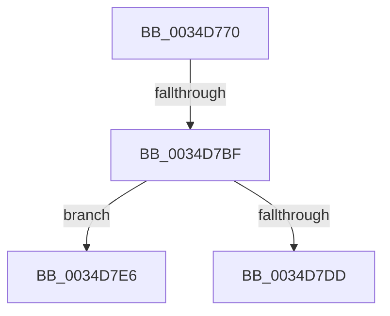

# SMKM_STORE&lt;SM_TRAITS&gt;::SmStMapVirtualRegion

- RVA: `0x0034D770`–`0x0034D7E9` (길이 `121` bytes)
- VA: `0x000000014034D770`
- 실행 섹션: `.text`
- PDB 이름 있음: `예`; PDB Function 태그: `아니요`
- unwind 정보 RVA: `0x000789C8`
- 디코드: `32`개 명령, `121/121` bytes 표시
- 미해석 바이트: `0` (있으면 어셈블리에 `.byte`로 보존)

> 이 문서는 커널 이미지의 기계어와 PDB 기호를 분석해 생성했습니다. 4번과 5번은 함수 원형과 자료형을 바이너리 사용 방식에서 추정한 C 해석이며 원본 소스 복구 결과는 아닙니다.

## 1. Dependencies

- 직접 호출 지점: **1**; 고유 호출 대상: **1**
- 직접 호출자로 확인된 함수: **6**
- RIP 상대 이미지 참조: **0**

### Outgoing calls
- `0x0034D7D0` → [StLockAcquireShared](StLockAcquireShared_function_0034C728.md) (function, `0x0034C728`)

### Direct callers
- [SMKM_STORE&lt;SM_TRAITS&gt;::SmStCompareRegionDataCallback](SMKM_STORE_SM_TRAITS_SmStCompareRegionDataCallback_function_0034D390.md) at `0x0034D3FB`
- [SMKM_STORE&lt;SM_TRAITS&gt;::SmStCompareRegionDataCallback](SMKM_STORE_SM_TRAITS_SmStCompareRegionDataCallback_function_0034D390.md) at `0x0034D64C`
- [SMKM_STORE&lt;SM_TRAITS&gt;::SmStMapRegion](SMKM_STORE_SM_TRAITS_SmStMapRegion_function_0034D738.md) at `0x0034D74D`
- [SMKM_STORE&lt;SM_TRAITS&gt;::SmStPrioritizeRegionsStore](SMKM_STORE_SM_TRAITS_SmStPrioritizeRegionsStore_function_0034DE28.md) at `0x0034DF47`
- [sub_004201AA](../42/Unknown_function_004201AA.md) at `0x004203C8`
- [SMKM_STORE&lt;SM_TRAITS&gt;::SmStOutSwapStore](../49/SMKM_STORE_SM_TRAITS_SmStOutSwapStore_function_00496C84.md) at `0x00496E69`
- [SMKM_STORE&lt;SM_TRAITS&gt;::SmStTrimWsStore](../4B/SMKM_STORE_SM_TRAITS_SmStTrimWsStore_function_004BEB4C.md) at `0x004BED5E`
- [SMKM_STORE&lt;SM_TRAITS&gt;::SmStTrimWsStore](../4B/SMKM_STORE_SM_TRAITS_SmStTrimWsStore_function_004BEB4C.md) at `0x004BEE21`

### Static image references
- 디코드된 RIP-relative 메모리 참조가 없습니다.

## 2. Other-region calls and transfers

- 다른 실행 섹션으로 향하는 call: **0**
- call이 아닌 외부 분기/꼬리 이동: **2**
  - `0x0034D7BD` → [sub_0034D7E9](Unknown_function_0034D7E9.md) (`tail-transfer`)
  - `0x0034D7E1` → [sub_0034D8EA + 0x9](Unknown_function_0034D8EA.md) (`tail-transfer`)

## 3. Assembly (complete function range)

```asm
0034D770  44 89 4C 24 20                  mov dword ptr [rsp + 0x20], r9d
0034D775  44 89 44 24 18                  mov dword ptr [rsp + 0x18], r8d
0034D77A  53                              push rbx
0034D77B  55                              push rbp
0034D77C  56                              push rsi
0034D77D  57                              push rdi
0034D77E  41 54                           push r12
0034D780  41 56                           push r14
0034D782  41 57                           push r15
0034D784  48 83 EC 30                     sub rsp, 0x30
0034D788  48 8B 81 68 1B 00 00            mov rax, qword ptr [rcx + 0x1b68]
0034D78F  45 33 C0                        xor r8d, r8d
0034D792  44 8B BC 24 90 00 00 00         mov r15d, dword ptr [rsp + 0x90]
0034D79A  48 8B F1                        mov rsi, rcx
0034D79D  8B FA                           mov edi, edx
0034D79F  49 BC 00 00 FF FF FF FF FF 7F   movabs r12, 0x7fffffffffff0000
0034D7A9  44 89 84 24 88 00 00 00         mov dword ptr [rsp + 0x88], r8d
0034D7B1  41 8D 68 01                     lea ebp, [r8 + 1]
0034D7B5  4C 8D 34 F8                     lea r14, [rax + rdi*8]
0034D7B9  41 F6 C7 40                     test r15b, 0x40
0034D7BD  74 2A                           je 0x14034d7e9
0034D7BF  48 8D 99 98 1A 00 00            lea rbx, [rcx + 0x1a98]
0034D7C6  89 AC 24 88 00 00 00            mov dword ptr [rsp + 0x88], ebp
0034D7CD  48 8B CB                        mov rcx, rbx
0034D7D0  E8 53 EF FF FF                  call 0x14034c728
0034D7D5  49 8B 06                        mov rax, qword ptr [r14]
0034D7D8  49 85 C4                        test r12, rax
0034D7DB  75 09                           jne 0x14034d7e6
0034D7DD  33 C9                           xor ecx, ecx
0034D7DF  8B E9                           mov ebp, ecx
0034D7E1  E9 0D 01 00 00                  jmp 0x14034d8f3
0034D7E6  45 33 C0                        xor r8d, r8d
```

## 4. C-style interpretation (structured pseudocode)

```c
__int64 __fastcall SMKM_STORE_SM_TRAITS___SmStMapVirtualRegion(__int64 a1, int a2, int a3, int a4, unsigned int a5)
{
    __int64 result;
    __int64 v_rsp;
    unsigned int v_stack_p18;
    unsigned int v_stack_p20;

    v_stack_p20 = a4;
    v_stack_p18 = a3;
    v_rsp = (v_rsp) - (48);
    a3 = 0;
    v_stack_p20 = 0;
    v_stack_p20 = (unsigned int)(a3 + 1);
    result = StLockAcquireShared(a1 + 6808, a2, a3, a4);
    if (((v_r12) & (*(unsigned __int64 *)(*(unsigned __int64 *)(a1 + 7016) + (unsigned int)(a2) * 8))) != 0) goto loc_0034D7E6;
    a1 = 0;
loc_0034D7E6:
    a3 = 0;
    return *(unsigned __int64 *)(*(unsigned __int64 *)(a1 + 7016) + (unsigned int)(a2) * 8);
}
```

## 5. (Beta) C Style

```c
int64_t SMKM_STORE_SM_TRAITS___SmStMapVirtualRegion(void *Arg1, int32_t Arg2, int32_t Arg3, int32_t Arg4, uint32_t Arg5)
{
    uint8_t *arg1 = (uint8_t *)Arg1;

    int64_t result;
    int64_t local_rsp;
    uint32_t v_stack_p18;
    uint32_t v_stack_p20;

    v_stack_p20 = Arg4;
    v_stack_p18 = Arg3;
    local_rsp = (local_rsp) - (48);
    Arg3 = 0;
    v_stack_p20 = 0;
    v_stack_p20 = (uint32_t)(Arg3 + 1);
    result = StLockAcquireShared(Arg1 + 6808, Arg2, Arg3, Arg4);
    if (((local_r12) & (*(uint64_t *)(*(uint64_t *)(arg1 + 0x1B68) + (uint32_t)(Arg2) * 8))) != 0) goto loc_0034D7E6;
    Arg1 = 0;
loc_0034D7E6:
    Arg3 = 0;
    return *(uint64_t *)(*(uint64_t *)(arg1 + 0x1B68) + (uint32_t)(Arg2) * 8);
}
```

### 관측된 메모리 오프셋

구조체 형식이 확인되지 않은 접근은 인자 기준의 오프셋으로만 기록했습니다.

| 기준 인자 | 오프셋 표현 | 폭 (bit) | 접근 |
|---|---:|---:|---|
| `Arg1` | `+ 0x1A98` | `64` | `R` |
| `Arg1` | `+ 0x1B68` | `64` | `R` |

## 6. Execution-region graph

[열기: 2D/3D 그래프와 함수 탐색 컨트롤 패널](../../../control-panel.html?section=text&rva=0x0034D770&view=graph)

- 2D 그래프는 위에서 아래로 흐르고, 3D 그래프는 빈 공간을 드래그해 회전합니다. Shift+드래그는 이동, 휠은 확대·축소, 함수 노드 선택은 대상 보고서 이동입니다.

### Static fallback


