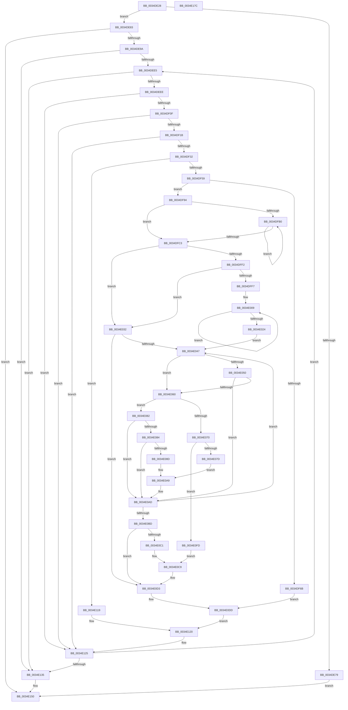

# SMKM_STORE&lt;SM_TRAITS&gt;::SmStPrioritizeRegionsStore

- RVA: `0x0034DE28`–`0x0034E17D` (길이 `853` bytes)
- VA: `0x000000014034DE28`
- 실행 섹션: `.text`
- PDB 이름 있음: `예`; PDB Function 태그: `아니요`
- unwind 정보 RVA: `0x00078B40`
- 디코드: `206`개 명령, `853/853` bytes 표시
- 미해석 바이트: `0` (있으면 어셈블리에 `.byte`로 보존)

> 이 문서는 커널 이미지의 기계어와 PDB 기호를 분석해 생성했습니다. 4번과 5번은 함수 원형과 자료형을 바이너리 사용 방식에서 추정한 C 해석이며 원본 소스 복구 결과는 아닙니다.

## 1. Dependencies

- 직접 호출 지점: **12**; 고유 호출 대상: **9**
- 직접 호출자로 확인된 함수: **1**
- RIP 상대 이미지 참조: **1**

### Outgoing calls
- `0x0034DEB8` → [KiStackAttachProcess](../21/KiStackAttachProcess_function_00216820.md) (function, `0x00216820`)
- `0x0034DEC7` → [StLockAcquireShared](StLockAcquireShared_function_0034C728.md) (function, `0x0034C728`)
- `0x0034DF47` → [SMKM_STORE<SM_TRAITS>::SmStMapVirtualRegion](SMKM_STORE_SM_TRAITS_SmStMapVirtualRegion_function_0034D770.md) (function, `0x0034D770`)
- `0x0034DF60` → [StLockReleaseShared](../2E/StLockReleaseShared_function_002E0320.md) (function, `0x002E0320`)
- `0x0034DF8A` → [MmSetPriorityVaRanges](../../page/9F/MmSetPriorityVaRanges_function_009F455C.md) (function, `0x009F455C`)
- `0x0034DFE9` → [ZwQueryVirtualMemory](../6A/ZwQueryVirtualMemory_function_006AD530.md) (function, `0x006AD530`)
- `0x0034E0CE` → [MmSetPriorityVaRanges](../../page/9F/MmSetPriorityVaRanges_function_009F455C.md) (function, `0x009F455C`)
- `0x0034E0E7` → [StLockAcquireShared](StLockAcquireShared_function_0034C728.md) (function, `0x0034C728`)
- `0x0034E0F6` → [SMKM_STORE<SM_TRAITS>::SmStUnmapVirtualRegion](SMKM_STORE_SM_TRAITS_SmStUnmapVirtualRegion_function_0034CCA0.md) (function, `0x0034CCA0`)
- `0x0034E138` → [StLockReleaseShared](../2E/StLockReleaseShared_function_002E0320.md) (function, `0x002E0320`)
- `0x0034E14B` → [KiUnstackDetachProcess](../21/KiUnstackDetachProcess_function_00217D30.md) (function, `0x00217D30`)
- `0x0034E15C` → [_security_check_cookie](../6A/_security_check_cookie_function_006AC640.md) (function, `0x006AC640`)

### Direct callers
- [SMKM_STORE_MGR&lt;SM_TRAITS&gt;::SmHighMemPriorityWatchdogWorker](SMKM_STORE_MGR_SM_TRAITS_SmHighMemPriorityWatchdogWorker_function_0034C080.md) at `0x0034C183`

### Static image references
- `0x0034DE47` → RVA `0x00E0A740` (`.data`; read)

## 2. Other-region calls and transfers

- 다른 실행 섹션으로 향하는 call: **2**
  - `0x0034DF8A` → [MmSetPriorityVaRanges](../../page/9F/MmSetPriorityVaRanges_function_009F455C.md) (`.text` → `PAGE`)
  - `0x0034E0CE` → [MmSetPriorityVaRanges](../../page/9F/MmSetPriorityVaRanges_function_009F455C.md) (`.text` → `PAGE`)
- 별도 외부 분기/꼬리 이동을 확인하지 못했습니다.

## 3. Assembly (complete function range)

```asm
0034DE28  48 89 5C 24 18                  mov qword ptr [rsp + 0x18], rbx
0034DE2D  55                              push rbp
0034DE2E  56                              push rsi
0034DE2F  57                              push rdi
0034DE30  41 54                           push r12
0034DE32  41 55                           push r13
0034DE34  41 56                           push r14
0034DE36  41 57                           push r15
0034DE38  48 8D AC 24 80 FC FF FF         lea rbp, [rsp - 0x380]
0034DE40  48 81 EC 80 04 00 00            sub rsp, 0x480
0034DE47  48 8B 05 F2 C8 AB 00            mov rax, qword ptr [rip + 0xabc8f2]
0034DE4E  48 33 C4                        xor rax, rsp
0034DE51  48 89 85 70 03 00 00            mov qword ptr [rbp + 0x370], rax
0034DE58  F6 81 95 1A 00 00 04            test byte ptr [rcx + 0x1a95], 4
0034DE5F  0F 57 C0                        xorps xmm0, xmm0
0034DE62  0F 11 44 24 40                  movups xmmword ptr [rsp + 0x40], xmm0
0034DE67  4C 8B EA                        mov r13, rdx
0034DE6A  48 8B F9                        mov rdi, rcx
0034DE6D  0F 11 44 24 50                  movups xmmword ptr [rsp + 0x50], xmm0
0034DE72  0F 11 44 24 60                  movups xmmword ptr [rsp + 0x60], xmm0
0034DE77  75 0A                           jne 0x14034de83
0034DE79  BB BB 00 00 C0                  mov ebx, 0xc00000bb
0034DE7E  E9 CD 02 00 00                  jmp 0x14034e150
0034DE83  44 8B B1 18 09 00 00            mov r14d, dword ptr [rcx + 0x918]
0034DE8A  33 DB                           xor ebx, ebx
0034DE8C  44 89 74 24 34                  mov dword ptr [rsp + 0x34], r14d
0034DE91  45 85 F6                        test r14d, r14d
0034DE94  0F 84 B6 02 00 00               je 0x14034e150
0034DE9A  44 8B B9 60 1B 00 00            mov r15d, dword ptr [rcx + 0x1b60]
0034DEA1  4C 8D 44 24 40                  lea r8, [rsp + 0x40]
0034DEA6  48 8B 89 00 1D 00 00            mov rcx, qword ptr [rcx + 0x1d00]
0034DEAD  33 D2                           xor edx, edx
0034DEAF  41 C1 EF 0C                     shr r15d, 0xc
0034DEB3  44 89 7C 24 30                  mov dword ptr [rsp + 0x30], r15d
0034DEB8  E8 63 89 EC FF                  call 0x140216820
0034DEBD  48 8D B7 98 1A 00 00            lea rsi, [rdi + 0x1a98]
0034DEC4  48 8B CE                        mov rcx, rsi
0034DEC7  E8 5C E8 FF FF                  call 0x14034c728
0034DECC  F0 FF 87 0C 1D 00 00            lock inc dword ptr [rdi + 0x1d0c]
0034DED3  44 8B C3                        mov r8d, ebx
0034DED6  44 8B E3                        mov r12d, ebx
0034DED9  39 9F 64 1B 00 00               cmp dword ptr [rdi + 0x1b64], ebx
0034DEDF  0F 86 50 02 00 00               jbe 0x14034e135
0034DEE5  45 3B C6                        cmp r8d, r14d
0034DEE8  0F 83 47 02 00 00               jae 0x14034e135
0034DEEE  48 8B 87 68 1B 00 00            mov rax, qword ptr [rdi + 0x1b68]
0034DEF5  41 8B D4                        mov edx, r12d
0034DEF8  48 8B 0C D0                     mov rcx, qword ptr [rax + rdx*8]
0034DEFC  48 B8 00 00 FF FF FF FF FF 7F   movabs rax, 0x7fffffffffff0000
0034DF06  48 85 C8                        test rax, rcx
0034DF09  0F 84 16 02 00 00               je 0x14034e125
0034DF0F  38 9F 58 03 00 00               cmp byte ptr [rdi + 0x358], bl
0034DF15  0F 85 0A 02 00 00               jne 0x14034e125
0034DF1B  48 8B 87 C8 05 00 00            mov rax, qword ptr [rdi + 0x5c8]
0034DF22  0F B7 0C 50                     movzx ecx, word ptr [rax + rdx*2]
0034DF26  C1 E9 0D                        shr ecx, 0xd
0034DF29  83 F9 06                        cmp ecx, 6
0034DF2C  0F 85 F3 01 00 00               jne 0x14034e125
0034DF32  41 FF C0                        inc r8d
0034DF35  89 5C 24 20                     mov dword ptr [rsp + 0x20], ebx
0034DF39  44 89 44 24 38                  mov dword ptr [rsp + 0x38], r8d
0034DF3E  41 8B D4                        mov edx, r12d
0034DF41  45 33 C0                        xor r8d, r8d
0034DF44  48 8B CF                        mov rcx, rdi
0034DF47  E8 24 F8 FF FF                  call 0x14034d770
0034DF4C  48 8B F0                        mov rsi, rax
0034DF4F  48 83 F8 04                     cmp rax, 4
0034DF53  0F 86 C0 01 00 00               jbe 0x14034e119
0034DF59  48 8D 8F 98 1A 00 00            lea rcx, [rdi + 0x1a98]
0034DF60  E8 BB 23 F9 FF                  call 0x1402e0320
0034DF65  49 39 5D 00                     cmp qword ptr [r13], rbx
0034DF69  75 29                           jne 0x14034df94
0034DF6B  8B 87 60 1B 00 00               mov eax, dword ptr [rdi + 0x1b60]
0034DF71  48 8D 54 24 70                  lea rdx, [rsp + 0x70]
0034DF76  41 B8 05 00 00 00               mov r8d, 5
0034DF7C  48 89 74 24 70                  mov qword ptr [rsp + 0x70], rsi
0034DF81  48 89 44 24 78                  mov qword ptr [rsp + 0x78], rax
0034DF86  41 8D 48 FC                     lea ecx, [r8 - 4]
0034DF8A  E8 CD 65 6A 00                  call 0x1409f455c
0034DF8F  E9 49 01 00 00                  jmp 0x14034e0dd
0034DF94  41 8B C7                        mov eax, r15d
0034DF97  48 8B CE                        mov rcx, rsi
0034DF9A  C1 E0 0C                        shl eax, 0xc
0034DF9D  44 8B F0                        mov r14d, eax
0034DFA0  4C 8D 3C 30                     lea r15, [rax + rsi]
0034DFA4  48 8D 85 70 01 00 00            lea rax, [rbp + 0x170]
0034DFAB  49 3B F7                        cmp rsi, r15
0034DFAE  73 13                           jae 0x14034dfc3
0034DFB0  48 89 08                        mov qword ptr [rax], rcx
0034DFB3  48 81 C1 00 10 00 00            add rcx, 0x1000
0034DFBA  48 8D 40 10                     lea rax, [rax + 0x10]
0034DFBE  49 3B CF                        cmp rcx, r15
0034DFC1  72 ED                           jb 0x14034dfb0
0034DFC3  8B 44 24 30                     mov eax, dword ptr [rsp + 0x30]
0034DFC7  4C 8D 8D 70 01 00 00            lea r9, [rbp + 0x170]
0034DFCE  48 C1 E0 04                     shl rax, 4
0034DFD2  41 B8 04 00 00 00               mov r8d, 4
0034DFD8  48 89 5C 24 28                  mov qword ptr [rsp + 0x28], rbx
0034DFDD  48 8B D6                        mov rdx, rsi
0034DFE0  48 83 C9 FF                     or rcx, 0xffffffffffffffff
0034DFE4  48 89 44 24 20                  mov qword ptr [rsp + 0x20], rax
0034DFE9  E8 42 F5 35 00                  call 0x1406ad530
0034DFEE  85 C0                           test eax, eax
0034DFF0  79 40                           jns 0x14034e032
0034DFF2  49 3B F7                        cmp rsi, r15
0034DFF5  73 3B                           jae 0x14034e032
0034DFF7  49 8D 4E FF                     lea rcx, [r14 - 1]
0034DFFB  48 C1 E9 0C                     shr rcx, 0xc
0034DFFF  48 8D 95 78 01 00 00            lea rdx, [rbp + 0x178]
0034E006  48 FF C1                        inc rcx
0034E009  48 8B 02                        mov rax, qword ptr [rdx]
0034E00C  48 0F BA F0 18                  btr rax, 0x18
0034E011  48 0D 01 00 00 06               or rax, 0x6000001
0034E017  48 89 02                        mov qword ptr [rdx], rax
0034E01A  48 8D 52 10                     lea rdx, [rdx + 0x10]
0034E01E  48 83 E9 01                     sub rcx, 1
0034E022  75 E5                           jne 0x14034e009
0034E024  4C 8B D6                        mov r10, rsi
0034E027  4C 8D 85 70 01 00 00            lea r8, [rbp + 0x170]
0034E02E  8B D3                           mov edx, ebx
0034E030  EB 15                           jmp 0x14034e047
0034E032  4C 8D 85 70 01 00 00            lea r8, [rbp + 0x170]
0034E039  4C 8B D6                        mov r10, rsi
0034E03C  8B D3                           mov edx, ebx
0034E03E  49 3B F7                        cmp rsi, r15
0034E041  0F 83 8C 00 00 00               jae 0x14034e0d3
0034E047  49 8B 48 08                     mov rcx, qword ptr [r8 + 8]
0034E04B  F6 C1 01                        test cl, 1
0034E04E  75 10                           jne 0x14034e060
0034E050  48 8B C1                        mov rax, rcx
0034E053  25 00 00 C0 00                  and eax, 0xc00000
0034E058  48 3D 00 00 40 00               cmp rax, 0x400000
0034E05E  75 4D                           jne 0x14034e0ad
0034E060  81 E1 00 00 00 07               and ecx, 0x7000000
0034E066  B8 00 00 00 06                  mov eax, 0x6000000
0034E06B  48 3B C8                        cmp rcx, rax
0034E06E  75 12                           jne 0x14034e082
0034E070  49 8B 45 00                     mov rax, qword ptr [r13]
0034E074  48 85 C0                        test rax, rax
0034E077  0F 84 80 00 00 00               je 0x14034e0fd
0034E07D  48 FF C8                        dec rax
0034E080  EB 27                           jmp 0x14034e0a9
0034E082  73 29                           jae 0x14034e0ad
0034E084  4D 8B 4D 00                     mov r9, qword ptr [r13]
0034E088  4D 85 C9                        test r9, r9
0034E08B  74 20                           je 0x14034e0ad
0034E08D  49 8B 00                        mov rax, qword ptr [r8]
0034E090  8B CA                           mov ecx, edx
0034E092  48 03 C9                        add rcx, rcx
0034E095  FF C2                           inc edx
0034E097  48 89 44 CC 70                  mov qword ptr [rsp + rcx*8 + 0x70], rax
0034E09C  49 8D 41 FF                     lea rax, [r9 - 1]
0034E0A0  48 C7 44 CC 78 00 10 00 00      mov qword ptr [rsp + rcx*8 + 0x78], 0x1000
0034E0A9  49 89 45 00                     mov qword ptr [r13], rax
0034E0AD  49 81 C2 00 10 00 00            add r10, 0x1000
0034E0B4  49 83 C0 10                     add r8, 0x10
0034E0B8  4D 3B D7                        cmp r10, r15
0034E0BB  72 8A                           jb 0x14034e047
0034E0BD  85 D2                           test edx, edx
0034E0BF  74 12                           je 0x14034e0d3
0034E0C1  8B CA                           mov ecx, edx
0034E0C3  41 B8 06 00 00 00               mov r8d, 6
0034E0C9  48 8D 54 24 70                  lea rdx, [rsp + 0x70]
0034E0CE  E8 89 64 6A 00                  call 0x1409f455c
0034E0D3  44 8B 7C 24 30                  mov r15d, dword ptr [rsp + 0x30]
0034E0D8  44 8B 74 24 34                  mov r14d, dword ptr [rsp + 0x34]
0034E0DD  48 8D B7 98 1A 00 00            lea rsi, [rdi + 0x1a98]
0034E0E4  48 8B CE                        mov rcx, rsi
0034E0E7  E8 3C E6 FF FF                  call 0x14034c728
0034E0EC  41 8B D4                        mov edx, r12d
0034E0EF  89 5C 24 28                     mov dword ptr [rsp + 0x28], ebx
0034E0F3  48 8B CF                        mov rcx, rdi
0034E0F6  E8 A5 EB FF FF                  call 0x14034cca0
0034E0FB  EB 23                           jmp 0x14034e120
0034E0FD  8B 87 60 1B 00 00               mov eax, dword ptr [rdi + 0x1b60]
0034E103  41 B8 05 00 00 00               mov r8d, 5
0034E109  48 89 74 24 70                  mov qword ptr [rsp + 0x70], rsi
0034E10E  48 89 44 24 78                  mov qword ptr [rsp + 0x78], rax
0034E113  41 8D 48 FC                     lea ecx, [r8 - 4]
0034E117  EB B0                           jmp 0x14034e0c9
0034E119  48 8D B7 98 1A 00 00            lea rsi, [rdi + 0x1a98]
0034E120  44 8B 44 24 38                  mov r8d, dword ptr [rsp + 0x38]
0034E125  41 FF C4                        inc r12d
0034E128  44 3B A7 64 1B 00 00            cmp r12d, dword ptr [rdi + 0x1b64]
0034E12F  0F 82 B0 FD FF FF               jb 0x14034dee5
0034E135  48 8B CE                        mov rcx, rsi
0034E138  E8 E3 21 F9 FF                  call 0x1402e0320
0034E13D  F0 FF 8F 0C 1D 00 00            lock dec dword ptr [rdi + 0x1d0c]
0034E144  48 8D 4C 24 40                  lea rcx, [rsp + 0x40]
0034E149  33 D2                           xor edx, edx
0034E14B  E8 E0 9B EC FF                  call 0x140217d30
0034E150  8B C3                           mov eax, ebx
0034E152  48 8B 8D 70 03 00 00            mov rcx, qword ptr [rbp + 0x370]
0034E159  48 33 CC                        xor rcx, rsp
0034E15C  E8 DF E4 35 00                  call 0x1406ac640
0034E161  48 8B 9C 24 D0 04 00 00         mov rbx, qword ptr [rsp + 0x4d0]
0034E169  48 81 C4 80 04 00 00            add rsp, 0x480
0034E170  41 5F                           pop r15
0034E172  41 5E                           pop r14
0034E174  41 5D                           pop r13
0034E176  41 5C                           pop r12
0034E178  5F                              pop rdi
0034E179  5E                              pop rsi
0034E17A  5D                              pop rbp
0034E17B  C3                              ret
0034E17C  CC                              int3
```

## 4. C-style interpretation (structured pseudocode)

```c
__int64 __fastcall SMKM_STORE_SM_TRAITS___SmStPrioritizeRegionsStore(__int64 a1, __int64 a2)
{
    __int64 result;
    __int64 v_r10;
    __int64 v_r12;
    __int64 v_r15;
    __int64 v_rbx;
    __int64 v_rsp;
    unsigned __int64 v_stack_m240;
    unsigned __int64 v_stack_m248;
    unsigned __int64 v_stack_m3B8;
    unsigned __int64 v_stack_m440;
    unsigned __int64 v_stack_m448;
    unsigned __int64 v_stack_m458;
    unsigned __int64 v_stack_m468;
    unsigned __int64 v_stack_m478;
    unsigned __int64 v_stack_m48;
    unsigned int v_stack_m480;
    unsigned int v_stack_m484;
    unsigned int v_stack_m488;
    unsigned __int64 v_stack_m490;
    unsigned int v_stack_m498;
    unsigned __int64 v_stack_p18;

    v_stack_p18 = v_rbx;
    v_rsp = (v_rsp) - (0x480ULL);
    result = (*(unsigned __int64 *)(v_rip + 11258098)) ^ (v_rsp);
    v_stack_m48 = result;
    v_stack_m478 = v_xmm0;
    v_stack_m468 = v_xmm0;
    v_stack_m458 = v_xmm0;
    if (((*(unsigned __int8 *)(a1 + 6805)) & (4)) != 0) goto loc_0034DE83;
    goto loc_0034E150;
loc_0034DE83:
    v_rbx = 0;
    v_stack_m484 = (unsigned int)((unsigned int)(*(unsigned int *)(a1 + 2328)));
    if ((unsigned int)((unsigned int)(*(unsigned int *)(a1 + 2328))) == 0) goto loc_0034E150;
    a2 = 0;
    v_r15 = (unsigned int)(((unsigned int)(*(unsigned int *)(a1 + 7008))) >> (12));
    v_stack_m488 = (unsigned int)(v_r15);
    result = KiStackAttachProcess(*(unsigned __int64 *)(a1 + 7424), a2, v_stack_m478, a4);
    result = StLockAcquireShared(a1 + 6808, a2, v_stack_m478, a4);
    if ((*(unsigned int *)(a1 + 7012)) <= 0) goto loc_0034E135;
loc_0034DEE5:
    if (0 >= ((unsigned int)((unsigned int)(*(unsigned int *)(a1 + 2328))))) goto loc_0034E135;
    if (((*(unsigned __int64 *)(a1 + 7016)) & (*(unsigned __int64 *)(*(unsigned __int64 *)(a1 + 7016) + 0 * 8))) == 0) goto loc_0034E125;
    if ((*(unsigned __int8 *)(a1 + 856)) != 0) goto loc_0034E125;
    a1 = (unsigned int)((*(unsigned __int16 *)(*(unsigned __int64 *)(a1 + 1480) + 0 * 2)) >> (13));
    if (((unsigned int)(a1)) != 6) goto loc_0034E125;
    a3 = (unsigned int)((0) + 1);
    v_stack_m498 = 0;
    v_stack_m480 = (unsigned int)(a3);
    a3 = 0;
    result = SMKM_STORE_SM_TRAITS___SmStMapVirtualRegion(a1, 0, a3, a4);
    if (result <= 4) goto loc_0034E119;
    result = StLockReleaseShared(a1 + 6808, 0, a3, a4);
    if ((*(unsigned __int64 *)(a2)) != 0) goto loc_0034DF94;
    v_stack_m448 = result;
    v_stack_m440 = (unsigned int)(*(unsigned int *)(a1 + 7008));
    result = MmSetPriorityVaRanges(5 - 4, v_stack_m448, 5, a4);
    goto loc_0034E0DD;
loc_0034DF94:
    result = (unsigned int)(((unsigned int)((unsigned int)(v_r15))) << (12));
    if (result >= (result + result * 1)) goto loc_0034DFC3;
loc_0034DFB0:
    *(unsigned __int64 *)(v_stack_m248) = result;
    a1 = (result) + (0x1000ULL);
    if (a1 < (result + result * 1)) goto loc_0034DFB0;
loc_0034DFC3:
    result = ((unsigned int)(v_stack_m488)) << (4);
    v_stack_m490 = 0;
    a1 = (a1) | (-1);
    v_stack_m498 = result;
    result = ZwQueryVirtualMemory(a1, result, 4, v_stack_m248);
    if (!sign_flag) goto loc_0034E032;
    if (result >= (result + result * 1)) goto loc_0034E032;
    a1 = ((unsigned int)((unsigned int)(result)) - 1) >> (12);
    a1 = (a1) + 1;
loc_0034E009:
    result = (*(unsigned __int64 *)(v_stack_m240)) | (0x6000001ULL);
    *(unsigned __int64 *)(v_stack_m240) = result;
    a1 = (a1) - (1);
    if (condition_is_not_equal) goto loc_0034E009;
    goto loc_0034E047;
loc_0034E032:
    if (result >= (result + result * 1)) goto loc_0034E0D3;
loc_0034E047:
    if ((((unsigned __int8)(*(unsigned __int64 *)(v_stack_m248 + 8))) & (1)) != 0) goto loc_0034E060;
    result = (unsigned int)((*(unsigned __int64 *)(v_stack_m248 + 8)) & (0xC00000ULL));
    if (result != 0x400000ULL) goto loc_0034E0AD;
loc_0034E060:
    a1 = (unsigned int)((*(unsigned __int64 *)(v_stack_m248 + 8)) & (0x7000000ULL));
    if (a1 != ((unsigned int)(0x6000000ULL))) goto loc_0034E082;
    if (*(unsigned __int64 *)(a2) == 0) goto loc_0034E0FD;
    result = (*(unsigned __int64 *)(a2)) - 1;
    goto loc_0034E0A9;
loc_0034E082:
    if (condition_is_above_or_equal) goto loc_0034E0AD;
    if (*(unsigned __int64 *)(a2) == 0) goto loc_0034E0AD;
    a1 = (0) + (0);
    a2 = (unsigned int)((0) + 1);
    *(unsigned __int64 *)(v_rsp + a1 * 8 + 112) = *(unsigned __int64 *)(v_stack_m248);
    *(unsigned __int64 *)(v_rsp + a1 * 8 + 120) = 0x1000ULL;
loc_0034E0A9:
    *(unsigned __int64 *)(a2) = *(unsigned __int64 *)(a2) - 1;
loc_0034E0AD:
    v_r10 = (result) + (0x1000ULL);
    a3 = (v_stack_m248) + (16);
    if (v_r10 < (result + result * 1)) goto loc_0034E047;
    if ((unsigned int)(a2) == 0) goto loc_0034E0D3;
loc_0034E0C9:
    result = MmSetPriorityVaRanges((unsigned int)((unsigned int)(a2)), v_stack_m448, 6, *(unsigned __int64 *)(a2));
loc_0034E0D3:
loc_0034E0DD:
    result = StLockAcquireShared(a1 + 6808, v_stack_m448, 6, *(unsigned __int64 *)(a2));
    v_stack_m490 = 0;
    result = SMKM_STORE_SM_TRAITS___SmStUnmapVirtualRegion(a1, 0, 6, *(unsigned __int64 *)(a2));
    goto loc_0034E120;
loc_0034E0FD:
    v_stack_m448 = a1 + 6808;
    v_stack_m440 = (unsigned int)(*(unsigned int *)(a1 + 7008));
    goto loc_0034E0C9;
loc_0034E119:
loc_0034E120:
loc_0034E125:
    v_r12 = (unsigned int)((0) + 1);
    if (((unsigned int)(v_r12)) < (*(unsigned int *)(a1 + 7012))) goto loc_0034DEE5;
loc_0034E135:
    result = StLockReleaseShared(a1 + 6808, 0, (unsigned int)(v_stack_m480), *(unsigned __int64 *)(a2));
    a2 = 0;
    result = KiUnstackDetachProcess(v_stack_m478, a2, (unsigned int)(v_stack_m480), *(unsigned __int64 *)(a2));
loc_0034E150:
    a1 = (v_stack_m48) ^ (v_rsp);
    result = _security_check_cookie(a1, a2, (unsigned int)(v_stack_m480), *(unsigned __int64 *)(a2));
    v_rsp = (v_rsp) + (0x480ULL);
    return result;
}
```

## 5. (Beta) C Style

```c
int64_t SMKM_STORE_SM_TRAITS___SmStPrioritizeRegionsStore(void *Arg1, void *Arg2)
{
    uint8_t *arg1 = (uint8_t *)Arg1;
    uint8_t *arg2 = (uint8_t *)Arg2;

    int64_t result;
    int64_t local_r10;
    int64_t local_r12;
    int64_t local_r15;
    int64_t local_rbx;
    int64_t local_rsp;
    uint64_t v_stack_m240;
    uint64_t v_stack_m248;
    uint64_t v_stack_m3B8;
    uint64_t v_stack_m440;
    uint64_t v_stack_m448;
    uint64_t v_stack_m458;
    uint64_t v_stack_m468;
    uint64_t v_stack_m478;
    uint64_t v_stack_m48;
    uint32_t v_stack_m480;
    uint32_t v_stack_m484;
    uint32_t v_stack_m488;
    uint64_t v_stack_m490;
    uint32_t v_stack_m498;
    uint64_t v_stack_p18;

    v_stack_p18 = local_rbx;
    local_rsp = (local_rsp) - (0x480ULL);
    result = (*(uint64_t *)(v_rip + 0xABC8F2)) ^ (local_rsp);
    v_stack_m48 = result;
    v_stack_m478 = v_xmm0;
    v_stack_m468 = v_xmm0;
    v_stack_m458 = v_xmm0;
    if (((*(uint8_t *)(arg1 + 0x1A95)) & (4)) != 0) goto loc_0034DE83;
    goto loc_0034E150;
loc_0034DE83:
    local_rbx = 0;
    v_stack_m484 = (uint32_t)((uint32_t)(*(uint32_t *)(arg1 + 0x918)));
    if ((uint32_t)((uint32_t)(*(uint32_t *)(arg1 + 0x918))) == 0) goto loc_0034E150;
    Arg2 = 0;
    local_r15 = (uint32_t)(((uint32_t)(*(uint32_t *)(arg1 + 0x1B60))) >> (12));
    v_stack_m488 = (uint32_t)(local_r15);
    result = KiStackAttachProcess(*(uint64_t *)(arg1 + 0x1D00), Arg2, v_stack_m478, a4);
    result = StLockAcquireShared(Arg1 + 6808, Arg2, v_stack_m478, a4);
    if ((*(uint32_t *)(arg1 + 0x1B64)) <= 0) goto loc_0034E135;
loc_0034DEE5:
    if (0 >= ((uint32_t)((uint32_t)(*(uint32_t *)(arg1 + 0x918))))) goto loc_0034E135;
    if (((*(uint64_t *)(arg1 + 0x1B68)) & (*(uint64_t *)(*(uint64_t *)(arg1 + 0x1B68) + 0x0 * 8))) == 0) goto loc_0034E125;
    if ((*(uint8_t *)(arg1 + 0x358)) != 0) goto loc_0034E125;
    Arg1 = (uint32_t)((*(uint16_t *)(*(uint64_t *)(arg1 + 0x5C8) + 0x0 * 2)) >> (13));
    if (((uint32_t)(Arg1)) != 6) goto loc_0034E125;
    a3 = (uint32_t)((0) + 1);
    v_stack_m498 = 0;
    v_stack_m480 = (uint32_t)(a3);
    a3 = 0;
    result = SMKM_STORE_SM_TRAITS___SmStMapVirtualRegion(Arg1, 0, a3, a4);
    if (result <= 4) goto loc_0034E119;
    result = StLockReleaseShared(Arg1 + 6808, 0, a3, a4);
    if ((*(uint64_t *)(arg2)) != 0) goto loc_0034DF94;
    v_stack_m448 = result;
    v_stack_m440 = (uint32_t)(*(uint32_t *)(arg1 + 0x1B60));
    result = MmSetPriorityVaRanges(5 - 4, v_stack_m448, 5, a4);
    goto loc_0034E0DD;
loc_0034DF94:
    result = (uint32_t)(((uint32_t)((uint32_t)(local_r15))) << (12));
    if (result >= (result + result * 1)) goto loc_0034DFC3;
loc_0034DFB0:
    *(uint64_t *)(v_stack_m248) = result;
    Arg1 = (result) + (0x1000ULL);
    if (Arg1 < (result + result * 1)) goto loc_0034DFB0;
loc_0034DFC3:
    result = ((uint32_t)(v_stack_m488)) << (4);
    v_stack_m490 = 0;
    Arg1 = (Arg1) | (-1);
    v_stack_m498 = result;
    result = ZwQueryVirtualMemory(Arg1, result, 4, v_stack_m248);
    if (!sign_flag) goto loc_0034E032;
    if (result >= (result + result * 1)) goto loc_0034E032;
    Arg1 = ((uint32_t)((uint32_t)(result)) - 1) >> (12);
    Arg1 = (Arg1) + 1;
loc_0034E009:
    result = (*(uint64_t *)(v_stack_m240)) | (0x6000001ULL);
    *(uint64_t *)(v_stack_m240) = result;
    Arg1 = (Arg1) - (1);
    if (condition_is_not_equal) goto loc_0034E009;
    goto loc_0034E047;
loc_0034E032:
    if (result >= (result + result * 1)) goto loc_0034E0D3;
loc_0034E047:
    if ((((uint8_t)(*(uint64_t *)(v_stack_m248 + 0x8))) & (1)) != 0) goto loc_0034E060;
    result = (uint32_t)((*(uint64_t *)(v_stack_m248 + 0x8)) & (0xC00000ULL));
    if (result != 0x400000ULL) goto loc_0034E0AD;
loc_0034E060:
    Arg1 = (uint32_t)((*(uint64_t *)(v_stack_m248 + 0x8)) & (0x7000000ULL));
    if (Arg1 != ((uint32_t)(0x6000000ULL))) goto loc_0034E082;
    if (*(uint64_t *)(arg2) == 0) goto loc_0034E0FD;
    result = (*(uint64_t *)(arg2)) - 1;
    goto loc_0034E0A9;
loc_0034E082:
    if (condition_is_above_or_equal) goto loc_0034E0AD;
    if (*(uint64_t *)(arg2) == 0) goto loc_0034E0AD;
    Arg1 = (0) + (0);
    Arg2 = (uint32_t)((0) + 1);
    *(uint64_t *)(local_rsp + arg1 * 8 + 0x70) = *(uint64_t *)(v_stack_m248);
    *(uint64_t *)(local_rsp + arg1 * 8 + 0x78) = 0x1000ULL;
loc_0034E0A9:
    *(uint64_t *)(arg2) = *(uint64_t *)(arg2) - 1;
loc_0034E0AD:
    local_r10 = (result) + (0x1000ULL);
    a3 = (v_stack_m248) + (16);
    if (local_r10 < (result + result * 1)) goto loc_0034E047;
    if ((uint32_t)(Arg2) == 0) goto loc_0034E0D3;
loc_0034E0C9:
    result = MmSetPriorityVaRanges((uint32_t)((uint32_t)(Arg2)), v_stack_m448, 6, *(uint64_t *)(arg2));
loc_0034E0D3:
loc_0034E0DD:
    result = StLockAcquireShared(Arg1 + 6808, v_stack_m448, 6, *(uint64_t *)(arg2));
    v_stack_m490 = 0;
    result = SMKM_STORE_SM_TRAITS___SmStUnmapVirtualRegion(Arg1, 0, 6, *(uint64_t *)(arg2));
    goto loc_0034E120;
loc_0034E0FD:
    v_stack_m448 = Arg1 + 6808;
    v_stack_m440 = (uint32_t)(*(uint32_t *)(arg1 + 0x1B60));
    goto loc_0034E0C9;
loc_0034E119:
loc_0034E120:
loc_0034E125:
    local_r12 = (uint32_t)((0) + 1);
    if (((uint32_t)(local_r12)) < (*(uint32_t *)(arg1 + 0x1B64))) goto loc_0034DEE5;
loc_0034E135:
    result = StLockReleaseShared(Arg1 + 6808, 0, (uint32_t)(v_stack_m480), *(uint64_t *)(arg2));
    Arg2 = 0;
    result = KiUnstackDetachProcess(v_stack_m478, Arg2, (uint32_t)(v_stack_m480), *(uint64_t *)(arg2));
loc_0034E150:
    Arg1 = (v_stack_m48) ^ (local_rsp);
    result = _security_check_cookie(Arg1, Arg2, (uint32_t)(v_stack_m480), *(uint64_t *)(arg2));
    local_rsp = (local_rsp) + (0x480ULL);
    return result;
}
```

### 관측된 메모리 오프셋

구조체 형식이 확인되지 않은 접근은 인자 기준의 오프셋으로만 기록했습니다.

| 기준 인자 | 오프셋 표현 | 폭 (bit) | 접근 |
|---|---:|---:|---|
| `Arg1` | `+ 0x358` | `8` | `R` |
| `Arg1` | `+ 0x5C8` | `64` | `R` |
| `Arg1` | `+ 0x918` | `32` | `R` |
| `Arg1` | `+ 0x1A95` | `8` | `R` |
| `Arg1` | `+ 0x1A98` | `64` | `R` |
| `Arg1` | `+ 0x1B60` | `32` | `R` |
| `Arg1` | `+ 0x1B64` | `32` | `R` |
| `Arg1` | `+ 0x1B68` | `64` | `R` |
| `Arg1` | `+ 0x1D00` | `64` | `R` |
| `Arg1` | `+ 0x1D0C` | `32` | `R/W` |
| `Arg2` | `+ 0x0` | `64` | `R` |
| `Arg2` | `+ 0x0` | `64` | `W` |

## 6. Execution-region graph

[열기: 2D/3D 그래프와 함수 탐색 컨트롤 패널](../../../control-panel.html?section=text&rva=0x0034DE28&view=graph)

- 2D 그래프는 위에서 아래로 흐르고, 3D 그래프는 빈 공간을 드래그해 회전합니다. Shift+드래그는 이동, 휠은 확대·축소, 함수 노드 선택은 대상 보고서 이동입니다.

### Static fallback


