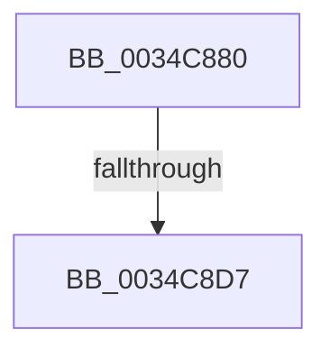

# SMKM_STORE&lt;SM_TRAITS&gt;::SmStTrimWsStoreBatch

- RVA: `0x0034C880`–`0x0034C8E9` (길이 `105` bytes)
- VA: `0x000000014034C880`
- 실행 섹션: `.text`
- PDB 이름 있음: `예`; PDB Function 태그: `아니요`
- unwind 정보 RVA: `0x00078764`
- 디코드: `27`개 명령, `105/105` bytes 표시
- 미해석 바이트: `0` (있으면 어셈블리에 `.byte`로 보존)

> 이 문서는 커널 이미지의 기계어와 PDB 기호를 분석해 생성했습니다. 4번과 5번은 함수 원형과 자료형을 바이너리 사용 방식에서 추정한 C 해석이며 원본 소스 복구 결과는 아닙니다.

## 1. Dependencies

- 직접 호출 지점: **1**; 고유 호출 대상: **1**
- 직접 호출자로 확인된 함수: **1**
- RIP 상대 이미지 참조: **0**

### Outgoing calls
- `0x0034C8B6` → [StLockReleaseShared](../2E/StLockReleaseShared_function_002E0320.md) (function, `0x002E0320`)

### Direct callers
- [SMKM_STORE&lt;SM_TRAITS&gt;::SmStTrimWsStore](../4B/SMKM_STORE_SM_TRAITS_SmStTrimWsStore_function_004BEB4C.md) at `0x004BED84`
- [SMKM_STORE&lt;SM_TRAITS&gt;::SmStTrimWsStore](../4B/SMKM_STORE_SM_TRAITS_SmStTrimWsStore_function_004BEB4C.md) at `0x004BEE5D`
- [SMKM_STORE&lt;SM_TRAITS&gt;::SmStTrimWsStore](../4B/SMKM_STORE_SM_TRAITS_SmStTrimWsStore_function_004BEB4C.md) at `0x004BEEB0`

### Static image references
- 디코드된 RIP-relative 메모리 참조가 없습니다.

## 2. Other-region calls and transfers

- 다른 실행 섹션으로 향하는 call: **0**
- call이 아닌 외부 분기/꼬리 이동: **1**
  - `0x0034C8D1` → [sub_0034CAB5](Unknown_function_0034CAB5.md) (`tail-transfer`)

## 3. Assembly (complete function range)

```asm
0034C880  48 89 5C 24 18                  mov qword ptr [rsp + 0x18], rbx
0034C885  48 89 6C 24 20                  mov qword ptr [rsp + 0x20], rbp
0034C88A  48 89 4C 24 08                  mov qword ptr [rsp + 8], rcx
0034C88F  57                              push rdi
0034C890  41 54                           push r12
0034C892  41 55                           push r13
0034C894  41 56                           push r14
0034C896  41 57                           push r15
0034C898  48 83 EC 40                     sub rsp, 0x40
0034C89C  48 8B F9                        mov rdi, rcx
0034C89F  45 8B E9                        mov r13d, r9d
0034C8A2  33 DB                           xor ebx, ebx
0034C8A4  48 81 C1 98 1A 00 00            add rcx, 0x1a98
0034C8AB  48 89 5C 24 30                  mov qword ptr [rsp + 0x30], rbx
0034C8B0  4D 8B F8                        mov r15, r8
0034C8B3  4C 8B E2                        mov r12, rdx
0034C8B6  E8 65 3A F9 FF                  call 0x1402e0320
0034C8BB  4C 8B B4 24 98 00 00 00         mov r14, qword ptr [rsp + 0x98]
0034C8C3  8B AF 60 1B 00 00               mov ebp, dword ptr [rdi + 0x1b60]
0034C8C9  48 89 6C 24 38                  mov qword ptr [rsp + 0x38], rbp
0034C8CE  4D 85 F6                        test r14, r14
0034C8D1  0F 84 DE 01 00 00               je 0x14034cab5
0034C8D7  C1 ED 0C                        shr ebp, 0xc
0034C8DA  8D 4B 40                        lea ecx, [rbx + 0x40]
0034C8DD  8B FD                           mov edi, ebp
0034C8DF  41 B8 73 6D 57 71               mov r8d, 0x71576d73
0034C8E5  49 0F AF FD                     imul rdi, r13
```

## 4. C-style interpretation (structured pseudocode)

```c
__int64 __fastcall SMKM_STORE_SM_TRAITS___SmStTrimWsStoreBatch(__int64 a1, __int64 a2, __int64 a3, int a4, __int64 a5, __int64 a6)
{
    __int64 result;
    __int64 v_rbp;
    __int64 v_rbx;
    __int64 v_rdi;
    __int64 v_rsp;
    unsigned __int64 v_stack_m30;
    unsigned __int64 v_stack_m38;
    unsigned __int64 v_stack_p18;
    unsigned __int64 v_stack_p20;
    unsigned __int64 v_stack_p8;

    v_stack_p18 = v_rbx;
    v_stack_p20 = v_rbp;
    v_stack_p8 = a1;
    v_rsp = (v_rsp) - (64);
    v_rbx = 0;
    a1 = (a1) + (0x1A98ULL);
    v_stack_m38 = 0;
    result = StLockReleaseShared(a1, a2, a3, a4);
    v_stack_m30 = (unsigned int)(*(unsigned int *)(a1 + 7008));
    v_rbp = (unsigned int)(((unsigned int)(*(unsigned int *)(a1 + 7008))) >> (12));
    v_rdi = ((unsigned int)((unsigned int)(v_rbp))) * ((unsigned int)(a4));
    return result;
}
```

## 5. (Beta) C Style

```c
int64_t SMKM_STORE_SM_TRAITS___SmStTrimWsStoreBatch(void *Arg1, int64_t Arg2, int64_t Arg3, int32_t Arg4, uint64_t Arg5, int64_t Arg6)
{
    uint8_t *arg1 = (uint8_t *)Arg1;

    int64_t result;
    int64_t local_rbp;
    int64_t local_rbx;
    int64_t local_rdi;
    int64_t local_rsp;
    uint64_t v_stack_m30;
    uint64_t v_stack_m38;
    uint64_t v_stack_p18;
    uint64_t v_stack_p20;
    uint64_t v_stack_p8;

    v_stack_p18 = local_rbx;
    v_stack_p20 = local_rbp;
    v_stack_p8 = Arg1;
    local_rsp = (local_rsp) - (64);
    local_rbx = 0;
    Arg1 = (Arg1) + (0x1A98ULL);
    v_stack_m38 = 0;
    result = StLockReleaseShared(Arg1, Arg2, Arg3, Arg4);
    v_stack_m30 = (uint32_t)(*(uint32_t *)(arg1 + 0x1B60));
    local_rbp = (uint32_t)(((uint32_t)(*(uint32_t *)(arg1 + 0x1B60))) >> (12));
    local_rdi = ((uint32_t)((uint32_t)(local_rbp))) * ((uint32_t)(Arg4));
    return result;
}
```

### 관측된 메모리 오프셋

구조체 형식이 확인되지 않은 접근은 인자 기준의 오프셋으로만 기록했습니다.

| 기준 인자 | 오프셋 표현 | 폭 (bit) | 접근 |
|---|---:|---:|---|
| `Arg1` | `+ 0x1B60` | `32` | `R` |

## 6. Execution-region graph

[열기: 2D/3D 그래프와 함수 탐색 컨트롤 패널](../../../control-panel.html?section=text&rva=0x0034C880&view=graph)

- 2D 그래프는 위에서 아래로 흐르고, 3D 그래프는 빈 공간을 드래그해 회전합니다. Shift+드래그는 이동, 휠은 확대·축소, 함수 노드 선택은 대상 보고서 이동입니다.

### Static fallback


