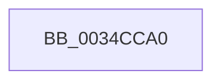

# SMKM_STORE&lt;SM_TRAITS&gt;::SmStUnmapVirtualRegion

- RVA: `0x0034CCA0`–`0x0034CCB2` (길이 `18` bytes)
- VA: `0x000000014034CCA0`
- 실행 섹션: `.text`
- PDB 이름 있음: `예`; PDB Function 태그: `아니요`
- unwind 정보 RVA: `0x00078850`
- 디코드: `5`개 명령, `18/18` bytes 표시
- 미해석 바이트: `0` (있으면 어셈블리에 `.byte`로 보존)

> 이 문서는 커널 이미지의 기계어와 PDB 기호를 분석해 생성했습니다. 4번과 5번은 함수 원형과 자료형을 바이너리 사용 방식에서 추정한 C 해석이며 원본 소스 복구 결과는 아닙니다.

## 1. Dependencies

- 직접 호출 지점: **0**; 고유 호출 대상: **0**
- 직접 호출자로 확인된 함수: **7**
- RIP 상대 이미지 참조: **0**

### Outgoing calls
- 직접 디코드된 call 명령이 없습니다.

### Direct callers
- [ST_STORE&lt;SM_TRAITS&gt;::StUnlockAndUnmapRegion](ST_STORE_SM_TRAITS_StUnlockAndUnmapRegion_function_0034C7F0.md) at `0x0034C819`
- [ST_STORE&lt;SM_TRAITS&gt;::StUnlockAndUnmapRegion](ST_STORE_SM_TRAITS_StUnlockAndUnmapRegion_function_0034C7F0.md) at `0x0034C856`
- [sub_0034CA36](Unknown_function_0034CA36.md) at `0x0034CA5F`
- [sub_0034CBA6](Unknown_function_0034CBA6.md) at `0x0034CBC6`
- [SMKM_STORE&lt;SM_TRAITS&gt;::SmStCompareRegionDataCallback](SMKM_STORE_SM_TRAITS_SmStCompareRegionDataCallback_function_0034D390.md) at `0x0034D616`
- [SMKM_STORE&lt;SM_TRAITS&gt;::SmStCompareRegionDataCallback](SMKM_STORE_SM_TRAITS_SmStCompareRegionDataCallback_function_0034D390.md) at `0x0034D692`
- [SMKM_STORE&lt;SM_TRAITS&gt;::SmStCompareRegionDataCallback](SMKM_STORE_SM_TRAITS_SmStCompareRegionDataCallback_function_0034D390.md) at `0x0034D6B8`
- [SMKM_STORE&lt;SM_TRAITS&gt;::SmStPrioritizeRegionsStore](SMKM_STORE_SM_TRAITS_SmStPrioritizeRegionsStore_function_0034DE28.md) at `0x0034E0F6`
- [SMKM_STORE&lt;SM_TRAITS&gt;::SmStOutSwapStore](../49/SMKM_STORE_SM_TRAITS_SmStOutSwapStore_function_00496C84.md) at `0x00496EE0`
- [SMKM_STORE&lt;SM_TRAITS&gt;::SmStOutSwapStore](../49/SMKM_STORE_SM_TRAITS_SmStOutSwapStore_function_00496C84.md) at `0x00496F5E`
- [ST_STORE&lt;SM_TRAITS&gt;::StMapAndLockRegion](../4E/ST_STORE_SM_TRAITS_StMapAndLockRegion_function_004EC090.md) at `0x004EC1EB`

### Static image references
- 디코드된 RIP-relative 메모리 참조가 없습니다.

## 2. Other-region calls and transfers

- 다른 실행 섹션으로 향하는 call: **0**
- 별도 외부 분기/꼬리 이동을 확인하지 못했습니다.

## 3. Assembly (complete function range)

```asm
0034CCA0  40 56                           push rsi
0034CCA2  41 55                           push r13
0034CCA4  48 83 EC 38                     sub rsp, 0x38
0034CCA8  48 8B 81 68 1B 00 00            mov rax, qword ptr [rcx + 0x1b68]
0034CCAF  45 33 ED                        xor r13d, r13d
```

## 4. C-style interpretation (structured pseudocode)

```c
__int64 __fastcall SMKM_STORE_SM_TRAITS___SmStUnmapVirtualRegion(__int64 a1)
{
    __int64 v_r13;
    __int64 v_rsp;

    v_rsp = (v_rsp) - (56);
    v_r13 = 0;
    return *(unsigned __int64 *)(a1 + 7016);
}
```

## 5. (Beta) C Style

```c
int64_t SMKM_STORE_SM_TRAITS___SmStUnmapVirtualRegion(void *Arg1)
{
    uint8_t *arg1 = (uint8_t *)Arg1;

    int64_t local_r13;
    int64_t local_rsp;

    local_rsp = (local_rsp) - (56);
    local_r13 = 0;
    return *(uint64_t *)(arg1 + 0x1B68);
}
```

### 관측된 메모리 오프셋

구조체 형식이 확인되지 않은 접근은 인자 기준의 오프셋으로만 기록했습니다.

| 기준 인자 | 오프셋 표현 | 폭 (bit) | 접근 |
|---|---:|---:|---|
| `Arg1` | `+ 0x1B68` | `64` | `R` |

## 6. Execution-region graph

[열기: 2D/3D 그래프와 함수 탐색 컨트롤 패널](../../../control-panel.html?section=text&rva=0x0034CCA0&view=graph)

- 2D 그래프는 위에서 아래로 흐르고, 3D 그래프는 빈 공간을 드래그해 회전합니다. Shift+드래그는 이동, 휠은 확대·축소, 함수 노드 선택은 대상 보고서 이동입니다.

### Static fallback


