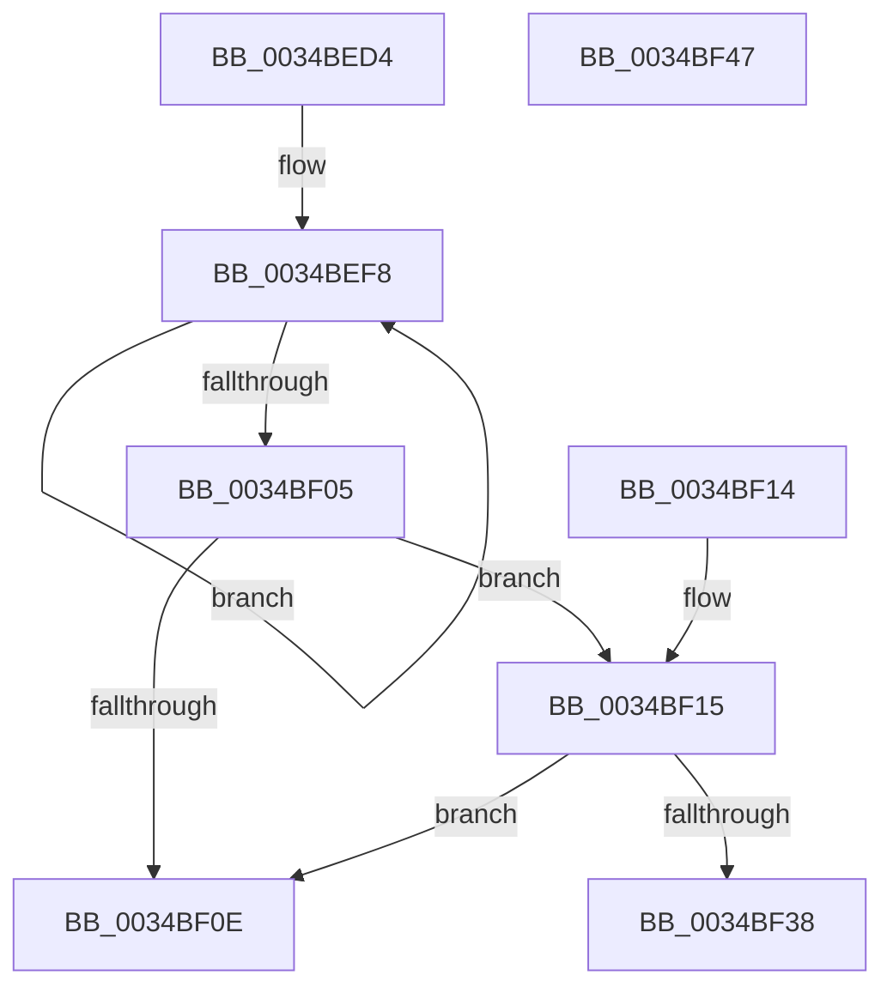

# ST_STORE&lt;SM_TRAITS&gt;::StSufficientSpaceForAdd

- RVA: `0x0034BED4`–`0x0034BF48` (길이 `116` bytes)
- VA: `0x000000014034BED4`
- 실행 섹션: `.text`
- PDB 이름 있음: `예`; PDB Function 태그: `아니요`
- unwind 정보 RVA: `0x000DB714`
- 디코드: `33`개 명령, `116/116` bytes 표시
- 미해석 바이트: `0` (있으면 어셈블리에 `.byte`로 보존)

> 이 문서는 커널 이미지의 기계어와 PDB 기호를 분석해 생성했습니다. 4번과 5번은 함수 원형과 자료형을 바이너리 사용 방식에서 추정한 C 해석이며 원본 소스 복구 결과는 아닙니다.

## 1. Dependencies

- 직접 호출 지점: **0**; 고유 호출 대상: **0**
- 직접 호출자로 확인된 함수: **1**
- RIP 상대 이미지 참조: **0**

### Outgoing calls
- 직접 디코드된 call 명령이 없습니다.

### Direct callers
- [SMKM_STORE_MGR&lt;SM_TRAITS&gt;::SmPageWrite](SMKM_STORE_MGR_SM_TRAITS_SmPageWrite_function_0034BA54.md) at `0x0034BADC`

### Static image references
- 디코드된 RIP-relative 메모리 참조가 없습니다.

## 2. Other-region calls and transfers

- 다른 실행 섹션으로 향하는 call: **0**
- 별도 외부 분기/꼬리 이동을 확인하지 못했습니다.

## 3. Assembly (complete function range)

```asm
0034BED4  4C 8B C9                        mov r9, rcx
0034BED7  45 33 DB                        xor r11d, r11d
0034BEDA  41 8B CB                        mov ecx, r11d
0034BEDD  41 8B 81 58 03 00 00            mov eax, dword ptr [r9 + 0x358]
0034BEE4  4D 8D 91 E8 08 00 00            lea r10, [r9 + 0x8e8]
0034BEEB  F6 D8                           neg al
0034BEED  4D 1B C0                        sbb r8, r8
0034BEF0  49 83 E0 F9                     and r8, 0xfffffffffffffff9
0034BEF4  49 83 C0 08                     add r8, 8
0034BEF8  41 03 0A                        add ecx, dword ptr [r10]
0034BEFB  4D 8D 52 08                     lea r10, [r10 + 8]
0034BEFF  49 83 E8 01                     sub r8, 1
0034BF03  75 F3                           jne 0x14034bef8
0034BF05  41 39 89 A8 03 00 00            cmp dword ptr [r9 + 0x3a8], ecx
0034BF0C  76 07                           jbe 0x14034bf15
0034BF0E  B8 01 00 00 00                  mov eax, 1
0034BF13  C3                              ret
0034BF14  CC                              int3
0034BF15  8B C2                           mov eax, edx
0034BF17  41 8B 94 C1 EC 08 00 00         mov edx, dword ptr [r9 + rax*8 + 0x8ec]
0034BF1F  41 8B 8C C1 E8 08 00 00         mov ecx, dword ptr [r9 + rax*8 + 0x8e8]
0034BF27  41 8B 81 60 03 00 00            mov eax, dword ptr [r9 + 0x360]
0034BF2E  C1 E8 04                        shr eax, 4
0034BF31  0F AF C1                        imul eax, ecx
0034BF34  3B C2                           cmp eax, edx
0034BF36  72 D6                           jb 0x14034bf0e
0034BF38  2B C2                           sub eax, edx
0034BF3A  C1 E1 08                        shl ecx, 8
0034BF3D  3B C1                           cmp eax, ecx
0034BF3F  41 0F 93 C3                     setae r11b
0034BF43  41 8B C3                        mov eax, r11d
0034BF46  C3                              ret
0034BF47  CC                              int3
```

## 4. C-style interpretation (structured pseudocode)

```c
__int64 __fastcall ST_STORE_SM_TRAITS___StSufficientSpaceForAdd(__int64 a1, int a2, __int64 a3)
{
    __int64 result;
    __int64 v_r11;

    v_r11 = 0;
    result = (unsigned __int8)(-((unsigned int)(*(unsigned int *)(a1 + 856))));
    a3 = (a3) & (-7);
    a3 = (a3) + (8);
loc_0034BEF8:
    a1 = (unsigned int)((0) + (*(unsigned int *)(a1 + 2280)));
    a3 = (a3) - (1);
    if (condition_is_not_equal) goto loc_0034BEF8;
    if ((*(unsigned int *)(a1 + 936)) <= ((unsigned int)(a1))) goto loc_0034BF15;
loc_0034BF0E:
    return 1;
loc_0034BF15:
    result = (unsigned int)(((unsigned int)(*(unsigned int *)(a1 + 864))) >> (4));
    result = (unsigned int)((result) * ((unsigned int)((unsigned int)(*(unsigned int *)(a1 + (unsigned int)(a2) * 8 + 2280)))));
    if (((unsigned int)(result)) < ((unsigned int)((unsigned int)(*(unsigned int *)(a1 + (unsigned int)(a2) * 8 + 2284))))) goto loc_0034BF0E;
    result = (unsigned int)((result) - ((unsigned int)((unsigned int)(*(unsigned int *)(a1 + (unsigned int)(a2) * 8 + 2284)))));
    a1 = (unsigned int)(((unsigned int)(*(unsigned int *)(a1 + (unsigned int)(a2) * 8 + 2280))) << (8));
    v_r11 = (((unsigned int)(result)) >= ((unsigned int)(a1))) ? 1 : 0;
    return (unsigned int)((unsigned int)(v_r11));
}
```

## 5. (Beta) C Style

```c
int64_t ST_STORE_SM_TRAITS___StSufficientSpaceForAdd(void *Arg1, int32_t Arg2, int64_t Arg3)
{
    uint8_t *arg1 = (uint8_t *)Arg1;

    int64_t result;
    int64_t local_r11;

    local_r11 = 0;
    result = (uint8_t)(-((uint32_t)(*(uint32_t *)(arg1 + 0x358))));
    Arg3 = (Arg3) & (-7);
    Arg3 = (Arg3) + (8);
loc_0034BEF8:
    Arg1 = (uint32_t)((0) + (*(uint32_t *)(arg1 + 0x8E8)));
    Arg3 = (Arg3) - (1);
    if (condition_is_not_equal) goto loc_0034BEF8;
    if ((*(uint32_t *)(arg1 + 0x3A8)) <= ((uint32_t)(Arg1))) goto loc_0034BF15;
loc_0034BF0E:
    return 1;
loc_0034BF15:
    result = (uint32_t)(((uint32_t)(*(uint32_t *)(arg1 + 0x360))) >> (4));
    result = (uint32_t)((result) * ((uint32_t)((uint32_t)(*(uint32_t *)(arg1 + (uint32_t)(Arg2) * 8 + 0x8E8)))));
    if (((uint32_t)(result)) < ((uint32_t)((uint32_t)(*(uint32_t *)(arg1 + (uint32_t)(Arg2) * 8 + 0x8EC))))) goto loc_0034BF0E;
    result = (uint32_t)((result) - ((uint32_t)((uint32_t)(*(uint32_t *)(arg1 + (uint32_t)(Arg2) * 8 + 0x8EC)))));
    Arg1 = (uint32_t)(((uint32_t)(*(uint32_t *)(arg1 + (uint32_t)(Arg2) * 8 + 0x8E8))) << (8));
    local_r11 = (((uint32_t)(result)) >= ((uint32_t)(Arg1))) ? 1 : 0;
    return (uint32_t)((uint32_t)(local_r11));
}
```

### 관측된 메모리 오프셋

구조체 형식이 확인되지 않은 접근은 인자 기준의 오프셋으로만 기록했습니다.

| 기준 인자 | 오프셋 표현 | 폭 (bit) | 접근 |
|---|---:|---:|---|
| `Arg1` | `+ 0x0` | `32` | `R` |
| `Arg1` | `+ 0x8` | `64` | `R` |
| `Arg1` | `+ 0x358` | `32` | `R` |
| `Arg1` | `+ 0x360` | `32` | `R` |
| `Arg1` | `+ 0x3A8` | `32` | `R` |
| `Arg1` | `+ 0x8E8` | `64` | `R` |
| `Arg1` | `+ 0x8E8 + rax*8` | `32` | `R` |
| `Arg1` | `+ 0x8EC + rax*8` | `32` | `R` |

## 6. Execution-region graph

[열기: 2D/3D 그래프와 함수 탐색 컨트롤 패널](../../../control-panel.html?section=text&rva=0x0034BED4&view=graph)

- 2D 그래프는 위에서 아래로 흐르고, 3D 그래프는 빈 공간을 드래그해 회전합니다. Shift+드래그는 이동, 휠은 확대·축소, 함수 노드 선택은 대상 보고서 이동입니다.

### Static fallback


