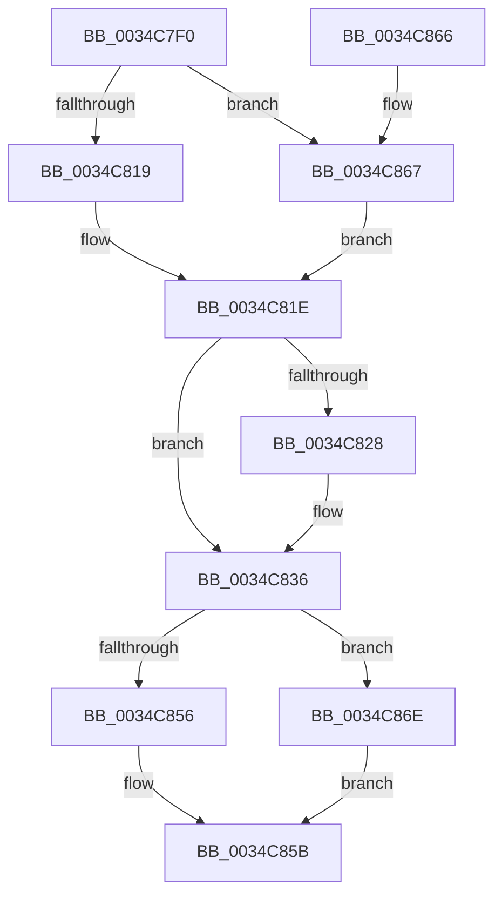

# ST_STORE&lt;SM_TRAITS&gt;::StUnlockAndUnmapRegion

- RVA: `0x0034C7F0`–`0x0034C875` (길이 `133` bytes)
- VA: `0x000000014034C7F0`
- 실행 섹션: `.text`
- PDB 이름 있음: `예`; PDB Function 태그: `아니요`
- unwind 정보 RVA: `0x00078754`
- 디코드: `35`개 명령, `133/133` bytes 표시
- 미해석 바이트: `0` (있으면 어셈블리에 `.byte`로 보존)

> 이 문서는 커널 이미지의 기계어와 PDB 기호를 분석해 생성했습니다. 4번과 5번은 함수 원형과 자료형을 바이너리 사용 방식에서 추정한 C 해석이며 원본 소스 복구 결과는 아닙니다.

## 1. Dependencies

- 직접 호출 지점: **4**; 고유 호출 대상: **2**
- 직접 호출자로 확인된 함수: **3**
- RIP 상대 이미지 참조: **0**

### Outgoing calls
- `0x0034C819` → [SMKM_STORE<SM_TRAITS>::SmStUnmapVirtualRegion](SMKM_STORE_SM_TRAITS_SmStUnmapVirtualRegion_function_0034CCA0.md) (function, `0x0034CCA0`)
- `0x0034C856` → [SMKM_STORE<SM_TRAITS>::SmStUnmapVirtualRegion](SMKM_STORE_SM_TRAITS_SmStUnmapVirtualRegion_function_0034CCA0.md) (function, `0x0034CCA0`)
- `0x0034C867` → [SMKM_STORE<SM_TRAITS>::SmStUnmapPhysicalRegion](../3E/SMKM_STORE_SM_TRAITS_SmStUnmapPhysicalRegion_function_003E76E0.md) (function, `0x003E76E0`)
- `0x0034C86E` → [SMKM_STORE<SM_TRAITS>::SmStUnmapPhysicalRegion](../3E/SMKM_STORE_SM_TRAITS_SmStUnmapPhysicalRegion_function_003E76E0.md) (function, `0x003E76E0`)

### Direct callers
- [ST_STORE&lt;SM_TRAITS&gt;::StDmCurrentRegionSet](../3B/ST_STORE_SM_TRAITS_StDmCurrentRegionSet_function_003B1130.md) at `0x003B1227`
- [ST_STORE&lt;SM_TRAITS&gt;::StCompactionPerformInMem](../41/ST_STORE_SM_TRAITS_StCompactionPerformInMem_function_004111D8.md) at `0x004113D4`
- [ST_STORE&lt;SM_TRAITS&gt;::StCompactionPerformInMem](../41/ST_STORE_SM_TRAITS_StCompactionPerformInMem_function_004111D8.md) at `0x004113EA`
- [ST_STORE&lt;SM_TRAITS&gt;::StCompactionPerformInMem](../41/ST_STORE_SM_TRAITS_StCompactionPerformInMem_function_004111D8.md) at `0x00411424`
- [ST_STORE&lt;SM_TRAITS&gt;::StCompactionPerformInMem](../41/ST_STORE_SM_TRAITS_StCompactionPerformInMem_function_004111D8.md) at `0x00411433`
- [ST_STORE&lt;SM_TRAITS&gt;::StCompactionPerformEmergency](../4E/ST_STORE_SM_TRAITS_StCompactionPerformEmergency_function_004EB170.md) at `0x004EB330`

### Static image references
- 디코드된 RIP-relative 메모리 참조가 없습니다.

## 2. Other-region calls and transfers

- 다른 실행 섹션으로 향하는 call: **0**
- 별도 외부 분기/꼬리 이동을 확인하지 못했습니다.

## 3. Assembly (complete function range)

```asm
0034C7F0  48 89 5C 24 08                  mov qword ptr [rsp + 8], rbx
0034C7F5  57                              push rdi
0034C7F6  48 83 EC 30                     sub rsp, 0x30
0034C7FA  48 8B F9                        mov rdi, rcx
0034C7FD  8B DA                           mov ebx, edx
0034C7FF  48 8B 89 20 03 00 00            mov rcx, qword ptr [rcx + 0x320]
0034C806  8B D3                           mov edx, ebx
0034C808  C7 44 24 28 01 00 00 00         mov dword ptr [rsp + 0x28], 1
0034C810  F6 81 95 1A 00 00 04            test byte ptr [rcx + 0x1a95], 4
0034C817  74 4E                           je 0x14034c867
0034C819  E8 82 04 00 00                  call 0x14034cca0
0034C81E  33 C9                           xor ecx, ecx
0034C820  38 8F 08 03 00 00               cmp byte ptr [rdi + 0x308], cl
0034C826  75 0E                           jne 0x14034c836
0034C828  48 8B 87 78 05 00 00            mov rax, qword ptr [rdi + 0x578]
0034C82F  0F B7 0C 58                     movzx ecx, word ptr [rax + rbx*2]
0034C833  C1 E9 0D                        shr ecx, 0xd
0034C836  4C 8B 87 20 03 00 00            mov r8, qword ptr [rdi + 0x320]
0034C83D  8B D3                           mov edx, ebx
0034C83F  C1 E1 04                        shl ecx, 4
0034C842  83 C9 04                        or ecx, 4
0034C845  89 4C 24 28                     mov dword ptr [rsp + 0x28], ecx
0034C849  49 8B C8                        mov rcx, r8
0034C84C  41 F6 80 95 1A 00 00 04         test byte ptr [r8 + 0x1a95], 4
0034C854  74 18                           je 0x14034c86e
0034C856  E8 45 04 00 00                  call 0x14034cca0
0034C85B  48 8B 5C 24 40                  mov rbx, qword ptr [rsp + 0x40]
0034C860  48 83 C4 30                     add rsp, 0x30
0034C864  5F                              pop rdi
0034C865  C3                              ret
0034C866  CC                              int3
0034C867  E8 74 AE 09 00                  call 0x1403e76e0
0034C86C  EB B0                           jmp 0x14034c81e
0034C86E  E8 6D AE 09 00                  call 0x1403e76e0
0034C873  EB E6                           jmp 0x14034c85b
```

## 4. C-style interpretation (structured pseudocode)

```c
__int64 __fastcall ST_STORE_SM_TRAITS___StUnlockAndUnmapRegion(__int64 a1, int a2)
{
    __int64 result;
    __int64 v_rsp;
    unsigned int v_stack_m10;
    unsigned __int64 v_stack_p8;

    v_stack_p8 = v_rbx;
    v_rsp = (v_rsp) - (48);
    v_stack_m10 = 1;
    if (((*(unsigned __int8 *)(*(unsigned __int64 *)(a1 + 800) + 6805)) & (4)) == 0) goto loc_0034C867;
    result = SMKM_STORE_SM_TRAITS___SmStUnmapVirtualRegion(*(unsigned __int64 *)(a1 + 800), (unsigned int)((unsigned int)((unsigned int)(a2))), a3, a4);
loc_0034C81E:
    a1 = 0;
    if ((*(unsigned __int8 *)(a1 + 776)) == 0) {
        result = *(unsigned __int64 *)(a1 + 1400);
        a1 = *(unsigned __int16 *)(result + (unsigned int)(a2) * 2);
        a1 = (unsigned int)((a1) >> (13));
    }
    a1 = (unsigned int)((a1) << (4));
    a1 = (unsigned int)((a1) | (4));
    v_stack_m10 = (unsigned int)(a1);
    if (((*(unsigned __int8 *)(*(unsigned __int64 *)(a1 + 800) + 6805)) & (4)) == 0) goto loc_0034C86E;
    result = SMKM_STORE_SM_TRAITS___SmStUnmapVirtualRegion(*(unsigned __int64 *)(a1 + 800), (unsigned int)((unsigned int)((unsigned int)(a2))), *(unsigned __int64 *)(a1 + 800), a4);
loc_0034C85B:
    v_rsp = (v_rsp) + (48);
    return result;
loc_0034C867:
    result = SMKM_STORE_SM_TRAITS___SmStUnmapPhysicalRegion(*(unsigned __int64 *)(a1 + 800), (unsigned int)((unsigned int)((unsigned int)(a2))), *(unsigned __int64 *)(a1 + 800), a4);
    goto loc_0034C81E;
loc_0034C86E:
    result = SMKM_STORE_SM_TRAITS___SmStUnmapPhysicalRegion(*(unsigned __int64 *)(a1 + 800), (unsigned int)((unsigned int)((unsigned int)(a2))), *(unsigned __int64 *)(a1 + 800), a4);
    goto loc_0034C85B;
}
```

## 5. (Beta) C Style

```c
int64_t ST_STORE_SM_TRAITS___StUnlockAndUnmapRegion(void *Arg1, int32_t Arg2)
{
    uint8_t *arg1 = (uint8_t *)Arg1;

    int64_t result;
    int64_t local_rsp;
    uint32_t v_stack_m10;
    uint64_t v_stack_p8;

    v_stack_p8 = local_rbx;
    local_rsp = (local_rsp) - (48);
    v_stack_m10 = 1;
    if (((*(uint8_t *)(*(uint64_t *)(arg1 + 0x320) + 0x1A95)) & (4)) == 0) goto loc_0034C867;
    result = SMKM_STORE_SM_TRAITS___SmStUnmapVirtualRegion(*(uint64_t *)(arg1 + 0x320), (uint32_t)((uint32_t)((uint32_t)(Arg2))), a3, a4);
loc_0034C81E:
    Arg1 = 0;
    if ((*(uint8_t *)(arg1 + 0x308)) == 0) {
        result = *(uint64_t *)(arg1 + 0x578);
        Arg1 = *(uint16_t *)(result + (uint32_t)(Arg2) * 2);
        Arg1 = (uint32_t)((Arg1) >> (13));
    }
    Arg1 = (uint32_t)((Arg1) << (4));
    Arg1 = (uint32_t)((Arg1) | (4));
    v_stack_m10 = (uint32_t)(Arg1);
    if (((*(uint8_t *)(*(uint64_t *)(arg1 + 0x320) + 0x1A95)) & (4)) == 0) goto loc_0034C86E;
    result = SMKM_STORE_SM_TRAITS___SmStUnmapVirtualRegion(*(uint64_t *)(arg1 + 0x320), (uint32_t)((uint32_t)((uint32_t)(Arg2))), *(uint64_t *)(arg1 + 0x320), a4);
loc_0034C85B:
    local_rsp = (local_rsp) + (48);
    return result;
loc_0034C867:
    result = SMKM_STORE_SM_TRAITS___SmStUnmapPhysicalRegion(*(uint64_t *)(arg1 + 0x320), (uint32_t)((uint32_t)((uint32_t)(Arg2))), *(uint64_t *)(arg1 + 0x320), a4);
    goto loc_0034C81E;
loc_0034C86E:
    result = SMKM_STORE_SM_TRAITS___SmStUnmapPhysicalRegion(*(uint64_t *)(arg1 + 0x320), (uint32_t)((uint32_t)((uint32_t)(Arg2))), *(uint64_t *)(arg1 + 0x320), a4);
    goto loc_0034C85B;
}
```

### 관측된 메모리 오프셋

구조체 형식이 확인되지 않은 접근은 인자 기준의 오프셋으로만 기록했습니다.

| 기준 인자 | 오프셋 표현 | 폭 (bit) | 접근 |
|---|---:|---:|---|
| `Arg1` | `+ 0x308` | `8` | `R` |
| `Arg1` | `+ 0x320` | `64` | `R` |
| `Arg1` | `+ 0x578` | `64` | `R` |

## 6. Execution-region graph

[열기: 2D/3D 그래프와 함수 탐색 컨트롤 패널](../../../control-panel.html?section=text&rva=0x0034C7F0&view=graph)

- 2D 그래프는 위에서 아래로 흐르고, 3D 그래프는 빈 공간을 드래그해 회전합니다. Shift+드래그는 이동, 휠은 확대·축소, 함수 노드 선택은 대상 보고서 이동입니다.

### Static fallback


