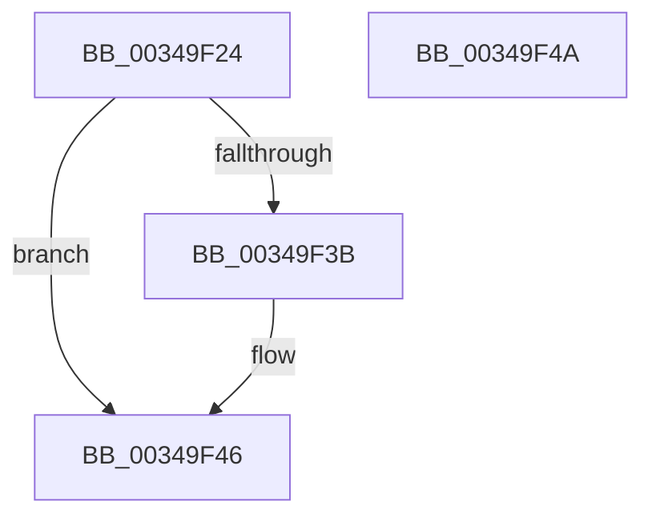

# SmKmStoreGet

- RVA: `0x00349F24`–`0x00349F4B` (길이 `39` bytes)
- VA: `0x0000000140349F24`
- 실행 섹션: `.text`
- PDB 이름 있음: `예`; PDB Function 태그: `아니요`
- unwind 정보 RVA: `0x000DB714`
- 디코드: `13`개 명령, `39/39` bytes 표시
- 미해석 바이트: `0` (있으면 어셈블리에 `.byte`로 보존)

> 이 문서는 커널 이미지의 기계어와 PDB 기호를 분석해 생성했습니다. 4번과 5번은 함수 원형과 자료형을 바이너리 사용 방식에서 추정한 C 해석이며 원본 소스 복구 결과는 아닙니다.

## 1. Dependencies

- 직접 호출 지점: **0**; 고유 호출 대상: **0**
- 직접 호출자로 확인된 함수: **8**
- RIP 상대 이미지 참조: **0**

### Outgoing calls
- 직접 디코드된 call 명령이 없습니다.

### Direct callers
- [SmpProcessQueryStoreStats](SmpProcessQueryStoreStats_function_00349D6C.md) at `0x00349DC0`
- [sub_006D8FB2](../6D/Unknown_function_006D8FB2.md) at `0x006D8FC2`
- [SmpKeyedStoreCreate](../../page/A5/SmpKeyedStoreCreate_function_00A50B64.md) at `0x00A50C88`
- [SmStoreCompressionStop](../../page/A6/SmStoreCompressionStop_function_00A6197C.md) at `0x00A61AAD`
- [SmSwapStore](../../page/A6/SmSwapStore_function_00A61D14.md) at `0x00A61D5C`
- [SmProcessDeleteNotification](../../page/A6/SmProcessDeleteNotification_function_00A686F4.md) at `0x00A68751`
- [SmProcessSystemStoreTrimRequest](../../page/A7/SmProcessSystemStoreTrimRequest_function_00A784E0.md) at `0x00A78755`
- [sub_00B41A62](../../page/B4/Unknown_function_00B41A62.md) at `0x00B41AA1`

### Static image references
- 디코드된 RIP-relative 메모리 참조가 없습니다.

## 2. Other-region calls and transfers

- 다른 실행 섹션으로 향하는 call: **0**
- 별도 외부 분기/꼬리 이동을 확인하지 못했습니다.

## 3. Assembly (complete function range)

```asm
00349F24  81 E2 FF 03 00 00               and edx, 0x3ff
00349F2A  8B C2                           mov eax, edx
00349F2C  48 C1 E8 05                     shr rax, 5
00349F30  4C 8B 04 C1                     mov r8, qword ptr [rcx + rax*8]
00349F34  33 C0                           xor eax, eax
00349F36  4D 85 C0                        test r8, r8
00349F39  74 0B                           je 0x140349f46
00349F3B  83 E2 1F                        and edx, 0x1f
00349F3E  48 8D 04 92                     lea rax, [rdx + rdx*4]
00349F42  49 8D 04 C0                     lea rax, [r8 + rax*8]
00349F46  48 8B 00                        mov rax, qword ptr [rax]
00349F49  C3                              ret
00349F4A  CC                              int3
```

## 4. C-style interpretation (structured pseudocode)

```c
__int64 __fastcall SmKmStoreGet(__int64 a1, int a2)
{
    __int64 result;

    a2 = (unsigned int)((a2) & (0x3FFULL));
    result = ((unsigned int)(a2)) >> (5);
    result = 0;
    if (*(unsigned __int64 *)(a1 + result * 8) != 0) {
        a2 = (unsigned int)((a2) & (31));
        result = a2 + a2 * 4;
        result = *(unsigned __int64 *)(a1 + result * 8) + result * 8;
    }
    return *(unsigned __int64 *)(result);
}
```

## 5. (Beta) C Style

```c
int64_t SmKmStoreGet(void *Arg1, void *Arg2)
{
    uint8_t *arg1 = (uint8_t *)Arg1;
    uint8_t *arg2 = (uint8_t *)Arg2;

    int64_t result;

    Arg2 = (uint32_t)((Arg2) & (0x3FFULL));
    result = ((uint32_t)(Arg2)) >> (5);
    result = 0;
    if (*(uint64_t *)(arg1 + result * 8) != 0) {
        Arg2 = (uint32_t)((Arg2) & (31));
        result = Arg2 + Arg2 * 4;
        result = *(uint64_t *)(arg1 + result * 8) + result * 8;
    }
    return *(uint64_t *)(result);
}
```

### 관측된 메모리 오프셋

구조체 형식이 확인되지 않은 접근은 인자 기준의 오프셋으로만 기록했습니다.

| 기준 인자 | 오프셋 표현 | 폭 (bit) | 접근 |
|---|---:|---:|---|
| `Arg1` | `+ 0x0 + rax*8` | `64` | `R` |
| `Arg2` | `+ 0x0 + rdx*4` | `64` | `R` |

## 6. Execution-region graph

[열기: 2D/3D 그래프와 함수 탐색 컨트롤 패널](../../../control-panel.html?section=text&rva=0x00349F24&view=graph)

- 2D 그래프는 위에서 아래로 흐르고, 3D 그래프는 빈 공간을 드래그해 회전합니다. Shift+드래그는 이동, 휠은 확대·축소, 함수 노드 선택은 대상 보고서 이동입니다.

### Static fallback


