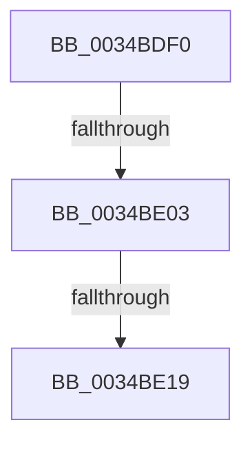

# SmKmStoreReferenceEx

- RVA: `0x0034BDF0`–`0x0034BE2E` (길이 `62` bytes)
- VA: `0x000000014034BDF0`
- 실행 섹션: `.text`
- PDB 이름 있음: `예`; PDB Function 태그: `아니요`
- unwind 정보 RVA: `0x00078658`
- 디코드: `15`개 명령, `62/62` bytes 표시
- 미해석 바이트: `0` (있으면 어셈블리에 `.byte`로 보존)

> 이 문서는 커널 이미지의 기계어와 PDB 기호를 분석해 생성했습니다. 4번과 5번은 함수 원형과 자료형을 바이너리 사용 방식에서 추정한 C 해석이며 원본 소스 복구 결과는 아닙니다.

## 1. Dependencies

- 직접 호출 지점: **0**; 고유 호출 대상: **0**
- 직접 호출자로 확인된 함수: **5**
- RIP 상대 이미지 참조: **0**

### Outgoing calls
- 직접 디코드된 call 명령이 없습니다.

### Direct callers
- [SMKM_STORE_MGR&lt;SM_TRAITS&gt;::SmPageWrite](SMKM_STORE_MGR_SM_TRAITS_SmPageWrite_function_0034BA54.md) at `0x0034BABE`
- [SMKM_STORE_MGR&lt;SM_TRAITS&gt;::SmUpdateMemoryConditions](SMKM_STORE_MGR_SM_TRAITS_SmUpdateMemoryConditions_function_0034BD60.md) at `0x0034BD96`
- [SMKM_STORE_MGR&lt;SM_TRAITS&gt;::SmHighMemPriorityWatchdogWorker](SMKM_STORE_MGR_SM_TRAITS_SmHighMemPriorityWatchdogWorker_function_0034C080.md) at `0x0034C156`
- [SMKM_STORE_MGR&lt;SM_TRAITS&gt;::SmReadPickStore](SMKM_STORE_MGR_SM_TRAITS_SmReadPickStore_function_0034C494.md) at `0x0034C514`
- [SmEtwEnableCallback](../../page/7A/SmEtwEnableCallback_function_007AA080.md) at `0x007AA133`
- [SmEtwEnableCallback](../../page/7A/SmEtwEnableCallback_function_007AA080.md) at `0x007AA190`

### Static image references
- 디코드된 RIP-relative 메모리 참조가 없습니다.

## 2. Other-region calls and transfers

- 다른 실행 섹션으로 향하는 call: **0**
- call이 아닌 외부 분기/꼬리 이동: **3**
  - `0x0034BDFD` → [sub_0034BEA8 + 0x6](Unknown_function_0034BEA8.md) (`tail-transfer`)
  - `0x0034BE13` → [sub_0034BEA8 + 0x6](Unknown_function_0034BEA8.md) (`tail-transfer`)
  - `0x0034BE28` → [sub_0034BEA8 + 0x6](Unknown_function_0034BEA8.md) (`tail-transfer`)

## 3. Assembly (complete function range)

```asm
0034BDF0  48 83 EC 28                     sub rsp, 0x28
0034BDF4  4C 8B D1                        mov r10, rcx
0034BDF7  81 FA 00 04 00 00               cmp edx, 0x400
0034BDFD  0F 83 AB 00 00 00               jae 0x14034beae
0034BE03  8B C2                           mov eax, edx
0034BE05  48 C1 E8 05                     shr rax, 5
0034BE09  44 8B C2                        mov r8d, edx
0034BE0C  4C 8B 0C C1                     mov r9, qword ptr [rcx + rax*8]
0034BE10  4D 85 C9                        test r9, r9
0034BE13  0F 84 95 00 00 00               je 0x14034beae
0034BE19  41 83 E0 1F                     and r8d, 0x1f
0034BE1D  4B 8D 04 80                     lea rax, [r8 + r8*4]
0034BE21  49 8D 0C C1                     lea rcx, [r9 + rax*8]
0034BE25  48 85 C9                        test rcx, rcx
0034BE28  0F 84 80 00 00 00               je 0x14034beae
```

## 4. C-style interpretation (structured pseudocode)

```c
__int64 __fastcall SmKmStoreReferenceEx(__int64 a1, int a2)
{
    __int64 result;
    __int64 v_rsp;

    v_rsp = (v_rsp) - (40);
    result = ((unsigned int)(a2)) >> (5);
    a3 = (unsigned int)(((unsigned int)(a2)) & (31));
}
```

## 5. (Beta) C Style

```c
int64_t SmKmStoreReferenceEx(void *Arg1, int32_t Arg2)
{
    uint8_t *arg1 = (uint8_t *)Arg1;

    int64_t result;
    int64_t local_rsp;

    local_rsp = (local_rsp) - (40);
    result = ((uint32_t)(Arg2)) >> (5);
    a3 = (uint32_t)(((uint32_t)(Arg2)) & (31));
}
```

### 관측된 메모리 오프셋

구조체 형식이 확인되지 않은 접근은 인자 기준의 오프셋으로만 기록했습니다.

| 기준 인자 | 오프셋 표현 | 폭 (bit) | 접근 |
|---|---:|---:|---|
| `Arg1` | `+ 0x0 + rax*8` | `64` | `R` |

## 6. Execution-region graph

[열기: 2D/3D 그래프와 함수 탐색 컨트롤 패널](../../../control-panel.html?section=text&rva=0x0034BDF0&view=graph)

- 2D 그래프는 위에서 아래로 흐르고, 3D 그래프는 빈 공간을 드래그해 회전합니다. Shift+드래그는 이동, 휠은 확대·축소, 함수 노드 선택은 대상 보고서 이동입니다.

### Static fallback


