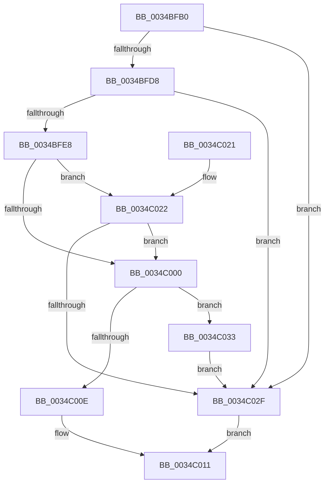

# SmKmStoreReference

- RVA: `0x0034BFB0`–`0x0034C03E` (길이 `142` bytes)
- VA: `0x000000014034BFB0`
- 실행 섹션: `.text`
- PDB 이름 있음: `예`; PDB Function 태그: `아니요`
- unwind 정보 RVA: `0x000786B8`
- 디코드: `44`개 명령, `142/142` bytes 표시
- 미해석 바이트: `0` (있으면 어셈블리에 `.byte`로 보존)

> 이 문서는 커널 이미지의 기계어와 PDB 기호를 분석해 생성했습니다. 4번과 5번은 함수 원형과 자료형을 바이너리 사용 방식에서 추정한 C 해석이며 원본 소스 복구 결과는 아닙니다.

## 1. Dependencies

- 직접 호출 지점: **2**; 고유 호출 대상: **2**
- 직접 호출자로 확인된 함수: **9**
- RIP 상대 이미지 참조: **0**

### Outgoing calls
- `0x0034C026` → [ExfAcquireRundownProtection](ExfAcquireRundownProtection_function_0034C050.md) (function, `0x0034C050`)
- `0x0034C037` → [ExReleaseRundownProtection](ExReleaseRundownProtection_function_00349E80.md) (function, `0x00349E80`)

### Direct callers
- [sub_00205FE2](../20/Unknown_function_00205FE2.md) at `0x00206111`
- [SmpKeyedStoreReference](SmpKeyedStoreReference_function_003499CC.md) at `0x00349A89`
- [SMKM_STORE_MGR&lt;SM_TRAITS&gt;::SmPerformStoreMaintenance](../49/SMKM_STORE_MGR_SM_TRAITS_SmPerformStoreMaintenance_function_00496FD8.md) at `0x0049706A`
- [SMKM_STORE_MGR&lt;SM_TRAITS&gt;::SmStoreRequest](../4A/SMKM_STORE_MGR_SM_TRAITS_SmStoreRequest_function_004A2160.md) at `0x004A217F`
- [ST_STORE&lt;SM_TRAITS&gt;::StDmDeviceError](../60/ST_STORE_SM_TRAITS_StDmDeviceError_function_0060D2C4.md) at `0x0060D415`
- [SMKM_STORE_MGR&lt;SM_TRAITS&gt;::SmStoreTerminate](../61/SMKM_STORE_MGR_SM_TRAITS_SmStoreTerminate_function_00610BD4.md) at `0x00610C25`
- [SmGetStoreOwnerProcessId](../61/SmGetStoreOwnerProcessId_function_00610E4C.md) at `0x00610E7E`
- [SmIssueIo](../61/SmIssueIo_function_00610F90.md) at `0x00610FEB`
- [SmProcessListRequestExtended](../../page/7A/SmProcessListRequestExtended_function_007A6A28.md) at `0x007A6A75`

### Static image references
- 디코드된 RIP-relative 메모리 참조가 없습니다.

## 2. Other-region calls and transfers

- 다른 실행 섹션으로 향하는 call: **0**
- 별도 외부 분기/꼬리 이동을 확인하지 못했습니다.

## 3. Assembly (complete function range)

```asm
0034BFB0  48 89 5C 24 10                  mov qword ptr [rsp + 0x10], rbx
0034BFB5  48 89 74 24 18                  mov qword ptr [rsp + 0x18], rsi
0034BFBA  57                              push rdi
0034BFBB  48 83 EC 20                     sub rsp, 0x20
0034BFBF  8B C2                           mov eax, edx
0034BFC1  8B FA                           mov edi, edx
0034BFC3  25 FF 03 00 00                  and eax, 0x3ff
0034BFC8  44 8B C0                        mov r8d, eax
0034BFCB  49 C1 E8 05                     shr r8, 5
0034BFCF  4A 8B 14 C1                     mov rdx, qword ptr [rcx + r8*8]
0034BFD3  48 85 D2                        test rdx, rdx
0034BFD6  74 57                           je 0x14034c02f
0034BFD8  83 E0 1F                        and eax, 0x1f
0034BFDB  48 8D 0C 80                     lea rcx, [rax + rax*4]
0034BFDF  48 8D 1C CA                     lea rbx, [rdx + rcx*8]
0034BFE3  48 85 DB                        test rbx, rbx
0034BFE6  74 47                           je 0x14034c02f
0034BFE8  0F 0D 4B 08                     prefetchw byte ptr [rbx + 8]
0034BFEC  48 8B 43 08                     mov rax, qword ptr [rbx + 8]
0034BFF0  48 83 E0 FE                     and rax, 0xfffffffffffffffe
0034BFF4  48 8D 48 02                     lea rcx, [rax + 2]
0034BFF8  F0 48 0F B1 4B 08               lock cmpxchg qword ptr [rbx + 8], rcx
0034BFFE  75 22                           jne 0x14034c022
0034C000  0F B7 4B 20                     movzx ecx, word ptr [rbx + 0x20]
0034C004  83 E1 3F                        and ecx, 0x3f
0034C007  C1 EF 0A                        shr edi, 0xa
0034C00A  3B CF                           cmp ecx, edi
0034C00C  75 25                           jne 0x14034c033
0034C00E  48 8B 03                        mov rax, qword ptr [rbx]
0034C011  48 8B 5C 24 38                  mov rbx, qword ptr [rsp + 0x38]
0034C016  48 8B 74 24 40                  mov rsi, qword ptr [rsp + 0x40]
0034C01B  48 83 C4 20                     add rsp, 0x20
0034C01F  5F                              pop rdi
0034C020  C3                              ret
0034C021  CC                              int3
0034C022  48 8D 4B 08                     lea rcx, [rbx + 8]
0034C026  E8 25 00 00 00                  call 0x14034c050
0034C02B  84 C0                           test al, al
0034C02D  75 D1                           jne 0x14034c000
0034C02F  33 C0                           xor eax, eax
0034C031  EB DE                           jmp 0x14034c011
0034C033  48 8D 4B 08                     lea rcx, [rbx + 8]
0034C037  E8 44 DE FF FF                  call 0x140349e80
0034C03C  EB F1                           jmp 0x14034c02f
```

## 4. C-style interpretation (structured pseudocode)

```c
__int64 __fastcall SmKmStoreReference(__int64 a1, int a2)
{
    __int64 result;
    __int64 v_rdi;
    __int64 v_rsp;
    unsigned __int64 v_stack_p10;
    unsigned __int64 v_stack_p18;

    v_stack_p10 = v_rbx;
    v_stack_p18 = v_rsi;
    v_rsp = (v_rsp) - (32);
    result = (unsigned int)(((unsigned int)(a2)) & (0x3FFULL));
    a3 = ((unsigned int)((unsigned int)(result))) >> (5);
    if (*(unsigned __int64 *)(a1 + a3 * 8) == 0) goto loc_0034C02F;
    result = (unsigned int)((result) & (31));
    if (*(unsigned __int64 *)(a1 + a3 * 8) + result + result * 4 * 8 == 0) goto loc_0034C02F;
    result = (*(unsigned __int64 *)(*(unsigned __int64 *)(a1 + a3 * 8) + result + result * 4 * 8 + 8)) & (-2);
    if (condition_is_not_equal) goto loc_0034C022;
loc_0034C000:
    a1 = (unsigned int)((*(unsigned __int16 *)(*(unsigned __int64 *)(a1 + a3 * 8) + result + result * 4 * 8 + 32)) & (63));
    v_rdi = (unsigned int)(((unsigned int)(a2)) >> (10));
    if (((unsigned int)(a1)) != ((unsigned int)(v_rdi))) goto loc_0034C033;
loc_0034C011:
    v_rsp = (v_rsp) + (32);
    return *(unsigned __int64 *)(*(unsigned __int64 *)(a1 + a3 * 8) + result + result * 4 * 8);
loc_0034C022:
    result = ExfAcquireRundownProtection(v_stack_p10 + 8, *(unsigned __int64 *)(a1 + a3 * 8), a3, a4);
    if ((unsigned __int8)(result) != 0) goto loc_0034C000;
loc_0034C02F:
    result = 0;
    goto loc_0034C011;
loc_0034C033:
    result = ExReleaseRundownProtection(v_stack_p10 + 8, *(unsigned __int64 *)(a1 + a3 * 8), a3, a4);
    goto loc_0034C02F;
}
```

## 5. (Beta) C Style

```c
int64_t SmKmStoreReference(void *Arg1, void *Arg2)
{
    uint8_t *arg1 = (uint8_t *)Arg1;
    uint8_t *arg2 = (uint8_t *)Arg2;

    int64_t result;
    int64_t local_rdi;
    int64_t local_rsp;
    uint64_t v_stack_p10;
    uint64_t v_stack_p18;

    v_stack_p10 = local_rbx;
    v_stack_p18 = local_rsi;
    local_rsp = (local_rsp) - (32);
    result = (uint32_t)(((uint32_t)(Arg2)) & (0x3FFULL));
    a3 = ((uint32_t)((uint32_t)(result))) >> (5);
    if (*(uint64_t *)(arg1 + a3 * 8) == 0) goto loc_0034C02F;
    result = (uint32_t)((result) & (31));
    if (*(uint64_t *)(arg1 + a3 * 8) + result + result * 4 * 8 == 0) goto loc_0034C02F;
    result = (*(uint64_t *)(*(uint64_t *)(arg1 + a3 * 8) + result + result * 4 * 8 + 0x8)) & (-2);
    if (condition_is_not_equal) goto loc_0034C022;
loc_0034C000:
    Arg1 = (uint32_t)((*(uint16_t *)(*(uint64_t *)(arg1 + a3 * 8) + result + result * 4 * 8 + 0x20)) & (63));
    local_rdi = (uint32_t)(((uint32_t)(Arg2)) >> (10));
    if (((uint32_t)(Arg1)) != ((uint32_t)(local_rdi))) goto loc_0034C033;
loc_0034C011:
    local_rsp = (local_rsp) + (32);
    return *(uint64_t *)(*(uint64_t *)(arg1 + a3 * 8) + result + result * 4 * 8);
loc_0034C022:
    result = ExfAcquireRundownProtection(v_stack_p10 + 8, *(uint64_t *)(arg1 + a3 * 8), a3, a4);
    if ((uint8_t)(result) != 0) goto loc_0034C000;
loc_0034C02F:
    result = 0;
    goto loc_0034C011;
loc_0034C033:
    result = ExReleaseRundownProtection(v_stack_p10 + 8, *(uint64_t *)(arg1 + a3 * 8), a3, a4);
    goto loc_0034C02F;
}
```

### 관측된 메모리 오프셋

구조체 형식이 확인되지 않은 접근은 인자 기준의 오프셋으로만 기록했습니다.

| 기준 인자 | 오프셋 표현 | 폭 (bit) | 접근 |
|---|---:|---:|---|
| `Arg1` | `+ 0x0 + r8*8` | `64` | `R` |
| `Arg2` | `+ 0x0 + rax*4` | `64` | `R` |

## 6. Execution-region graph

[열기: 2D/3D 그래프와 함수 탐색 컨트롤 패널](../../../control-panel.html?section=text&rva=0x0034BFB0&view=graph)

- 2D 그래프는 위에서 아래로 흐르고, 3D 그래프는 빈 공간을 드래그해 회전합니다. Shift+드래그는 이동, 휠은 확대·축소, 함수 노드 선택은 대상 보고서 이동입니다.

### Static fallback


