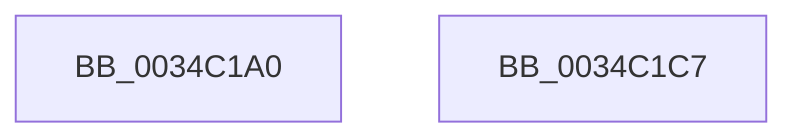

# SmPageRead

- RVA: `0x0034C1A0`–`0x0034C1C8` (길이 `40` bytes)
- VA: `0x000000014034C1A0`
- 실행 섹션: `.text`
- PDB 이름 있음: `예`; PDB Function 태그: `아니요`
- unwind 정보 RVA: `0x0005D2F4`
- 디코드: `11`개 명령, `40/40` bytes 표시
- 미해석 바이트: `0` (있으면 어셈블리에 `.byte`로 보존)

> 이 문서는 커널 이미지의 기계어와 PDB 기호를 분석해 생성했습니다. 4번과 5번은 함수 원형과 자료형을 바이너리 사용 방식에서 추정한 C 해석이며 원본 소스 복구 결과는 아닙니다.

## 1. Dependencies

- 직접 호출 지점: **1**; 고유 호출 대상: **1**
- 직접 호출자로 확인된 함수: **3**
- RIP 상대 이미지 참조: **0**

### Outgoing calls
- `0x0034C1BD` → [SMKM_STORE_MGR<SM_TRAITS>::SmPageRead](SMKM_STORE_MGR_SM_TRAITS_SmPageRead_function_0034C1D0.md) (function, `0x0034C1D0`)

### Direct callers
- [MiIssueHardFaultIo](../38/MiIssueHardFaultIo_function_003812EC.md) at `0x00381379`
- [MiReadPagefilePage](../66/MiReadPagefilePage_function_0066F78C.md) at `0x0066F97E`
- [MiPfExecuteReadList](../../page/93/MiPfExecuteReadList_function_0093E1AC.md) at `0x0093E337`

### Static image references
- 디코드된 RIP-relative 메모리 참조가 없습니다.

## 2. Other-region calls and transfers

- 다른 실행 섹션으로 향하는 call: **0**
- 별도 외부 분기/꼬리 이동을 확인하지 못했습니다.

## 3. Assembly (complete function range)

```asm
0034C1A0  48 83 EC 38                     sub rsp, 0x38
0034C1A4  8B 02                           mov eax, dword ptr [rdx]
0034C1A6  48 8D 54 24 40                  lea rdx, [rsp + 0x40]
0034C1AB  48 8B 49 18                     mov rcx, qword ptr [rcx + 0x18]
0034C1AF  89 44 24 40                     mov dword ptr [rsp + 0x40], eax
0034C1B3  48 8B 44 24 60                  mov rax, qword ptr [rsp + 0x60]
0034C1B8  48 89 44 24 20                  mov qword ptr [rsp + 0x20], rax
0034C1BD  E8 0E 00 00 00                  call 0x14034c1d0
0034C1C2  48 83 C4 38                     add rsp, 0x38
0034C1C6  C3                              ret
0034C1C7  CC                              int3
```

## 4. C-style interpretation (structured pseudocode)

```c
__int64 __fastcall SmPageRead(__int64 a1, __int64 a2, __int64 a3, __int64 a4, __int64 a5)
{
    __int64 result;
    __int64 v_rsp;
    unsigned __int64 v_stack_m18;
    unsigned __int64 v_stack_p8;

    v_rsp = (v_rsp) - (56);
    v_stack_p8 = (unsigned int)((unsigned int)(*(unsigned int *)(a2)));
    v_stack_m18 = a5;
    result = SMKM_STORE_MGR_SM_TRAITS___SmPageRead(*(unsigned __int64 *)(a1 + 24), v_stack_p8, a3, a4);
    v_rsp = (v_rsp) + (56);
    return result;
}
```

## 5. (Beta) C Style

```c
int64_t SmPageRead(void *Arg1, void *Arg2, int64_t Arg3, int64_t Arg4, int64_t Arg5)
{
    uint8_t *arg1 = (uint8_t *)Arg1;
    uint8_t *arg2 = (uint8_t *)Arg2;

    int64_t result;
    int64_t local_rsp;
    uint64_t v_stack_m18;
    uint64_t v_stack_p8;

    local_rsp = (local_rsp) - (56);
    v_stack_p8 = (uint32_t)((uint32_t)(*(uint32_t *)(arg2)));
    v_stack_m18 = Arg5;
    result = SMKM_STORE_MGR_SM_TRAITS___SmPageRead(*(uint64_t *)(arg1 + 0x18), v_stack_p8, Arg3, Arg4);
    local_rsp = (local_rsp) + (56);
    return result;
}
```

### 관측된 메모리 오프셋

구조체 형식이 확인되지 않은 접근은 인자 기준의 오프셋으로만 기록했습니다.

| 기준 인자 | 오프셋 표현 | 폭 (bit) | 접근 |
|---|---:|---:|---|
| `Arg1` | `+ 0x18` | `64` | `R` |
| `Arg2` | `+ 0x0` | `32` | `R` |

## 6. Execution-region graph

[열기: 2D/3D 그래프와 함수 탐색 컨트롤 패널](../../../control-panel.html?section=text&rva=0x0034C1A0&view=graph)

- 2D 그래프는 위에서 아래로 흐르고, 3D 그래프는 빈 공간을 드래그해 회전합니다. Shift+드래그는 이동, 휠은 확대·축소, 함수 노드 선택은 대상 보고서 이동입니다.

### Static fallback


