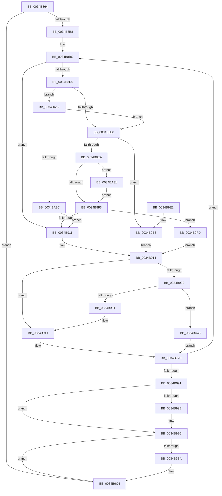

# SmPageWrite

- RVA: `0x0034B864`–`0x0034BA4D` (길이 `489` bytes)
- VA: `0x000000014034B864`
- 실행 섹션: `.text`
- PDB 이름 있음: `예`; PDB Function 태그: `아니요`
- unwind 정보 RVA: `0x00078608`
- 디코드: `125`개 명령, `489/489` bytes 표시
- 미해석 바이트: `0` (있으면 어셈블리에 `.byte`로 보존)

> 이 문서는 커널 이미지의 기계어와 PDB 기호를 분석해 생성했습니다. 4번과 5번은 함수 원형과 자료형을 바이너리 사용 방식에서 추정한 C 해석이며 원본 소스 복구 결과는 아닙니다.

## 1. Dependencies

- 직접 호출 지점: **5**; 고유 호출 대상: **4**
- 직접 호출자로 확인된 함수: **1**
- RIP 상대 이미지 참조: **1**

### Outgoing calls
- `0x0034B901` → [SmpKeyedStoreReference](SmpKeyedStoreReference_function_003499CC.md) (function, `0x003499CC`)
- `0x0034B978` → [SMKM_STORE_MGR<SM_TRAITS>::SmPageWrite](SMKM_STORE_MGR_SM_TRAITS_SmPageWrite_function_0034BA54.md) (function, `0x0034BA54`)
- `0x0034B9B0` → [SMKM_STORE_MGR<SM_TRAITS>::SmCompressCtxQueueEntries](../4A/SMKM_STORE_MGR_SM_TRAITS_SmCompressCtxQueueEntries_function_004A11CC.md) (function, `0x004A11CC`)
- `0x0034B9BF` → [SmKmStoreDereference](../20/SmKmStoreDereference_function_00206574.md) (function, `0x00206574`)
- `0x0034BA36` → [SmKmStoreDereference](../20/SmKmStoreDereference_function_00206574.md) (function, `0x00206574`)

### Direct callers
- [MiStoreWriteModifiedPages](../2B/MiStoreWriteModifiedPages_function_002B46C4.md) at `0x002B4C9E`

### Static image references
- `0x0034B8A5` → RVA `0x00FC5000` (`ALMOSTRO`; read)

## 2. Other-region calls and transfers

- 다른 실행 섹션으로 향하는 call: **0**
- 별도 외부 분기/꼬리 이동을 확인하지 못했습니다.

## 3. Assembly (complete function range)

```asm
0034B864  48 89 5C 24 10                  mov qword ptr [rsp + 0x10], rbx
0034B869  48 89 74 24 20                  mov qword ptr [rsp + 0x20], rsi
0034B86E  55                              push rbp
0034B86F  57                              push rdi
0034B870  41 54                           push r12
0034B872  41 56                           push r14
0034B874  41 57                           push r15
0034B876  48 8B EC                        mov rbp, rsp
0034B879  48 83 EC 60                     sub rsp, 0x60
0034B87D  83 65 F4 00                     and dword ptr [rbp - 0xc], 0
0034B881  48 8D 45 E0                     lea rax, [rbp - 0x20]
0034B885  48 8B 71 18                     mov rsi, qword ptr [rcx + 0x18]
0034B889  45 33 FF                        xor r15d, r15d
0034B88C  4C 21 7D E0                     and qword ptr [rbp - 0x20], r15
0034B890  41 83 CC FF                     or r12d, 0xffffffff
0034B894  45 8B F0                        mov r14d, r8d
0034B897  41 8B FC                        mov edi, r12d
0034B89A  49 C1 E6 06                     shl r14, 6
0034B89E  4C 03 F2                        add r14, rdx
0034B8A1  48 89 45 E8                     mov qword ptr [rbp - 0x18], rax
0034B8A5  0F B7 05 54 97 C7 00            movzx eax, word ptr [rip + 0xc79754]
0034B8AC  89 45 F0                        mov dword ptr [rbp - 0x10], eax
0034B8AF  49 3B D6                        cmp rdx, r14
0034B8B2  0F 83 0C 01 00 00               jae 0x14034b9c4
0034B8B8  48 8D 5A 10                     lea rbx, [rdx + 0x10]
0034B8BC  8B 43 F4                        mov eax, dword ptr [rbx - 0xc]
0034B8BF  89 45 40                        mov dword ptr [rbp + 0x40], eax
0034B8C2  48 8B 43 10                     mov rax, qword ptr [rbx + 0x10]
0034B8C6  48 89 45 30                     mov qword ptr [rbp + 0x30], rax
0034B8CA  8B 03                           mov eax, dword ptr [rbx]
0034B8CC  A8 03                           test al, 3
0034B8CE  75 41                           jne 0x14034b911
0034B8D0  F7 86 B0 08 00 00 00 08 00 00   test dword ptr [rsi + 0x8b0], 0x800
0034B8DA  0F 85 39 01 00 00               jne 0x14034ba19
0034B8E0  4C 3B 7B F8                     cmp r15, qword ptr [rbx - 8]
0034B8E4  0F 84 F9 00 00 00               je 0x14034b9e3
0034B8EA  41 3B FC                        cmp edi, r12d
0034B8ED  0F 85 3E 01 00 00               jne 0x14034ba31
0034B8F3  4C 8B 43 F8                     mov r8, qword ptr [rbx - 8]
0034B8F7  48 8D 8E B8 08 00 00            lea rcx, [rsi + 0x8b8]
0034B8FE  48 8B D6                        mov rdx, rsi
0034B901  E8 C6 E0 FF FF                  call 0x1403499cc
0034B906  8B F8                           mov edi, eax
0034B908  41 3B C4                        cmp eax, r12d
0034B90B  0F 85 EC 00 00 00               jne 0x14034b9fd
0034B911  8B 4D 30                        mov ecx, dword ptr [rbp + 0x30]
0034B914  8B C1                           mov eax, ecx
0034B916  25 FF 07 00 00                  and eax, 0x7ff
0034B91B  3D 00 04 00 00                  cmp eax, 0x400
0034B920  75 1F                           jne 0x14034b941
0034B922  8B 86 E0 08 00 00               mov eax, dword ptr [rsi + 0x8e0]
0034B928  41 3B C4                        cmp eax, r12d
0034B92B  0F 84 12 01 00 00               je 0x14034ba43
0034B931  25 FF 03 00 00                  and eax, 0x3ff
0034B936  81 E1 00 F8 FF FF               and ecx, 0xfffff800
0034B93C  0B C1                           or eax, ecx
0034B93E  89 45 30                        mov dword ptr [rbp + 0x30], eax
0034B941  48 8B 4B 20                     mov rcx, qword ptr [rbx + 0x20]
0034B945  48 8D 55 40                     lea rdx, [rbp + 0x40]
0034B949  4C 8B 4B 18                     mov r9, qword ptr [rbx + 0x18]
0034B94D  48 B8 FF FF FF FF FF FF FF 7F   movabs rax, 0x7fffffffffffffff
0034B957  4C 8B 45 30                     mov r8, qword ptr [rbp + 0x30]
0034B95B  48 23 C8                        and rcx, rax
0034B95E  48 8D 45 E0                     lea rax, [rbp - 0x20]
0034B962  48 89 44 24 30                  mov qword ptr [rsp + 0x30], rax
0034B967  48 8B 43 28                     mov rax, qword ptr [rbx + 0x28]
0034B96B  48 89 44 24 28                  mov qword ptr [rsp + 0x28], rax
0034B970  48 89 4C 24 20                  mov qword ptr [rsp + 0x20], rcx
0034B975  48 8B CE                        mov rcx, rsi
0034B978  E8 D7 00 00 00                  call 0x14034ba54
0034B97D  89 43 F0                        mov dword ptr [rbx - 0x10], eax
0034B980  48 83 C3 40                     add rbx, 0x40
0034B984  48 8D 43 F0                     lea rax, [rbx - 0x10]
0034B988  49 3B C6                        cmp rax, r14
0034B98B  0F 82 2B FF FF FF               jb 0x14034b8bc
0034B991  48 8D 45 E0                     lea rax, [rbp - 0x20]
0034B995  48 39 45 E8                     cmp qword ptr [rbp - 0x18], rax
0034B999  74 1A                           je 0x14034b9b5
0034B99B  8B 45 F0                        mov eax, dword ptr [rbp - 0x10]
0034B99E  48 8D 55 E0                     lea rdx, [rbp - 0x20]
0034B9A2  48 69 C8 B0 00 00 00            imul rcx, rax, 0xb0
0034B9A9  48 03 8E 00 05 00 00            add rcx, qword ptr [rsi + 0x500]
0034B9B0  E8 17 58 15 00                  call 0x1404a11cc
0034B9B5  41 3B FC                        cmp edi, r12d
0034B9B8  74 0A                           je 0x14034b9c4
0034B9BA  8B D7                           mov edx, edi
0034B9BC  48 8B CE                        mov rcx, rsi
0034B9BF  E8 B0 AB EB FF                  call 0x140206574
0034B9C4  4C 8D 5C 24 60                  lea r11, [rsp + 0x60]
0034B9C9  B8 03 01 00 00                  mov eax, 0x103
0034B9CE  49 8B 5B 38                     mov rbx, qword ptr [r11 + 0x38]
0034B9D2  49 8B 73 48                     mov rsi, qword ptr [r11 + 0x48]
0034B9D6  49 8B E3                        mov rsp, r11
0034B9D9  41 5F                           pop r15
0034B9DB  41 5E                           pop r14
0034B9DD  41 5C                           pop r12
0034B9DF  5F                              pop rdi
0034B9E0  5D                              pop rbp
0034B9E1  C3                              ret
0034B9E2  CC                              int3
0034B9E3  8B 4D 30                        mov ecx, dword ptr [rbp + 0x30]
0034B9E6  8B C7                           mov eax, edi
0034B9E8  81 E1 00 F8 FF FF               and ecx, 0xfffff800
0034B9EE  25 FF 03 00 00                  and eax, 0x3ff
0034B9F3  0B C8                           or ecx, eax
0034B9F5  89 4D 30                        mov dword ptr [rbp + 0x30], ecx
0034B9F8  E9 17 FF FF FF                  jmp 0x14034b914
0034B9FD  8B 4D 30                        mov ecx, dword ptr [rbp + 0x30]
0034BA00  25 FF 03 00 00                  and eax, 0x3ff
0034BA05  4C 8B 7B F8                     mov r15, qword ptr [rbx - 8]
0034BA09  81 E1 00 F8 FF FF               and ecx, 0xfffff800
0034BA0F  0B C8                           or ecx, eax
0034BA11  89 4D 30                        mov dword ptr [rbp + 0x30], ecx
0034BA14  E9 FB FE FF FF                  jmp 0x14034b914
0034BA19  48 B8 FF FF FE FF FF 7F 00 00   movabs rax, 0x7ffffffeffff
0034BA23  48 39 03                        cmp qword ptr [rbx], rax
0034BA26  0F 86 B4 FE FF FF               jbe 0x14034b8e0
0034BA2C  E9 E0 FE FF FF                  jmp 0x14034b911
0034BA31  8B D7                           mov edx, edi
0034BA33  48 8B CE                        mov rcx, rsi
0034BA36  E8 39 AB EB FF                  call 0x140206574
0034BA3B  45 33 FF                        xor r15d, r15d
0034BA3E  E9 B0 FE FF FF                  jmp 0x14034b8f3
0034BA43  B8 1B 02 00 C0                  mov eax, 0xc000021b
0034BA48  E9 30 FF FF FF                  jmp 0x14034b97d
```

## 4. C-style interpretation (structured pseudocode)

```c
__int64 __fastcall SmPageWrite(__int64 a1, __int64 a2, int a3)
{
    __int64 result;
    __int64 v_r12;
    __int64 v_r14;
    __int64 v_r15;
    __int64 v_rbx;
    __int64 v_rsp;
    unsigned __int64 v_stack_m28;
    unsigned int v_stack_m34;
    unsigned int v_stack_m38;
    unsigned __int64 v_stack_m40;
    unsigned __int64 v_stack_m48;
    unsigned __int64 v_stack_m58;
    unsigned __int64 v_stack_m60;
    unsigned __int64 v_stack_m68;
    unsigned __int64 v_stack_p10;
    unsigned int v_stack_p18;
    unsigned __int64 v_stack_p20;
    unsigned __int64 v_stack_p8;

    v_stack_p10 = v_rbx;
    v_stack_p20 = v_rsi;
    v_rsp = (v_rsp) - (96);
    v_r15 = 0;
    v_r12 = (unsigned int)((v_r12) | (0xFFFFFFFFULL));
    v_r14 = ((unsigned int)(a3)) << (6);
    v_r14 = (v_r14) + (a2);
    v_stack_m40 = v_stack_m48;
    v_stack_m38 = (unsigned int)(*(unsigned __int16 *)(v_rip + 13080404));
    if (a2 >= v_r14) goto loc_0034B9C4;
loc_0034B8BC:
    v_stack_p18 = (unsigned int)((unsigned int)(*(unsigned int *)(a2 + 16 - 12)));
    v_stack_p8 = *(unsigned __int64 *)(a2 + 16 + 16);
    if ((((unsigned __int8)((unsigned int)(*(unsigned int *)(a2 + 16)))) & (3)) != 0) goto loc_0034B911;
    if (((*(unsigned int *)(*(unsigned __int64 *)(a1 + 24) + 2224)) & (0x800ULL)) != 0) goto loc_0034BA19;
loc_0034B8E0:
    if (0 == (*(unsigned __int64 *)(a2 + 16 - 8))) goto loc_0034B9E3;
    if (((unsigned int)((unsigned int)((unsigned int)(v_r12)))) != ((unsigned int)(v_r12))) goto loc_0034BA31;
loc_0034B8F3:
    result = SmpKeyedStoreReference(*(unsigned __int64 *)(a1 + 24) + 2232, *(unsigned __int64 *)(a1 + 24), *(unsigned __int64 *)(a2 + 16 - 8), a4);
    if (((unsigned int)(result)) != ((unsigned int)(v_r12))) goto loc_0034B9FD;
loc_0034B911:
loc_0034B914:
    result = (unsigned int)(((unsigned int)((unsigned int)((unsigned int)(v_stack_p8)))) & (0x7FFULL));
    if (((unsigned int)(result)) != 0x400ULL) goto loc_0034B941;
    if (((unsigned int)((unsigned int)(*(unsigned int *)(*(unsigned __int64 *)(a1 + 24) + 2272)))) == ((unsigned int)(v_r12))) goto loc_0034BA43;
    result = (unsigned int)(((unsigned int)(*(unsigned int *)(*(unsigned __int64 *)(a1 + 24) + 2272))) & (0x3FFULL));
    a1 = (unsigned int)(((unsigned int)(v_stack_p8)) & (0xFFFFF800ULL));
    result = (unsigned int)((result) | ((unsigned int)(a1)));
    v_stack_p8 = (unsigned int)(result);
loc_0034B941:
    a1 = (*(unsigned __int64 *)(a2 + 16 + 32)) & (result);
    v_stack_m58 = v_stack_m48;
    v_stack_m60 = *(unsigned __int64 *)(a2 + 16 + 40);
    v_stack_m68 = a1;
    result = SMKM_STORE_MGR_SM_TRAITS___SmPageWrite(*(unsigned __int64 *)(a1 + 24), v_stack_p18, v_stack_p8, *(unsigned __int64 *)(a2 + 16 + 24));
loc_0034B97D:
    *(unsigned int *)(a2 + 16 - 16) = (unsigned int)(result);
    v_rbx = (a2 + 16) + (64);
    if ((v_rbx - 16) < v_r14) goto loc_0034B8BC;
    result = v_stack_m48;
    if (v_stack_m40 != v_stack_m48) {
        result = v_stack_m38;
        a2 = v_stack_m48;
        a1 = (*(unsigned __int64 *)(a1 + 24)) * (result);
        a1 = (a1) + (*(unsigned __int64 *)(*(unsigned __int64 *)(a1 + 24) + 1280));
        result = SMKM_STORE_MGR_SM_TRAITS___SmCompressCtxQueueEntries(a1, a2, v_stack_p8, *(unsigned __int64 *)(a2 + 16 + 24));
    }
    if (((unsigned int)((unsigned int)((unsigned int)(result)))) != ((unsigned int)(v_r12))) {
        a2 = (unsigned int)((unsigned int)((unsigned int)(result)));
        a1 = *(unsigned __int64 *)(a1 + 24);
        result = SmKmStoreDereference(a1, a2, v_stack_p8, *(unsigned __int64 *)(a2 + 16 + 24));
    }
    return 259;
loc_0034B9E3:
    a1 = (unsigned int)(((unsigned int)(v_stack_p8)) & (0xFFFFF800ULL));
    result = (unsigned int)(((unsigned int)((unsigned int)((unsigned int)((unsigned int)(result))))) & (0x3FFULL));
    a1 = (unsigned int)((a1) | ((unsigned int)(result)));
    v_stack_p8 = (unsigned int)(a1);
    goto loc_0034B914;
loc_0034B9FD:
    result = (unsigned int)((result) & (0x3FFULL));
    a1 = (unsigned int)(((unsigned int)(v_stack_p8)) & (0xFFFFF800ULL));
    a1 = (unsigned int)((a1) | ((unsigned int)(result)));
    v_stack_p8 = (unsigned int)(a1);
    goto loc_0034B914;
loc_0034BA19:
    if ((*(unsigned __int64 *)(*(unsigned __int64 *)(v_stack_m28 + 56))) <= result) goto loc_0034B8E0;
    goto loc_0034B911;
loc_0034BA31:
    result = SmKmStoreDereference(*(unsigned __int64 *)(v_stack_m28 + 72), (unsigned int)((unsigned int)((unsigned int)((unsigned int)(result)))), v_stack_p8, *(unsigned __int64 *)(a2 + 16 + 24));
    v_r15 = 0;
    goto loc_0034B8F3;
loc_0034BA43:
    goto loc_0034B97D;
}
```

## 5. (Beta) C Style

```c
int64_t SmPageWrite(void *Arg1, int64_t Arg2, int32_t Arg3)
{
    uint8_t *arg1 = (uint8_t *)Arg1;

    int64_t result;
    int64_t local_r12;
    int64_t local_r14;
    int64_t local_r15;
    int64_t local_rbx;
    int64_t local_rsp;
    uint64_t v_stack_m28;
    uint32_t v_stack_m34;
    uint32_t v_stack_m38;
    uint64_t v_stack_m40;
    uint64_t v_stack_m48;
    uint64_t v_stack_m58;
    uint64_t v_stack_m60;
    uint64_t v_stack_m68;
    uint64_t v_stack_p10;
    uint32_t v_stack_p18;
    uint64_t v_stack_p20;
    uint64_t v_stack_p8;

    v_stack_p10 = local_rbx;
    v_stack_p20 = local_rsi;
    local_rsp = (local_rsp) - (96);
    local_r15 = 0;
    local_r12 = (uint32_t)((local_r12) | (0xFFFFFFFFULL));
    local_r14 = ((uint32_t)(Arg3)) << (6);
    local_r14 = (local_r14) + (Arg2);
    v_stack_m40 = v_stack_m48;
    v_stack_m38 = (uint32_t)(*(uint16_t *)(v_rip + 0xC79754));
    if (Arg2 >= local_r14) goto loc_0034B9C4;
loc_0034B8BC:
    v_stack_p18 = (uint32_t)((uint32_t)(*(uint32_t *)(Arg2 + 0x10 - 0xC)));
    v_stack_p8 = *(uint64_t *)(Arg2 + 0x10 + 0x10);
    if ((((uint8_t)((uint32_t)(*(uint32_t *)(Arg2 + 0x10)))) & (3)) != 0) goto loc_0034B911;
    if (((*(uint32_t *)(*(uint64_t *)(arg1 + 0x18) + 0x8B0)) & (0x800ULL)) != 0) goto loc_0034BA19;
loc_0034B8E0:
    if (0 == (*(uint64_t *)(Arg2 + 0x10 - 0x8))) goto loc_0034B9E3;
    if (((uint32_t)((uint32_t)((uint32_t)(local_r12)))) != ((uint32_t)(local_r12))) goto loc_0034BA31;
loc_0034B8F3:
    result = SmpKeyedStoreReference(*(uint64_t *)(arg1 + 0x18) + 2232, *(uint64_t *)(arg1 + 0x18), *(uint64_t *)(Arg2 + 0x10 - 0x8), a4);
    if (((uint32_t)(result)) != ((uint32_t)(local_r12))) goto loc_0034B9FD;
loc_0034B911:
loc_0034B914:
    result = (uint32_t)(((uint32_t)((uint32_t)((uint32_t)(v_stack_p8)))) & (0x7FFULL));
    if (((uint32_t)(result)) != 0x400ULL) goto loc_0034B941;
    if (((uint32_t)((uint32_t)(*(uint32_t *)(*(uint64_t *)(arg1 + 0x18) + 0x8E0)))) == ((uint32_t)(local_r12))) goto loc_0034BA43;
    result = (uint32_t)(((uint32_t)(*(uint32_t *)(*(uint64_t *)(arg1 + 0x18) + 0x8E0))) & (0x3FFULL));
    Arg1 = (uint32_t)(((uint32_t)(v_stack_p8)) & (0xFFFFF800ULL));
    result = (uint32_t)((result) | ((uint32_t)(Arg1)));
    v_stack_p8 = (uint32_t)(result);
loc_0034B941:
    Arg1 = (*(uint64_t *)(Arg2 + 0x10 + 0x20)) & (result);
    v_stack_m58 = v_stack_m48;
    v_stack_m60 = *(uint64_t *)(Arg2 + 0x10 + 0x28);
    v_stack_m68 = Arg1;
    result = SMKM_STORE_MGR_SM_TRAITS___SmPageWrite(*(uint64_t *)(arg1 + 0x18), v_stack_p18, v_stack_p8, *(uint64_t *)(Arg2 + 0x10 + 0x18));
loc_0034B97D:
    *(uint32_t *)(Arg2 + 0x10 - 0x10) = (uint32_t)(result);
    local_rbx = (Arg2 + 16) + (64);
    if ((local_rbx - 16) < local_r14) goto loc_0034B8BC;
    result = v_stack_m48;
    if (v_stack_m40 != v_stack_m48) {
        result = v_stack_m38;
        Arg2 = v_stack_m48;
        Arg1 = (*(uint64_t *)(arg1 + 0x18)) * (result);
        Arg1 = (Arg1) + (*(uint64_t *)(*(uint64_t *)(arg1 + 0x18) + 0x500));
        result = SMKM_STORE_MGR_SM_TRAITS___SmCompressCtxQueueEntries(Arg1, Arg2, v_stack_p8, *(uint64_t *)(Arg2 + 0x10 + 0x18));
    }
    if (((uint32_t)((uint32_t)((uint32_t)(result)))) != ((uint32_t)(local_r12))) {
        Arg2 = (uint32_t)((uint32_t)((uint32_t)(result)));
        Arg1 = *(uint64_t *)(arg1 + 0x18);
        result = SmKmStoreDereference(Arg1, Arg2, v_stack_p8, *(uint64_t *)(Arg2 + 0x10 + 0x18));
    }
    return 259;
loc_0034B9E3:
    Arg1 = (uint32_t)(((uint32_t)(v_stack_p8)) & (0xFFFFF800ULL));
    result = (uint32_t)(((uint32_t)((uint32_t)((uint32_t)((uint32_t)(result))))) & (0x3FFULL));
    Arg1 = (uint32_t)((Arg1) | ((uint32_t)(result)));
    v_stack_p8 = (uint32_t)(Arg1);
    goto loc_0034B914;
loc_0034B9FD:
    result = (uint32_t)((result) & (0x3FFULL));
    Arg1 = (uint32_t)(((uint32_t)(v_stack_p8)) & (0xFFFFF800ULL));
    Arg1 = (uint32_t)((Arg1) | ((uint32_t)(result)));
    v_stack_p8 = (uint32_t)(Arg1);
    goto loc_0034B914;
loc_0034BA19:
    if ((*(uint64_t *)(*(uint64_t *)(v_stack_m28 + 0x38))) <= result) goto loc_0034B8E0;
    goto loc_0034B911;
loc_0034BA31:
    result = SmKmStoreDereference(*(uint64_t *)(v_stack_m28 + 0x48), (uint32_t)((uint32_t)((uint32_t)((uint32_t)(result)))), v_stack_p8, *(uint64_t *)(Arg2 + 0x10 + 0x18));
    local_r15 = 0;
    goto loc_0034B8F3;
loc_0034BA43:
    goto loc_0034B97D;
}
```

### 관측된 메모리 오프셋

구조체 형식이 확인되지 않은 접근은 인자 기준의 오프셋으로만 기록했습니다.

| 기준 인자 | 오프셋 표현 | 폭 (bit) | 접근 |
|---|---:|---:|---|
| `Arg1` | `+ 0x18` | `64` | `R` |

## 6. Execution-region graph

[열기: 2D/3D 그래프와 함수 탐색 컨트롤 패널](../../../control-panel.html?section=text&rva=0x0034B864&view=graph)

- 2D 그래프는 위에서 아래로 흐르고, 3D 그래프는 빈 공간을 드래그해 회전합니다. Shift+드래그는 이동, 휠은 확대·축소, 함수 노드 선택은 대상 보고서 이동입니다.

### Static fallback


