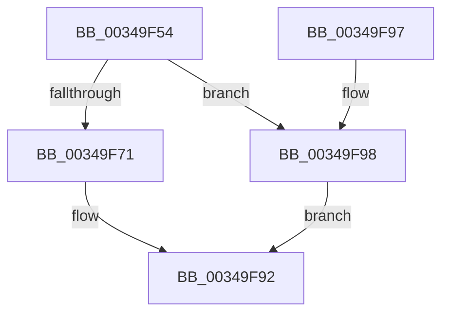

# SmStoreExistsForProcess

- RVA: `0x00349F54`–`0x00349F9C` (길이 `72` bytes)
- VA: `0x0000000140349F54`
- 실행 섹션: `.text`
- PDB 이름 있음: `예`; PDB Function 태그: `아니요`
- unwind 정보 RVA: `0x00069B1C`
- 디코드: `20`개 명령, `72/72` bytes 표시
- 미해석 바이트: `0` (있으면 어셈블리에 `.byte`로 보존)

> 이 문서는 커널 이미지의 기계어와 PDB 기호를 분석해 생성했습니다. 4번과 5번은 함수 원형과 자료형을 바이너리 사용 방식에서 추정한 C 해석이며 원본 소스 복구 결과는 아닙니다.

## 1. Dependencies

- 직접 호출 지점: **1**; 고유 호출 대상: **1**
- 직접 호출자로 확인된 함수: **5**
- RIP 상대 이미지 참조: **0**

### Outgoing calls
- `0x00349F83` → [SmpKeyedStoreEntryGet](SmpKeyedStoreEntryGet_function_00349FB0.md) (function, `0x00349FB0`)

### Direct callers
- [MmOutSwapWorkingSet](../2A/MmOutSwapWorkingSet_function_002A6BC8.md) at `0x002A6C72`
- [MiReleaseOutSwappedProcessCommit](../3C/MiReleaseOutSwappedProcessCommit_function_003C8320.md) at `0x003C8436`
- [SmProcessProcessStoreInfoRequest](../../page/7A/SmProcessProcessStoreInfoRequest_function_007A6B48.md) at `0x007A6C39`
- [VmpPauseResumeNotify](../../page/7A/VmpPauseResumeNotify_function_007ADA08.md) at `0x007ADB5A`
- [PfpPrivSourceEnum](../../page/91/PfpPrivSourceEnum_function_0091BF00.md) at `0x0091C2D7`

### Static image references
- 디코드된 RIP-relative 메모리 참조가 없습니다.

## 2. Other-region calls and transfers

- 다른 실행 섹션으로 향하는 call: **0**
- 별도 외부 분기/꼬리 이동을 확인하지 못했습니다.

## 3. Assembly (complete function range)

```asm
00349F54  48 83 EC 28                     sub rsp, 0x28
00349F58  48 8B 81 58 07 00 00            mov rax, qword ptr [rcx + 0x758]
00349F5F  48 89 4C 24 30                  mov qword ptr [rsp + 0x30], rcx
00349F64  48 8B 50 18                     mov rdx, qword ptr [rax + 0x18]
00349F68  48 3B 8A 78 08 00 00            cmp rcx, qword ptr [rdx + 0x878]
00349F6F  74 27                           je 0x140349f98
00349F71  48 8D 8A B8 08 00 00            lea rcx, [rdx + 0x8b8]
00349F78  45 33 C9                        xor r9d, r9d
00349F7B  48 8D 54 24 30                  lea rdx, [rsp + 0x30]
00349F80  45 33 C0                        xor r8d, r8d
00349F83  E8 28 00 00 00                  call 0x140349fb0
00349F88  33 C9                           xor ecx, ecx
00349F8A  48 85 C0                        test rax, rax
00349F8D  0F 95 C1                        setne cl
00349F90  8B C1                           mov eax, ecx
00349F92  48 83 C4 28                     add rsp, 0x28
00349F96  C3                              ret
00349F97  CC                              int3
00349F98  33 C0                           xor eax, eax
00349F9A  EB F6                           jmp 0x140349f92
```

## 4. C-style interpretation (structured pseudocode)

```c
__int64 __fastcall SmStoreExistsForProcess(__int64 a1, __int64 a2, int a3, int a4)
{
    __int64 result;
    __int64 v_rsp;
    unsigned __int64 v_stack_p8;

    v_rsp = (v_rsp) - (40);
    v_stack_p8 = a1;
    if (a1 == (*(unsigned __int64 *)(*(unsigned __int64 *)(*(unsigned __int64 *)(a1 + 1880) + 24) + 2168))) goto loc_00349F98;
    a4 = 0;
    a3 = 0;
    result = SmpKeyedStoreEntryGet(*(unsigned __int64 *)(*(unsigned __int64 *)(a1 + 1880) + 24) + 2232, v_stack_p8, a3, a4);
    a1 = 0;
    a1 = (result != 0) ? 1 : 0;
loc_00349F92:
    v_rsp = (v_rsp) + (40);
    return (unsigned int)((unsigned int)(a1));
loc_00349F98:
    result = 0;
    goto loc_00349F92;
}
```

## 5. (Beta) C Style

```c
int64_t SmStoreExistsForProcess(void *Arg1, int64_t Arg2, int32_t Arg3, int32_t Arg4)
{
    uint8_t *arg1 = (uint8_t *)Arg1;

    int64_t result;
    int64_t local_rsp;
    uint64_t v_stack_p8;

    local_rsp = (local_rsp) - (40);
    v_stack_p8 = Arg1;
    if (Arg1 == (*(uint64_t *)(*(uint64_t *)(*(uint64_t *)(arg1 + 0x758) + 0x18) + 0x878))) goto loc_00349F98;
    Arg4 = 0;
    Arg3 = 0;
    result = SmpKeyedStoreEntryGet(*(uint64_t *)(*(uint64_t *)(arg1 + 0x758) + 0x18) + 2232, v_stack_p8, Arg3, Arg4);
    Arg1 = 0;
    Arg1 = (result != 0) ? 1 : 0;
loc_00349F92:
    local_rsp = (local_rsp) + (40);
    return (uint32_t)((uint32_t)(Arg1));
loc_00349F98:
    result = 0;
    goto loc_00349F92;
}
```

### 관측된 메모리 오프셋

구조체 형식이 확인되지 않은 접근은 인자 기준의 오프셋으로만 기록했습니다.

| 기준 인자 | 오프셋 표현 | 폭 (bit) | 접근 |
|---|---:|---:|---|
| `Arg1` | `+ 0x758` | `64` | `R` |

## 6. Execution-region graph

[열기: 2D/3D 그래프와 함수 탐색 컨트롤 패널](../../../control-panel.html?section=text&rva=0x00349F54&view=graph)

- 2D 그래프는 위에서 아래로 흐르고, 3D 그래프는 빈 공간을 드래그해 회전합니다. Shift+드래그는 이동, 휠은 확대·축소, 함수 노드 선택은 대상 보고서 이동입니다.

### Static fallback


