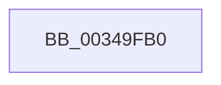

# SmpKeyedStoreEntryGet

- RVA: `0x00349FB0`–`0x00349FC2` (길이 `18` bytes)
- VA: `0x0000000140349FB0`
- 실행 섹션: `.text`
- PDB 이름 있음: `예`; PDB Function 태그: `아니요`
- unwind 정보 RVA: `0x00078420`
- 디코드: `7`개 명령, `18/18` bytes 표시
- 미해석 바이트: `0` (있으면 어셈블리에 `.byte`로 보존)

> 이 문서는 커널 이미지의 기계어와 PDB 기호를 분석해 생성했습니다. 4번과 5번은 함수 원형과 자료형을 바이너리 사용 방식에서 추정한 C 해석이며 원본 소스 복구 결과는 아닙니다.

## 1. Dependencies

- 직접 호출 지점: **0**; 고유 호출 대상: **0**
- 직접 호출자로 확인된 함수: **10**
- RIP 상대 이미지 참조: **0**

### Outgoing calls
- 직접 디코드된 call 명령이 없습니다.

### Direct callers
- [SmpKeyedStoreReference](SmpKeyedStoreReference_function_003499CC.md) at `0x00349A42`
- [SmpProcessQueryStoreStats](SmpProcessQueryStoreStats_function_00349D6C.md) at `0x00349DAB`
- [SmStoreExistsForProcess](SmStoreExistsForProcess_function_00349F54.md) at `0x00349F83`
- [SmGetStoreOwnerProcessId](../61/SmGetStoreOwnerProcessId_function_00610E4C.md) at `0x00610F17`
- [SmpKeyedStoreCreate](../../page/A5/SmpKeyedStoreCreate_function_00A50B64.md) at `0x00A50C3B`
- [SmStoreCompressionStop](../../page/A6/SmStoreCompressionStop_function_00A6197C.md) at `0x00A619D3`
- [SmStoreCompressionStart](../../page/A6/SmStoreCompressionStart_function_00A61AD0.md) at `0x00A61B11`
- [SmSwapStore](../../page/A6/SmSwapStore_function_00A61D14.md) at `0x00A61D4B`
- [SmProcessDeleteNotification](../../page/A6/SmProcessDeleteNotification_function_00A686F4.md) at `0x00A6872A`
- [sub_00B41A62](../../page/B4/Unknown_function_00B41A62.md) at `0x00B41A86`

### Static image references
- 디코드된 RIP-relative 메모리 참조가 없습니다.

## 2. Other-region calls and transfers

- 다른 실행 섹션으로 향하는 call: **0**
- 별도 외부 분기/꼬리 이동을 확인하지 못했습니다.

## 3. Assembly (complete function range)

```asm
00349FB0  48 8B C4                        mov rax, rsp
00349FB3  53                              push rbx
00349FB4  56                              push rsi
00349FB5  41 55                           push r13
00349FB7  41 56                           push r14
00349FB9  41 57                           push r15
00349FBB  48 81 EC 80 00 00 00            sub rsp, 0x80
```

## 4. C-style interpretation (structured pseudocode)

```c
__int64 __fastcall SmpKeyedStoreEntryGet(void)
{
    __int64 v_rsp;

    v_rsp = (v_rsp) - (128);
    return v_rsp;
}
```

## 5. (Beta) C Style

```c
void SmpKeyedStoreEntryGet(void)
{
    int64_t local_rsp;

    local_rsp = (local_rsp) - (128);
    return local_rsp;
}
```

## 6. Execution-region graph

[열기: 2D/3D 그래프와 함수 탐색 컨트롤 패널](../../../control-panel.html?section=text&rva=0x00349FB0&view=graph)

- 2D 그래프는 위에서 아래로 흐르고, 3D 그래프는 빈 공간을 드래그해 회전합니다. Shift+드래그는 이동, 휠은 확대·축소, 함수 노드 선택은 대상 보고서 이동입니다.

### Static fallback


