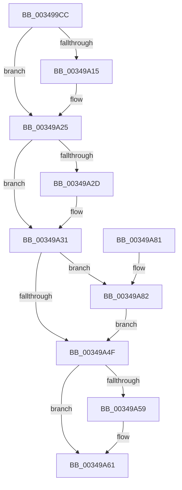

# SmpKeyedStoreReference

- RVA: `0x003499CC`–`0x00349A94` (길이 `200` bytes)
- VA: `0x00000001403499CC`
- 실행 섹션: `.text`
- PDB 이름 있음: `예`; PDB Function 태그: `아니요`
- unwind 정보 RVA: `0x000783C0`
- 디코드: `62`개 명령, `200/200` bytes 표시
- 미해석 바이트: `0` (있으면 어셈블리에 `.byte`로 보존)

> 이 문서는 커널 이미지의 기계어와 PDB 기호를 분석해 생성했습니다. 4번과 5번은 함수 원형과 자료형을 바이너리 사용 방식에서 추정한 C 해석이며 원본 소스 복구 결과는 아닙니다.

## 1. Dependencies

- 직접 호출 지점: **7**; 고유 호출 대상: **7**
- 직접 호출자로 확인된 함수: **1**
- RIP 상대 이미지 참조: **0**

### Outgoing calls
- `0x00349A00` → [KeAbPreAcquire](../21/KeAbPreAcquire_function_00210230.md) (function, `0x00210230`)
- `0x00349A20` → [ExfAcquirePushLockSharedEx](../21/ExfAcquirePushLockSharedEx_function_0021044C.md) (function, `0x0021044C`)
- `0x00349A42` → [SmpKeyedStoreEntryGet](SmpKeyedStoreEntryGet_function_00349FB0.md) (function, `0x00349FB0`)
- `0x00349A5C` → [ExfReleasePushLockShared](../26/ExfReleasePushLockShared_function_00263440.md) (function, `0x00263440`)
- `0x00349A64` → [KeAbPostRelease](../2E/KeAbPostRelease_function_002E1600.md) (function, `0x002E1600`)
- `0x00349A69` → [KeLeaveCriticalRegion](../25/KeLeaveCriticalRegion_function_0025D8B0.md) (function, `0x0025D8B0`)
- `0x00349A89` → [SmKmStoreReference](SmKmStoreReference_function_0034BFB0.md) (function, `0x0034BFB0`)

### Direct callers
- [SmPageWrite](SmPageWrite_function_0034B864.md) at `0x0034B901`

### Static image references
- 디코드된 RIP-relative 메모리 참조가 없습니다.

## 2. Other-region calls and transfers

- 다른 실행 섹션으로 향하는 call: **0**
- 별도 외부 분기/꼬리 이동을 확인하지 못했습니다.

## 3. Assembly (complete function range)

```asm
003499CC  48 89 5C 24 10                  mov qword ptr [rsp + 0x10], rbx
003499D1  4C 89 44 24 18                  mov qword ptr [rsp + 0x18], r8
003499D6  55                              push rbp
003499D7  56                              push rsi
003499D8  57                              push rdi
003499D9  41 56                           push r14
003499DB  41 57                           push r15
003499DD  48 83 EC 20                     sub rsp, 0x20
003499E1  65 48 8B 04 25 88 01 00 00      mov rax, qword ptr gs:[0x188]
003499EA  48 8B EA                        mov rbp, rdx
003499ED  45 33 C0                        xor r8d, r8d
003499F0  33 D2                           xor edx, edx
003499F2  48 8B D9                        mov rbx, rcx
003499F5  83 CE FF                        or esi, 0xffffffff
003499F8  66 FF 88 E4 01 00 00            dec word ptr [rax + 0x1e4]
003499FF  90                              nop
00349A00  E8 2B 68 EC FF                  call 0x140210230
00349A05  48 8B F8                        mov rdi, rax
00349A08  33 C0                           xor eax, eax
00349A0A  44 8D 78 11                     lea r15d, [rax + 0x11]
00349A0E  F0 4C 0F B1 3B                  lock cmpxchg qword ptr [rbx], r15
00349A13  74 10                           je 0x140349a25
00349A15  4C 8B CB                        mov r9, rbx
00349A18  4C 8B C7                        mov r8, rdi
00349A1B  33 D2                           xor edx, edx
00349A1D  48 8B CB                        mov rcx, rbx
00349A20  E8 27 6A EC FF                  call 0x14021044c
00349A25  45 33 F6                        xor r14d, r14d
00349A28  48 85 FF                        test rdi, rdi
00349A2B  74 04                           je 0x140349a31
00349A2D  C6 47 0A 01                     mov byte ptr [rdi + 0xa], 1
00349A31  41 B9 01 00 00 00               mov r9d, 1
00349A37  48 8D 54 24 60                  lea rdx, [rsp + 0x60]
00349A3C  45 33 C0                        xor r8d, r8d
00349A3F  48 8B CB                        mov rcx, rbx
00349A42  E8 69 05 00 00                  call 0x140349fb0
00349A47  48 8B F8                        mov rdi, rax
00349A4A  48 85 C0                        test rax, rax
00349A4D  75 33                           jne 0x140349a82
00349A4F  49 8B C7                        mov rax, r15
00349A52  F0 4C 0F B1 33                  lock cmpxchg qword ptr [rbx], r14
00349A57  74 08                           je 0x140349a61
00349A59  48 8B CB                        mov rcx, rbx
00349A5C  E8 DF 99 F1 FF                  call 0x140263440
00349A61  48 8B CB                        mov rcx, rbx
00349A64  E8 97 7B F9 FF                  call 0x1402e1600
00349A69  E8 42 3E F1 FF                  call 0x14025d8b0
00349A6E  48 8B 5C 24 58                  mov rbx, qword ptr [rsp + 0x58]
00349A73  8B C6                           mov eax, esi
00349A75  48 83 C4 20                     add rsp, 0x20
00349A79  41 5F                           pop r15
00349A7B  41 5E                           pop r14
00349A7D  5F                              pop rdi
00349A7E  5E                              pop rsi
00349A7F  5D                              pop rbp
00349A80  C3                              ret
00349A81  CC                              int3
00349A82  0F B7 50 10                     movzx edx, word ptr [rax + 0x10]
00349A86  48 8B CD                        mov rcx, rbp
00349A89  E8 22 25 00 00                  call 0x14034bfb0
00349A8E  0F B7 77 10                     movzx esi, word ptr [rdi + 0x10]
00349A92  EB BB                           jmp 0x140349a4f
```

## 4. C-style interpretation (structured pseudocode)

```c
__int64 __fastcall SmpKeyedStoreReference(__int64 a1, __int64 a2, __int64 a3)
{
    __int64 result;
    __int64 v_r14;
    __int64 v_rsi;
    __int64 v_rsp;
    unsigned __int64 v_stack_p10;
    unsigned __int64 v_stack_p18;

    v_stack_p10 = v_rbx;
    v_stack_p18 = a3;
    v_rsp = (v_rsp) - (32);
    a3 = 0;
    a2 = 0;
    v_rsi = (unsigned int)((v_rsi) | (0xFFFFFFFFULL));
    result = KeAbPreAcquire(a1, a2, a3, a4);
    result = 0;
    if (!(condition_is_equal)) {
        a4 = a1;
        a3 = 0;
        a2 = 0;
        a1 = a1;
        result = ExfAcquirePushLockSharedEx(a1, a2, a3, a4);
    }
    v_r14 = 0;
    if (result != 0) {
        *(unsigned __int8 *)(result + 10) = 1;
    }
    a3 = 0;
    result = SmpKeyedStoreEntryGet(a1, v_stack_p18, a3, 1);
    if (result != 0) goto loc_00349A82;
loc_00349A4F:
    result = result + 17;
    if (result != 0) {
        a1 = a1;
        result = ExfReleasePushLockShared(a1, v_stack_p18, a3, 1);
    }
    result = KeAbPostRelease(a1, v_stack_p18, a3, 1);
    result = KeLeaveCriticalRegion(a1, v_stack_p18, a3, 1);
    v_rsp = (v_rsp) + (32);
    return (unsigned int)((unsigned int)(v_rsi));
loc_00349A82:
    result = SmKmStoreReference(0, *(unsigned __int16 *)((unsigned int)((unsigned int)(v_rsi)) + 16), a3, 1);
    goto loc_00349A4F;
}
```

## 5. (Beta) C Style

```c
int64_t SmpKeyedStoreReference(void *Arg1, int64_t Arg2, int64_t Arg3)
{
    uint8_t *arg1 = (uint8_t *)Arg1;

    int64_t result;
    int64_t local_r14;
    int64_t local_rsi;
    int64_t local_rsp;
    uint64_t v_stack_p10;
    uint64_t v_stack_p18;

    v_stack_p10 = local_rbx;
    v_stack_p18 = Arg3;
    local_rsp = (local_rsp) - (32);
    Arg3 = 0;
    Arg2 = 0;
    local_rsi = (uint32_t)((local_rsi) | (0xFFFFFFFFULL));
    result = KeAbPreAcquire(Arg1, Arg2, Arg3, a4);
    result = 0;
    if (!(condition_is_equal)) {
        a4 = Arg1;
        Arg3 = 0;
        Arg2 = 0;
        Arg1 = Arg1;
        result = ExfAcquirePushLockSharedEx(Arg1, Arg2, Arg3, a4);
    }
    local_r14 = 0;
    if (result != 0) {
        *(uint8_t *)(result + 0xA) = 1;
    }
    Arg3 = 0;
    result = SmpKeyedStoreEntryGet(Arg1, v_stack_p18, Arg3, 1);
    if (result != 0) goto loc_00349A82;
loc_00349A4F:
    result = result + 17;
    if (result != 0) {
        Arg1 = Arg1;
        result = ExfReleasePushLockShared(Arg1, v_stack_p18, Arg3, 1);
    }
    result = KeAbPostRelease(Arg1, v_stack_p18, Arg3, 1);
    result = KeLeaveCriticalRegion(Arg1, v_stack_p18, Arg3, 1);
    local_rsp = (local_rsp) + (32);
    return (uint32_t)((uint32_t)(local_rsi));
loc_00349A82:
    result = SmKmStoreReference(0, *(uint16_t *)((uint32_t)((uint32_t)(local_rsi)) + 0x10), Arg3, 1);
    goto loc_00349A4F;
}
```

### 관측된 메모리 오프셋

구조체 형식이 확인되지 않은 접근은 인자 기준의 오프셋으로만 기록했습니다.

| 기준 인자 | 오프셋 표현 | 폭 (bit) | 접근 |
|---|---:|---:|---|
| `Arg1` | `+ 0x0` | `64` | `R` |

## 6. Execution-region graph

[열기: 2D/3D 그래프와 함수 탐색 컨트롤 패널](../../../control-panel.html?section=text&rva=0x003499CC&view=graph)

- 2D 그래프는 위에서 아래로 흐르고, 3D 그래프는 빈 공간을 드래그해 회전합니다. Shift+드래그는 이동, 휠은 확대·축소, 함수 노드 선택은 대상 보고서 이동입니다.

### Static fallback


