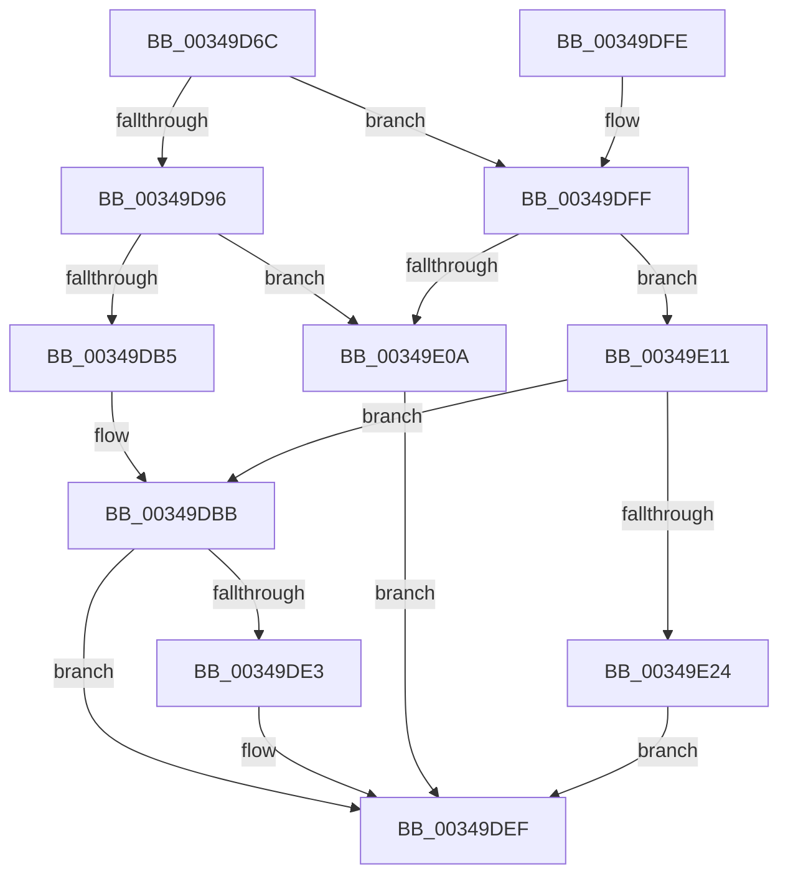

# SmpProcessQueryStoreStats

- RVA: `0x00349D6C`–`0x00349E2B` (길이 `191` bytes)
- VA: `0x0000000140349D6C`
- 실행 섹션: `.text`
- PDB 이름 있음: `예`; PDB Function 태그: `아니요`
- unwind 정보 RVA: `0x00078400`
- 디코드: `55`개 명령, `191/191` bytes 표시
- 미해석 바이트: `0` (있으면 어셈블리에 `.byte`로 보존)

> 이 문서는 커널 이미지의 기계어와 PDB 기호를 분석해 생성했습니다. 4번과 5번은 함수 원형과 자료형을 바이너리 사용 방식에서 추정한 C 해석이며 원본 소스 복구 결과는 아닙니다.

## 1. Dependencies

- 직접 호출 지점: **5**; 고유 호출 대상: **5**
- 직접 호출자로 확인된 함수: **3**
- RIP 상대 이미지 참조: **0**

### Outgoing calls
- `0x00349DAB` → [SmpKeyedStoreEntryGet](SmpKeyedStoreEntryGet_function_00349FB0.md) (function, `0x00349FB0`)
- `0x00349DC0` → [SmKmStoreGet](SmKmStoreGet_function_00349F24.md) (function, `0x00349F24`)
- `0x00349DD8` → [SMKM_STORE<SM_TRAITS>::SmStGetStoreStats](SMKM_STORE_SM_TRAITS_SmStGetStoreStats_function_00349F0C.md) (function, `0x00349F0C`)
- `0x00349DEA` → [ExReleaseRundownProtection](ExReleaseRundownProtection_function_00349E80.md) (function, `0x00349E80`)
- `0x00349E18` → [ExAcquireRundownProtection](../21/ExAcquireRundownProtection_function_00216620.md) (function, `0x00216620`)

### Direct callers
- [SmQueryStoreCommitUsage](../60/SmQueryStoreCommitUsage_function_0060EA80.md) at `0x0060EABF`
- [EtwpLogMemInfoWs](../../page/91/EtwpLogMemInfoWs_function_0091C594.md) at `0x0091C7B9`
- [SmProcessQueryStoreStats](../../page/91/SmProcessQueryStoreStats_function_0091D324.md) at `0x0091D364`

### Static image references
- 디코드된 RIP-relative 메모리 참조가 없습니다.

## 2. Other-region calls and transfers

- 다른 실행 섹션으로 향하는 call: **0**
- 별도 외부 분기/꼬리 이동을 확인하지 못했습니다.

## 3. Assembly (complete function range)

```asm
00349D6C  4C 8B DC                        mov r11, rsp
00349D6F  49 89 5B 10                     mov qword ptr [r11 + 0x10], rbx
00349D73  55                              push rbp
00349D74  56                              push rsi
00349D75  57                              push rdi
00349D76  48 83 EC 20                     sub rsp, 0x20
00349D7A  49 83 63 18 00                  and qword ptr [r11 + 0x18], 0
00349D7F  48 8B EA                        mov rbp, rdx
00349D82  48 8B 81 58 07 00 00            mov rax, qword ptr [rcx + 0x758]
00349D89  48 8B 78 18                     mov rdi, qword ptr [rax + 0x18]
00349D8D  48 3B 8F 78 08 00 00            cmp rcx, qword ptr [rdi + 0x878]
00349D94  74 69                           je 0x140349dff
00349D96  49 89 4B 18                     mov qword ptr [r11 + 0x18], rcx
00349D9A  49 8D 53 18                     lea rdx, [r11 + 0x18]
00349D9E  48 8D 8F B8 08 00 00            lea rcx, [rdi + 0x8b8]
00349DA5  45 33 C9                        xor r9d, r9d
00349DA8  45 33 C0                        xor r8d, r8d
00349DAB  E8 00 02 00 00                  call 0x140349fb0
00349DB0  48 85 C0                        test rax, rax
00349DB3  74 55                           je 0x140349e0a
00349DB5  0F B7 58 10                     movzx ebx, word ptr [rax + 0x10]
00349DB9  33 F6                           xor esi, esi
00349DBB  8B D3                           mov edx, ebx
00349DBD  48 8B CF                        mov rcx, rdi
00349DC0  E8 5F 01 00 00                  call 0x140349f24
00349DC5  4C 8B C5                        mov r8, rbp
00349DC8  C7 44 24 40 00 06 00 00         mov dword ptr [rsp + 0x40], 0x600
00349DD0  48 8B C8                        mov rcx, rax
00349DD3  4C 8D 4C 24 40                  lea r9, [rsp + 0x40]
00349DD8  E8 2F 01 00 00                  call 0x140349f0c
00349DDD  8B D8                           mov ebx, eax
00349DDF  85 F6                           test esi, esi
00349DE1  74 0C                           je 0x140349def
00349DE3  48 8D 8F 40 08 00 00            lea rcx, [rdi + 0x840]
00349DEA  E8 91 00 00 00                  call 0x140349e80
00349DEF  8B C3                           mov eax, ebx
00349DF1  48 8B 5C 24 48                  mov rbx, qword ptr [rsp + 0x48]
00349DF6  48 83 C4 20                     add rsp, 0x20
00349DFA  5F                              pop rdi
00349DFB  5E                              pop rsi
00349DFC  5D                              pop rbp
00349DFD  C3                              ret
00349DFE  CC                              int3
00349DFF  8B 9F E0 08 00 00               mov ebx, dword ptr [rdi + 0x8e0]
00349E05  83 FB FF                        cmp ebx, -1
00349E08  75 07                           jne 0x140349e11
00349E0A  BB 25 02 00 C0                  mov ebx, 0xc0000225
00349E0F  EB DE                           jmp 0x140349def
00349E11  48 8D 8F 40 08 00 00            lea rcx, [rdi + 0x840]
00349E18  E8 03 C8 EC FF                  call 0x140216620
00349E1D  0F B6 F0                        movzx esi, al
00349E20  84 C0                           test al, al
00349E22  75 97                           jne 0x140349dbb
00349E24  BB A0 04 00 C0                  mov ebx, 0xc00004a0
00349E29  EB C4                           jmp 0x140349def
```

## 4. C-style interpretation (structured pseudocode)

```c
__int64 __fastcall SmpProcessQueryStoreStats(__int64 a1, __int64 a2, int a3, int a4)
{
    __int64 result;
    __int64 v_rsi;
    __int64 v_rsp;
    unsigned __int64 v_stack_p10;
    unsigned int v_stack_p8;

    *(unsigned __int64 *)(v_rsp + 16) = v_rbx;
    v_rsp = (v_rsp) - (32);
    if (a1 == (*(unsigned __int64 *)(*(unsigned __int64 *)(*(unsigned __int64 *)(a1 + 1880) + 24) + 2168))) goto loc_00349DFF;
    *(unsigned __int64 *)(v_rsp + 24) = a1;
    a4 = 0;
    a3 = 0;
    result = SmpKeyedStoreEntryGet(*(unsigned __int64 *)(*(unsigned __int64 *)(a1 + 1880) + 24) + 2232, v_rsp + 24, a3, a4);
    if (result == 0) goto loc_00349E0A;
    v_rsi = 0;
loc_00349DBB:
    result = SmKmStoreGet(*(unsigned __int64 *)(*(unsigned __int64 *)(a1 + 1880) + 24), (unsigned int)((unsigned int)(*(unsigned __int16 *)(result + 16))), a3, a4);
    v_stack_p8 = 0x600ULL;
    result = SMKM_STORE_SM_TRAITS___SmStGetStoreStats(result, (unsigned int)((unsigned int)(*(unsigned __int16 *)(result + 16))), a2, v_stack_p8);
    if (0 != 0) {
        a1 = *(unsigned __int64 *)(*(unsigned __int64 *)(a1 + 1880) + 24) + 2112;
        result = ExReleaseRundownProtection(a1, (unsigned int)((unsigned int)(*(unsigned __int16 *)(result + 16))), a2, v_stack_p8);
    }
    v_rsp = (v_rsp) + (32);
    return (unsigned int)((unsigned int)((unsigned int)((unsigned int)(result))));
loc_00349DFF:
    if (((unsigned int)((unsigned int)(*(unsigned int *)(*(unsigned __int64 *)(*(unsigned __int64 *)(a1 + 1880) + 24) + 2272)))) != -1) goto loc_00349E11;
loc_00349E0A:
    goto loc_00349DEF;
loc_00349E11:
    result = ExAcquireRundownProtection(*(unsigned __int64 *)(*(unsigned __int64 *)(a1 + 1880) + 24) + 2112, (unsigned int)((unsigned int)(*(unsigned __int16 *)(result + 16))), a2, v_stack_p8);
    if ((unsigned __int8)(result) != 0) goto loc_00349DBB;
    goto loc_00349DEF;
}
```

## 5. (Beta) C Style

```c
int64_t SmpProcessQueryStoreStats(void *Arg1, int64_t Arg2, int32_t Arg3, int32_t Arg4)
{
    uint8_t *arg1 = (uint8_t *)Arg1;

    int64_t result;
    int64_t local_rsi;
    int64_t local_rsp;
    uint64_t v_stack_p10;
    uint32_t v_stack_p8;

    *(uint64_t *)(local_rsp + 0x10) = local_rbx;
    local_rsp = (local_rsp) - (32);
    if (Arg1 == (*(uint64_t *)(*(uint64_t *)(*(uint64_t *)(arg1 + 0x758) + 0x18) + 0x878))) goto loc_00349DFF;
    *(void **)(local_rsp + 0x18) = Arg1;
    Arg4 = 0;
    Arg3 = 0;
    result = SmpKeyedStoreEntryGet(*(uint64_t *)(*(uint64_t *)(arg1 + 0x758) + 0x18) + 2232, local_rsp + 24, Arg3, Arg4);
    if (result == 0) goto loc_00349E0A;
    local_rsi = 0;
loc_00349DBB:
    result = SmKmStoreGet(*(uint64_t *)(*(uint64_t *)(arg1 + 0x758) + 0x18), (uint32_t)((uint32_t)(*(uint16_t *)(result + 0x10))), Arg3, Arg4);
    v_stack_p8 = 0x600ULL;
    result = SMKM_STORE_SM_TRAITS___SmStGetStoreStats(result, (uint32_t)((uint32_t)(*(uint16_t *)(result + 0x10))), Arg2, v_stack_p8);
    if (0 != 0) {
        Arg1 = *(uint64_t *)(*(uint64_t *)(arg1 + 0x758) + 0x18) + 2112;
        result = ExReleaseRundownProtection(Arg1, (uint32_t)((uint32_t)(*(uint16_t *)(result + 0x10))), Arg2, v_stack_p8);
    }
    local_rsp = (local_rsp) + (32);
    return (uint32_t)((uint32_t)((uint32_t)((uint32_t)(result))));
loc_00349DFF:
    if (((uint32_t)((uint32_t)(*(uint32_t *)(*(uint64_t *)(*(uint64_t *)(arg1 + 0x758) + 0x18) + 0x8E0)))) != -1) goto loc_00349E11;
loc_00349E0A:
    goto loc_00349DEF;
loc_00349E11:
    result = ExAcquireRundownProtection(*(uint64_t *)(*(uint64_t *)(arg1 + 0x758) + 0x18) + 2112, (uint32_t)((uint32_t)(*(uint16_t *)(result + 0x10))), Arg2, v_stack_p8);
    if ((uint8_t)(result) != 0) goto loc_00349DBB;
    goto loc_00349DEF;
}
```

### 관측된 메모리 오프셋

구조체 형식이 확인되지 않은 접근은 인자 기준의 오프셋으로만 기록했습니다.

| 기준 인자 | 오프셋 표현 | 폭 (bit) | 접근 |
|---|---:|---:|---|
| `Arg1` | `+ 0x758` | `64` | `R` |

## 6. Execution-region graph

[열기: 2D/3D 그래프와 함수 탐색 컨트롤 패널](../../../control-panel.html?section=text&rva=0x00349D6C&view=graph)

- 2D 그래프는 위에서 아래로 흐르고, 3D 그래프는 빈 공간을 드래그해 회전합니다. Shift+드래그는 이동, 휠은 확대·축소, 함수 노드 선택은 대상 보고서 이동입니다.

### Static fallback


