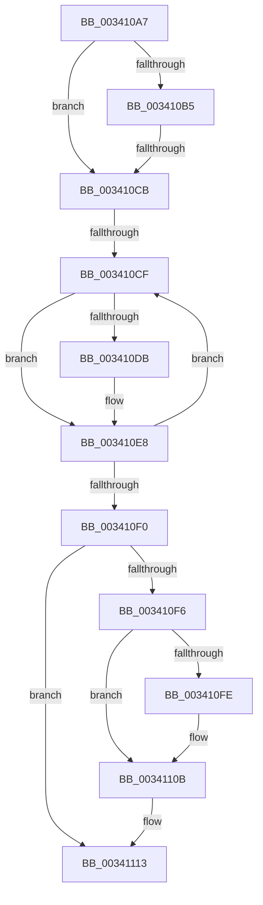

# sub_003410A7

- RVA: `0x003410A7`–`0x00341118` (길이 `113` bytes)
- VA: `0x00000001403410A7`
- 실행 섹션: `.text`
- PDB 이름 있음: `아니요`; PDB Function 태그: `아니요`
- unwind 정보 RVA: `0x00077500`
- 디코드: `31`개 명령, `113/113` bytes 표시
- 미해석 바이트: `0` (있으면 어셈블리에 `.byte`로 보존)

> 이 문서는 커널 이미지의 기계어와 PDB 기호를 분석해 생성했습니다. 4번과 5번은 함수 원형과 자료형을 바이너리 사용 방식에서 추정한 C 해석이며 원본 소스 복구 결과는 아닙니다.

## 1. Dependencies

- 직접 호출 지점: **2**; 고유 호출 대상: **2**
- 직접 호출자로 확인된 함수: **0**
- RIP 상대 이미지 참조: **1**

### Outgoing calls
- `0x003410E3` → [KeSetEvent](../33/KeSetEvent_function_0033F310.md) (function, `0x0033F310`)
- `0x00341106` → [KiLowerIrqlProcessIrqlFlags](../4F/KiLowerIrqlProcessIrqlFlags_function_004F5698.md) (function, `0x004F5698`)

### Direct callers
- 이 함수 시작 RVA로 연결되는 직접 call은 확인되지 않았습니다. 간접 호출은 완전히 역산할 수 없습니다.

### Static image references
- `0x003410C2` → RVA `0x00FC6D20` (`ALMOSTRO`; read)

## 2. Other-region calls and transfers

- 다른 실행 섹션으로 향하는 call: **0**
- call이 아닌 외부 분기/꼬리 이동: **2**
  - `0x003410C9` → [sub_00341124](Unknown_function_00341124.md) (`tail-transfer`)
  - `0x003410CD` → [sub_00341147](Unknown_function_00341147.md) (`tail-transfer`)

## 3. Assembly (complete function range)

```asm
003410A7  48 89 74 24 30                  mov qword ptr [rsp + 0x30], rsi
003410AC  40 B6 02                        mov sil, 2
003410AF  4C 39 53 28                     cmp qword ptr [rbx + 0x28], r10
003410B3  74 16                           je 0x1403410cb
003410B5  44 0F 20 C6                     mov rsi, cr8
003410B9  B8 02 00 00 00                  mov eax, 2
003410BE  44 0F 22 C0                     mov cr8, rax
003410C2  44 39 15 57 5C C8 00            cmp dword ptr [rip + 0xc85c57], r10d
003410C9  75 59                           jne 0x140341124
003410CB  85 FF                           test edi, edi
003410CD  74 78                           je 0x140341147
003410CF  48 8B 7B 28                     mov rdi, qword ptr [rbx + 0x28]
003410D3  F0 0F BA 73 34 01               lock btr dword ptr [rbx + 0x34], 1
003410D9  72 0D                           jb 0x1403410e8
003410DB  45 33 C0                        xor r8d, r8d
003410DE  33 D2                           xor edx, edx
003410E0  48 8B CB                        mov rcx, rbx
003410E3  E8 28 E2 FF FF                  call 0x14033f310
003410E8  48 8B DF                        mov rbx, rdi
003410EB  48 85 FF                        test rdi, rdi
003410EE  75 DF                           jne 0x1403410cf
003410F0  40 80 FE 02                     cmp sil, 2
003410F4  74 1D                           je 0x140341113
003410F6  39 3D 24 5C C8 00               cmp dword ptr [rip + 0xc85c24], edi
003410FC  74 0D                           je 0x14034110b
003410FE  44 0F 20 C1                     mov rcx, cr8
00341102  40 0F B6 D6                     movzx edx, sil
00341106  E8 8D 45 1B 00                  call 0x1404f5698
0034110B  40 0F B6 C6                     movzx eax, sil
0034110F  44 0F 22 C0                     mov cr8, rax
00341113  48 8B 74 24 30                  mov rsi, qword ptr [rsp + 0x30]
```

## 4. C-style interpretation (structured pseudocode)

```c
__int64 __fastcall sub_003410A7(__int64 a1, int a2, int a3, __int64 a4, __int64 a5, __int64 a6)
{
    __int64 result;
    unsigned __int64 v_stack_p30;

    v_stack_p30 = v_rsi;
    if ((*(unsigned __int64 *)(v_rbx + 40)) == v_r10) goto loc_003410CB;
loc_003410CB:
loc_003410CF:
    result = 2;
    if (!(condition_is_below)) {
        a3 = 0;
        a2 = 0;
        a1 = v_rbx;
        result = KeSetEvent(a1, a2, a3, a4);
    }
    if (*(unsigned __int64 *)(v_rbx + 40) != 0) goto loc_003410CF;
    if (((unsigned __int8)(v_cr8)) == 2) goto loc_00341113;
    if ((*(unsigned int *)(v_rip + 13130788)) != ((unsigned int)(*(unsigned __int64 *)(v_rbx + 40)))) {
        a1 = 2;
        a2 = (unsigned __int8)(v_cr8);
        result = KiLowerIrqlProcessIrqlFlags(a1, a2, a3, a4);
    }
loc_00341113:
    return (unsigned __int8)(v_cr8);
}
```

## 5. (Beta) C Style

```c
int64_t sub_003410A7(int64_t Arg1, int32_t Arg2, int32_t Arg3, int64_t Arg4, uint64_t Arg5, int64_t Arg6)
{
    int64_t result;
    uint64_t v_stack_p30;

    v_stack_p30 = local_rsi;
    if ((*(uint64_t *)(local_rbx + 0x28)) == local_r10) goto loc_003410CB;
loc_003410CB:
loc_003410CF:
    result = 2;
    if (!(condition_is_below)) {
        Arg3 = 0;
        Arg2 = 0;
        Arg1 = local_rbx;
        result = KeSetEvent(Arg1, Arg2, Arg3, Arg4);
    }
    if (*(uint64_t *)(local_rbx + 0x28) != 0) goto loc_003410CF;
    if (((uint8_t)(v_cr8)) == 2) goto loc_00341113;
    if ((*(uint32_t *)(v_rip + 0xC85C24)) != ((uint32_t)(*(uint64_t *)(local_rbx + 0x28)))) {
        Arg1 = 2;
        Arg2 = (uint8_t)(v_cr8);
        result = KiLowerIrqlProcessIrqlFlags(Arg1, Arg2, Arg3, Arg4);
    }
loc_00341113:
    return (uint8_t)(v_cr8);
}
```

## 6. Execution-region graph

[열기: 2D/3D 그래프와 함수 탐색 컨트롤 패널](../../../control-panel.html?section=text&rva=0x003410A7&view=graph)

- 2D 그래프는 위에서 아래로 흐르고, 3D 그래프는 빈 공간을 드래그해 회전합니다. Shift+드래그는 이동, 휠은 확대·축소, 함수 노드 선택은 대상 보고서 이동입니다.

### Static fallback


