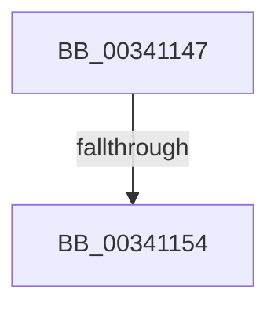

# sub_00341147

- RVA: `0x00341147`–`0x00341179` (길이 `50` bytes)
- VA: `0x0000000140341147`
- 실행 섹션: `.text`
- PDB 이름 있음: `아니요`; PDB Function 태그: `아니요`
- unwind 정보 RVA: `0x0007754C`
- 디코드: `13`개 명령, `50/50` bytes 표시
- 미해석 바이트: `0` (있으면 어셈블리에 `.byte`로 보존)

> 이 문서는 커널 이미지의 기계어와 PDB 기호를 분석해 생성했습니다. 4번과 5번은 함수 원형과 자료형을 바이너리 사용 방식에서 추정한 C 해석이며 원본 소스 복구 결과는 아닙니다.

## 1. Dependencies

- 직접 호출 지점: **1**; 고유 호출 대상: **1**
- 직접 호출자로 확인된 함수: **0**
- RIP 상대 이미지 참조: **0**

### Outgoing calls
- `0x0034116F` → [KiAbConvertWaiterToOwnerEntry](../21/KiAbConvertWaiterToOwnerEntry_function_00219430.md) (function, `0x00219430`)

### Direct callers
- 이 함수 시작 RVA로 연결되는 직접 call은 확인되지 않았습니다. 간접 호출은 완전히 역산할 수 없습니다.

### Static image references
- 디코드된 RIP-relative 메모리 참조가 없습니다.

## 2. Other-region calls and transfers

- 다른 실행 섹션으로 향하는 call: **0**
- call이 아닌 외부 분기/꼬리 이동: **2**
  - `0x0034114E` → [sub_003410A7 + 0x28](Unknown_function_003410A7.md) (`tail-transfer`)
  - `0x00341174` → [sub_003410A7 + 0x28](Unknown_function_003410A7.md) (`tail-transfer`)

## 3. Assembly (complete function range)

```asm
00341147  48 8B 53 38                     mov rdx, qword ptr [rbx + 0x38]
0034114B  48 85 D2                        test rdx, rdx
0034114E  0F 84 7B FF FF FF               je 0x1403410cf
00341154  48 8B 02                        mov rax, qword ptr [rdx]
00341157  48 8B CA                        mov rcx, rdx
0034115A  0F B6 42 08                     movzx eax, byte ptr [rdx + 8]
0034115E  83 E0 3F                        and eax, 0x3f
00341161  4C 6B C0 58                     imul r8, rax, 0x58
00341165  49 2B C8                        sub rcx, r8
00341168  45 33 C0                        xor r8d, r8d
0034116B  48 8B 49 F0                     mov rcx, qword ptr [rcx - 0x10]
0034116F  E8 BC 82 ED FF                  call 0x140219430
00341174  E9 56 FF FF FF                  jmp 0x1403410cf
```

## 4. C-style interpretation (structured pseudocode)

```c
__int64 __fastcall sub_00341147(void)
{
    __int64 result;

    result = (unsigned int)((*(unsigned __int8 *)(*(unsigned __int64 *)(v_rbx + 56) + 8)) & (63));
    a3 = (a3) * (result);
    a1 = (*(unsigned __int64 *)(v_rbx + 56)) - (a3);
    a3 = 0;
    result = KiAbConvertWaiterToOwnerEntry(*(unsigned __int64 *)(a1 - 16), *(unsigned __int64 *)(v_rbx + 56), a3, a4);
}
```

## 5. (Beta) C Style

```c
void sub_00341147(void)
{
    int64_t result;

    result = (uint32_t)((*(uint8_t *)(*(uint64_t *)(local_rbx + 0x38) + 0x8)) & (63));
    a3 = (a3) * (result);
    a1 = (*(uint64_t *)(local_rbx + 0x38)) - (a3);
    a3 = 0;
    result = KiAbConvertWaiterToOwnerEntry(*(uint64_t *)(a1 - 0x10), *(uint64_t *)(local_rbx + 0x38), a3, a4);
}
```

## 6. Execution-region graph

[열기: 2D/3D 그래프와 함수 탐색 컨트롤 패널](../../../control-panel.html?section=text&rva=0x00341147&view=graph)

- 2D 그래프는 위에서 아래로 흐르고, 3D 그래프는 빈 공간을 드래그해 회전합니다. Shift+드래그는 이동, 휠은 확대·축소, 함수 노드 선택은 대상 보고서 이동입니다.

### Static fallback


