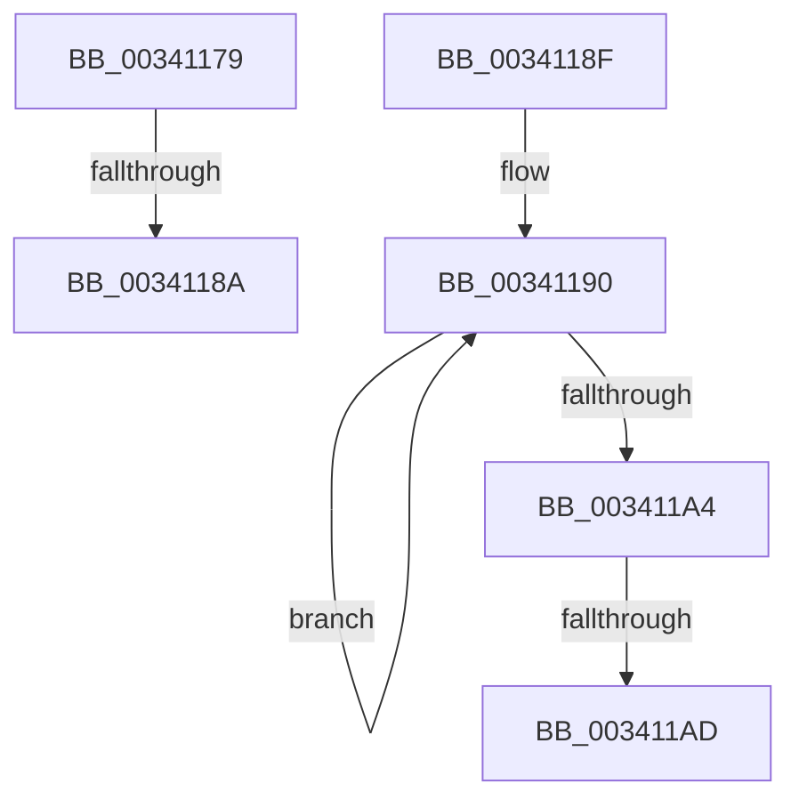

# sub_00341179

- RVA: `0x00341179`–`0x003411B6` (길이 `61` bytes)
- VA: `0x0000000140341179`
- 실행 섹션: `.text`
- PDB 이름 있음: `아니요`; PDB Function 태그: `아니요`
- unwind 정보 RVA: `0x00077560`
- 디코드: `17`개 명령, `61/61` bytes 표시
- 미해석 바이트: `0` (있으면 어셈블리에 `.byte`로 보존)

> 이 문서는 커널 이미지의 기계어와 PDB 기호를 분석해 생성했습니다. 4번과 5번은 함수 원형과 자료형을 바이너리 사용 방식에서 추정한 C 해석이며 원본 소스 복구 결과는 아닙니다.

## 1. Dependencies

- 직접 호출 지점: **0**; 고유 호출 대상: **0**
- 직접 호출자로 확인된 함수: **0**
- RIP 상대 이미지 참조: **0**

### Outgoing calls
- 직접 디코드된 call 명령이 없습니다.

### Direct callers
- 이 함수 시작 RVA로 연결되는 직접 call은 확인되지 않았습니다. 간접 호출은 완전히 역산할 수 없습니다.

### Static image references
- 디코드된 RIP-relative 메모리 참조가 없습니다.

## 2. Other-region calls and transfers

- 다른 실행 섹션으로 향하는 call: **0**
- call이 아닌 외부 분기/꼬리 이동: **4**
  - `0x00341188` → [sub_00341118](Unknown_function_00341118.md) (`tail-transfer`)
  - `0x0034118A` → [ExpWakePushLock + 0x15](ExpWakePushLock_function_00341050.md) (`tail-transfer`)
  - `0x003411A7` → [ExpWakePushLock + 0x35](ExpWakePushLock_function_00341050.md) (`tail-transfer`)
  - `0x003411B1` → [ExpWakePushLock + 0x35](ExpWakePushLock_function_00341050.md) (`tail-transfer`)

## 3. Assembly (complete function range)

```asm
00341179  48 8D 4A FC                     lea rcx, [rdx - 4]
0034117D  48 8B C2                        mov rax, rdx
00341180  F0 49 0F B1 09                  lock cmpxchg qword ptr [r9], rcx
00341185  48 8B D0                        mov rdx, rax
00341188  74 8E                           je 0x140341118
0034118A  E9 D6 FE FF FF                  jmp 0x140341065
0034118F  90                              nop
00341190  48 8B C1                        mov rax, rcx
00341193  48 8B 49 18                     mov rcx, qword ptr [rcx + 0x18]
00341197  48 89 41 28                     mov qword ptr [rcx + 0x28], rax
0034119B  48 8B 59 20                     mov rbx, qword ptr [rcx + 0x20]
0034119F  48 85 DB                        test rbx, rbx
003411A2  74 EC                           je 0x140341190
003411A4  49 3B C8                        cmp rcx, r8
003411A7  0F 84 D8 FE FF FF               je 0x140341085
003411AD  49 89 58 20                     mov qword ptr [r8 + 0x20], rbx
003411B1  E9 CF FE FF FF                  jmp 0x140341085
```

## 4. C-style interpretation (structured pseudocode)

```c
__int64 __fastcall sub_00341179(__int64 a1, __int64 a2, __int64 a3, __int64 a4)
{
}
```

## 5. (Beta) C Style

```c
int64_t sub_00341179(int64_t Arg1, void *Arg2, int64_t Arg3, void *Arg4)
{
    uint8_t *arg2 = (uint8_t *)Arg2;
    uint8_t *arg4 = (uint8_t *)Arg4;

}
```

### 관측된 메모리 오프셋

구조체 형식이 확인되지 않은 접근은 인자 기준의 오프셋으로만 기록했습니다.

| 기준 인자 | 오프셋 표현 | 폭 (bit) | 접근 |
|---|---:|---:|---|
| `Arg2` | `- 0x4` | `64` | `R` |
| `Arg4` | `+ 0x0` | `64` | `R` |

## 6. Execution-region graph

[열기: 2D/3D 그래프와 함수 탐색 컨트롤 패널](../../../control-panel.html?section=text&rva=0x00341179&view=graph)

- 2D 그래프는 위에서 아래로 흐르고, 3D 그래프는 빈 공간을 드래그해 회전합니다. Shift+드래그는 이동, 휠은 확대·축소, 함수 노드 선택은 대상 보고서 이동입니다.

### Static fallback


