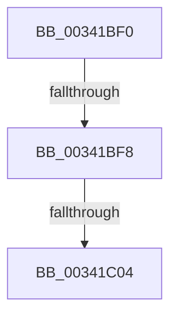

# sub_00341BF0

- RVA: `0x00341BF0`–`0x00341C22` (길이 `50` bytes)
- VA: `0x0000000140341BF0`
- 실행 섹션: `.text`
- PDB 이름 있음: `아니요`; PDB Function 태그: `아니요`
- unwind 정보 RVA: `0x00077650`
- 디코드: `13`개 명령, `50/50` bytes 표시
- 미해석 바이트: `0` (있으면 어셈블리에 `.byte`로 보존)

> 이 문서는 커널 이미지의 기계어와 PDB 기호를 분석해 생성했습니다. 4번과 5번은 함수 원형과 자료형을 바이너리 사용 방식에서 추정한 C 해석이며 원본 소스 복구 결과는 아닙니다.

## 1. Dependencies

- 직접 호출 지점: **1**; 고유 호출 대상: **1**
- 직접 호출자로 확인된 함수: **0**
- RIP 상대 이미지 참조: **0**

### Outgoing calls
- `0x00341C10` → [KeReleaseInStackQueuedSpinLock](KeReleaseInStackQueuedSpinLock_function_00342CE0.md) (function, `0x00342CE0`)

### Direct callers
- 이 함수 시작 RVA로 연결되는 직접 call은 확인되지 않았습니다. 간접 호출은 완전히 역산할 수 없습니다.

### Static image references
- 디코드된 RIP-relative 메모리 참조가 없습니다.

## 2. Other-region calls and transfers

- 다른 실행 섹션으로 향하는 call: **0**
- call이 아닌 외부 분기/꼬리 이동: **3**
  - `0x00341BF6` → [sub_00341C58](Unknown_function_00341C58.md) (`tail-transfer`)
  - `0x00341C02` → [sub_00341C58](Unknown_function_00341C58.md) (`tail-transfer`)
  - `0x00341C1D` → [sub_00341B4C + 0x1A](Unknown_function_00341B4C.md) (`tail-transfer`)

## 3. Assembly (complete function range)

```asm
00341BF0  8B 51 08                        mov edx, dword ptr [rcx + 8]
00341BF3  44 3B F2                        cmp r14d, edx
00341BF6  73 60                           jae 0x140341c58
00341BF8  49 8B C6                        mov rax, r14
00341BFB  48 03 C0                        add rax, rax
00341BFE  48 39 34 C1                     cmp qword ptr [rcx + rax*8], rsi
00341C02  75 54                           jne 0x140341c58
00341C04  8B 7C C1 08                     mov edi, dword ptr [rcx + rax*8 + 8]
00341C08  C1 EF 03                        shr edi, 3
00341C0B  48 8D 4C 24 30                  lea rcx, [rsp + 0x30]
00341C10  E8 CB 10 00 00                  call 0x140342ce0
00341C15  4C 8B B4 24 80 00 00 00         mov r14, qword ptr [rsp + 0x80]
00341C1D  E9 44 FF FF FF                  jmp 0x140341b66
```

## 4. C-style interpretation (structured pseudocode)

```c
__int64 __fastcall sub_00341BF0(__int64 a1, __int64 a2, __int64 a3, __int64 a4, __int64 a5, __int64 a6, __int64 a7, __int64 a8, __int64 a9, __int64 a10, __int64 a11, __int64 a12, __int64 a13, __int64 a14, __int64 a15, __int64 a16)
{
    __int64 result;
    __int64 v_rdi;

    result = (v_r14) + (v_r14);
    v_rdi = (unsigned int)(((unsigned int)(*(unsigned int *)(a1 + result * 8 + 8))) >> (3));
    result = KeReleaseInStackQueuedSpinLock(a6, (unsigned int)(*(unsigned int *)(a1 + 8)), a3, a4);
}
```

## 5. (Beta) C Style

```c
int64_t sub_00341BF0(void *Arg1, int64_t Arg2, int64_t Arg3, int64_t Arg4, uint64_t Arg5, int64_t Arg6, uint64_t Arg7, uint64_t Arg8, uint64_t Arg9, uint64_t Arg10, uint64_t Arg11, uint64_t Arg12, uint64_t Arg13, uint64_t Arg14, uint64_t Arg15, int64_t Arg16)
{
    uint8_t *arg1 = (uint8_t *)Arg1;

    int64_t result;
    int64_t local_rdi;

    result = (local_r14) + (local_r14);
    local_rdi = (uint32_t)(((uint32_t)(*(uint32_t *)(arg1 + result * 8 + 0x8))) >> (3));
    result = KeReleaseInStackQueuedSpinLock(Arg6, (uint32_t)(*(uint32_t *)(arg1 + 0x8)), Arg3, Arg4);
}
```

### 관측된 메모리 오프셋

구조체 형식이 확인되지 않은 접근은 인자 기준의 오프셋으로만 기록했습니다.

| 기준 인자 | 오프셋 표현 | 폭 (bit) | 접근 |
|---|---:|---:|---|
| `Arg1` | `+ 0x0 + rax*8` | `64` | `R` |
| `Arg1` | `+ 0x8` | `32` | `R` |
| `Arg1` | `+ 0x8 + rax*8` | `32` | `R` |

## 6. Execution-region graph

[열기: 2D/3D 그래프와 함수 탐색 컨트롤 패널](../../../control-panel.html?section=text&rva=0x00341BF0&view=graph)

- 2D 그래프는 위에서 아래로 흐르고, 3D 그래프는 빈 공간을 드래그해 회전합니다. Shift+드래그는 이동, 휠은 확대·축소, 함수 노드 선택은 대상 보고서 이동입니다.

### Static fallback


