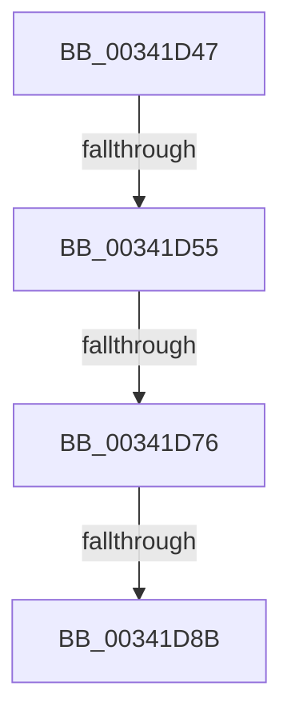

# sub_00341D47

- RVA: `0x00341D47`–`0x00341DA8` (길이 `97` bytes)
- VA: `0x0000000140341D47`
- 실행 섹션: `.text`
- PDB 이름 있음: `아니요`; PDB Function 태그: `아니요`
- unwind 정보 RVA: `0x0007772C`
- 디코드: `26`개 명령, `97/97` bytes 표시
- 미해석 바이트: `0` (있으면 어셈블리에 `.byte`로 보존)

> 이 문서는 커널 이미지의 기계어와 PDB 기호를 분석해 생성했습니다. 4번과 5번은 함수 원형과 자료형을 바이너리 사용 방식에서 추정한 C 해석이며 원본 소스 복구 결과는 아닙니다.

## 1. Dependencies

- 직접 호출 지점: **2**; 고유 호출 대상: **2**
- 직접 호출자로 확인된 함수: **0**
- RIP 상대 이미지 참조: **2**

### Outgoing calls
- `0x00341D5F` → [KiReleaseQueuedSpinLockInstrumented](../21/KiReleaseQueuedSpinLockInstrumented_function_002179F0.md) (function, `0x002179F0`)
- `0x00341D7E` → [ExReleaseRundownProtectionCacheAware](ExReleaseRundownProtectionCacheAware_function_00342DF0.md) (function, `0x00342DF0`)

### Direct callers
- 이 함수 시작 RVA로 연결되는 직접 call은 확인되지 않았습니다. 간접 호출은 완전히 역산할 수 없습니다.

### Static image references
- `0x00341D47` → RVA `0x00F0DE58` (`.data`; read)
- `0x00341D64` → RVA `0x00FC6D20` (`ALMOSTRO`; read)

## 2. Other-region calls and transfers

- 다른 실행 섹션으로 향하는 call: **0**
- call이 아닌 외부 분기/꼬리 이동: **3**
  - `0x00341D4F` → [sub_00341DB3 + 0xC3](Unknown_function_00341DB3.md) (`tail-transfer`)
  - `0x00341D70` → [sub_00341DB3 + 0x145](Unknown_function_00341DB3.md) (`tail-transfer`)
  - `0x00341D89` → [sub_00341DA9](Unknown_function_00341DA9.md) (`tail-transfer`)

## 3. Assembly (complete function range)

```asm
00341D47  8B 05 0B C1 BC 00               mov eax, dword ptr [rip + 0xbcc10b]
00341D4D  85 C0                           test eax, eax
00341D4F  0F 85 21 01 00 00               jne 0x140341e76
00341D55  48 8B 54 24 78                  mov rdx, qword ptr [rsp + 0x78]
00341D5A  48 8D 4C 24 20                  lea rcx, [rsp + 0x20]
00341D5F  E8 8C 5C ED FF                  call 0x1402179f0
00341D64  83 3D B5 4F C8 00 00            cmp dword ptr [rip + 0xc84fb5], 0
00341D6B  0F B6 7C 24 30                  movzx edi, byte ptr [rsp + 0x30]
00341D70  0F 85 82 01 00 00               jne 0x140341ef8
00341D76  44 0F 22 C7                     mov cr8, rdi
00341D7A  48 8B 4B 10                     mov rcx, qword ptr [rbx + 0x10]
00341D7E  E8 6D 10 00 00                  call 0x140342df0
00341D83  48 8B DD                        mov rbx, rbp
00341D86  48 85 ED                        test rbp, rbp
00341D89  75 1E                           jne 0x140341da9
00341D8B  48 8B BC 24 80 00 00 00         mov rdi, qword ptr [rsp + 0x80]
00341D93  8B C6                           mov eax, esi
00341D95  4C 8B 7C 24 40                  mov r15, qword ptr [rsp + 0x40]
00341D9A  48 83 C4 48                     add rsp, 0x48
00341D9E  41 5E                           pop r14
00341DA0  41 5D                           pop r13
00341DA2  41 5C                           pop r12
00341DA4  5E                              pop rsi
00341DA5  5D                              pop rbp
00341DA6  5B                              pop rbx
00341DA7  C3                              ret
```

## 4. C-style interpretation (structured pseudocode)

```c
__int64 __fastcall sub_00341D47(__int64 a1, __int64 a2, __int64 a3, __int64 a4, __int64 a5, unsigned __int8 a6, __int64 a7, __int64 a8, __int64 a9, __int64 a10, __int64 a11, __int64 a12, __int64 a13, __int64 a14, __int64 a15, __int64 a16)
{
    __int64 result;
    __int64 v_rsp;
    unsigned __int64 v_stack_p20;

    result = KiReleaseQueuedSpinLockInstrumented(v_stack_p20, a15, a3, a4);
    result = ExReleaseRundownProtectionCacheAware(*(unsigned __int64 *)(v_rbx + 16), a15, a3, a4);
    v_rsp = (v_rsp) + (72);
    return (unsigned int)((unsigned int)(v_rsi));
}
```

## 5. (Beta) C Style

```c
int64_t sub_00341D47(int64_t Arg1, int64_t Arg2, int64_t Arg3, int64_t Arg4, uint64_t Arg5, uint8_t Arg6, uint64_t Arg7, int64_t Arg8, uint64_t Arg9, uint64_t Arg10, uint64_t Arg11, uint64_t Arg12, uint64_t Arg13, uint64_t Arg14, int64_t Arg15, int64_t Arg16)
{
    int64_t result;
    int64_t local_rsp;
    uint64_t v_stack_p20;

    result = KiReleaseQueuedSpinLockInstrumented(v_stack_p20, Arg15, Arg3, Arg4);
    result = ExReleaseRundownProtectionCacheAware(*(uint64_t *)(local_rbx + 0x10), Arg15, Arg3, Arg4);
    local_rsp = (local_rsp) + (72);
    return (uint32_t)((uint32_t)(local_rsi));
}
```

## 6. Execution-region graph

[열기: 2D/3D 그래프와 함수 탐색 컨트롤 패널](../../../control-panel.html?section=text&rva=0x00341D47&view=graph)

- 2D 그래프는 위에서 아래로 흐르고, 3D 그래프는 빈 공간을 드래그해 회전합니다. Shift+드래그는 이동, 휠은 확대·축소, 함수 노드 선택은 대상 보고서 이동입니다.

### Static fallback


