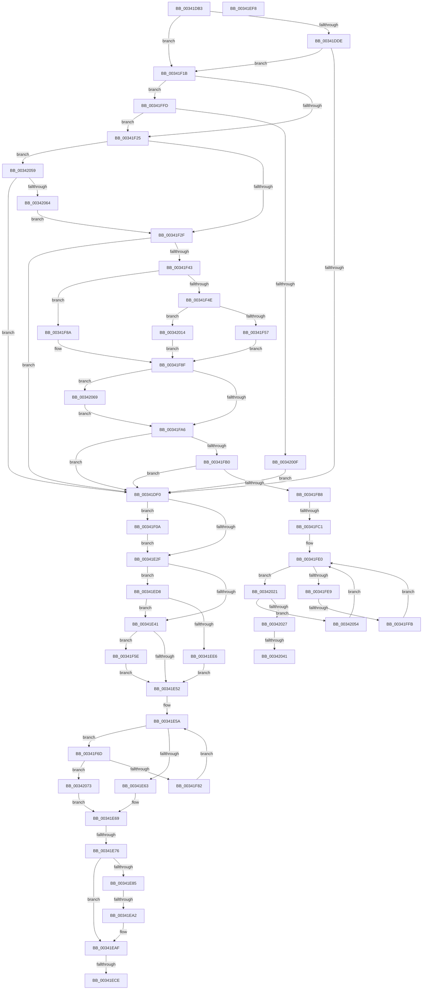

# sub_00341DB3

- RVA: `0x00341DB3`–`0x0034207B` (길이 `712` bytes)
- VA: `0x0000000140341DB3`
- 실행 섹션: `.text`
- PDB 이름 있음: `아니요`; PDB Function 태그: `아니요`
- unwind 정보 RVA: `0x00077770`
- 디코드: `164`개 명령, `712/712` bytes 표시
- 미해석 바이트: `0` (있으면 어셈블리에 `.byte`로 보존)

> 이 문서는 커널 이미지의 기계어와 PDB 기호를 분석해 생성했습니다. 4번과 5번은 함수 원형과 자료형을 바이너리 사용 방식에서 추정한 C 해석이며 원본 소스 복구 결과는 아닙니다.

## 1. Dependencies

- 직접 호출 지점: **13**; 고유 호출 대상: **13**
- 직접 호출자로 확인된 함수: **0**
- RIP 상대 이미지 참조: **5**

### Outgoing calls
- `0x00341EA7` → [KxWaitForLockChainValid](../21/KxWaitForLockChainValid_function_00217AA0.md) (function, `0x00217AA0`)
- `0x00341ECE` → [KeWakeAddressAll](../21/KeWakeAddressAll_function_00217C20.md) (function, `0x00217C20`)
- `0x00341EEE` → [KiAcquireQueuedSpinLockInstrumented](../27/KiAcquireQueuedSpinLockInstrumented_function_00275850.md) (function, `0x00275850`)
- `0x00341F00` → [KiLowerIrqlProcessIrqlFlags](../4F/KiLowerIrqlProcessIrqlFlags_function_004F5698.md) (function, `0x004F5698`)
- `0x00341F11` → [KiRaiseIrqlProcessIrqlFlags](../4F/KiRaiseIrqlProcessIrqlFlags_function_004F56FC.md) (function, `0x004F56FC`)
- `0x00341F32` → [PfpPartitionReferenceParentSafe](PfpPartitionReferenceParentSafe_function_00343754.md) (function, `0x00343754`)
- `0x00341F57` → [PfTFiNotifyFileStreamCreateCallback](../45/PfTFiNotifyFileStreamCreateCallback_function_0045EEB0.md) (function, `0x0045EEB0`)
- `0x00341F63` → [KxWaitForLockOwnerShip](../25/KxWaitForLockOwnerShip_function_00257EB0.md) (function, `0x00257EB0`)
- `0x00341F75` → [ExAcquireRundownProtectionCacheAware](../23/ExAcquireRundownProtectionCacheAware_function_0023D110.md) (function, `0x0023D110`)
- `0x00341F8A` → [PfTFiNotifyFileInfoDeleteCallback](../45/PfTFiNotifyFileInfoDeleteCallback_function_0045F040.md) (function, `0x0045F040`)
- `0x00341F99` → [PsDereferencePartition](PsDereferencePartition_function_00342E70.md) (function, `0x00342E70`)
- `0x00342017` → [guard_dispatch_icall](../6B/guard_dispatch_icall_function_006BAAD0.md) (function, `0x006BAAD0`)
- `0x0034204A` → [KeSetEvent](../33/KeSetEvent_function_0033F310.md) (function, `0x0033F310`)

### Direct callers
- 이 함수 시작 RVA로 연결되는 직접 call은 확인되지 않았습니다. 간접 호출은 완전히 역산할 수 없습니다.

### Static image references
- `0x00341DC7` → RVA `0x0045EEB0` (`PfTFiNotifyFileStreamCreateCallback`; read)
- `0x00341DCE` → RVA `0x0045F040` (`PfTFiNotifyFileInfoDeleteCallback`; read)
- `0x00341E22` → RVA `0x00FC6D20` (`ALMOSTRO`; read)
- `0x00341E2F` → RVA `0x00FC6B06` (`ALMOSTRO`; read)
- `0x00341ED8` → RVA `0x00F0DE58` (`.data`; read)

## 2. Other-region calls and transfers

- 다른 실행 섹션으로 향하는 call: **0**
- call이 아닌 외부 분기/꼬리 이동: **9**
  - `0x00341E70` → [sub_00341D47](Unknown_function_00341D47.md) (`tail-transfer`)
  - `0x00341E9C` → [sub_00341D47 + 0x1D](Unknown_function_00341D47.md) (`tail-transfer`)
  - `0x00341EC8` → [sub_00341D47 + 0x1D](Unknown_function_00341D47.md) (`tail-transfer`)
  - `0x00341ED3` → [sub_00341D47 + 0x1D](Unknown_function_00341D47.md) (`tail-transfer`)
  - `0x00341F05` → [sub_00341D47 + 0x2F](Unknown_function_00341D47.md) (`tail-transfer`)
  - `0x00341FBB` → [sub_00341D47 + 0x44](Unknown_function_00341D47.md) (`tail-transfer`)
  - `0x00341FF5` → [sub_00341D47 + 0x44](Unknown_function_00341D47.md) (`tail-transfer`)
  - `0x0034203B` → [sub_00341D47 + 0x44](Unknown_function_00341D47.md) (`tail-transfer`)
  - `0x0034204F` → [sub_00341D47 + 0x44](Unknown_function_00341D47.md) (`tail-transfer`)

## 3. Assembly (complete function range)

```asm
00341DB3  48 89 BC 24 80 00 00 00         mov qword ptr [rsp + 0x80], rdi
00341DBB  4C 89 7C 24 40                  mov qword ptr [rsp + 0x40], r15
00341DC0  45 8B FC                        mov r15d, r12d
00341DC3  41 83 E7 01                     and r15d, 1
00341DC7  4C 8D 15 E2 D0 11 00            lea r10, [rip + 0x11d0e2]
00341DCE  4C 8D 0D 6B D2 11 00            lea r9, [rip + 0x11d26b]
00341DD5  45 85 FF                        test r15d, r15d
00341DD8  0F 84 3D 01 00 00               je 0x140341f1b
00341DDE  8B 83 5C 02 00 00               mov eax, dword ptr [rbx + 0x25c]
00341DE4  39 83 58 02 00 00               cmp dword ptr [rbx + 0x258], eax
00341DEA  0F 82 2B 01 00 00               jb 0x140341f1b
00341DF0  33 C0                           xor eax, eax
00341DF2  0F 57 C0                        xorps xmm0, xmm0
00341DF5  0F 11 44 24 20                  movups xmmword ptr [rsp + 0x20], xmm0
00341DFA  48 89 44 24 30                  mov qword ptr [rsp + 0x30], rax
00341DFF  48 8B 7B 08                     mov rdi, qword ptr [rbx + 8]
00341E03  48 81 C7 78 03 00 00            add rdi, 0x378
00341E0A  4C 89 74 24 20                  mov qword ptr [rsp + 0x20], r14
00341E0F  48 89 7C 24 28                  mov qword ptr [rsp + 0x28], rdi
00341E14  90                              nop
00341E15  44 0F 20 C5                     mov rbp, cr8
00341E19  B8 02 00 00 00                  mov eax, 2
00341E1E  44 0F 22 C0                     mov cr8, rax
00341E22  83 3D F7 4E C8 00 00            cmp dword ptr [rip + 0xc84ef7], 0
00341E29  0F 85 DB 00 00 00               jne 0x140341f0a
00341E2F  F6 05 D0 4C C8 00 21            test byte ptr [rip + 0xc84cd0], 0x21
00341E36  40 88 6C 24 30                  mov byte ptr [rsp + 0x30], bpl
00341E3B  0F 85 97 00 00 00               jne 0x140341ed8
00341E41  48 8D 54 24 20                  lea rdx, [rsp + 0x20]
00341E46  48 87 17                        xchg qword ptr [rdi], rdx
00341E49  48 85 D2                        test rdx, rdx
00341E4C  0F 85 0C 01 00 00               jne 0x140341f5e
00341E52  4C 8B 73 18                     mov r14, qword ptr [rbx + 0x18]
00341E56  48 83 C7 08                     add rdi, 8
00341E5A  4C 3B F7                        cmp r14, rdi
00341E5D  0F 85 0A 01 00 00               jne 0x140341f6d
00341E63  45 33 F6                        xor r14d, r14d
00341E66  41 8B EE                        mov ebp, r14d
00341E69  F6 05 96 4C C8 00 01            test byte ptr [rip + 0xc84c96], 1
00341E70  0F 85 D1 FE FF FF               jne 0x140341d47
00341E76  0F 0D 4C 24 20                  prefetchw byte ptr [rsp + 0x20]
00341E7B  48 8B 4C 24 20                  mov rcx, qword ptr [rsp + 0x20]
00341E80  48 85 C9                        test rcx, rcx
00341E83  75 2A                           jne 0x140341eaf
00341E85  48 8B 4C 24 28                  mov rcx, qword ptr [rsp + 0x28]
00341E8A  48 8D 44 24 20                  lea rax, [rsp + 0x20]
00341E8F  F0 4C 0F B1 31                  lock cmpxchg qword ptr [rcx], r14
00341E94  48 8D 4C 24 20                  lea rcx, [rsp + 0x20]
00341E99  48 3B C1                        cmp rax, rcx
00341E9C  0F 84 C2 FE FF FF               je 0x140341d64
00341EA2  48 8D 4C 24 20                  lea rcx, [rsp + 0x20]
00341EA7  E8 F4 5B ED FF                  call 0x140217aa0
00341EAC  48 8B C8                        mov rcx, rax
00341EAF  4C 89 74 24 20                  mov qword ptr [rsp + 0x20], r14
00341EB4  48 83 C1 08                     add rcx, 8
00341EB8  48 8B 44 24 28                  mov rax, qword ptr [rsp + 0x28]
00341EBD  48 8B D0                        mov rdx, rax
00341EC0  48 87 11                        xchg qword ptr [rcx], rdx
00341EC3  32 D0                           xor dl, al
00341EC5  F6 C2 04                        test dl, 4
00341EC8  0F 84 96 FE FF FF               je 0x140341d64
00341ECE  E8 4D 5D ED FF                  call 0x140217c20
00341ED3  E9 8C FE FF FF                  jmp 0x140341d64
00341ED8  8B 05 7A BF BC 00               mov eax, dword ptr [rip + 0xbcbf7a]
00341EDE  85 C0                           test eax, eax
00341EE0  0F 85 5B FF FF FF               jne 0x140341e41
00341EE6  48 8B D7                        mov rdx, rdi
00341EE9  48 8D 4C 24 20                  lea rcx, [rsp + 0x20]
00341EEE  E8 5D 39 F3 FF                  call 0x140275850
00341EF3  E9 5A FF FF FF                  jmp 0x140341e52
00341EF8  44 0F 20 C1                     mov rcx, cr8
00341EFC  40 0F B6 D7                     movzx edx, dil
00341F00  E8 93 37 1B 00                  call 0x1404f5698
00341F05  E9 6C FE FF FF                  jmp 0x140341d76
00341F0A  0F B6 D0                        movzx edx, al
00341F0D  40 0F B6 CD                     movzx ecx, bpl
00341F11  E8 E6 37 1B 00                  call 0x1404f56fc
00341F16  E9 14 FF FF FF                  jmp 0x140341e2f
00341F1B  41 F6 C4 02                     test r12b, 2
00341F1F  0F 85 D8 00 00 00               jne 0x140341ffd
00341F25  41 F6 C4 04                     test r12b, 4
00341F29  0F 85 2A 01 00 00               jne 0x140342059
00341F2F  48 8B CB                        mov rcx, rbx
00341F32  E8 1D 18 00 00                  call 0x140343754
00341F37  48 8B F8                        mov rdi, rax
00341F3A  48 85 C0                        test rax, rax
00341F3D  0F 84 AD FE FF FF               je 0x140341df0
00341F43  48 8B D5                        mov rdx, rbp
00341F46  48 8B CB                        mov rcx, rbx
00341F49  4D 3B E9                        cmp r13, r9
00341F4C  74 3C                           je 0x140341f8a
00341F4E  4D 3B EA                        cmp r13, r10
00341F51  0F 85 BD 00 00 00               jne 0x140342014
00341F57  E8 54 CF 11 00                  call 0x14045eeb0
00341F5C  EB 31                           jmp 0x140341f8f
00341F5E  48 8D 4C 24 20                  lea rcx, [rsp + 0x20]
00341F63  E8 48 5F F1 FF                  call 0x140257eb0
00341F68  E9 E5 FE FF FF                  jmp 0x140341e52
00341F6D  49 8B 4E F8                     mov rcx, qword ptr [r14 - 8]
00341F71  49 8D 6E E8                     lea rbp, [r14 - 0x18]
00341F75  E8 96 B1 EF FF                  call 0x14023d110
00341F7A  84 C0                           test al, al
00341F7C  0F 85 F1 00 00 00               jne 0x140342073
00341F82  4D 8B 36                        mov r14, qword ptr [r14]
00341F85  E9 D0 FE FF FF                  jmp 0x140341e5a
00341F8A  E8 B1 D0 11 00                  call 0x14045f040
00341F8F  BA 50 66 50 74                  mov edx, 0x74506650
00341F94  48 8B CF                        mov rcx, rdi
00341F97  8B E8                           mov ebp, eax
00341F99  E8 D2 0E 00 00                  call 0x140342e70
00341F9E  85 ED                           test ebp, ebp
00341FA0  0F 88 C3 00 00 00               js 0x140342069
00341FA6  41 F6 C4 08                     test r12b, 8
00341FAA  0F 84 40 FE FF FF               je 0x140341df0
00341FB0  85 ED                           test ebp, ebp
00341FB2  0F 88 38 FE FF FF               js 0x140341df0
00341FB8  48 85 DB                        test rbx, rbx
00341FBB  0F 84 CA FD FF FF               je 0x140341d8b
00341FC1  4C 8B 4B 10                     mov r9, qword ptr [rbx + 0x10]
00341FC5  33 D2                           xor edx, edx
00341FC7  65 8B 04 25 A4 01 00 00         mov eax, dword ptr gs:[0x1a4]
00341FCF  41 F7 71 14                     div dword ptr [r9 + 0x14]
00341FD3  41 0F AF 51 10                  imul edx, dword ptr [r9 + 0x10]
00341FD8  8B CA                           mov ecx, edx
00341FDA  49 03 09                        add rcx, qword ptr [r9]
00341FDD  0F 0D 09                        prefetchw byte ptr [rcx]
00341FE0  4C 8B 01                        mov r8, qword ptr [rcx]
00341FE3  41 F6 C0 01                     test r8b, 1
00341FE7  75 38                           jne 0x140342021
00341FE9  49 8D 50 FE                     lea rdx, [r8 - 2]
00341FED  49 8B C0                        mov rax, r8
00341FF0  F0 48 0F B1 11                  lock cmpxchg qword ptr [rcx], rdx
00341FF5  0F 84 90 FD FF FF               je 0x140341d8b
00341FFB  EB E3                           jmp 0x140341fe0
00341FFD  8B 83 64 02 00 00               mov eax, dword ptr [rbx + 0x264]
00342003  39 83 60 02 00 00               cmp dword ptr [rbx + 0x260], eax
00342009  0F 82 16 FF FF FF               jb 0x140341f25
0034200F  E9 DC FD FF FF                  jmp 0x140341df0
00342014  49 8B C5                        mov rax, r13
00342017  E8 B4 8A 37 00                  call 0x1406baad0
0034201C  E9 6E FF FF FF                  jmp 0x140341f8f
00342021  49 83 F8 01                     cmp r8, 1
00342025  74 2D                           je 0x140342054
00342027  49 83 E0 FE                     and r8, 0xfffffffffffffffe
0034202B  48 C7 C0 FF FF FF FF            mov rax, 0xffffffffffffffff
00342032  F0 49 0F C1 00                  lock xadd qword ptr [r8], rax
00342037  48 83 F8 01                     cmp rax, 1
0034203B  0F 85 4A FD FF FF               jne 0x140341d8b
00342041  49 8D 48 08                     lea rcx, [r8 + 8]
00342045  33 D2                           xor edx, edx
00342047  45 33 C0                        xor r8d, r8d
0034204A  E8 C1 D2 FF FF                  call 0x14033f310
0034204F  E9 37 FD FF FF                  jmp 0x140341d8b
00342054  49 8B 09                        mov rcx, qword ptr [r9]
00342057  EB 87                           jmp 0x140341fe0
00342059  8B 43 4C                        mov eax, dword ptr [rbx + 0x4c]
0034205C  A8 01                           test al, 1
0034205E  0F 85 8C FD FF FF               jne 0x140341df0
00342064  E9 C6 FE FF FF                  jmp 0x140341f2f
00342069  85 F6                           test esi, esi
0034206B  0F 49 F5                        cmovns esi, ebp
0034206E  E9 33 FF FF FF                  jmp 0x140341fa6
00342073  45 33 F6                        xor r14d, r14d
00342076  E9 EE FD FF FF                  jmp 0x140341e69
```

## 4. C-style interpretation (structured pseudocode)

```c
__int64 __fastcall sub_00341DB3(__int64 a1, __int64 a2, __int64 a3, __int64 a4, __int64 a5)
{
    __int64 result;
    __int64 v_r14;
    __int64 v_r15;
    __int64 v_rdi;
    __int64 v_rsi;
    unsigned __int64 v_stack_p20;
    unsigned __int64 v_stack_p28;
    unsigned __int64 v_stack_p30;
    unsigned __int64 v_stack_p40;
    unsigned __int64 v_stack_p80;

    v_stack_p80 = v_rdi;
    v_stack_p40 = v_r15;
    v_r15 = (unsigned int)(((unsigned int)((unsigned int)(v_r12))) & (1));
    if ((unsigned int)(v_r15) == 0) goto loc_00341F1B;
    if ((*(unsigned int *)(v_rbx + 600)) < ((unsigned int)((unsigned int)(*(unsigned int *)(v_rbx + 604))))) goto loc_00341F1B;
loc_00341DF0:
    result = 0;
    v_stack_p20 = v_xmm0;
    v_stack_p30 = 0;
    v_rdi = (*(unsigned __int64 *)(v_rbx + 8)) + (888);
    v_stack_p20 = v_r14;
    v_stack_p28 = v_rdi;
    if ((*(unsigned int *)(v_rip + 13127415)) != 0) goto loc_00341F0A;
loc_00341E2F:
    v_stack_p30 = (unsigned __int8)(v_cr8);
    if (((*(unsigned __int8 *)(v_rip + 13126864)) & (33)) != 0) goto loc_00341ED8;
loc_00341E41:
    if (v_stack_p20 != 0) goto loc_00341F5E;
loc_00341E52:
    v_rdi = (v_rdi) + (8);
loc_00341E5A:
    if ((*(unsigned __int64 *)(v_rbx + 24)) != v_rdi) goto loc_00341F6D;
    v_r14 = 0;
loc_00341E69:
    if (v_stack_p20 != 0) goto loc_00341EAF;
    result = KxWaitForLockChainValid(v_stack_p20, v_stack_p20, a3, v_rip + 1167979);
loc_00341EAF:
    v_stack_p20 = 0;
    a1 = (result) + (8);
    a2 = (unsigned __int8)((a5) ^ ((unsigned __int8)(a5)));
    result = KeWakeAddressAll(a1, a2, a3, v_rip + 1167979);
loc_00341ED8:
    if ((unsigned int)((unsigned int)(*(unsigned int *)(v_rip + 12369786))) != 0) goto loc_00341E41;
    result = KiAcquireQueuedSpinLockInstrumented(v_stack_p20, v_rdi, a3, v_rip + 1167979);
    goto loc_00341E52;
loc_00341F0A:
    result = KiRaiseIrqlProcessIrqlFlags(0, (unsigned __int8)(result), a3, v_rip + 1167979);
    goto loc_00341E2F;
loc_00341F1B:
    if ((((unsigned __int8)(v_r12)) & (2)) != 0) goto loc_00341FFD;
loc_00341F25:
    if ((((unsigned __int8)(v_r12)) & (4)) != 0) goto loc_00342059;
loc_00341F2F:
    result = PfpPartitionReferenceParentSafe(v_rbx, (unsigned __int8)(result), a3, v_rip + 1167979);
    if (result == 0) goto loc_00341DF0;
    if (v_r13 == (v_rip + 1167979)) goto loc_00341F8A;
    if (v_r13 != (v_rip + 1167586)) goto loc_00342014;
    result = PfTFiNotifyFileStreamCreateCallback(v_rbx, 0, a3, v_rip + 1167979);
    goto loc_00341F8F;
loc_00341F5E:
    result = KxWaitForLockOwnerShip(v_stack_p20, 0, a3, v_rip + 1167979);
    goto loc_00341E52;
loc_00341F6D:
    result = ExAcquireRundownProtectionCacheAware(*(unsigned __int64 *)(v_r14 - 8), 0, a3, v_rip + 1167979);
    if ((unsigned __int8)(result) != 0) goto loc_00342073;
    goto loc_00341E5A;
loc_00341F8A:
    result = PfTFiNotifyFileInfoDeleteCallback(*(unsigned __int64 *)(v_r14 - 8), 0, a3, v_rip + 1167979);
loc_00341F8F:
    result = PsDereferencePartition(result, (unsigned int)(0x74506650ULL), a3, v_rip + 1167979);
    if (sign_flag) goto loc_00342069;
loc_00341FA6:
    if ((((unsigned __int8)(v_r12)) & (8)) == 0) goto loc_00341DF0;
    if (sign_flag) goto loc_00341DF0;
    a2 = 0;
    a2 = (unsigned int)((a2) * (*(unsigned int *)(*(unsigned __int64 *)(v_rbx + 16) + 16)));
    a1 = ((unsigned int)((unsigned int)(a2))) + (*(unsigned __int64 *)(*(unsigned __int64 *)(v_rbx + 16)));
loc_00341FE0:
    if ((((unsigned __int8)(*(unsigned __int64 *)(a1))) & (1)) != 0) goto loc_00342021;
    goto loc_00341FE0;
loc_00341FFD:
    if ((*(unsigned int *)(v_rbx + 608)) < ((unsigned int)((unsigned int)(*(unsigned int *)(v_rbx + 612))))) goto loc_00341F25;
    goto loc_00341DF0;
loc_00342014:
    result = guard_dispatch_icall(a1, *(unsigned __int64 *)(a1) - 2, *(unsigned __int64 *)(a1), *(unsigned __int64 *)(v_rbx + 16));
    goto loc_00341F8F;
loc_00342021:
    if ((*(unsigned __int64 *)(a1)) == 1) goto loc_00342054;
    a3 = (*(unsigned __int64 *)(a1)) & (-2);
    a2 = 0;
    a3 = 0;
    result = KeSetEvent(a3 + 8, a2, a3, *(unsigned __int64 *)(v_rbx + 16));
loc_00342054:
    goto loc_00341FE0;
loc_00342059:
    if ((((unsigned __int8)((unsigned int)(*(unsigned int *)(v_rbx + 76)))) & (1)) != 0) goto loc_00341DF0;
    goto loc_00341F2F;
loc_00342069:
    if (!sign_flag) { v_rsi = (unsigned int)((unsigned int)((unsigned int)(result))); }
    goto loc_00341FA6;
loc_00342073:
    v_r14 = 0;
    goto loc_00341E69;
}
```

## 5. (Beta) C Style

```c
int64_t sub_00341DB3(int64_t Arg1, int64_t Arg2, int64_t Arg3, int64_t Arg4, void *Arg5)
{
    uint8_t *arg5 = (uint8_t *)Arg5;

    int64_t result;
    int64_t local_r14;
    int64_t local_r15;
    int64_t local_rdi;
    int64_t local_rsi;
    uint64_t v_stack_p20;
    uint64_t v_stack_p28;
    uint64_t v_stack_p30;
    uint64_t v_stack_p40;
    uint64_t v_stack_p80;

    v_stack_p80 = local_rdi;
    v_stack_p40 = local_r15;
    local_r15 = (uint32_t)(((uint32_t)((uint32_t)(local_r12))) & (1));
    if ((uint32_t)(local_r15) == 0) goto loc_00341F1B;
    if ((*(uint32_t *)(local_rbx + 0x258)) < ((uint32_t)((uint32_t)(*(uint32_t *)(local_rbx + 0x25C))))) goto loc_00341F1B;
loc_00341DF0:
    result = 0;
    v_stack_p20 = v_xmm0;
    v_stack_p30 = 0;
    local_rdi = (*(uint64_t *)(local_rbx + 0x8)) + (888);
    v_stack_p20 = local_r14;
    v_stack_p28 = local_rdi;
    if ((*(uint32_t *)(v_rip + 0xC84EF7)) != 0) goto loc_00341F0A;
loc_00341E2F:
    v_stack_p30 = (uint8_t)(v_cr8);
    if (((*(uint8_t *)(v_rip + 0xC84CD0)) & (33)) != 0) goto loc_00341ED8;
loc_00341E41:
    if (v_stack_p20 != 0) goto loc_00341F5E;
loc_00341E52:
    local_rdi = (local_rdi) + (8);
loc_00341E5A:
    if ((*(uint64_t *)(local_rbx + 0x18)) != local_rdi) goto loc_00341F6D;
    local_r14 = 0;
loc_00341E69:
    if (v_stack_p20 != 0) goto loc_00341EAF;
    result = KxWaitForLockChainValid(v_stack_p20, v_stack_p20, Arg3, v_rip + 1167979);
loc_00341EAF:
    v_stack_p20 = 0;
    Arg1 = (result) + (8);
    Arg2 = (uint8_t)((Arg5) ^ ((uint8_t)(Arg5)));
    result = KeWakeAddressAll(Arg1, Arg2, Arg3, v_rip + 1167979);
loc_00341ED8:
    if ((uint32_t)((uint32_t)(*(uint32_t *)(v_rip + 0xBCBF7A))) != 0) goto loc_00341E41;
    result = KiAcquireQueuedSpinLockInstrumented(v_stack_p20, local_rdi, Arg3, v_rip + 1167979);
    goto loc_00341E52;
loc_00341F0A:
    result = KiRaiseIrqlProcessIrqlFlags(0, (uint8_t)(result), Arg3, v_rip + 1167979);
    goto loc_00341E2F;
loc_00341F1B:
    if ((((uint8_t)(local_r12)) & (2)) != 0) goto loc_00341FFD;
loc_00341F25:
    if ((((uint8_t)(local_r12)) & (4)) != 0) goto loc_00342059;
loc_00341F2F:
    result = PfpPartitionReferenceParentSafe(local_rbx, (uint8_t)(result), Arg3, v_rip + 1167979);
    if (result == 0) goto loc_00341DF0;
    if (local_r13 == (v_rip + 1167979)) goto loc_00341F8A;
    if (local_r13 != (v_rip + 1167586)) goto loc_00342014;
    result = PfTFiNotifyFileStreamCreateCallback(local_rbx, 0, Arg3, v_rip + 1167979);
    goto loc_00341F8F;
loc_00341F5E:
    result = KxWaitForLockOwnerShip(v_stack_p20, 0, Arg3, v_rip + 1167979);
    goto loc_00341E52;
loc_00341F6D:
    result = ExAcquireRundownProtectionCacheAware(*(uint64_t *)(local_r14 - 0x8), 0, Arg3, v_rip + 1167979);
    if ((uint8_t)(result) != 0) goto loc_00342073;
    goto loc_00341E5A;
loc_00341F8A:
    result = PfTFiNotifyFileInfoDeleteCallback(*(uint64_t *)(local_r14 - 0x8), 0, Arg3, v_rip + 1167979);
loc_00341F8F:
    result = PsDereferencePartition(result, (uint32_t)(0x74506650ULL), Arg3, v_rip + 1167979);
    if (sign_flag) goto loc_00342069;
loc_00341FA6:
    if ((((uint8_t)(local_r12)) & (8)) == 0) goto loc_00341DF0;
    if (sign_flag) goto loc_00341DF0;
    Arg2 = 0;
    Arg2 = (uint32_t)((Arg2) * (*(uint32_t *)(*(uint64_t *)(local_rbx + 0x10) + 0x10)));
    Arg1 = ((uint32_t)((uint32_t)(Arg2))) + (*(uint64_t *)(*(uint64_t *)(local_rbx + 0x10)));
loc_00341FE0:
    if ((((uint8_t)(*(uint64_t *)(Arg1))) & (1)) != 0) goto loc_00342021;
    goto loc_00341FE0;
loc_00341FFD:
    if ((*(uint32_t *)(local_rbx + 0x260)) < ((uint32_t)((uint32_t)(*(uint32_t *)(local_rbx + 0x264))))) goto loc_00341F25;
    goto loc_00341DF0;
loc_00342014:
    result = guard_dispatch_icall(Arg1, *(uint64_t *)(Arg1) - 2, *(uint64_t *)(Arg1), *(uint64_t *)(local_rbx + 0x10));
    goto loc_00341F8F;
loc_00342021:
    if ((*(uint64_t *)(Arg1)) == 1) goto loc_00342054;
    Arg3 = (*(uint64_t *)(Arg1)) & (-2);
    Arg2 = 0;
    Arg3 = 0;
    result = KeSetEvent(Arg3 + 8, Arg2, Arg3, *(uint64_t *)(local_rbx + 0x10));
loc_00342054:
    goto loc_00341FE0;
loc_00342059:
    if ((((uint8_t)((uint32_t)(*(uint32_t *)(local_rbx + 0x4C)))) & (1)) != 0) goto loc_00341DF0;
    goto loc_00341F2F;
loc_00342069:
    if (!sign_flag) { local_rsi = (uint32_t)((uint32_t)((uint32_t)(result))); }
    goto loc_00341FA6;
loc_00342073:
    local_r14 = 0;
    goto loc_00341E69;
}
```

### 관측된 메모리 오프셋

구조체 형식이 확인되지 않은 접근은 인자 기준의 오프셋으로만 기록했습니다.

| 기준 인자 | 오프셋 표현 | 폭 (bit) | 접근 |
|---|---:|---:|---|
| `Arg5` | `+ 0x0` | `64` | `R` |

## 6. Execution-region graph

[열기: 2D/3D 그래프와 함수 탐색 컨트롤 패널](../../../control-panel.html?section=text&rva=0x00341DB3&view=graph)

- 2D 그래프는 위에서 아래로 흐르고, 3D 그래프는 빈 공간을 드래그해 회전합니다. Shift+드래그는 이동, 휠은 확대·축소, 함수 노드 선택은 대상 보고서 이동입니다.

### Static fallback


