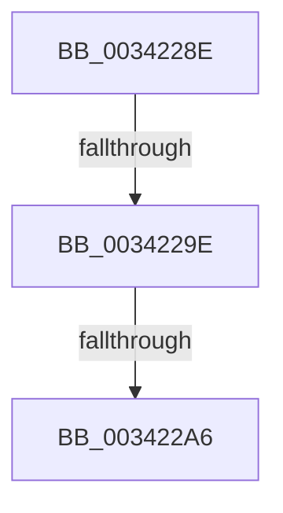

# sub_0034228E

- RVA: `0x0034228E`–`0x003422B4` (길이 `38` bytes)
- VA: `0x000000014034228E`
- 실행 섹션: `.text`
- PDB 이름 있음: `아니요`; PDB Function 태그: `아니요`
- unwind 정보 RVA: `0x000777B0`
- 디코드: `10`개 명령, `38/38` bytes 표시
- 미해석 바이트: `0` (있으면 어셈블리에 `.byte`로 보존)

> 이 문서는 커널 이미지의 기계어와 PDB 기호를 분석해 생성했습니다. 4번과 5번은 함수 원형과 자료형을 바이너리 사용 방식에서 추정한 C 해석이며 원본 소스 복구 결과는 아닙니다.

## 1. Dependencies

- 직접 호출 지점: **0**; 고유 호출 대상: **0**
- 직접 호출자로 확인된 함수: **0**
- RIP 상대 이미지 참조: **0**

### Outgoing calls
- 직접 디코드된 call 명령이 없습니다.

### Direct callers
- 이 함수 시작 RVA로 연결되는 직접 call은 확인되지 않았습니다. 간접 호출은 완전히 역산할 수 없습니다.

### Static image references
- 디코드된 RIP-relative 메모리 참조가 없습니다.

## 2. Other-region calls and transfers

- 다른 실행 섹션으로 향하는 call: **0**
- call이 아닌 외부 분기/꼬리 이동: **3**
  - `0x00342298` → [sub_003427B2](Unknown_function_003427B2.md) (`tail-transfer`)
  - `0x003422A0` → [sub_003427B2 + 0x29](Unknown_function_003427B2.md) (`tail-transfer`)
  - `0x003422AE` → [sub_003427B2 + 0x21](Unknown_function_003427B2.md) (`tail-transfer`)

## 3. Assembly (complete function range)

```asm
0034228E  49 89 5B 10                     mov qword ptr [r11 + 0x10], rbx
00342292  4D 89 63 20                     mov qword ptr [r11 + 0x20], r12
00342296  A8 08                           test al, 8
00342298  0F 85 14 05 00 00               jne 0x1403427b2
0034229E  A8 04                           test al, 4
003422A0  0F 85 35 05 00 00               jne 0x1403427db
003422A6  8B 47 08                        mov eax, dword ptr [rdi + 8]
003422A9  45 33 E4                        xor r12d, r12d
003422AC  A8 01                           test al, 1
003422AE  0F 84 1F 05 00 00               je 0x1403427d3
```

## 4. C-style interpretation (structured pseudocode)

```c
__int64 __fastcall sub_0034228E(void)
{
    __int64 v_r12;

    *(unsigned __int64 *)(v_r11 + 16) = v_rbx;
    *(unsigned __int64 *)(v_r11 + 32) = v_r12;
    v_r12 = 0;
}
```

## 5. (Beta) C Style

```c
void sub_0034228E(void)
{
    int64_t local_r12;

    *(uint64_t *)(local_r11 + 0x10) = local_rbx;
    *(uint64_t *)(local_r11 + 0x20) = local_r12;
    local_r12 = 0;
}
```

## 6. Execution-region graph

[열기: 2D/3D 그래프와 함수 탐색 컨트롤 패널](../../../control-panel.html?section=text&rva=0x0034228E&view=graph)

- 2D 그래프는 위에서 아래로 흐르고, 3D 그래프는 빈 공간을 드래그해 회전합니다. Shift+드래그는 이동, 휠은 확대·축소, 함수 노드 선택은 대상 보고서 이동입니다.

### Static fallback


