# sub_003422B4

- RVA: `0x003422B4`–`0x003425BC` (길이 `776` bytes)
- VA: `0x00000001403422B4`
- 실행 섹션: `.text`
- PDB 이름 있음: `아니요`; PDB Function 태그: `아니요`
- unwind 정보 RVA: `0x000777C8`
- 디코드: `170`개 명령, `776/776` bytes 표시
- 미해석 바이트: `0` (있으면 어셈블리에 `.byte`로 보존)

> 이 문서는 커널 이미지의 기계어와 PDB 기호를 분석해 생성했습니다. 4번과 5번은 함수 원형과 자료형을 바이너리 사용 방식에서 추정한 C 해석이며 원본 소스 복구 결과는 아닙니다.

## 1. Dependencies

- 직접 호출 지점: **14**; 고유 호출 대상: **12**
- 직접 호출자로 확인된 함수: **0**
- RIP 상대 이미지 참조: **6**

### Outgoing calls
- `0x003422E0` → [PfpPartitionGetFirst](PfpPartitionGetFirst_function_00342ED0.md) (function, `0x00342ED0`)
- `0x00342309` → [PfpPartitionReferenceParentSafe](PfpPartitionReferenceParentSafe_function_00343754.md) (function, `0x00343754`)
- `0x00342336` → [KeAcquireInStackQueuedSpinLock](../27/KeAcquireInStackQueuedSpinLock_function_002757A0.md) (function, `0x002757A0`)
- `0x00342353` → [KeReleaseInStackQueuedSpinLock](KeReleaseInStackQueuedSpinLock_function_00342CE0.md) (function, `0x00342CE0`)
- `0x0034235C` → [ExReleaseRundownProtectionCacheAware](ExReleaseRundownProtectionCacheAware_function_00342DF0.md) (function, `0x00342DF0`)
- `0x0034236E` → [KeReleaseInStackQueuedSpinLock](KeReleaseInStackQueuedSpinLock_function_00342CE0.md) (function, `0x00342CE0`)
- `0x00342377` → [ExReleaseRundownProtectionCacheAware](ExReleaseRundownProtectionCacheAware_function_00342DF0.md) (function, `0x00342DF0`)
- `0x00342448` → [PsGetIoPriorityThread](PsGetIoPriorityThread_function_00343930.md) (function, `0x00343930`)
- `0x00342491` → [PfSnLogPageFaultCommon](PfSnLogPageFaultCommon_function_00343070.md) (function, `0x00343070`)
- `0x003424CD` → [ExfReleaseRundownProtection](ExfReleaseRundownProtection_function_00349EB0.md) (function, `0x00349EB0`)
- `0x003424E0` → [KeAcquireSpinLockRaiseToDpc](../20/KeAcquireSpinLockRaiseToDpc_function_00208470.md) (function, `0x00208470`)
- `0x003424FC` → [ExAcquireRundownProtection](../21/ExAcquireRundownProtection_function_00216620.md) (function, `0x00216620`)
- `0x0034250F` → [KeReleaseSpinLock](../39/KeReleaseSpinLock_function_00392BA0.md) (function, `0x00392BA0`)
- `0x00342597` → [PsDereferencePartition](PsDereferencePartition_function_00342E70.md) (function, `0x00342E70`)

### Direct callers
- 이 함수 시작 RVA로 연결되는 직접 call은 확인되지 않았습니다. 간접 호출은 완전히 역산할 수 없습니다.

### Static image references
- `0x003422BC` → RVA `0x00E67228` (`.data`; read)
- `0x003422E5` → RVA `0x0045F040` (`PfTFiNotifyFileInfoDeleteCallback`; read)
- `0x003422EF` → RVA `0x0045EEB0` (`PfTFiNotifyFileStreamCreateCallback`; read)
- `0x00342302` → RVA `0x0046CFC0` (`PfpPartitionCanDoNameLoggingCallback`; read)
- `0x003423C6` → RVA `0x00E67248` (`.data`; read)
- `0x003424D4` → RVA `0x00E67260` (`.data`; read)

## 2. Other-region calls and transfers

- 다른 실행 섹션으로 향하는 call: **0**
- call이 아닌 외부 분기/꼬리 이동: **10**
  - `0x00342314` → [sub_003425E5 + 0xEC](Unknown_function_003425E5.md) (`tail-transfer`)
  - `0x00342349` → [sub_003425E5 + 0x109](Unknown_function_003425E5.md) (`tail-transfer`)
  - `0x00342394` → [sub_003425E5 + 0xD3](Unknown_function_003425E5.md) (`tail-transfer`)
  - `0x003423A1` → [sub_00342822 + 0xC](Unknown_function_00342822.md) (`tail-transfer`)
  - `0x00342435` → [sub_003425E5 + 0x159](Unknown_function_003425E5.md) (`tail-transfer`)
  - `0x00342450` → [sub_00342822](Unknown_function_00342822.md) (`tail-transfer`)
  - `0x00342460` → [sub_00342A28](Unknown_function_00342A28.md) (`tail-transfer`)
  - `0x00342523` → [sub_00342C29 + 0x62](Unknown_function_00342C29.md) (`tail-transfer`)
  - `0x0034256E` → [sub_00342822 + 0xDF](Unknown_function_00342822.md) (`tail-transfer`)
  - `0x00342583` → [sub_003425E5](Unknown_function_003425E5.md) (`tail-transfer`)

## 3. Assembly (complete function range)

```asm
003422B4  48 89 B4 24 40 01 00 00         mov qword ptr [rsp + 0x140], rsi
003422BC  48 8D 0D 65 4F B2 00            lea rcx, [rip + 0xb24f65]
003422C3  4C 89 AC 24 10 01 00 00         mov qword ptr [rsp + 0x110], r13
003422CB  4C 89 B4 24 08 01 00 00         mov qword ptr [rsp + 0x108], r14
003422D3  4C 89 BC 24 00 01 00 00         mov qword ptr [rsp + 0x100], r15
003422DB  44 89 64 24 34                  mov dword ptr [rsp + 0x34], r12d
003422E0  E8 EB 0B 00 00                  call 0x140342ed0
003422E5  4C 8D 2D 54 CD 11 00            lea r13, [rip + 0x11cd54]
003422EC  48 8B F0                        mov rsi, rax
003422EF  4C 8D 35 BA CB 11 00            lea r14, [rip + 0x11cbba]
003422F6  48 85 C0                        test rax, rax
003422F9  0F 84 90 00 00 00               je 0x14034238f
003422FF  48 8B CE                        mov rcx, rsi
00342302  4C 8D 0D B7 AC 12 00            lea r9, [rip + 0x12acb7]
00342309  E8 46 14 00 00                  call 0x140343754
0034230E  48 8B D8                        mov rbx, rax
00342311  48 85 C0                        test rax, rax
00342314  0F 85 B7 03 00 00               jne 0x1403426d1
0034231A  0F 57 C0                        xorps xmm0, xmm0
0034231D  48 8D 55 90                     lea rdx, [rbp - 0x70]
00342321  33 C0                           xor eax, eax
00342323  0F 11 45 90                     movups xmmword ptr [rbp - 0x70], xmm0
00342327  48 89 45 A0                     mov qword ptr [rbp - 0x60], rax
0034232B  48 8B 5E 08                     mov rbx, qword ptr [rsi + 8]
0034232F  48 8D 8B 78 03 00 00            lea rcx, [rbx + 0x378]
00342336  E8 65 34 F3 FF                  call 0x1402757a0
0034233B  4C 8B 76 18                     mov r14, qword ptr [rsi + 0x18]
0034233F  4C 8D BB 80 03 00 00            lea r15, [rbx + 0x380]
00342346  4D 3B F7                        cmp r14, r15
00342349  0F 85 9F 03 00 00               jne 0x1403426ee
0034234F  48 8D 4D 90                     lea rcx, [rbp - 0x70]
00342353  E8 88 09 00 00                  call 0x140342ce0
00342358  48 8B 4E 10                     mov rcx, qword ptr [rsi + 0x10]
0034235C  E8 8F 0A 00 00                  call 0x140342df0
00342361  4C 8D 35 48 CB 11 00            lea r14, [rip + 0x11cb48]
00342368  EB 25                           jmp 0x14034238f
0034236A  48 8D 4D 90                     lea rcx, [rbp - 0x70]
0034236E  E8 6D 09 00 00                  call 0x140342ce0
00342373  48 8B 4E 10                     mov rcx, qword ptr [rsi + 0x10]
00342377  E8 74 0A 00 00                  call 0x140342df0
0034237C  4C 8D 35 2D CB 11 00            lea r14, [rip + 0x11cb2d]
00342383  48 8B F3                        mov rsi, rbx
00342386  48 85 DB                        test rbx, rbx
00342389  0F 85 70 FF FF FF               jne 0x1403422ff
0034238F  44 39 64 24 34                  cmp dword ptr [rsp + 0x34], r12d
00342394  0F 84 1E 03 00 00               je 0x1403426b8
0034239A  48 63 47 04                     movsxd rax, dword ptr [rdi + 4]
0034239E  83 F8 04                        cmp eax, 4
003423A1  0F 85 87 04 00 00               jne 0x14034282e
003423A7  48 8B 57 10                     mov rdx, qword ptr [rdi + 0x10]
003423AB  8B 4A 08                        mov ecx, dword ptr [rdx + 8]
003423AE  44 8B 72 10                     mov r14d, dword ptr [rdx + 0x10]
003423B2  81 E1 FF 0F 00 00               and ecx, 0xfff
003423B8  49 81 C6 FF 0F 00 00            add r14, 0xfff
003423BF  4C 03 F1                        add r14, rcx
003423C2  49 C1 EE 0C                     shr r14, 0xc
003423C6  44 39 25 7B 4E B2 00            cmp dword ptr [rip + 0xb24e7b], r12d
003423CD  0F 84 56 01 00 00               je 0x140342529
003423D3  4C 8B 7A 20                     mov r15, qword ptr [rdx + 0x20]
003423D7  4D 8B CE                        mov r9, r14
003423DA  48 8B 42 18                     mov rax, qword ptr [rdx + 0x18]
003423DE  4C 8B 12                        mov r10, qword ptr [rdx]
003423E1  4C 8B 6A 08                     mov r13, qword ptr [rdx + 8]
003423E5  49 8B B7 20 02 00 00            mov rsi, qword ptr [r15 + 0x220]
003423EC  48 89 44 24 60                  mov qword ptr [rsp + 0x60], rax
003423F1  4C 89 54 24 50                  mov qword ptr [rsp + 0x50], r10
003423F6  0F 0D 8E 90 03 00 00            prefetchw byte ptr [rsi + 0x390]
003423FD  48 8B 96 90 03 00 00            mov rdx, qword ptr [rsi + 0x390]
00342404  F6 C2 0F                        test dl, 0xf
00342407  74 19                           je 0x140342422
00342409  48 8D 4A FF                     lea rcx, [rdx - 1]
0034240D  48 8B C2                        mov rax, rdx
00342410  F0 48 0F B1 8E 90 03 00 00      lock cmpxchg qword ptr [rsi + 0x390], rcx
00342419  74 07                           je 0x140342422
0034241B  48 8B D0                        mov rdx, rax
0034241E  A8 0F                           test al, 0xf
00342420  75 E7                           jne 0x140342409
00342422  48 8B DA                        mov rbx, rdx
00342425  48 83 E3 F0                     and rbx, 0xfffffffffffffff0
00342429  0F 84 F1 00 00 00               je 0x140342520
0034242F  83 E2 0F                        and edx, 0xf
00342432  83 FA 01                        cmp edx, 1
00342435  0F 86 03 03 00 00               jbe 0x14034273e
0034243B  41 F6 87 A8 05 00 00 40         test byte ptr [r15 + 0x5a8], 0x40
00342443  75 6C                           jne 0x1403424b1
00342445  49 8B CF                        mov rcx, r15
00342448  E8 E3 14 00 00                  call 0x140343930
0034244D  83 F8 02                        cmp eax, 2
00342450  0F 8C CC 03 00 00               jl 0x140342822
00342456  48 8B 83 B0 01 00 00            mov rax, qword ptr [rbx + 0x1b0]
0034245D  48 85 C0                        test rax, rax
00342460  0F 85 C2 05 00 00               jne 0x140342a28
00342466  49 81 E5 00 F0 FF FF            and r13, 0xfffffffffffff000
0034246D  4D 85 C9                        test r9, r9
00342470  74 3F                           je 0x1403424b1
00342472  48 8B 7C 24 60                  mov rdi, qword ptr [rsp + 0x60]
00342477  49 8B F6                        mov rsi, r14
0034247A  66 0F 1F 44 00 00               nop word ptr [rax + rax]
00342480  4D 8B CD                        mov r9, r13
00342483  44 89 64 24 20                  mov dword ptr [rsp + 0x20], r12d
00342488  4C 8B C7                        mov r8, rdi
0034248B  49 8B D2                        mov rdx, r10
0034248E  48 8B CB                        mov rcx, rbx
00342491  E8 DA 0B 00 00                  call 0x140343070
00342496  85 C0                           test eax, eax
00342498  78 12                           js 0x1403424ac
0034249A  4C 8B 54 24 50                  mov r10, qword ptr [rsp + 0x50]
0034249F  49 81 C5 00 10 00 00            add r13, 0x1000
003424A6  48 83 EE 01                     sub rsi, 1
003424AA  75 D4                           jne 0x140342480
003424AC  48 8B 7C 24 58                  mov rdi, qword ptr [rsp + 0x58]
003424B1  48 8D 8B 68 01 00 00            lea rcx, [rbx + 0x168]
003424B8  0F 0D 09                        prefetchw byte ptr [rcx]
003424BB  48 8B 01                        mov rax, qword ptr [rcx]
003424BE  48 83 E0 FE                     and rax, 0xfffffffffffffffe
003424C2  48 8D 50 FE                     lea rdx, [rax - 2]
003424C6  F0 48 0F B1 11                  lock cmpxchg qword ptr [rcx], rdx
003424CB  74 5C                           je 0x140342529
003424CD  E8 DE 79 00 00                  call 0x140349eb0
003424D2  EB 55                           jmp 0x140342529
003424D4  48 8D 0D 85 4D B2 00            lea rcx, [rip + 0xb24d85]
003424DB  C6 44 24 30 01                  mov byte ptr [rsp + 0x30], 1
003424E0  E8 8B 5F EC FF                  call 0x140208470
003424E5  48 8B B6 90 03 00 00            mov rsi, qword ptr [rsi + 0x390]
003424EC  0F B6 D8                        movzx ebx, al
003424EF  48 83 E6 F0                     and rsi, 0xfffffffffffffff0
003424F3  74 10                           je 0x140342505
003424F5  48 8D 8E 68 01 00 00            lea rcx, [rsi + 0x168]
003424FC  E8 1F 41 ED FF                  call 0x140216620
00342501  88 44 24 30                     mov byte ptr [rsp + 0x30], al
00342505  0F B6 D3                        movzx edx, bl
00342508  48 8D 0D 51 4D B2 00            lea rcx, [rip + 0xb24d51]
0034250F  E8 8C 06 05 00                  call 0x140392ba0
00342514  44 38 64 24 30                  cmp byte ptr [rsp + 0x30], r12b
00342519  49 8B DC                        mov rbx, r12
0034251C  48 0F 45 DE                     cmovne rbx, rsi
00342520  48 85 DB                        test rbx, rbx
00342523  0F 85 62 07 00 00               jne 0x140342c8b
00342529  48 8B 47 10                     mov rax, qword ptr [rdi + 0x10]
0034252D  0F 57 C0                        xorps xmm0, xmm0
00342530  0F 11 44 24 68                  movups xmmword ptr [rsp + 0x68], xmm0
00342535  0F 11 44 24 78                  movups xmmword ptr [rsp + 0x78], xmm0
0034253A  48 8B 48 20                     mov rcx, qword ptr [rax + 0x20]
0034253E  4C 63 50 14                     movsxd r10, dword ptr [rax + 0x14]
00342542  4C 8B 48 08                     mov r9, qword ptr [rax + 8]
00342546  4C 8B 58 18                     mov r11, qword ptr [rax + 0x18]
0034254A  33 C0                           xor eax, eax
0034254C  4C 8B 81 20 02 00 00            mov r8, qword ptr [rcx + 0x220]
00342553  48 89 45 88                     mov qword ptr [rbp - 0x78], rax
00342557  49 8B 98 58 07 00 00            mov rbx, qword ptr [r8 + 0x758]
0034255E  0F 0D 4B 28                     prefetchw byte ptr [rbx + 0x28]
00342562  48 8B 43 28                     mov rax, qword ptr [rbx + 0x28]
00342566  48 8D 50 01                     lea rdx, [rax + 1]
0034256A  48 83 FA 01                     cmp rdx, 1
0034256E  0F 86 8D 03 00 00               jbe 0x140342901
00342574  F0 48 0F B1 53 28               lock cmpxchg qword ptr [rbx + 0x28], rdx
0034257A  75 EA                           jne 0x140342566
0034257C  48 8B 7B 20                     mov rdi, qword ptr [rbx + 0x20]
00342580  48 85 DB                        test rbx, rbx
00342583  75 60                           jne 0x1403425e5
00342585  BF BB 00 00 C0                  mov edi, 0xc00000bb
0034258A  48 85 DB                        test rbx, rbx
0034258D  74 0D                           je 0x14034259c
0034258F  BA 50 66 50 74                  mov edx, 0x74506650
00342594  48 8B CB                        mov rcx, rbx
00342597  E8 D4 08 00 00                  call 0x140342e70
0034259C  4C 8B B4 24 08 01 00 00         mov r14, qword ptr [rsp + 0x108]
003425A4  4C 8B AC 24 10 01 00 00         mov r13, qword ptr [rsp + 0x110]
003425AC  48 8B B4 24 40 01 00 00         mov rsi, qword ptr [rsp + 0x140]
003425B4  4C 8B BC 24 00 01 00 00         mov r15, qword ptr [rsp + 0x100]
```

## 4. C-style interpretation (structured pseudocode)

```c
__int64 __fastcall sub_003422B4(__int64 a1, __int64 a2, __int64 a3, __int64 a4, __int64 a5, __int64 a6, __int64 a7, __int64 a8, __int64 a9, __int64 a10, __int64 a11, __int64 a12, __int64 a13, __int64 a14, __int64 a15, __int64 a16, __int64 a17, __int64 a18, __int64 a19, __int64 a20, __int64 a21, __int64 a22, __int64 a23, __int64 a24, __int64 a25, __int64 a26, __int64 a27, __int64 a28, __int64 a29, __int64 a30, __int64 a31, __int64 a32, __int64 a33, __int64 a34, __int64 a35, __int64 a36, __int64 a37, __int64 a38, __int64 a39, __int64 a40)
{
    __int64 result;
    __int64 v_r13;
    __int64 v_r14;
    __int64 v_rbx;
    __int64 v_rsi;
    unsigned __int64 v_stack_p100;
    unsigned __int64 v_stack_p108;
    unsigned __int64 v_stack_p110;
    unsigned __int64 v_stack_p140;
    unsigned int v_stack_p20;
    unsigned __int8 v_stack_p30;
    unsigned int v_stack_p34;
    unsigned __int64 v_stack_p50;
    unsigned __int64 v_stack_p60;

    v_stack_p140 = v_rsi;
    v_stack_p110 = v_r13;
    v_stack_p108 = v_r14;
    v_stack_p100 = v_r15;
    v_stack_p34 = (unsigned int)(v_r12);
    result = PfpPartitionGetFirst(v_rip + 11685733, a2, a3, a4);
    if (result == 0) goto loc_0034238F;
loc_003422FF:
    result = PfpPartitionReferenceParentSafe(result, a2, a3, v_rip + 1223863);
    result = 0;
    *(unsigned __int64 *)(v_rbp - 112) = v_xmm0;
    *(unsigned __int64 *)(v_rbp - 96) = 0;
    result = KeAcquireInStackQueuedSpinLock(*(unsigned __int64 *)(result + 8) + 888, v_rbp - 112, a3, v_rip + 1223863);
    result = KeReleaseInStackQueuedSpinLock(v_rbp - 112, v_rbp - 112, a3, v_rip + 1223863);
    result = ExReleaseRundownProtectionCacheAware(*(unsigned __int64 *)(result + 16), v_rbp - 112, a3, v_rip + 1223863);
    goto loc_0034238F;
loc_0034238F:
    a1 = (unsigned int)(((unsigned int)(*(unsigned int *)(*(unsigned __int64 *)(v_rdi + 16) + 8))) & (0xFFFULL));
    v_r14 = ((unsigned int)(*(unsigned int *)(*(unsigned __int64 *)(v_rdi + 16) + 16))) + (0xFFFULL);
    v_r14 = (v_r14) + (a1);
    v_r14 = (v_r14) >> (12);
    if ((*(unsigned int *)(v_rip + 11685499)) == ((unsigned int)(v_r12))) goto loc_00342529;
    v_stack_p60 = *(unsigned __int64 *)(*(unsigned __int64 *)(v_rdi + 16) + 24);
    v_stack_p50 = *(unsigned __int64 *)(*(unsigned __int64 *)(v_rdi + 16));
    if ((((unsigned __int8)(*(unsigned __int64 *)(*(unsigned __int64 *)(*(unsigned __int64 *)(*(unsigned __int64 *)(v_rdi + 16) + 32) + 544) + 912))) & (15)) == 0) goto loc_00342422;
loc_00342409:
    if ((((unsigned __int8)(*(unsigned __int64 *)(*(unsigned __int64 *)(*(unsigned __int64 *)(*(unsigned __int64 *)(v_rdi + 16) + 32) + 544) + 912))) & (15)) == 0) goto loc_00342422;
    if ((((unsigned __int8)(*(unsigned __int64 *)(*(unsigned __int64 *)(*(unsigned __int64 *)(*(unsigned __int64 *)(v_rdi + 16) + 32) + 544) + 912))) & (15)) != 0) goto loc_00342409;
loc_00342422:
    v_rbx = (*(unsigned __int64 *)(*(unsigned __int64 *)(*(unsigned __int64 *)(*(unsigned __int64 *)(v_rdi + 16) + 32) + 544) + 912)) & (-16);
    if (condition_is_equal) goto loc_00342520;
    a2 = (unsigned int)((*(unsigned __int64 *)(*(unsigned __int64 *)(*(unsigned __int64 *)(*(unsigned __int64 *)(v_rdi + 16) + 32) + 544) + 912)) & (15));
    if (((*(unsigned __int8 *)(*(unsigned __int64 *)(*(unsigned __int64 *)(v_rdi + 16) + 32) + 1448)) & (64)) != 0) goto loc_003424B1;
    result = PsGetIoPriorityThread(*(unsigned __int64 *)(*(unsigned __int64 *)(v_rdi + 16) + 32), a2, a3, v_r14);
    v_r13 = (*(unsigned __int64 *)(*(unsigned __int64 *)(v_rdi + 16) + 8)) & (0xFFFFFFFFFFFFF000ULL);
    if (v_r14 == 0) goto loc_003424B1;
loc_00342480:
    v_stack_p20 = (unsigned int)(v_r12);
    result = PfSnLogPageFaultCommon(v_rbx, *(unsigned __int64 *)(*(unsigned __int64 *)(v_rdi + 16)), a12, v_r13);
    if (sign_flag) goto loc_003424AC;
    v_r13 = (v_r13) + (0x1000ULL);
    v_rsi = (v_r14) - (1);
    if (condition_is_not_equal) goto loc_00342480;
loc_003424AC:
loc_003424B1:
    result = (*(unsigned __int64 *)(v_rbx + 360)) & (-2);
    if (condition_is_equal) goto loc_00342529;
    result = ExfReleaseRundownProtection(v_rbx + 360, result - 2, a12, v_r13);
    goto loc_00342529;
loc_00342520:
loc_00342529:
    a13 = v_xmm0;
    a15 = v_xmm0;
    result = 0;
    *(unsigned __int64 *)(v_rbp - 120) = 0;
loc_00342566:
    if ((*(unsigned __int64 *)(*(unsigned __int64 *)(*(unsigned __int64 *)(*(unsigned __int64 *)(*(unsigned __int64 *)(a11 + 16) + 32) + 544) + 1880) + 40) + 1) != 1) goto loc_00342566;
    result = *(unsigned __int64 *)(*(unsigned __int64 *)(*(unsigned __int64 *)(*(unsigned __int64 *)(*(unsigned __int64 *)(a11 + 16) + 32) + 544) + 1880) + 40);
    if (*(unsigned __int64 *)(*(unsigned __int64 *)(*(unsigned __int64 *)(*(unsigned __int64 *)(a11 + 16) + 32) + 544) + 1880) != 0) {
        a2 = 0x74506650ULL;
        a1 = *(unsigned __int64 *)(*(unsigned __int64 *)(*(unsigned __int64 *)(*(unsigned __int64 *)(a11 + 16) + 32) + 544) + 1880);
        result = PsDereferencePartition(a1, a2, *(unsigned __int64 *)(*(unsigned __int64 *)(*(unsigned __int64 *)(a11 + 16) + 32) + 544), *(unsigned __int64 *)(*(unsigned __int64 *)(a11 + 16) + 8));
    }
    return result;
}
```

## 5. (Beta) C Style

```c
int64_t sub_003422B4(int64_t Arg1, int64_t Arg2, int64_t Arg3, int64_t Arg4, uint64_t Arg5, uint64_t Arg6, uint64_t Arg7, uint64_t Arg8, uint64_t Arg9, int64_t Arg10, int64_t Arg11, int64_t Arg12, int64_t Arg13, uint64_t Arg14, int64_t Arg15, uint64_t Arg16, uint64_t Arg17, uint64_t Arg18, uint64_t Arg19, uint64_t Arg20, uint64_t Arg21, uint64_t Arg22, uint64_t Arg23, uint64_t Arg24, uint64_t Arg25, uint64_t Arg26, uint64_t Arg27, uint64_t Arg28, uint64_t Arg29, uint64_t Arg30, uint64_t Arg31, int64_t Arg32, int64_t Arg33, int64_t Arg34, uint64_t Arg35, uint64_t Arg36, uint64_t Arg37, uint64_t Arg38, uint64_t Arg39, int64_t Arg40)
{
    int64_t result;
    int64_t local_r13;
    int64_t local_r14;
    int64_t local_rbx;
    int64_t local_rsi;
    uint64_t v_stack_p100;
    uint64_t v_stack_p108;
    uint64_t v_stack_p110;
    uint64_t v_stack_p140;
    uint32_t v_stack_p20;
    uint8_t v_stack_p30;
    uint32_t v_stack_p34;
    uint64_t v_stack_p50;
    uint64_t v_stack_p60;

    v_stack_p140 = local_rsi;
    v_stack_p110 = local_r13;
    v_stack_p108 = local_r14;
    v_stack_p100 = local_r15;
    v_stack_p34 = (uint32_t)(local_r12);
    result = PfpPartitionGetFirst(v_rip + 11685733, Arg2, Arg3, Arg4);
    if (result == 0) goto loc_0034238F;
loc_003422FF:
    result = PfpPartitionReferenceParentSafe(result, Arg2, Arg3, v_rip + 1223863);
    result = 0;
    *(uint64_t *)(local_rbp - 0x70) = v_xmm0;
    *(uint64_t *)(local_rbp - 0x60) = 0;
    result = KeAcquireInStackQueuedSpinLock(*(uint64_t *)(result + 0x8) + 888, local_rbp - 112, Arg3, v_rip + 1223863);
    result = KeReleaseInStackQueuedSpinLock(local_rbp - 112, local_rbp - 112, Arg3, v_rip + 1223863);
    result = ExReleaseRundownProtectionCacheAware(*(uint64_t *)(result + 0x10), local_rbp - 112, Arg3, v_rip + 1223863);
    goto loc_0034238F;
loc_0034238F:
    Arg1 = (uint32_t)(((uint32_t)(*(uint32_t *)(*(uint64_t *)(local_rdi + 0x10) + 0x8))) & (0xFFFULL));
    local_r14 = ((uint32_t)(*(uint32_t *)(*(uint64_t *)(local_rdi + 0x10) + 0x10))) + (0xFFFULL);
    local_r14 = (local_r14) + (Arg1);
    local_r14 = (local_r14) >> (12);
    if ((*(uint32_t *)(v_rip + 0xB24E7B)) == ((uint32_t)(local_r12))) goto loc_00342529;
    v_stack_p60 = *(uint64_t *)(*(uint64_t *)(local_rdi + 0x10) + 0x18);
    v_stack_p50 = *(uint64_t *)(*(uint64_t *)(local_rdi + 0x10));
    if ((((uint8_t)(*(uint64_t *)(*(uint64_t *)(*(uint64_t *)(*(uint64_t *)(local_rdi + 0x10) + 0x20) + 0x220) + 0x390))) & (15)) == 0) goto loc_00342422;
loc_00342409:
    if ((((uint8_t)(*(uint64_t *)(*(uint64_t *)(*(uint64_t *)(*(uint64_t *)(local_rdi + 0x10) + 0x20) + 0x220) + 0x390))) & (15)) == 0) goto loc_00342422;
    if ((((uint8_t)(*(uint64_t *)(*(uint64_t *)(*(uint64_t *)(*(uint64_t *)(local_rdi + 0x10) + 0x20) + 0x220) + 0x390))) & (15)) != 0) goto loc_00342409;
loc_00342422:
    local_rbx = (*(uint64_t *)(*(uint64_t *)(*(uint64_t *)(*(uint64_t *)(local_rdi + 0x10) + 0x20) + 0x220) + 0x390)) & (-16);
    if (condition_is_equal) goto loc_00342520;
    Arg2 = (uint32_t)((*(uint64_t *)(*(uint64_t *)(*(uint64_t *)(*(uint64_t *)(local_rdi + 0x10) + 0x20) + 0x220) + 0x390)) & (15));
    if (((*(uint8_t *)(*(uint64_t *)(*(uint64_t *)(local_rdi + 0x10) + 0x20) + 0x5A8)) & (64)) != 0) goto loc_003424B1;
    result = PsGetIoPriorityThread(*(uint64_t *)(*(uint64_t *)(local_rdi + 0x10) + 0x20), Arg2, Arg3, local_r14);
    local_r13 = (*(uint64_t *)(*(uint64_t *)(local_rdi + 0x10) + 0x8)) & (0xFFFFFFFFFFFFF000ULL);
    if (local_r14 == 0) goto loc_003424B1;
loc_00342480:
    v_stack_p20 = (uint32_t)(local_r12);
    result = PfSnLogPageFaultCommon(local_rbx, *(uint64_t *)(*(uint64_t *)(local_rdi + 0x10)), Arg12, local_r13);
    if (sign_flag) goto loc_003424AC;
    local_r13 = (local_r13) + (0x1000ULL);
    local_rsi = (local_r14) - (1);
    if (condition_is_not_equal) goto loc_00342480;
loc_003424AC:
loc_003424B1:
    result = (*(uint64_t *)(local_rbx + 0x168)) & (-2);
    if (condition_is_equal) goto loc_00342529;
    result = ExfReleaseRundownProtection(local_rbx + 360, result - 2, Arg12, local_r13);
    goto loc_00342529;
loc_00342520:
loc_00342529:
    Arg13 = v_xmm0;
    Arg15 = v_xmm0;
    result = 0;
    *(uint64_t *)(local_rbp - 0x78) = 0;
loc_00342566:
    if ((*(uint64_t *)(*(uint64_t *)(*(uint64_t *)(*(uint64_t *)(*(uint64_t *)(Arg11 + 0x10) + 0x20) + 0x220) + 0x758) + 0x28) + 1) != 1) goto loc_00342566;
    result = *(uint64_t *)(*(uint64_t *)(*(uint64_t *)(*(uint64_t *)(*(uint64_t *)(Arg11 + 0x10) + 0x20) + 0x220) + 0x758) + 0x28);
    if (*(uint64_t *)(*(uint64_t *)(*(uint64_t *)(*(uint64_t *)(Arg11 + 0x10) + 0x20) + 0x220) + 0x758) != 0) {
        Arg2 = 0x74506650ULL;
        Arg1 = *(uint64_t *)(*(uint64_t *)(*(uint64_t *)(*(uint64_t *)(Arg11 + 0x10) + 0x20) + 0x220) + 0x758);
        result = PsDereferencePartition(Arg1, Arg2, *(uint64_t *)(*(uint64_t *)(*(uint64_t *)(Arg11 + 0x10) + 0x20) + 0x220), *(uint64_t *)(*(uint64_t *)(Arg11 + 0x10) + 0x8));
    }
    return result;
}
```

## 6. Execution-region graph

[열기: 2D/3D 그래프와 함수 탐색 컨트롤 패널](../../../control-panel.html?section=text&rva=0x003422B4&view=graph)

- 2D 그래프는 위에서 아래로 흐르고, 3D 그래프는 빈 공간을 드래그해 회전합니다. Shift+드래그는 이동, 휠은 확대·축소, 함수 노드 선택은 대상 보고서 이동입니다.

### Static fallback

```mermaid
flowchart TD
  bb_003422B4[BB_003422B4]
  bb_003422FF[BB_003422FF]
  bb_0034231A[BB_0034231A]
  bb_0034234F[BB_0034234F]
  bb_0034236A[BB_0034236A]
  bb_0034238F[BB_0034238F]
  bb_0034239A[BB_0034239A]
  bb_003423A7[BB_003423A7]
  bb_003423D3[BB_003423D3]
  bb_00342409[BB_00342409]
  bb_0034241B[BB_0034241B]
  bb_00342422[BB_00342422]
  bb_0034242F[BB_0034242F]
  bb_0034243B[BB_0034243B]
  bb_00342445[BB_00342445]
  bb_00342456[BB_00342456]
  bb_00342466[BB_00342466]
  bb_00342472[BB_00342472]
  bb_00342480[BB_00342480]
  bb_0034249A[BB_0034249A]
  bb_003424AC[BB_003424AC]
  bb_003424B1[BB_003424B1]
  bb_003424CD[BB_003424CD]
  bb_003424D4[BB_003424D4]
  bb_003424F5[BB_003424F5]
  bb_00342505[BB_00342505]
  bb_00342520[BB_00342520]
  bb_00342529[BB_00342529]
  bb_00342566[BB_00342566]
  bb_00342574[BB_00342574]
  bb_0034257C[BB_0034257C]
  bb_00342585[BB_00342585]
  bb_0034258F[BB_0034258F]
  bb_0034259C[BB_0034259C]
  bb_003422B4 -->|branch| bb_0034238F
  bb_003422B4 -->|fallthrough| bb_003422FF
  bb_003422FF -->|fallthrough| bb_0034231A
  bb_0034231A -->|fallthrough| bb_0034234F
  bb_0034234F -->|branch| bb_0034238F
  bb_0034236A -->|branch| bb_003422FF
  bb_0034236A -->|fallthrough| bb_0034238F
  bb_0034238F -->|fallthrough| bb_0034239A
  bb_0034239A -->|fallthrough| bb_003423A7
  bb_003423A7 -->|branch| bb_00342529
  bb_003423A7 -->|fallthrough| bb_003423D3
  bb_003423D3 -->|branch| bb_00342422
  bb_003423D3 -->|fallthrough| bb_00342409
  bb_00342409 -->|branch| bb_00342422
  bb_00342409 -->|fallthrough| bb_0034241B
  bb_0034241B -->|branch| bb_00342409
  bb_0034241B -->|fallthrough| bb_00342422
  bb_00342422 -->|branch| bb_00342520
  bb_00342422 -->|fallthrough| bb_0034242F
  bb_0034242F -->|fallthrough| bb_0034243B
  bb_0034243B -->|branch| bb_003424B1
  bb_0034243B -->|fallthrough| bb_00342445
  bb_00342445 -->|fallthrough| bb_00342456
  bb_00342456 -->|fallthrough| bb_00342466
  bb_00342466 -->|branch| bb_003424B1
  bb_00342466 -->|fallthrough| bb_00342472
  bb_00342472 -->|flow| bb_00342480
  bb_00342480 -->|branch| bb_003424AC
  bb_00342480 -->|fallthrough| bb_0034249A
  bb_0034249A -->|branch| bb_00342480
  bb_0034249A -->|fallthrough| bb_003424AC
  bb_003424AC -->|flow| bb_003424B1
  bb_003424B1 -->|branch| bb_00342529
  bb_003424B1 -->|fallthrough| bb_003424CD
  bb_003424CD -->|branch| bb_00342529
  bb_003424D4 -->|branch| bb_00342505
  bb_003424D4 -->|fallthrough| bb_003424F5
  bb_003424F5 -->|flow| bb_00342505
  bb_00342505 -->|flow| bb_00342520
  bb_00342520 -->|fallthrough| bb_00342529
  bb_00342529 -->|flow| bb_00342566
  bb_00342566 -->|fallthrough| bb_00342574
  bb_00342574 -->|branch| bb_00342566
  bb_00342574 -->|fallthrough| bb_0034257C
  bb_0034257C -->|fallthrough| bb_00342585
  bb_00342585 -->|branch| bb_0034259C
  bb_00342585 -->|fallthrough| bb_0034258F
  bb_0034258F -->|flow| bb_0034259C
```


