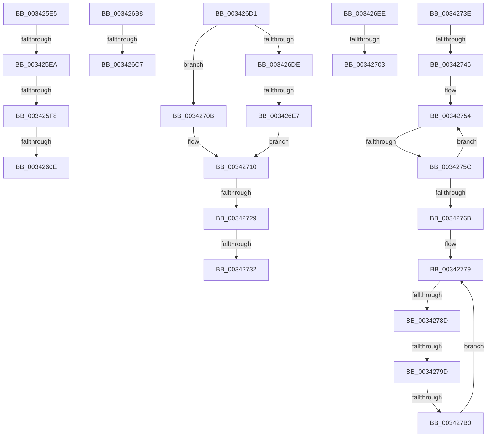

# sub_003425E5

- RVA: `0x003425E5`–`0x003427B2` (길이 `461` bytes)
- VA: `0x00000001403425E5`
- 실행 섹션: `.text`
- PDB 이름 있음: `아니요`; PDB Function 태그: `아니요`
- unwind 정보 RVA: `0x0007780C`
- 디코드: `102`개 명령, `461/461` bytes 표시
- 미해석 바이트: `0` (있으면 어셈블리에 `.byte`로 보존)

> 이 문서는 커널 이미지의 기계어와 PDB 기호를 분석해 생성했습니다. 4번과 5번은 함수 원형과 자료형을 바이너리 사용 방식에서 추정한 C 해석이며 원본 소스 복구 결과는 아닙니다.

## 1. Dependencies

- 직접 호출 지점: **6**; 고유 호출 대상: **6**
- 직접 호출자로 확인된 함수: **0**
- RIP 상대 이미지 참조: **3**

### Outgoing calls
- `0x00342601` → [PsGetPagePriorityThread](../3C/PsGetPagePriorityThread_function_003C3E80.md) (function, `0x003C3E80`)
- `0x003426AC` → [PfLogEvent](PfLogEvent_function_00349BA8.md) (function, `0x00349BA8`)
- `0x003426E7` → [PfTFiNotifyFileStreamCreateCallback](../45/PfTFiNotifyFileStreamCreateCallback_function_0045EEB0.md) (function, `0x0045EEB0`)
- `0x003426F6` → [ExAcquireRundownProtectionCacheAware](../23/ExAcquireRundownProtectionCacheAware_function_0023D110.md) (function, `0x0023D110`)
- `0x0034270B` → [PfTFiNotifyFileInfoDeleteCallback](../45/PfTFiNotifyFileInfoDeleteCallback_function_0045F040.md) (function, `0x0045F040`)
- `0x0034271B` → [PsDereferencePartition](PsDereferencePartition_function_00342E70.md) (function, `0x00342E70`)

### Direct callers
- 이 함수 시작 RVA로 연결되는 직접 call은 확인되지 않았습니다. 간접 호출은 완전히 역산할 수 없습니다.

### Static image references
- `0x0034264D` → RVA `0x00F0F228` (`.data`; read)
- `0x003426A5` → RVA `0x00E670CC` (`.data`; read)
- `0x00342732` → RVA `0x0045EEB0` (`PfTFiNotifyFileStreamCreateCallback`; read)

## 2. Other-region calls and transfers

- 다른 실행 섹션으로 향하는 call: **0**
- call이 아닌 외부 분기/꼬리 이동: **17**
  - `0x003425E8` → [sub_003422B4 + 0x2D1](Unknown_function_003422B4.md) (`tail-transfer`)
  - `0x003425F6` → [sub_003422B4 + 0x2D1](Unknown_function_003422B4.md) (`tail-transfer`)
  - `0x00342608` → [sub_003427F1](Unknown_function_003427F1.md) (`tail-transfer`)
  - `0x003426B3` → [sub_003422B4 + 0x2DB](Unknown_function_003422B4.md) (`tail-transfer`)
  - `0x003426C1` → [sub_003422B4 + 0xE6](Unknown_function_003422B4.md) (`tail-transfer`)
  - `0x003426CC` → [sub_003422B4 + 0x2E8](Unknown_function_003422B4.md) (`tail-transfer`)
  - `0x003426E1` → [sub_003427F1 + 0x8](Unknown_function_003427F1.md) (`tail-transfer`)
  - `0x003426FD` → [sub_003422B4 + 0xB6](Unknown_function_003422B4.md) (`tail-transfer`)
  - `0x00342706` → [sub_003422B4 + 0x92](Unknown_function_003422B4.md) (`tail-transfer`)
  - `0x00342723` → [sub_003422B4 + 0x66](Unknown_function_003422B4.md) (`tail-transfer`)
  - `0x0034272C` → [sub_003422B4 + 0xA4](Unknown_function_003422B4.md) (`tail-transfer`)
  - `0x00342739` → [sub_003422B4 + 0xDB](Unknown_function_003422B4.md) (`tail-transfer`)
  - `0x00342740` → [sub_003422B4 + 0x220](Unknown_function_003422B4.md) (`tail-transfer`)
  - `0x00342756` → [sub_003422B4 + 0x187](Unknown_function_003422B4.md) (`tail-transfer`)
  - `0x00342787` → [sub_00342C29](Unknown_function_00342C29.md) (`tail-transfer`)
  - `0x00342797` → [sub_00342C29](Unknown_function_00342C29.md) (`tail-transfer`)
  - `0x003427AA` → [sub_003422B4 + 0x187](Unknown_function_003422B4.md) (`tail-transfer`)

## 3. Assembly (complete function range)

```asm
003425E5  48 85 FF                        test rdi, rdi
003425E8  74 9B                           je 0x140342585
003425EA  8B 87 64 02 00 00               mov eax, dword ptr [rdi + 0x264]
003425F0  39 87 60 02 00 00               cmp dword ptr [rdi + 0x260], eax
003425F6  73 8D                           jae 0x140342585
003425F8  48 8B 03                        mov rax, qword ptr [rbx]
003425FB  8B 90 30 44 00 00               mov edx, dword ptr [rax + 0x4430]
00342601  E8 7A 18 08 00                  call 0x1403c3e80
00342606  3B C2                           cmp eax, edx
00342608  0F 82 E3 01 00 00               jb 0x1403427f1
0034260E  49 8B 88 D0 01 00 00            mov rcx, qword ptr [r8 + 0x1d0]
00342615  49 8B C2                        mov rax, r10
00342618  48 C1 E0 3F                     shl rax, 0x3f
0034261C  48 BA FF FF FF FF FF FF FF 1F   movabs rdx, 0x1fffffffffffffff
00342626  49 0B C6                        or rax, r14
00342629  49 C1 E9 0C                     shr r9, 0xc
0034262D  48 89 44 24 78                  mov qword ptr [rsp + 0x78], rax
00342632  48 8B C1                        mov rax, rcx
00342635  49 33 80 F8 01 00 00            xor rax, qword ptr [r8 + 0x1f8]
0034263C  48 23 C2                        and rax, rdx
0034263F  4C 89 4C 24 70                  mov qword ptr [rsp + 0x70], r9
00342644  48 89 45 80                     mov qword ptr [rbp - 0x80], rax
00342648  4C 8D 4C 24 68                  lea r9, [rsp + 0x68]
0034264D  8B 05 D5 CB BC 00               mov eax, dword ptr [rip + 0xbccbd5]
00342653  48 BA 20 03 00 00 80 F7 FF FF   movabs rdx, 0xfffff78000000320
0034265D  89 45 88                        mov dword ptr [rbp - 0x78], eax
00342660  48 B8 04 00 00 00 80 F7 FF FF   movabs rax, 0xfffff78000000004
0034266A  89 4D 8C                        mov dword ptr [rbp - 0x74], ecx
0034266D  48 8B CF                        mov rcx, rdi
00342670  4C 89 5C 24 68                  mov qword ptr [rsp + 0x68], r11
00342675  48 8B 12                        mov rdx, qword ptr [rdx]
00342678  8B 00                           mov eax, dword ptr [rax]
0034267A  44 8B C2                        mov r8d, edx
0034267D  4C 0F AF C0                     imul r8, rax
00342681  48 C1 EA 20                     shr rdx, 0x20
00342685  49 C1 E8 18                     shr r8, 0x18
00342689  48 0F AF D0                     imul rdx, rax
0034268D  C7 44 24 20 28 00 00 00         mov dword ptr [rsp + 0x20], 0x28
00342695  48 C1 E2 08                     shl rdx, 8
00342699  4C 03 C2                        add r8, rdx
0034269C  BA 0A 00 00 00                  mov edx, 0xa
003426A1  49 C1 E8 0A                     shr r8, 0xa
003426A5  44 03 05 20 4A B2 00            add r8d, dword ptr [rip + 0xb24a20]
003426AC  E8 F7 74 00 00                  call 0x140349ba8
003426B1  8B F8                           mov edi, eax
003426B3  E9 D7 FE FF FF                  jmp 0x14034258f
003426B8  8B 47 04                        mov eax, dword ptr [rdi + 4]
003426BB  83 E8 02                        sub eax, 2
003426BE  83 F8 02                        cmp eax, 2
003426C1  0F 86 D3 FC FF FF               jbe 0x14034239a
003426C7  BF 7F 00 00 C0                  mov edi, 0xc000007f
003426CC  E9 CB FE FF FF                  jmp 0x14034259c
003426D1  48 8D 54 24 34                  lea rdx, [rsp + 0x34]
003426D6  48 8B CE                        mov rcx, rsi
003426D9  4D 3B CD                        cmp r9, r13
003426DC  74 2D                           je 0x14034270b
003426DE  4D 3B CE                        cmp r9, r14
003426E1  0F 85 12 01 00 00               jne 0x1403427f9
003426E7  E8 C4 C7 11 00                  call 0x14045eeb0
003426EC  EB 22                           jmp 0x140342710
003426EE  49 8B 4E F8                     mov rcx, qword ptr [r14 - 8]
003426F2  49 8D 5E E8                     lea rbx, [r14 - 0x18]
003426F6  E8 15 AA EF FF                  call 0x14023d110
003426FB  84 C0                           test al, al
003426FD  0F 85 67 FC FF FF               jne 0x14034236a
00342703  4D 8B 36                        mov r14, qword ptr [r14]
00342706  E9 3B FC FF FF                  jmp 0x140342346
0034270B  E8 30 C9 11 00                  call 0x14045f040
00342710  BA 50 66 50 74                  mov edx, 0x74506650
00342715  48 8B CB                        mov rcx, rbx
00342718  44 8B F0                        mov r14d, eax
0034271B  E8 50 07 00 00                  call 0x140342e70
00342720  45 85 F6                        test r14d, r14d
00342723  0F 88 F1 FB FF FF               js 0x14034231a
00342729  48 85 F6                        test rsi, rsi
0034272C  0F 85 26 FC FF FF               jne 0x140342358
00342732  4C 8D 35 77 C7 11 00            lea r14, [rip + 0x11c777]
00342739  E9 51 FC FF FF                  jmp 0x14034238f
0034273E  85 D2                           test edx, edx
00342740  0F 84 8E FD FF FF               je 0x1403424d4
00342746  0F 0D 8B 68 01 00 00            prefetchw byte ptr [rbx + 0x168]
0034274D  48 8B 83 68 01 00 00            mov rax, qword ptr [rbx + 0x168]
00342754  A8 01                           test al, 1
00342756  0F 85 DF FC FF FF               jne 0x14034243b
0034275C  48 8D 48 1E                     lea rcx, [rax + 0x1e]
00342760  F0 48 0F B1 8B 68 01 00 00      lock cmpxchg qword ptr [rbx + 0x168], rcx
00342769  75 E9                           jne 0x140342754
0034276B  0F 0D 8E 90 03 00 00            prefetchw byte ptr [rsi + 0x390]
00342772  48 8B 86 90 03 00 00            mov rax, qword ptr [rsi + 0x390]
00342779  48 8B C8                        mov rcx, rax
0034277C  83 E1 0F                        and ecx, 0xf
0034277F  48 83 C1 0F                     add rcx, 0xf
00342783  48 83 F9 0F                     cmp rcx, 0xf
00342787  0F 87 9C 04 00 00               ja 0x140342c29
0034278D  48 8B C8                        mov rcx, rax
00342790  48 83 E1 F0                     and rcx, 0xfffffffffffffff0
00342794  48 3B D9                        cmp rbx, rcx
00342797  0F 85 8C 04 00 00               jne 0x140342c29
0034279D  48 8D 48 0F                     lea rcx, [rax + 0xf]
003427A1  F0 48 0F B1 8E 90 03 00 00      lock cmpxchg qword ptr [rsi + 0x390], rcx
003427AA  0F 84 8B FC FF FF               je 0x14034243b
003427B0  EB C7                           jmp 0x140342779
```

## 4. C-style interpretation (structured pseudocode)

```c
__int64 __fastcall sub_003425E5(__int64 a1, __int64 a2, __int64 a3, __int64 a4, __int64 a5, __int64 a6, __int64 a7, __int64 a8, __int64 a9, __int64 a10, __int64 a11, __int64 a12, __int64 a13)
{
    __int64 result;
    unsigned int v_stack_p20;
    unsigned __int64 v_stack_p34;
    unsigned __int64 v_stack_p68;
    unsigned __int64 v_stack_p70;
    unsigned __int64 v_stack_p78;

    result = PsGetPagePriorityThread(a1, (unsigned int)(*(unsigned int *)(*(unsigned __int64 *)(v_rbx) + 17456)), a3, a4);
    result = (v_r10) << (63);
    result = (result) | (v_r14);
    a4 = (a4) >> (12);
    v_stack_p78 = result;
    result = (*(unsigned __int64 *)(a3 + 464)) ^ (*(unsigned __int64 *)(a3 + 504));
    result = (result) & ((unsigned int)(*(unsigned int *)(*(unsigned __int64 *)(v_rbx) + 17456)));
    v_stack_p70 = a4;
    *(unsigned __int64 *)(v_rbp - 128) = result;
    *(unsigned int *)(v_rbp - 120) = (unsigned int)((unsigned int)(*(unsigned int *)(v_rip + 12372949)));
    *(unsigned int *)(v_rbp - 116) = (unsigned int)(*(unsigned __int64 *)(a3 + 464));
    v_stack_p68 = v_r11;
    a3 = ((unsigned int)((unsigned int)(*(unsigned __int64 *)((unsigned int)(*(unsigned int *)(*(unsigned __int64 *)(v_rbx) + 17456)))))) * ((unsigned int)(*(unsigned int *)((unsigned int)(*(unsigned int *)(v_rip + 12372949)))));
    a2 = (*(unsigned __int64 *)((unsigned int)(*(unsigned int *)(*(unsigned __int64 *)(v_rbx) + 17456)))) >> (32);
    a3 = (a3) >> (24);
    a2 = (a2) * ((unsigned int)(*(unsigned int *)((unsigned int)(*(unsigned int *)(v_rip + 12372949)))));
    v_stack_p20 = 40;
    a2 = (a2) << (8);
    a3 = (a3) + (a2);
    a3 = (a3) >> (10);
    a3 = (unsigned int)((a3) + (*(unsigned int *)(v_rip + 11684384)));
    result = PfLogEvent(v_rdi, 10, a3, a13);
}
```

## 5. (Beta) C Style

```c
int64_t sub_003425E5(int64_t Arg1, int64_t Arg2, int64_t Arg3, int64_t Arg4, uint64_t Arg5, uint64_t Arg6, uint64_t Arg7, uint64_t Arg8, uint64_t Arg9, uint64_t Arg10, uint64_t Arg11, uint64_t Arg12, int64_t Arg13)
{
    int64_t result;
    uint32_t v_stack_p20;
    uint64_t v_stack_p34;
    uint64_t v_stack_p68;
    uint64_t v_stack_p70;
    uint64_t v_stack_p78;

    result = PsGetPagePriorityThread(Arg1, (uint32_t)(*(uint32_t *)(*(uint64_t *)(local_rbx) + 0x4430)), Arg3, Arg4);
    result = (local_r10) << (63);
    result = (result) | (local_r14);
    Arg4 = (Arg4) >> (12);
    v_stack_p78 = result;
    result = (*(uint64_t *)(Arg3 + 0x1D0)) ^ (*(uint64_t *)(Arg3 + 0x1F8));
    result = (result) & ((uint32_t)(*(uint32_t *)(*(uint64_t *)(local_rbx) + 0x4430)));
    v_stack_p70 = Arg4;
    *(uint64_t *)(local_rbp - 0x80) = result;
    *(uint32_t *)(local_rbp - 0x78) = (uint32_t)((uint32_t)(*(uint32_t *)(v_rip + 0xBCCBD5)));
    *(uint32_t *)(local_rbp - 0x74) = (uint32_t)(*(uint64_t *)(Arg3 + 0x1D0));
    v_stack_p68 = local_r11;
    Arg3 = ((uint32_t)((uint32_t)(*(uint64_t *)((uint32_t)(*(uint32_t *)(*(uint64_t *)(local_rbx) + 0x4430)))))) * ((uint32_t)(*(uint32_t *)((uint32_t)(*(uint32_t *)(v_rip + 0xBCCBD5)))));
    Arg2 = (*(uint64_t *)((uint32_t)(*(uint32_t *)(*(uint64_t *)(local_rbx) + 0x4430)))) >> (32);
    Arg3 = (Arg3) >> (24);
    Arg2 = (Arg2) * ((uint32_t)(*(uint32_t *)((uint32_t)(*(uint32_t *)(v_rip + 0xBCCBD5)))));
    v_stack_p20 = 40;
    Arg2 = (Arg2) << (8);
    Arg3 = (Arg3) + (Arg2);
    Arg3 = (Arg3) >> (10);
    Arg3 = (uint32_t)((Arg3) + (*(uint32_t *)(v_rip + 0xB24A20)));
    result = PfLogEvent(local_rdi, 10, Arg3, Arg13);
}
```

## 6. Execution-region graph

[열기: 2D/3D 그래프와 함수 탐색 컨트롤 패널](../../../control-panel.html?section=text&rva=0x003425E5&view=graph)

- 2D 그래프는 위에서 아래로 흐르고, 3D 그래프는 빈 공간을 드래그해 회전합니다. Shift+드래그는 이동, 휠은 확대·축소, 함수 노드 선택은 대상 보고서 이동입니다.

### Static fallback


