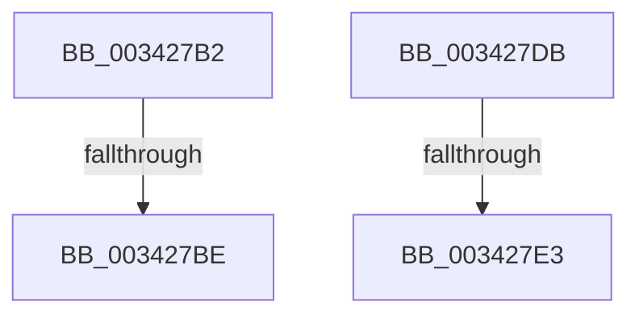

# sub_003427B2

- RVA: `0x003427B2`–`0x003427F1` (길이 `63` bytes)
- VA: `0x00000001403427B2`
- 실행 섹션: `.text`
- PDB 이름 있음: `아니요`; PDB Function 태그: `아니요`
- unwind 정보 RVA: `0x00077834`
- 디코드: `16`개 명령, `63/63` bytes 표시
- 미해석 바이트: `0` (있으면 어셈블리에 `.byte`로 보존)

> 이 문서는 커널 이미지의 기계어와 PDB 기호를 분석해 생성했습니다. 4번과 5번은 함수 원형과 자료형을 바이너리 사용 방식에서 추정한 C 해석이며 원본 소스 복구 결과는 아닙니다.

## 1. Dependencies

- 직접 호출 지점: **1**; 고유 호출 대상: **1**
- 직접 호출자로 확인된 함수: **0**
- RIP 상대 이미지 참조: **1**

### Outgoing calls
- `0x003427E7` → [PfSnNameRemoveAll](../../page/96/PfSnNameRemoveAll_function_00960C90.md) (function, `0x00960C90`)

### Direct callers
- 이 함수 시작 RVA로 연결되는 직접 call은 확인되지 않았습니다. 간접 호출은 완전히 역산할 수 없습니다.

### Static image references
- `0x003427C3` → RVA `0x00F0F228` (`.data`; read/write)

## 2. Other-region calls and transfers

- 다른 실행 섹션으로 향하는 call: **1**
  - `0x003427E7` → [PfSnNameRemoveAll](../../page/96/PfSnNameRemoveAll_function_00960C90.md) (`.text` → `PAGE`)
- call이 아닌 외부 분기/꼬리 이동: **4**
  - `0x003427B8` → [sub_00342A4A](Unknown_function_00342A4A.md) (`tail-transfer`)
  - `0x003427D6` → [sub_003425BC](Unknown_function_003425BC.md) (`tail-transfer`)
  - `0x003427E1` → [sub_00342803](Unknown_function_00342803.md) (`tail-transfer`)
  - `0x003427EC` → [sub_0034228E + 0x18](Unknown_function_0034228E.md) (`tail-transfer`)

## 3. Assembly (complete function range)

```asm
003427B2  8B 49 04                        mov ecx, dword ptr [rcx + 4]
003427B5  83 F9 07                        cmp ecx, 7
003427B8  0F 85 8C 02 00 00               jne 0x140342a4a
003427BE  B9 01 00 00 00                  mov ecx, 1
003427C3  F0 0F C1 0D 5D CA BC 00         lock xadd dword ptr [rip + 0xbcca5d], ecx
003427CB  FF C1                           inc ecx
003427CD  89 4F 10                        mov dword ptr [rdi + 0x10], ecx
003427D0  45 33 E4                        xor r12d, r12d
003427D3  41 8B FC                        mov edi, r12d
003427D6  E9 E1 FD FF FF                  jmp 0x1403425bc
003427DB  8B 41 04                        mov eax, dword ptr [rcx + 4]
003427DE  83 F8 03                        cmp eax, 3
003427E1  75 20                           jne 0x140342803
003427E3  48 8B 49 10                     mov rcx, qword ptr [rcx + 0x10]
003427E7  E8 A4 E4 61 00                  call 0x140960c90
003427EC  E9 B5 FA FF FF                  jmp 0x1403422a6
```

## 4. C-style interpretation (structured pseudocode)

```c
__int64 __fastcall sub_003427B2(__int64 a1)
{
    __int64 v_r12;

    a1 = (unsigned int)((1) + 1);
    *(unsigned int *)(v_rdi + 16) = (unsigned int)(a1);
    v_r12 = 0;
}
```

## 5. (Beta) C Style

```c
int64_t sub_003427B2(void *Arg1)
{
    uint8_t *arg1 = (uint8_t *)Arg1;

    int64_t local_r12;

    Arg1 = (uint32_t)((1) + 1);
    *(uint32_t *)(local_rdi + 0x10) = (uint32_t)(Arg1);
    local_r12 = 0;
}
```

### 관측된 메모리 오프셋

구조체 형식이 확인되지 않은 접근은 인자 기준의 오프셋으로만 기록했습니다.

| 기준 인자 | 오프셋 표현 | 폭 (bit) | 접근 |
|---|---:|---:|---|
| `Arg1` | `+ 0x4` | `32` | `R` |

## 6. Execution-region graph

[열기: 2D/3D 그래프와 함수 탐색 컨트롤 패널](../../../control-panel.html?section=text&rva=0x003427B2&view=graph)

- 2D 그래프는 위에서 아래로 흐르고, 3D 그래프는 빈 공간을 드래그해 회전합니다. Shift+드래그는 이동, 휠은 확대·축소, 함수 노드 선택은 대상 보고서 이동입니다.

### Static fallback


