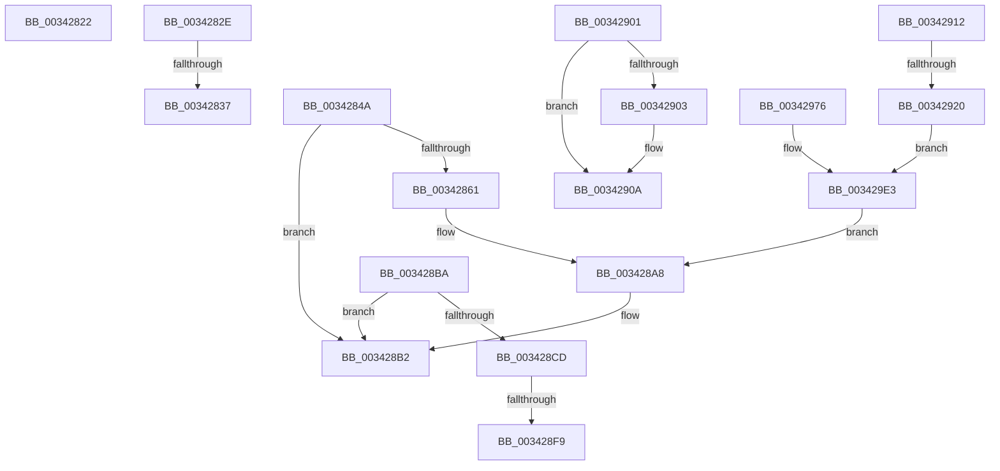

# sub_00342822

- RVA: `0x00342822`–`0x00342A1A` (길이 `504` bytes)
- VA: `0x0000000140342822`
- 실행 섹션: `.text`
- PDB 이름 있음: `아니요`; PDB Function 태그: `아니요`
- unwind 정보 RVA: `0x0007788C`
- 디코드: `123`개 명령, `504/504` bytes 표시
- 미해석 바이트: `0` (있으면 어셈블리에 `.byte`로 보존)

> 이 문서는 커널 이미지의 기계어와 PDB 기호를 분석해 생성했습니다. 4번과 5번은 함수 원형과 자료형을 바이너리 사용 방식에서 추정한 C 해석이며 원본 소스 복구 결과는 아닙니다.

## 1. Dependencies

- 직접 호출 지점: **4**; 고유 호출 대상: **2**
- 직접 호출자로 확인된 함수: **0**
- RIP 상대 이미지 참조: **5**

### Outgoing calls
- `0x0034286B` → [PfpRpFileKeyUpdate](../../page/85/PfpRpFileKeyUpdate_function_0085EB30.md) (function, `0x0085EB30`)
- `0x003428AD` → [PfpPartitionIterate](PfpPartitionIterate_function_00341D00.md) (function, `0x00341D00`)
- `0x003428DA` → [PfpRpFileKeyUpdate](../../page/85/PfpRpFileKeyUpdate_function_0085EB30.md) (function, `0x0085EB30`)
- `0x003428EA` → [PfpPartitionIterate](PfpPartitionIterate_function_00341D00.md) (function, `0x00341D00`)

### Direct callers
- 이 함수 시작 RVA로 연결되는 직접 call은 확인되지 않았습니다. 간접 호출은 완전히 역산할 수 없습니다.

### Static image references
- `0x00342837` → RVA `0x00000000` (`image boundary/outside`; read)
- `0x00342864` → RVA `0x00E67148` (`.data`; read)
- `0x00342936` → RVA `0x00F0F228` (`.data`; read)
- `0x003429FF` → RVA `0x004A82B0` (`PfpPartitionLogEventCallback`; read)
- `0x00342A06` → RVA `0x00E670CC` (`.data`; read)

## 2. Other-region calls and transfers

- 다른 실행 섹션으로 향하는 call: **2**
  - `0x0034286B` → [PfpRpFileKeyUpdate](../../page/85/PfpRpFileKeyUpdate_function_0085EB30.md) (`.text` → `PAGE`)
  - `0x003428DA` → [PfpRpFileKeyUpdate](../../page/85/PfpRpFileKeyUpdate_function_0085EB30.md) (`.text` → `PAGE`)
- call이 아닌 외부 분기/꼬리 이동: **7**
  - `0x00342829` → [sub_003422B4 + 0x1FD](Unknown_function_003422B4.md) (`tail-transfer`)
  - `0x00342831` → [sub_00342BC8 + 0x3C](Unknown_function_00342BC8.md) (`tail-transfer`)
  - `0x003428B5` → [sub_003422B4 + 0x2E8](Unknown_function_003422B4.md) (`tail-transfer`)
  - `0x003428F3` → [sub_003422B4 + 0x2E8](Unknown_function_003422B4.md) (`tail-transfer`)
  - `0x003428FC` → [sub_003422B4 + 0x2E8](Unknown_function_003422B4.md) (`tail-transfer`)
  - `0x0034290D` → [sub_003422B4 + 0x2D1](Unknown_function_003422B4.md) (`tail-transfer`)
  - `0x0034291A` → [sub_00342AF8 + 0x23](Unknown_function_00342AF8.md) (`tail-transfer`)

## 3. Assembly (complete function range)

```asm
00342822  F0 FF 83 50 01 00 00            lock inc dword ptr [rbx + 0x150]
00342829  E9 83 FC FF FF                  jmp 0x1403424b1
0034282E  83 F8 0D                        cmp eax, 0xd
00342831  0F 87 CD 03 00 00               ja 0x140342c04
00342837  48 8D 15 C2 D7 CB FF            lea rdx, [rip - 0x34283e]
0034283E  8B 8C 82 98 2C 34 00            mov ecx, dword ptr [rdx + rax*4 + 0x342c98]
00342845  48 03 CA                        add rcx, rdx
00342848  FF E1                           jmp rcx
0034284A  CC                              int3
0034284B  CC                              int3
0034284C  CC                              int3
0034284D  CC                              int3
0034284E  48 8B 57 10                     mov rdx, qword ptr [rdi + 0x10]
00342852  8B 42 20                        mov eax, dword ptr [rdx + 0x20]
00342855  8B C8                           mov ecx, eax
00342857  C1 E9 10                        shr ecx, 0x10
0034285A  0F B7 C0                        movzx eax, ax
0034285D  3B C8                           cmp ecx, eax
0034285F  76 51                           jbe 0x1403428b2
00342861  45 33 C0                        xor r8d, r8d
00342864  48 8D 0D DD 48 B2 00            lea rcx, [rip + 0xb248dd]
0034286B  E8 C0 C2 51 00                  call 0x14085eb30
00342870  48 8B 57 10                     mov rdx, qword ptr [rdi + 0x10]
00342874  4C 8D 45 A8                     lea r8, [rbp - 0x58]
00342878  44 89 65 AC                     mov dword ptr [rbp - 0x54], r12d
0034287C  B9 01 00 00 00                  mov ecx, 1
00342881  44 89 65 C4                     mov dword ptr [rbp - 0x3c], r12d
00342885  48 8B 42 10                     mov rax, qword ptr [rdx + 0x10]
00342889  48 89 45 B0                     mov qword ptr [rbp - 0x50], rax
0034288D  8B 42 2C                        mov eax, dword ptr [rdx + 0x2c]
00342890  48 89 45 B8                     mov qword ptr [rbp - 0x48], rax
00342894  41 8B C4                        mov eax, r12d
00342897  44 89 65 C0                     mov dword ptr [rbp - 0x40], r12d
0034289B  F6 42 24 08                     test byte ptr [rdx + 0x24], 8
0034289F  0F 45 C1                        cmovne eax, ecx
003428A2  49 8B CD                        mov rcx, r13
003428A5  89 45 C0                        mov dword ptr [rbp - 0x40], eax
003428A8  BA 02 00 00 00                  mov edx, 2
003428AD  E8 4E F4 FF FF                  call 0x140341d00
003428B2  41 8B FC                        mov edi, r12d
003428B5  E9 E2 FC FF FF                  jmp 0x14034259c
003428BA  48 8B 57 10                     mov rdx, qword ptr [rdi + 0x10]
003428BE  8B 42 20                        mov eax, dword ptr [rdx + 0x20]
003428C1  8B C8                           mov ecx, eax
003428C3  C1 E9 10                        shr ecx, 0x10
003428C6  0F B7 C0                        movzx eax, ax
003428C9  3B C8                           cmp ecx, eax
003428CB  76 E5                           jbe 0x1403428b2
003428CD  41 B8 01 00 00 00               mov r8d, 1
003428D3  48 8D 0D 6E 48 B2 00            lea rcx, [rip + 0xb2486e]
003428DA  E8 51 C2 51 00                  call 0x14085eb30
003428DF  4C 8B C7                        mov r8, rdi
003428E2  BA 02 00 00 00                  mov edx, 2
003428E7  49 8B CE                        mov rcx, r14
003428EA  E8 11 F4 FF FF                  call 0x140341d00
003428EF  8B F8                           mov edi, eax
003428F1  85 C0                           test eax, eax
003428F3  0F 88 A3 FC FF FF               js 0x14034259c
003428F9  41 8B FC                        mov edi, r12d
003428FC  E9 9B FC FF FF                  jmp 0x14034259c
00342901  74 07                           je 0x14034290a
00342903  B9 0E 00 00 00                  mov ecx, 0xe
00342908  CD 29                           int 0x29
0034290A  49 8B DC                        mov rbx, r12
0034290D  E9 73 FC FF FF                  jmp 0x140342585
00342912  48 8B 4F 10                     mov rcx, qword ptr [rdi + 0x10]
00342916  4C 39 61 08                     cmp qword ptr [rcx + 8], r12
0034291A  0F 84 FB 01 00 00               je 0x140342b1b
00342920  44 89 65 F4                     mov dword ptr [rbp - 0xc], r12d
00342924  48 BA 20 03 00 00 80 F7 FF FF   movabs rdx, 0xfffff78000000320
0034292E  48 8B 41 08                     mov rax, qword ptr [rcx + 8]
00342932  48 89 45 E8                     mov qword ptr [rbp - 0x18], rax
00342936  8B 05 EC C8 BC 00               mov eax, dword ptr [rip + 0xbcc8ec]
0034293C  89 45 F0                        mov dword ptr [rbp - 0x10], eax
0034293F  48 8B 01                        mov rax, qword ptr [rcx]
00342942  48 89 45 E0                     mov qword ptr [rbp - 0x20], rax
00342946  48 B8 04 00 00 00 80 F7 FF FF   movabs rax, 0xfffff78000000004
00342950  44 89 64 24 44                  mov dword ptr [rsp + 0x44], r12d
00342955  C7 44 24 38 1F 00 00 00         mov dword ptr [rsp + 0x38], 0x1f
0034295D  48 8B 0A                        mov rcx, qword ptr [rdx]
00342960  8B 00                           mov eax, dword ptr [rax]
00342962  8B D1                           mov edx, ecx
00342964  48 0F AF D0                     imul rdx, rax
00342968  48 C1 E9 20                     shr rcx, 0x20
0034296C  48 0F AF C8                     imul rcx, rax
00342970  48 8D 45 E0                     lea rax, [rbp - 0x20]
00342974  EB 6D                           jmp 0x1403429e3
00342976  48 8B 4F 10                     mov rcx, qword ptr [rdi + 0x10]
0034297A  44 89 65 CC                     mov dword ptr [rbp - 0x34], r12d
0034297E  8B 11                           mov edx, dword ptr [rcx]
00342980  8B 41 04                        mov eax, dword ptr [rcx + 4]
00342983  83 E2 03                        and edx, 3
00342986  89 45 C8                        mov dword ptr [rbp - 0x38], eax
00342989  48 03 D2                        add rdx, rdx
0034298C  48 8B 41 08                     mov rax, qword ptr [rcx + 8]
00342990  48 89 45 D0                     mov qword ptr [rbp - 0x30], rax
00342994  48 8B 41 10                     mov rax, qword ptr [rcx + 0x10]
00342998  48 05 FF 0F 00 00               add rax, 0xfff
0034299E  44 89 64 24 44                  mov dword ptr [rsp + 0x44], r12d
003429A3  48 25 00 F0 FF FF               and rax, 0xfffffffffffff000
003429A9  C7 44 24 38 18 00 00 00         mov dword ptr [rsp + 0x38], 0x18
003429B1  48 0B C2                        or rax, rdx
003429B4  48 BA 20 03 00 00 80 F7 FF FF   movabs rdx, 0xfffff78000000320
003429BE  48 89 45 D8                     mov qword ptr [rbp - 0x28], rax
003429C2  48 B8 04 00 00 00 80 F7 FF FF   movabs rax, 0xfffff78000000004
003429CC  48 8B 0A                        mov rcx, qword ptr [rdx]
003429CF  8B 00                           mov eax, dword ptr [rax]
003429D1  8B D1                           mov edx, ecx
003429D3  48 0F AF D0                     imul rdx, rax
003429D7  48 C1 E9 20                     shr rcx, 0x20
003429DB  48 0F AF C8                     imul rcx, rax
003429DF  48 8D 45 C8                     lea rax, [rbp - 0x38]
003429E3  48 C1 E1 08                     shl rcx, 8
003429E7  4C 8D 44 24 38                  lea r8, [rsp + 0x38]
003429EC  48 C1 EA 18                     shr rdx, 0x18
003429F0  48 03 D1                        add rdx, rcx
003429F3  C7 44 24 40 18 00 00 00         mov dword ptr [rsp + 0x40], 0x18
003429FB  48 C1 EA 0A                     shr rdx, 0xa
003429FF  48 8D 0D AA 58 16 00            lea rcx, [rip + 0x1658aa]
00342A06  03 15 C0 46 B2 00               add edx, dword ptr [rip + 0xb246c0]
00342A0C  89 54 24 3C                     mov dword ptr [rsp + 0x3c], edx
00342A10  48 89 44 24 48                  mov qword ptr [rsp + 0x48], rax
00342A15  E9 8E FE FF FF                  jmp 0x1403428a8
```

## 4. C-style interpretation (structured pseudocode)

```c
__int64 __fastcall sub_00342822(__int64 a1, __int64 a2, int a3)
{
    unsigned int v_stack_p38;
    unsigned int v_stack_p3C;
    unsigned int v_stack_p40;
    unsigned int v_stack_p44;
    unsigned __int64 v_stack_p48;
}
```

## 5. (Beta) C Style

```c
int64_t sub_00342822(int64_t Arg1, int64_t Arg2, int32_t Arg3)
{
    uint32_t v_stack_p38;
    uint32_t v_stack_p3C;
    uint32_t v_stack_p40;
    uint32_t v_stack_p44;
    uint64_t v_stack_p48;
}
```

## 6. Execution-region graph

[열기: 2D/3D 그래프와 함수 탐색 컨트롤 패널](../../../control-panel.html?section=text&rva=0x00342822&view=graph)

- 2D 그래프는 위에서 아래로 흐르고, 3D 그래프는 빈 공간을 드래그해 회전합니다. Shift+드래그는 이동, 휠은 확대·축소, 함수 노드 선택은 대상 보고서 이동입니다.

### Static fallback


