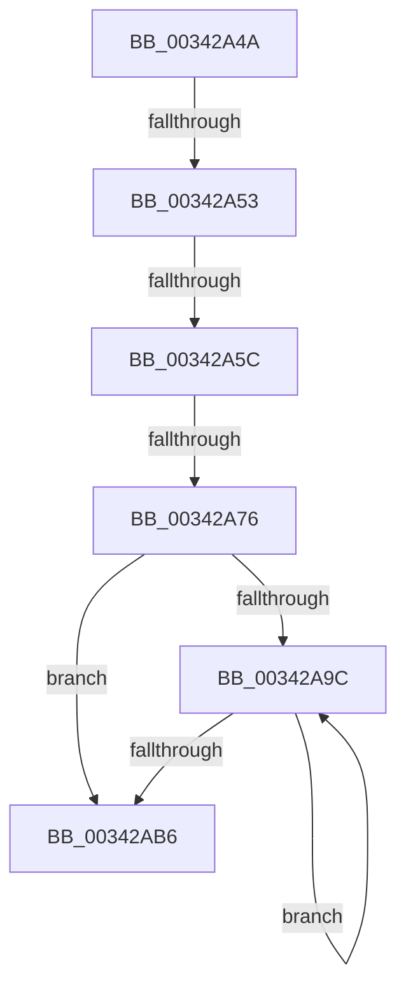

# sub_00342A4A

- RVA: `0x00342A4A`–`0x00342AF8` (길이 `174` bytes)
- VA: `0x0000000140342A4A`
- 실행 섹션: `.text`
- PDB 이름 있음: `아니요`; PDB Function 태그: `아니요`
- unwind 정보 RVA: `0x000778F4`
- 디코드: `35`개 명령, `174/174` bytes 표시
- 미해석 바이트: `0` (있으면 어셈블리에 `.byte`로 보존)

> 이 문서는 커널 이미지의 기계어와 PDB 기호를 분석해 생성했습니다. 4번과 5번은 함수 원형과 자료형을 바이너리 사용 방식에서 추정한 C 해석이며 원본 소스 복구 결과는 아닙니다.

## 1. Dependencies

- 직접 호출 지점: **6**; 고유 호출 대상: **4**
- 직접 호출자로 확인된 함수: **0**
- RIP 상대 이미지 참조: **8**

### Outgoing calls
- `0x00342A63` → [FsRtlAcquirePushLockExclusive](../4A/FsRtlAcquirePushLockExclusive_function_004A05F4.md) (function, `0x004A05F4`)
- `0x00342A7D` → [FsRtlAcquirePushLockExclusive](../4A/FsRtlAcquirePushLockExclusive_function_004A05F4.md) (function, `0x004A05F4`)
- `0x00342AA9` → [KeSetEvent](../33/KeSetEvent_function_0033F310.md) (function, `0x0033F310`)
- `0x00342ABD` → [PfLockExclusiveRelease](../49/PfLockExclusiveRelease_function_00491D88.md) (function, `0x00491D88`)
- `0x00342AC9` → [ExWaitForRundownProtectionRelease](../2A/ExWaitForRundownProtectionRelease_function_002A4CB0.md) (function, `0x002A4CB0`)
- `0x00342AEE` → [PfLockExclusiveRelease](../49/PfLockExclusiveRelease_function_00491D88.md) (function, `0x00491D88`)

### Direct callers
- 이 함수 시작 RVA로 연결되는 직접 call은 확인되지 않았습니다. 간접 호출은 완전히 역산할 수 없습니다.

### Static image references
- `0x00342A5C` → RVA `0x00E671F8` (`.data`; read)
- `0x00342A68` → RVA `0x00E671E8` (`.data`; read)
- `0x00342A76` → RVA `0x00E67200` (`.data`; read)
- `0x00342A82` → RVA `0x00E67218` (`.data`; read/write)
- `0x00342A89` → RVA `0x00E67208` (`.data`; read)
- `0x00342AC2` → RVA `0x00E671F0` (`.data`; read)
- `0x00342AD6` → RVA `0x00E671F0` (`.data`; read/write)
- `0x00342ADD` → RVA `0x00E671E8` (`.data`; write)

## 2. Other-region calls and transfers

- 다른 실행 섹션으로 향하는 call: **0**
- call이 아닌 외부 분기/꼬리 이동: **4**
  - `0x00342A4D` → [sub_00342B2F + 0x20](Unknown_function_00342B2F.md) (`tail-transfer`)
  - `0x00342A56` → [sub_00342B2F](Unknown_function_00342B2F.md) (`tail-transfer`)
  - `0x00342A70` → [sub_00342C0E + 0xA](Unknown_function_00342C0E.md) (`tail-transfer`)
  - `0x00342AF3` → [sub_003425BC](Unknown_function_003425BC.md) (`tail-transfer`)

## 3. Assembly (complete function range)

```asm
00342A4A  83 E9 0A                        sub ecx, 0xa
00342A4D  0F 84 FC 00 00 00               je 0x140342b4f
00342A53  83 E9 01                        sub ecx, 1
00342A56  0F 85 D3 00 00 00               jne 0x140342b2f
00342A5C  48 8D 0D 95 47 B2 00            lea rcx, [rip + 0xb24795]
00342A63  E8 8C DB 15 00                  call 0x1404a05f4
00342A68  48 83 3D 78 47 B2 00 00         cmp qword ptr [rip + 0xb24778], 0
00342A70  0F 84 A2 01 00 00               je 0x140342c18
00342A76  48 8D 0D 83 47 B2 00            lea rcx, [rip + 0xb24783]
00342A7D  E8 72 DB 15 00                  call 0x1404a05f4
00342A82  83 0D 8F 47 B2 00 01            or dword ptr [rip + 0xb2478f], 1
00342A89  48 8D 3D 78 47 B2 00            lea rdi, [rip + 0xb24778]
00342A90  48 8B 1D 71 47 B2 00            mov rbx, qword ptr [rip + 0xb24771]
00342A97  48 3B DF                        cmp rbx, rdi
00342A9A  74 1A                           je 0x140342ab6
00342A9C  83 4B 44 04                     or dword ptr [rbx + 0x44], 4
00342AA0  48 8D 4B 58                     lea rcx, [rbx + 0x58]
00342AA4  45 33 C0                        xor r8d, r8d
00342AA7  33 D2                           xor edx, edx
00342AA9  E8 62 C8 FF FF                  call 0x14033f310
00342AAE  48 8B 1B                        mov rbx, qword ptr [rbx]
00342AB1  48 3B DF                        cmp rbx, rdi
00342AB4  75 E6                           jne 0x140342a9c
00342AB6  48 8D 0D 43 47 B2 00            lea rcx, [rip + 0xb24743]
00342ABD  E8 C6 F2 14 00                  call 0x140491d88
00342AC2  48 8D 0D 27 47 B2 00            lea rcx, [rip + 0xb24727]
00342AC9  E8 E2 21 F6 FF                  call 0x1402a4cb0
00342ACE  45 33 E4                        xor r12d, r12d
00342AD1  B9 01 00 00 00                  mov ecx, 1
00342AD6  48 87 0D 13 47 B2 00            xchg qword ptr [rip + 0xb24713], rcx
00342ADD  4C 89 25 04 47 B2 00            mov qword ptr [rip + 0xb24704], r12
00342AE4  41 8B FC                        mov edi, r12d
00342AE7  48 8D 0D 0A 47 B2 00            lea rcx, [rip + 0xb2470a]
00342AEE  E8 95 F2 14 00                  call 0x140491d88
00342AF3  E9 C4 FA FF FF                  jmp 0x1403425bc
```

## 4. C-style interpretation (structured pseudocode)

```c
__int64 __fastcall sub_00342A4A(int a1, int a2, int a3)
{
    __int64 result;
    __int64 v_r12;

    a1 = (unsigned int)((a1) - (10));
    a1 = (unsigned int)((a1) - (1));
    result = FsRtlAcquirePushLockExclusive(v_rip + 11683733, a2, a3, a4);
    result = FsRtlAcquirePushLockExclusive(v_rip + 11683715, a2, a3, a4);
    if ((*(unsigned __int64 *)(v_rip + 11683697)) == (v_rip + 11683704)) goto loc_00342AB6;
loc_00342A9C:
    a3 = 0;
    a2 = 0;
    result = KeSetEvent(*(unsigned __int64 *)(v_rip + 11683697) + 88, a2, a3, a4);
    if ((*(unsigned __int64 *)(*(unsigned __int64 *)(v_rip + 11683697))) != (v_rip + 11683704)) goto loc_00342A9C;
loc_00342AB6:
    result = PfLockExclusiveRelease(v_rip + 11683651, a2, a3, a4);
    result = ExWaitForRundownProtectionRelease(v_rip + 11683623, a2, a3, a4);
    v_r12 = 0;
    *(unsigned __int64 *)(v_rip + 11683588) = 0;
    result = PfLockExclusiveRelease(v_rip + 11683594, a2, a3, a4);
}
```

## 5. (Beta) C Style

```c
int64_t sub_00342A4A(int32_t Arg1, int32_t Arg2, int32_t Arg3)
{
    int64_t result;
    int64_t local_r12;

    Arg1 = (uint32_t)((Arg1) - (10));
    Arg1 = (uint32_t)((Arg1) - (1));
    result = FsRtlAcquirePushLockExclusive(v_rip + 11683733, Arg2, Arg3, a4);
    result = FsRtlAcquirePushLockExclusive(v_rip + 11683715, Arg2, Arg3, a4);
    if ((*(uint64_t *)(v_rip + 0xB24771)) == (v_rip + 11683704)) goto loc_00342AB6;
loc_00342A9C:
    Arg3 = 0;
    Arg2 = 0;
    result = KeSetEvent(*(uint64_t *)(v_rip + 0xB24771) + 88, Arg2, Arg3, a4);
    if ((*(uint64_t *)(*(uint64_t *)(v_rip + 0xB24771))) != (v_rip + 11683704)) goto loc_00342A9C;
loc_00342AB6:
    result = PfLockExclusiveRelease(v_rip + 11683651, Arg2, Arg3, a4);
    result = ExWaitForRundownProtectionRelease(v_rip + 11683623, Arg2, Arg3, a4);
    local_r12 = 0;
    *(uint64_t *)(v_rip + 0xB24704) = 0;
    result = PfLockExclusiveRelease(v_rip + 11683594, Arg2, Arg3, a4);
}
```

## 6. Execution-region graph

[열기: 2D/3D 그래프와 함수 탐색 컨트롤 패널](../../../control-panel.html?section=text&rva=0x00342A4A&view=graph)

- 2D 그래프는 위에서 아래로 흐르고, 3D 그래프는 빈 공간을 드래그해 회전합니다. Shift+드래그는 이동, 휠은 확대·축소, 함수 노드 선택은 대상 보고서 이동입니다.

### Static fallback


