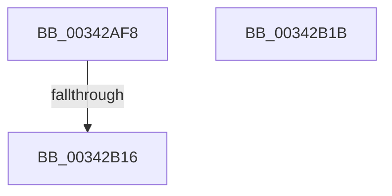

# sub_00342AF8

- RVA: `0x00342AF8`–`0x00342B25` (길이 `45` bytes)
- VA: `0x0000000140342AF8`
- 실행 섹션: `.text`
- PDB 이름 있음: `아니요`; PDB Function 태그: `아니요`
- unwind 정보 RVA: `0x0007790C`
- 디코드: `10`개 명령, `45/45` bytes 표시
- 미해석 바이트: `0` (있으면 어셈블리에 `.byte`로 보존)

> 이 문서는 커널 이미지의 기계어와 PDB 기호를 분석해 생성했습니다. 4번과 5번은 함수 원형과 자료형을 바이너리 사용 방식에서 추정한 C 해석이며 원본 소스 복구 결과는 아닙니다.

## 1. Dependencies

- 직접 호출 지점: **1**; 고유 호출 대상: **1**
- 직접 호출자로 확인된 함수: **0**
- RIP 상대 이미지 참조: **1**

### Outgoing calls
- `0x00342B07` → [PfpPartitionIterate](PfpPartitionIterate_function_00341D00.md) (function, `0x00341D00`)

### Direct callers
- 이 함수 시작 RVA로 연결되는 직접 call은 확인되지 않았습니다. 간접 호출은 완전히 역산할 수 없습니다.

### Static image references
- `0x00342AFB` → RVA `0x0045ED30` (`PfTFiNotifyVolumeCreateCallback`; read)

## 2. Other-region calls and transfers

- 다른 실행 섹션으로 향하는 call: **0**
- call이 아닌 외부 분기/꼬리 이동: **3**
  - `0x00342B10` → [sub_003422B4 + 0x2E8](Unknown_function_003422B4.md) (`tail-transfer`)
  - `0x00342B16` → [sub_00342822 + 0x90](Unknown_function_00342822.md) (`tail-transfer`)
  - `0x00342B20` → [sub_003422B4 + 0x2E8](Unknown_function_003422B4.md) (`tail-transfer`)

## 3. Assembly (complete function range)

```asm
00342AF8  4C 8B C7                        mov r8, rdi
00342AFB  48 8D 0D 2E C2 11 00            lea rcx, [rip + 0x11c22e]
00342B02  BA 02 00 00 00                  mov edx, 2
00342B07  E8 F4 F1 FF FF                  call 0x140341d00
00342B0C  8B F8                           mov edi, eax
00342B0E  85 C0                           test eax, eax
00342B10  0F 88 86 FA FF FF               js 0x14034259c
00342B16  E9 97 FD FF FF                  jmp 0x1403428b2
00342B1B  BF 4D 00 00 C0                  mov edi, 0xc000004d
00342B20  E9 77 FA FF FF                  jmp 0x14034259c
```

## 4. C-style interpretation (structured pseudocode)

```c
__int64 __fastcall sub_00342AF8(void)
{
    __int64 result;

    result = PfpPartitionIterate(v_rip + 1163822, 2, v_rdi, a4);
}
```

## 5. (Beta) C Style

```c
void sub_00342AF8(void)
{
    int64_t result;

    result = PfpPartitionIterate(v_rip + 1163822, 2, local_rdi, a4);
}
```

## 6. Execution-region graph

[열기: 2D/3D 그래프와 함수 탐색 컨트롤 패널](../../../control-panel.html?section=text&rva=0x00342AF8&view=graph)

- 2D 그래프는 위에서 아래로 흐르고, 3D 그래프는 빈 공간을 드래그해 회전합니다. Shift+드래그는 이동, 휠은 확대·축소, 함수 노드 선택은 대상 보고서 이동입니다.

### Static fallback


