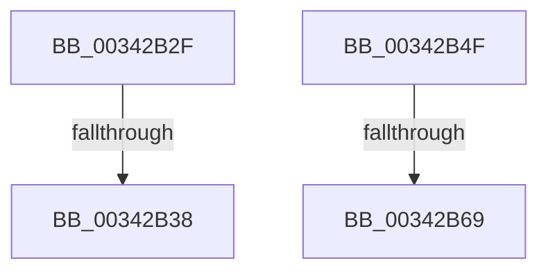

# sub_00342B2F

- RVA: `0x00342B2F`–`0x00342BC8` (길이 `153` bytes)
- VA: `0x0000000140342B2F`
- 실행 섹션: `.text`
- PDB 이름 있음: `아니요`; PDB Function 태그: `아니요`
- unwind 정보 RVA: `0x00077944`
- 디코드: `30`개 명령, `153/153` bytes 표시
- 미해석 바이트: `0` (있으면 어셈블리에 `.byte`로 보존)

> 이 문서는 커널 이미지의 기계어와 PDB 기호를 분석해 생성했습니다. 4번과 5번은 함수 원형과 자료형을 바이너리 사용 방식에서 추정한 C 해석이며 원본 소스 복구 결과는 아닙니다.

## 1. Dependencies

- 직접 호출 지점: **5**; 고유 호출 대상: **3**
- 직접 호출자로 확인된 함수: **0**
- RIP 상대 이미지 참조: **8**

### Outgoing calls
- `0x00342B56` → [FsRtlAcquirePushLockExclusive](../4A/FsRtlAcquirePushLockExclusive_function_004A05F4.md) (function, `0x004A05F4`)
- `0x00342B70` → [FsRtlAcquirePushLockExclusive](../4A/FsRtlAcquirePushLockExclusive_function_004A05F4.md) (function, `0x004A05F4`)
- `0x00342B83` → [PfLockExclusiveRelease](../49/PfLockExclusiveRelease_function_00491D88.md) (function, `0x00491D88`)
- `0x00342B97` → [guard_dispatch_icall](../6B/guard_dispatch_icall_function_006BAAD0.md) (function, `0x006BAAD0`)
- `0x00342BBE` → [PfLockExclusiveRelease](../49/PfLockExclusiveRelease_function_00491D88.md) (function, `0x00491D88`)

### Direct callers
- 이 함수 시작 RVA로 연결되는 직접 call은 확인되지 않았습니다. 간접 호출은 완전히 역산할 수 없습니다.

### Static image references
- `0x00342B38` → RVA `0x00E67360` (`.data`; read)
- `0x00342B4F` → RVA `0x00E671F8` (`.data`; read)
- `0x00342B5B` → RVA `0x00E671E8` (`.data`; read)
- `0x00342B69` → RVA `0x00E67200` (`.data`; read)
- `0x00342B75` → RVA `0x00E67218` (`.data`; read/write)
- `0x00342B8C` → RVA `0x00ABC350` (`PfpPrefetchSharedConflictNotifyStart`; read)
- `0x00342BA3` → RVA `0x00E671E8` (`.data`; write)
- `0x00342BB0` → RVA `0x00E671F0` (`.data`; read/write)

## 2. Other-region calls and transfers

- 다른 실행 섹션으로 향하는 call: **0**
- call이 아닌 외부 분기/꼬리 이동: **4**
  - `0x00342B32` → [sub_00342C0E](Unknown_function_00342C0E.md) (`tail-transfer`)
  - `0x00342B4A` → [sub_003425BC](Unknown_function_003425BC.md) (`tail-transfer`)
  - `0x00342B63` → [sub_00342C0E + 0x14](Unknown_function_00342C0E.md) (`tail-transfer`)
  - `0x00342BC3` → [sub_003425BC](Unknown_function_003425BC.md) (`tail-transfer`)

## 3. Assembly (complete function range)

```asm
00342B2F  83 F9 01                        cmp ecx, 1
00342B32  0F 85 D6 00 00 00               jne 0x140342c0e
00342B38  8B 05 22 48 B2 00               mov eax, dword ptr [rip + 0xb24822]
00342B3E  24 02                           and al, 2
00342B40  F6 D8                           neg al
00342B42  1B FF                           sbb edi, edi
00342B44  81 E7 89 01 00 C0               and edi, 0xc0000189
00342B4A  E9 6D FA FF FF                  jmp 0x1403425bc
00342B4F  48 8D 0D A2 46 B2 00            lea rcx, [rip + 0xb246a2]
00342B56  E8 99 DA 15 00                  call 0x1404a05f4
00342B5B  48 83 3D 85 46 B2 00 00         cmp qword ptr [rip + 0xb24685], 0
00342B63  0F 85 B9 00 00 00               jne 0x140342c22
00342B69  48 8D 0D 90 46 B2 00            lea rcx, [rip + 0xb24690]
00342B70  E8 7F DA 15 00                  call 0x1404a05f4
00342B75  83 25 9C 46 B2 00 FE            and dword ptr [rip + 0xb2469c], 0xfffffffe
00342B7C  48 8D 0D 7D 46 B2 00            lea rcx, [rip + 0xb2467d]
00342B83  E8 00 F2 14 00                  call 0x140491d88
00342B88  48 8B 47 10                     mov rax, qword ptr [rdi + 0x10]
00342B8C  48 8D 0D BD 97 77 00            lea rcx, [rip + 0x7797bd]
00342B93  48 8B 40 20                     mov rax, qword ptr [rax + 0x20]
00342B97  E8 34 7F 37 00                  call 0x1406baad0
00342B9C  48 8B 47 10                     mov rax, qword ptr [rdi + 0x10]
00342BA0  45 33 E4                        xor r12d, r12d
00342BA3  48 89 05 3E 46 B2 00            mov qword ptr [rip + 0xb2463e], rax
00342BAA  41 8B FC                        mov edi, r12d
00342BAD  41 8B C4                        mov eax, r12d
00342BB0  48 87 05 39 46 B2 00            xchg qword ptr [rip + 0xb24639], rax
00342BB7  48 8D 0D 3A 46 B2 00            lea rcx, [rip + 0xb2463a]
00342BBE  E8 C5 F1 14 00                  call 0x140491d88
00342BC3  E9 F4 F9 FF FF                  jmp 0x1403425bc
```

## 4. C-style interpretation (structured pseudocode)

```c
__int64 __fastcall sub_00342B2F(int a1)
{
    __int64 result;
    __int64 v_rdi;

    result = (unsigned __int8)(((unsigned int)(*(unsigned int *)(v_rip + 11683874))) & (2));
    result = (unsigned __int8)(-(result));
    v_rdi = (unsigned int)((v_rdi) & (0xC0000189ULL));
}
```

## 5. (Beta) C Style

```c
int64_t sub_00342B2F(int32_t Arg1)
{
    int64_t result;
    int64_t local_rdi;

    result = (uint8_t)(((uint32_t)(*(uint32_t *)(v_rip + 0xB24822))) & (2));
    result = (uint8_t)(-(result));
    local_rdi = (uint32_t)((local_rdi) & (0xC0000189ULL));
}
```

## 6. Execution-region graph

[열기: 2D/3D 그래프와 함수 탐색 컨트롤 패널](../../../control-panel.html?section=text&rva=0x00342B2F&view=graph)

- 2D 그래프는 위에서 아래로 흐르고, 3D 그래프는 빈 공간을 드래그해 회전합니다. Shift+드래그는 이동, 휠은 확대·축소, 함수 노드 선택은 대상 보고서 이동입니다.

### Static fallback


