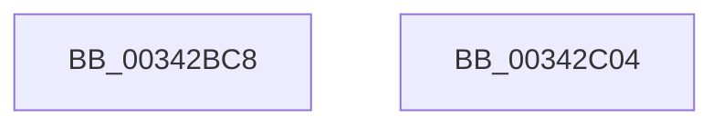

# sub_00342BC8

- RVA: `0x00342BC8`–`0x00342C0E` (길이 `70` bytes)
- VA: `0x0000000140342BC8`
- 실행 섹션: `.text`
- PDB 이름 있음: `아니요`; PDB Function 태그: `아니요`
- unwind 정보 RVA: `0x0007795C`
- 디코드: `16`개 명령, `70/70` bytes 표시
- 미해석 바이트: `0` (있으면 어셈블리에 `.byte`로 보존)

> 이 문서는 커널 이미지의 기계어와 PDB 기호를 분석해 생성했습니다. 4번과 5번은 함수 원형과 자료형을 바이너리 사용 방식에서 추정한 C 해석이며 원본 소스 복구 결과는 아닙니다.

## 1. Dependencies

- 직접 호출 지점: **1**; 고유 호출 대상: **1**
- 직접 호출자로 확인된 함수: **0**
- RIP 상대 이미지 참조: **0**

### Outgoing calls
- `0x00342BF7` → [PfpPartitionIterate](PfpPartitionIterate_function_00341D00.md) (function, `0x00341D00`)

### Direct callers
- 이 함수 시작 RVA로 연결되는 직접 call은 확인되지 않았습니다. 간접 호출은 완전히 역산할 수 없습니다.

### Static image references
- 디코드된 RIP-relative 메모리 참조가 없습니다.

## 2. Other-region calls and transfers

- 다른 실행 섹션으로 향하는 call: **0**
- call이 아닌 외부 분기/꼬리 이동: **2**
  - `0x00342BFF` → [sub_003422B4 + 0x2E8](Unknown_function_003422B4.md) (`tail-transfer`)
  - `0x00342C09` → [sub_003422B4 + 0x2E8](Unknown_function_003422B4.md) (`tail-transfer`)

## 3. Assembly (complete function range)

```asm
00342BC8  48 8B 4F 10                     mov rcx, qword ptr [rdi + 0x10]
00342BCC  4C 8D 45 A8                     lea r8, [rbp - 0x58]
00342BD0  48 C7 45 A8 02 00 00 00         mov qword ptr [rbp - 0x58], 2
00342BD8  BA 02 00 00 00                  mov edx, 2
00342BDD  44 89 65 C4                     mov dword ptr [rbp - 0x3c], r12d
00342BE1  48 8B 41 08                     mov rax, qword ptr [rcx + 8]
00342BE5  48 89 45 B0                     mov qword ptr [rbp - 0x50], rax
00342BE9  8B 41 38                        mov eax, dword ptr [rcx + 0x38]
00342BEC  49 8B CD                        mov rcx, r13
00342BEF  48 89 45 B8                     mov qword ptr [rbp - 0x48], rax
00342BF3  44 89 65 C0                     mov dword ptr [rbp - 0x40], r12d
00342BF7  E8 04 F1 FF FF                  call 0x140341d00
00342BFC  41 8B FC                        mov edi, r12d
00342BFF  E9 98 F9 FF FF                  jmp 0x14034259c
00342C04  BF BB 00 00 C0                  mov edi, 0xc00000bb
00342C09  E9 8E F9 FF FF                  jmp 0x14034259c
```

## 4. C-style interpretation (structured pseudocode)

```c
__int64 __fastcall sub_00342BC8(void)
{
    __int64 result;

    *(unsigned __int64 *)(v_rbp - 88) = 2;
    *(unsigned int *)(v_rbp - 60) = (unsigned int)(v_r12);
    *(unsigned __int64 *)(v_rbp - 80) = *(unsigned __int64 *)(*(unsigned __int64 *)(v_rdi + 16) + 8);
    *(unsigned __int64 *)(v_rbp - 72) = (unsigned int)(*(unsigned int *)(*(unsigned __int64 *)(v_rdi + 16) + 56));
    *(unsigned int *)(v_rbp - 64) = (unsigned int)(v_r12);
    result = PfpPartitionIterate(v_r13, 2, v_rbp - 88, a4);
}
```

## 5. (Beta) C Style

```c
void sub_00342BC8(void)
{
    int64_t result;

    *(uint64_t *)(local_rbp - 0x58) = 2;
    *(uint32_t *)(local_rbp - 0x3C) = (uint32_t)(local_r12);
    *(uint64_t *)(local_rbp - 0x50) = *(uint64_t *)(*(uint64_t *)(local_rdi + 0x10) + 0x8);
    *(uint64_t *)(local_rbp - 0x48) = (uint32_t)(*(uint32_t *)(*(uint64_t *)(local_rdi + 0x10) + 0x38));
    *(uint32_t *)(local_rbp - 0x40) = (uint32_t)(local_r12);
    result = PfpPartitionIterate(local_r13, 2, local_rbp - 88, a4);
}
```

## 6. Execution-region graph

[열기: 2D/3D 그래프와 함수 탐색 컨트롤 패널](../../../control-panel.html?section=text&rva=0x00342BC8&view=graph)

- 2D 그래프는 위에서 아래로 흐르고, 3D 그래프는 빈 공간을 드래그해 회전합니다. Shift+드래그는 이동, 휠은 확대·축소, 함수 노드 선택은 대상 보고서 이동입니다.

### Static fallback


