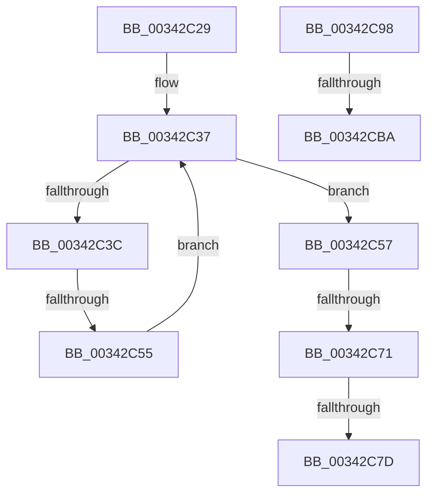

# sub_00342C29

- RVA: `0x00342C29`–`0x00342CD0` (길이 `167` bytes)
- VA: `0x0000000140342C29`
- 실행 섹션: `.text`
- PDB 이름 있음: `아니요`; PDB Function 태그: `아니요`
- unwind 정보 RVA: `0x0007799C`
- 디코드: `49`개 명령, `167/167` bytes 표시
- 미해석 바이트: `0` (있으면 어셈블리에 `.byte`로 보존)

> 이 문서는 커널 이미지의 기계어와 PDB 기호를 분석해 생성했습니다. 4번과 5번은 함수 원형과 자료형을 바이너리 사용 방식에서 추정한 C 해석이며 원본 소스 복구 결과는 아닙니다.

## 1. Dependencies

- 직접 호출 지점: **1**; 고유 호출 대상: **1**
- 직접 호출자로 확인된 함수: **0**
- RIP 상대 이미지 참조: **0**

### Outgoing calls
- `0x00342C86` → [KeSetEvent](../33/KeSetEvent_function_0033F310.md) (function, `0x0033F310`)

### Direct callers
- 이 함수 시작 RVA로 연결되는 직접 call은 확인되지 않았습니다. 간접 호출은 완전히 역산할 수 없습니다.

### Static image references
- 디코드된 RIP-relative 메모리 참조가 없습니다.

## 2. Other-region calls and transfers

- 다른 실행 섹션으로 향하는 call: **0**
- call이 아닌 외부 분기/꼬리 이동: **5**
  - `0x00342C4F` → [sub_003422B4 + 0x187](Unknown_function_003422B4.md) (`tail-transfer`)
  - `0x00342C6B` → [sub_003422B4 + 0x187](Unknown_function_003422B4.md) (`tail-transfer`)
  - `0x00342C77` → [sub_003422B4 + 0x187](Unknown_function_003422B4.md) (`tail-transfer`)
  - `0x00342C93` → [sub_003422B4 + 0x187](Unknown_function_003422B4.md) (`tail-transfer`)
  - `0x00342CB8` → [KeReleaseInStackQueuedSpinLock + 0x3](KeReleaseInStackQueuedSpinLock_function_00342CE0.md) (`tail-transfer`)

## 3. Assembly (complete function range)

```asm
00342C29  0F 0D 8B 68 01 00 00            prefetchw byte ptr [rbx + 0x168]
00342C30  48 8B 93 68 01 00 00            mov rdx, qword ptr [rbx + 0x168]
00342C37  F6 C2 01                        test dl, 1
00342C3A  75 1B                           jne 0x140342c57
00342C3C  48 8D 4A E2                     lea rcx, [rdx - 0x1e]
00342C40  48 8B C2                        mov rax, rdx
00342C43  F0 48 0F B1 8B 68 01 00 00      lock cmpxchg qword ptr [rbx + 0x168], rcx
00342C4C  48 8B D0                        mov rdx, rax
00342C4F  0F 84 E6 F7 FF FF               je 0x14034243b
00342C55  EB E0                           jmp 0x140342c37
00342C57  48 83 E2 FE                     and rdx, 0xfffffffffffffffe
00342C5B  48 C7 C0 F1 FF FF FF            mov rax, 0xfffffffffffffff1
00342C62  F0 48 0F C1 02                  lock xadd qword ptr [rdx], rax
00342C67  48 83 F8 0F                     cmp rax, 0xf
00342C6B  0F 85 CA F7 FF FF               jne 0x14034243b
00342C71  F0 0F BA 72 20 00               lock btr dword ptr [rdx + 0x20], 0
00342C77  0F 82 BE F7 FF FF               jb 0x14034243b
00342C7D  48 8D 4A 08                     lea rcx, [rdx + 8]
00342C81  45 33 C0                        xor r8d, r8d
00342C84  33 D2                           xor edx, edx
00342C86  E8 85 C6 FF FF                  call 0x14033f310
00342C8B  4C 8B 54 24 50                  mov r10, qword ptr [rsp + 0x50]
00342C90  4D 8B CE                        mov r9, r14
00342C93  E9 A3 F7 FF FF                  jmp 0x14034243b
00342C98  F8                              clc
00342C99  2A 34 00                        sub dh, byte ptr [rax + rax]
00342C9C  C8 2B 34 00                     enter 0x342b, 0
00342CA0  BA 28 34 00 4E                  mov edx, 0x4e003428
00342CA5  28 34 00                        sub byte ptr [rax + rax], dh
00342CA8  04 2C                           add al, 0x2c
00342CAA  34 00                           xor al, 0
00342CAC  04 2C                           add al, 0x2c
00342CAE  34 00                           xor al, 0
00342CB0  04 2C                           add al, 0x2c
00342CB2  34 00                           xor al, 0
00342CB4  04 2C                           add al, 0x2c
00342CB6  34 00                           xor al, 0
00342CB8  76 29                           jbe 0x140342ce3
00342CBA  34 00                           xor al, 0
00342CBC  04 2C                           add al, 0x2c
00342CBE  34 00                           xor al, 0
00342CC0  04 2C                           add al, 0x2c
00342CC2  34 00                           xor al, 0
00342CC4  04 2C                           add al, 0x2c
00342CC6  34 00                           xor al, 0
00342CC8  04 2C                           add al, 0x2c
00342CCA  34 00                           xor al, 0
00342CCC  12 29                           adc ch, byte ptr [rcx]
00342CCE  34 00                           xor al, 0
```

## 4. C-style interpretation (structured pseudocode)

```c
__int64 __fastcall sub_00342C29(__int64 a1, __int64 a2, int a3, __int64 a4, __int64 a5, __int64 a6, __int64 a7, __int64 a8, __int64 a9, __int64 a10)
{
    __int64 result;

loc_00342C37:
    if ((((unsigned __int8)(*(unsigned __int64 *)(v_rbx + 360))) & (1)) != 0) goto loc_00342C57;
    goto loc_00342C37;
loc_00342C57:
    a2 = (*(unsigned __int64 *)(v_rbx + 360)) & (-2);
    a3 = 0;
    a2 = 0;
    result = KeSetEvent(a2 + 8, a2, a3, a4);
}
```

## 5. (Beta) C Style

```c
int64_t sub_00342C29(int64_t Arg1, int64_t Arg2, int32_t Arg3, int64_t Arg4, uint64_t Arg5, uint64_t Arg6, uint64_t Arg7, uint64_t Arg8, uint64_t Arg9, int64_t Arg10)
{
    int64_t result;

loc_00342C37:
    if ((((uint8_t)(*(uint64_t *)(local_rbx + 0x168))) & (1)) != 0) goto loc_00342C57;
    goto loc_00342C37;
loc_00342C57:
    Arg2 = (*(uint64_t *)(local_rbx + 0x168)) & (-2);
    Arg3 = 0;
    Arg2 = 0;
    result = KeSetEvent(Arg2 + 8, Arg2, Arg3, Arg4);
}
```

## 6. Execution-region graph

[열기: 2D/3D 그래프와 함수 탐색 컨트롤 패널](../../../control-panel.html?section=text&rva=0x00342C29&view=graph)

- 2D 그래프는 위에서 아래로 흐르고, 3D 그래프는 빈 공간을 드래그해 회전합니다. Shift+드래그는 이동, 휠은 확대·축소, 함수 노드 선택은 대상 보고서 이동입니다.

### Static fallback


