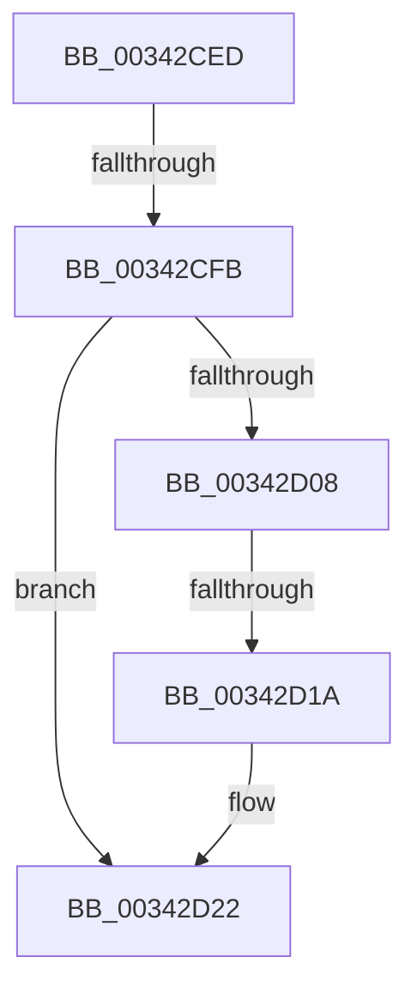

# sub_00342CED

- RVA: `0x00342CED`–`0x00342D39` (길이 `76` bytes)
- VA: `0x0000000140342CED`
- 실행 섹션: `.text`
- PDB 이름 있음: `아니요`; PDB Function 태그: `아니요`
- unwind 정보 RVA: `0x000779CC`
- 디코드: `22`개 명령, `76/76` bytes 표시
- 미해석 바이트: `0` (있으면 어셈블리에 `.byte`로 보존)

> 이 문서는 커널 이미지의 기계어와 PDB 기호를 분석해 생성했습니다. 4번과 5번은 함수 원형과 자료형을 바이너리 사용 방식에서 추정한 C 해석이며 원본 소스 복구 결과는 아닙니다.

## 1. Dependencies

- 직접 호출 지점: **1**; 고유 호출 대상: **1**
- 직접 호출자로 확인된 함수: **0**
- RIP 상대 이미지 참조: **0**

### Outgoing calls
- `0x00342D1D` → [KxWaitForLockChainValid](../21/KxWaitForLockChainValid_function_00217AA0.md) (function, `0x00217AA0`)

### Direct callers
- 이 함수 시작 RVA로 연결되는 직접 call은 확인되지 않았습니다. 간접 호출은 완전히 역산할 수 없습니다.

### Static image references
- 디코드된 RIP-relative 메모리 참조가 없습니다.

## 2. Other-region calls and transfers

- 다른 실행 섹션으로 향하는 call: **0**
- call이 아닌 외부 분기/꼬리 이동: **3**
  - `0x00342CF5` → [sub_00342D6F + 0x18](Unknown_function_00342D6F.md) (`tail-transfer`)
  - `0x00342D14` → [sub_00342D6F + 0x30](Unknown_function_00342D6F.md) (`tail-transfer`)
  - `0x00342D37` → [sub_00342D6F + 0x30](Unknown_function_00342D6F.md) (`tail-transfer`)

## 3. Assembly (complete function range)

```asm
00342CED  48 89 7C 24 38                  mov qword ptr [rsp + 0x38], rdi
00342CF2  48 8B F9                        mov rdi, rcx
00342CF5  0F 85 8C 00 00 00               jne 0x140342d87
00342CFB  0F 0D 09                        prefetchw byte ptr [rcx]
00342CFE  48 8B 01                        mov rax, qword ptr [rcx]
00342D01  33 DB                           xor ebx, ebx
00342D03  48 85 C0                        test rax, rax
00342D06  75 1A                           jne 0x140342d22
00342D08  48 8B 49 08                     mov rcx, qword ptr [rcx + 8]
00342D0C  48 8B C7                        mov rax, rdi
00342D0F  F0 48 0F B1 19                  lock cmpxchg qword ptr [rcx], rbx
00342D14  0F 84 85 00 00 00               je 0x140342d9f
00342D1A  48 8B CF                        mov rcx, rdi
00342D1D  E8 7E 4D ED FF                  call 0x140217aa0
00342D22  4C 8D 40 08                     lea r8, [rax + 8]
00342D26  48 89 1F                        mov qword ptr [rdi], rbx
00342D29  48 8B 4F 08                     mov rcx, qword ptr [rdi + 8]
00342D2D  48 8B C1                        mov rax, rcx
00342D30  49 87 00                        xchg qword ptr [r8], rax
00342D33  32 C1                           xor al, cl
00342D35  A8 04                           test al, 4
00342D37  74 66                           je 0x140342d9f
```

## 4. C-style interpretation (structured pseudocode)

```c
__int64 __fastcall sub_00342CED(__int64 a1)
{
    __int64 result;
    __int64 v_rbx;
    unsigned __int64 v_stack_p38;

    v_stack_p38 = v_rdi;
    v_rbx = 0;
    if (*(unsigned __int64 *)(a1) != 0) goto loc_00342D22;
    result = KxWaitForLockChainValid(a1, a2, a3, a4);
loc_00342D22:
    *(unsigned __int64 *)(a1) = 0;
    result = (unsigned __int8)((*(unsigned __int64 *)(a1 + 8)) ^ ((unsigned __int8)(*(unsigned __int64 *)(a1 + 8))));
}
```

## 5. (Beta) C Style

```c
int64_t sub_00342CED(void *Arg1)
{
    uint8_t *arg1 = (uint8_t *)Arg1;

    int64_t result;
    int64_t local_rbx;
    uint64_t v_stack_p38;

    v_stack_p38 = local_rdi;
    local_rbx = 0;
    if (*(uint64_t *)(arg1) != 0) goto loc_00342D22;
    result = KxWaitForLockChainValid(Arg1, a2, a3, a4);
loc_00342D22:
    *(uint64_t *)(arg1) = 0;
    result = (uint8_t)((*(uint64_t *)(arg1 + 0x8)) ^ ((uint8_t)(*(uint64_t *)(arg1 + 0x8))));
}
```

### 관측된 메모리 오프셋

구조체 형식이 확인되지 않은 접근은 인자 기준의 오프셋으로만 기록했습니다.

| 기준 인자 | 오프셋 표현 | 폭 (bit) | 접근 |
|---|---:|---:|---|
| `Arg1` | `+ 0x0` | `8` | `R` |
| `Arg1` | `+ 0x0` | `64` | `R` |
| `Arg1` | `+ 0x0` | `64` | `W` |
| `Arg1` | `+ 0x8` | `64` | `R` |

## 6. Execution-region graph

[열기: 2D/3D 그래프와 함수 탐색 컨트롤 패널](../../../control-panel.html?section=text&rva=0x00342CED&view=graph)

- 2D 그래프는 위에서 아래로 흐르고, 3D 그래프는 빈 공간을 드래그해 회전합니다. Shift+드래그는 이동, 휠은 확대·축소, 함수 노드 선택은 대상 보고서 이동입니다.

### Static fallback


