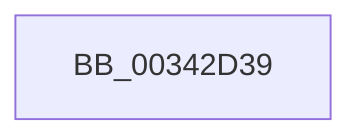

# sub_00342D39

- RVA: `0x00342D39`–`0x00342D6F` (길이 `54` bytes)
- VA: `0x0000000140342D39`
- 실행 섹션: `.text`
- PDB 이름 있음: `아니요`; PDB Function 태그: `아니요`
- unwind 정보 RVA: `0x000779E0`
- 디코드: `13`개 명령, `54/54` bytes 표시
- 미해석 바이트: `0` (있으면 어셈블리에 `.byte`로 보존)

> 이 문서는 커널 이미지의 기계어와 PDB 기호를 분석해 생성했습니다. 4번과 5번은 함수 원형과 자료형을 바이너리 사용 방식에서 추정한 C 해석이며 원본 소스 복구 결과는 아닙니다.

## 1. Dependencies

- 직접 호출 지점: **2**; 고유 호출 대상: **2**
- 직접 호출자로 확인된 함수: **0**
- RIP 상대 이미지 참조: **1**

### Outgoing calls
- `0x00342D51` → [KeDisableInterrupts](../21/KeDisableInterrupts_function_00217BE0.md) (function, `0x00217BE0`)
- `0x00342D60` → [KiHaltOnAddressWakeEntireList](../21/KiHaltOnAddressWakeEntireList_function_00217AF4.md) (function, `0x00217AF4`)

### Direct callers
- 이 함수 시작 RVA로 연결되는 직접 call은 확인되지 않았습니다. 간접 호출은 완전히 역산할 수 없습니다.

### Static image references
- `0x00342D46` → RVA `0x00F21B20` (`.data`; read)

## 2. Other-region calls and transfers

- 다른 실행 섹션으로 향하는 call: **0**
- call이 아닌 외부 분기/꼬리 이동: **1**
  - `0x00342D6D` → [sub_00342D6F + 0x30](Unknown_function_00342D6F.md) (`tail-transfer`)

## 3. Assembly (complete function range)

```asm
00342D39  48 89 74 24 30                  mov qword ptr [rsp + 0x30], rsi
00342D3E  F0 09 1C 24                     lock or dword ptr [rsp], ebx
00342D42  49 C1 E8 05                     shr r8, 5
00342D46  4C 8D 0D D3 ED BD 00            lea r9, [rip + 0xbdedd3]
00342D4D  41 83 E0 7F                     and r8d, 0x7f
00342D51  E8 8A 4E ED FF                  call 0x140217be0
00342D56  4B 87 1C C1                     xchg qword ptr [r9 + r8*8], rbx
00342D5A  48 8B D3                        mov rdx, rbx
00342D5D  0F B6 F0                        movzx esi, al
00342D60  E8 8F 4D ED FF                  call 0x140217af4
00342D65  40 84 F6                        test sil, sil
00342D68  48 8B 74 24 30                  mov rsi, qword ptr [rsp + 0x30]
00342D6D  74 30                           je 0x140342d9f
```

## 4. C-style interpretation (structured pseudocode)

```c
__int64 __fastcall sub_00342D39(__int64 a1, __int64 a2, __int64 a3, __int64 a4, __int64 a5, __int64 a6)
{
    __int64 result;
    unsigned int v_stack_p0;
    unsigned __int64 v_stack_p30;

    v_stack_p30 = v_rsi;
    a3 = (a3) >> (5);
    a3 = (unsigned int)((a3) & (127));
    result = KeDisableInterrupts(a1, a2, a3, v_rip + 12447187);
    result = KiHaltOnAddressWakeEntireList(a1, v_rbx, a3, v_rip + 12447187);
}
```

## 5. (Beta) C Style

```c
int64_t sub_00342D39(int64_t Arg1, int64_t Arg2, int64_t Arg3, int64_t Arg4, uint64_t Arg5, int64_t Arg6)
{
    int64_t result;
    uint32_t v_stack_p0;
    uint64_t v_stack_p30;

    v_stack_p30 = local_rsi;
    Arg3 = (Arg3) >> (5);
    Arg3 = (uint32_t)((Arg3) & (127));
    result = KeDisableInterrupts(Arg1, Arg2, Arg3, v_rip + 12447187);
    result = KiHaltOnAddressWakeEntireList(Arg1, local_rbx, Arg3, v_rip + 12447187);
}
```

## 6. Execution-region graph

[열기: 2D/3D 그래프와 함수 탐색 컨트롤 패널](../../../control-panel.html?section=text&rva=0x00342D39&view=graph)

- 2D 그래프는 위에서 아래로 흐르고, 3D 그래프는 빈 공간을 드래그해 회전합니다. Shift+드래그는 이동, 휠은 확대·축소, 함수 노드 선택은 대상 보고서 이동입니다.

### Static fallback


