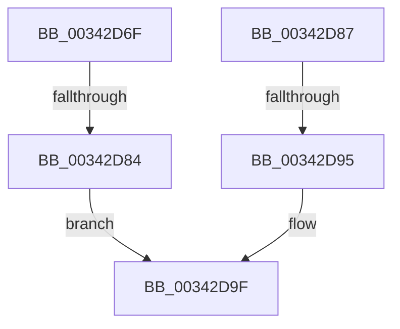

# sub_00342D6F

- RVA: `0x00342D6F`–`0x00342DB1` (길이 `66` bytes)
- VA: `0x0000000140342D6F`
- 실행 섹션: `.text`
- PDB 이름 있음: `아니요`; PDB Function 태그: `아니요`
- unwind 정보 RVA: `0x000779F4`
- 디코드: `15`개 명령, `66/66` bytes 표시
- 미해석 바이트: `0` (있으면 어셈블리에 `.byte`로 보존)

> 이 문서는 커널 이미지의 기계어와 PDB 기호를 분석해 생성했습니다. 4번과 5번은 함수 원형과 자료형을 바이너리 사용 방식에서 추정한 C 해석이며 원본 소스 복구 결과는 아닙니다.

## 1. Dependencies

- 직접 호출 지점: **1**; 고유 호출 대상: **1**
- 직접 호출자로 확인된 함수: **0**
- RIP 상대 이미지 참조: **2**

### Outgoing calls
- `0x00342D9A` → [KiReleaseQueuedSpinLockInstrumented](../21/KiReleaseQueuedSpinLockInstrumented_function_002179F0.md) (function, `0x002179F0`)

### Direct callers
- 이 함수 시작 RVA로 연결되는 직접 call은 확인되지 않았습니다. 간접 호출은 완전히 역산할 수 없습니다.

### Static image references
- `0x00342D87` → RVA `0x00F0DE58` (`.data`; read)
- `0x00342D9F` → RVA `0x00FC6D20` (`ALMOSTRO`; read)

## 2. Other-region calls and transfers

- 다른 실행 섹션으로 향하는 call: **0**
- call이 아닌 외부 분기/꼬리 이동: **3**
  - `0x00342D82` → [sub_00342DC8](Unknown_function_00342DC8.md) (`tail-transfer`)
  - `0x00342D8F` → [sub_00342CED + 0xE](Unknown_function_00342CED.md) (`tail-transfer`)
  - `0x00342DAF` → [sub_00342DB1 + 0xC](Unknown_function_00342DB1.md) (`tail-transfer`)

## 3. Assembly (complete function range)

```asm
00342D6F  65 48 8B 0C 25 20 00 00 00      mov rcx, qword ptr gs:[0x20]
00342D78  4C 8B 81 B8 8E 00 00            mov r8, qword ptr [rcx + 0x8eb8]
00342D7F  4D 85 C0                        test r8, r8
00342D82  75 44                           jne 0x140342dc8
00342D84  FB                              sti
00342D85  EB 18                           jmp 0x140342d9f
00342D87  8B 05 CB B0 BC 00               mov eax, dword ptr [rip + 0xbcb0cb]
00342D8D  85 C0                           test eax, eax
00342D8F  0F 85 66 FF FF FF               jne 0x140342cfb
00342D95  48 8B 54 24 28                  mov rdx, qword ptr [rsp + 0x28]
00342D9A  E8 51 4C ED FF                  call 0x1402179f0
00342D9F  83 3D 7A 3F C8 00 00            cmp dword ptr [rip + 0xc83f7a], 0
00342DA6  0F B6 5F 10                     movzx ebx, byte ptr [rdi + 0x10]
00342DAA  48 8B 7C 24 38                  mov rdi, qword ptr [rsp + 0x38]
00342DAF  74 0C                           je 0x140342dbd
```

## 4. C-style interpretation (structured pseudocode)

```c
__int64 __fastcall sub_00342D6F(__int64 a1, __int64 a2, __int64 a3, __int64 a4, __int64 a5, __int64 a6, __int64 a7)
{
    unsigned __int64 v_stack_p28;

    goto loc_00342D9F;
loc_00342D9F:
}
```

## 5. (Beta) C Style

```c
int64_t sub_00342D6F(int64_t Arg1, int64_t Arg2, int64_t Arg3, int64_t Arg4, uint64_t Arg5, uint64_t Arg6, int64_t Arg7)
{
    uint64_t v_stack_p28;

    goto loc_00342D9F;
loc_00342D9F:
}
```

## 6. Execution-region graph

[열기: 2D/3D 그래프와 함수 탐색 컨트롤 패널](../../../control-panel.html?section=text&rva=0x00342D6F&view=graph)

- 2D 그래프는 위에서 아래로 흐르고, 3D 그래프는 빈 공간을 드래그해 회전합니다. Shift+드래그는 이동, 휠은 확대·축소, 함수 노드 선택은 대상 보고서 이동입니다.

### Static fallback


