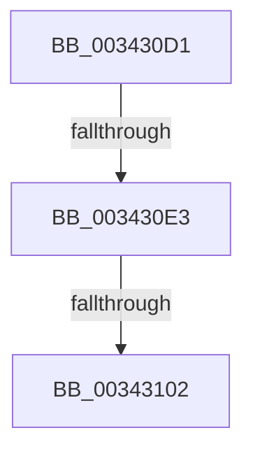

# sub_003430D1

- RVA: `0x003430D1`–`0x0034310B` (길이 `58` bytes)
- VA: `0x00000001403430D1`
- 실행 섹션: `.text`
- PDB 이름 있음: `아니요`; PDB Function 태그: `아니요`
- unwind 정보 RVA: `0x00077A64`
- 디코드: `14`개 명령, `58/58` bytes 표시
- 미해석 바이트: `0` (있으면 어셈블리에 `.byte`로 보존)

> 이 문서는 커널 이미지의 기계어와 PDB 기호를 분석해 생성했습니다. 4번과 5번은 함수 원형과 자료형을 바이너리 사용 방식에서 추정한 C 해석이며 원본 소스 복구 결과는 아닙니다.

## 1. Dependencies

- 직접 호출 지점: **0**; 고유 호출 대상: **0**
- 직접 호출자로 확인된 함수: **0**
- RIP 상대 이미지 참조: **1**

### Outgoing calls
- 직접 디코드된 call 명령이 없습니다.

### Direct callers
- 이 함수 시작 RVA로 연결되는 직접 call은 확인되지 않았습니다. 간접 호출은 완전히 역산할 수 없습니다.

### Static image references
- `0x003430E8` → RVA `0x00F0F228` (`.data`; read)

## 2. Other-region calls and transfers

- 다른 실행 섹션으로 향하는 call: **0**
- call이 아닌 외부 분기/꼬리 이동: **3**
  - `0x003430DD` → [sub_00343196](Unknown_function_00343196.md) (`tail-transfer`)
  - `0x003430FC` → [sub_003431B5](Unknown_function_003431B5.md) (`tail-transfer`)
  - `0x00343109` → [sub_00343173](Unknown_function_00343173.md) (`tail-transfer`)

## 3. Assembly (complete function range)

```asm
003430D1  48 89 6C 24 58                  mov qword ptr [rsp + 0x58], rbp
003430D6  48 89 74 24 20                  mov qword ptr [rsp + 0x20], rsi
003430DB  A8 01                           test al, 1
003430DD  0F 84 B3 00 00 00               je 0x140343196
003430E3  BE 01 00 00 00                  mov esi, 1
003430E8  8B 2D 3A C1 BC 00               mov ebp, dword ptr [rip + 0xbcc13a]
003430EE  90                              nop
003430EF  8B 83 94 01 00 00               mov eax, dword ptr [rbx + 0x194]
003430F5  4C 89 7C 24 68                  mov qword ptr [rsp + 0x68], r15
003430FA  3B E8                           cmp ebp, eax
003430FC  0F 85 B3 00 00 00               jne 0x1403431b5
00343102  48 8B 6C 24 58                  mov rbp, qword ptr [rsp + 0x58]
00343107  85 F6                           test esi, esi
00343109  74 68                           je 0x140343173
```

## 4. C-style interpretation (structured pseudocode)

```c
__int64 __fastcall sub_003430D1(__int64 a1, __int64 a2, __int64 a3, __int64 a4, __int64 a5, __int64 a6, __int64 a7, __int64 a8, __int64 a9, __int64 a10, __int64 a11)
{
    unsigned __int64 v_stack_p20;
    unsigned __int64 v_stack_p58;
    unsigned __int64 v_stack_p68;

    v_stack_p58 = v_rbp;
    v_stack_p20 = v_rsi;
    v_stack_p68 = v_r15;
}
```

## 5. (Beta) C Style

```c
int64_t sub_003430D1(int64_t Arg1, int64_t Arg2, int64_t Arg3, int64_t Arg4, uint64_t Arg5, uint64_t Arg6, uint64_t Arg7, uint64_t Arg8, uint64_t Arg9, uint64_t Arg10, int64_t Arg11)
{
    uint64_t v_stack_p20;
    uint64_t v_stack_p58;
    uint64_t v_stack_p68;

    v_stack_p58 = local_rbp;
    v_stack_p20 = local_rsi;
    v_stack_p68 = local_r15;
}
```

## 6. Execution-region graph

[열기: 2D/3D 그래프와 함수 탐색 컨트롤 패널](../../../control-panel.html?section=text&rva=0x003430D1&view=graph)

- 2D 그래프는 위에서 아래로 흐르고, 3D 그래프는 빈 공간을 드래그해 회전합니다. Shift+드래그는 이동, 휠은 확대·축소, 함수 노드 선택은 대상 보고서 이동입니다.

### Static fallback


