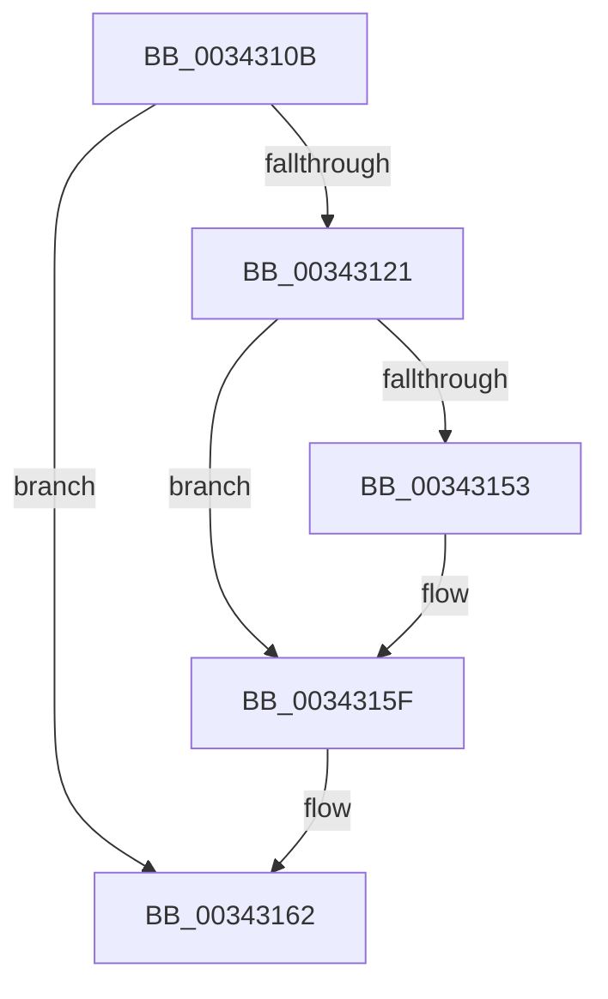

# sub_0034310B

- RVA: `0x0034310B`–`0x00343167` (길이 `92` bytes)
- VA: `0x000000014034310B`
- 실행 섹션: `.text`
- PDB 이름 있음: `아니요`; PDB Function 태그: `아니요`
- unwind 정보 RVA: `0x00077A7C`
- 디코드: `25`개 명령, `92/92` bytes 표시
- 미해석 바이트: `0` (있으면 어셈블리에 `.byte`로 보존)

> 이 문서는 커널 이미지의 기계어와 PDB 기호를 분석해 생성했습니다. 4번과 5번은 함수 원형과 자료형을 바이너리 사용 방식에서 추정한 C 해석이며 원본 소스 복구 결과는 아닙니다.

## 1. Dependencies

- 직접 호출 지점: **1**; 고유 호출 대상: **1**
- 직접 호출자로 확인된 함수: **0**
- RIP 상대 이미지 참조: **0**

### Outgoing calls
- `0x00343118` → [PfSnTraceGetLogEntry](PfSnTraceGetLogEntry_function_003437A0.md) (function, `0x003437A0`)

### Direct callers
- 이 함수 시작 RVA로 연결되는 직접 call은 확인되지 않았습니다. 간접 호출은 완전히 역산할 수 없습니다.

### Static image references
- 디코드된 RIP-relative 메모리 참조가 없습니다.

## 2. Other-region calls and transfers

- 다른 실행 섹션으로 향하는 call: **0**
- 별도 외부 분기/꼬리 이동을 확인하지 못했습니다.

## 3. Assembly (complete function range)

```asm
0034310B  4C 8D 44 24 50                  lea r8, [rsp + 0x50]
00343110  BA 01 00 00 00                  mov edx, 1
00343115  48 8B CB                        mov rcx, rbx
00343118  E8 83 06 00 00                  call 0x1403437a0
0034311D  85 C0                           test eax, eax
0034311F  78 41                           js 0x140343162
00343121  48 8B 54 24 50                  mov rdx, qword ptr [rsp + 0x50]
00343126  48 C1 E7 04                     shl rdi, 4
0034312A  8B 02                           mov eax, dword ptr [rdx]
0034312C  83 E0 0F                        and eax, 0xf
0034312F  48 0B C7                        or rax, rdi
00343132  48 89 02                        mov qword ptr [rdx], rax
00343135  4C 89 72 08                     mov qword ptr [rdx + 8], r14
00343139  48 8B 0A                        mov rcx, qword ptr [rdx]
0034313C  48 83 E1 F0                     and rcx, 0xfffffffffffffff0
00343140  8B C6                           mov eax, esi
00343142  48 0B C8                        or rcx, rax
00343145  48 89 0A                        mov qword ptr [rdx], rcx
00343148  F0 FF 83 4C 01 00 00            lock inc dword ptr [rbx + 0x14c]
0034314F  85 F6                           test esi, esi
00343151  75 0C                           jne 0x14034315f
00343153  48 8B 44 24 50                  mov rax, qword ptr [rsp + 0x50]
00343158  48 89 83 98 01 00 00            mov qword ptr [rbx + 0x198], rax
0034315F  41 8B C7                        mov eax, r15d
00343162  48 8B 74 24 20                  mov rsi, qword ptr [rsp + 0x20]
```

## 4. C-style interpretation (structured pseudocode)

```c
__int64 __fastcall sub_0034310B(__int64 a1, __int64 a2, __int64 a3, __int64 a4, __int64 a5, __int64 a6, __int64 a7, __int64 a8, __int64 a9, __int64 a10)
{
    __int64 result;
    __int64 v_rdi;
    unsigned __int64 v_stack_p20;

    result = PfSnTraceGetLogEntry(v_rbx, 1, a10, a4);
    if (sign_flag) goto loc_00343162;
    v_rdi = (v_rdi) << (4);
    result = (unsigned int)(((unsigned int)(*(unsigned int *)(a10))) & (15));
    result = (result) | (v_rdi);
    *(unsigned __int64 *)(a10) = result;
    *(unsigned __int64 *)(a10 + 8) = v_r14;
    a1 = (*(unsigned __int64 *)(a10)) & (-16);
    a1 = (a1) | ((unsigned int)((unsigned int)(v_rsi)));
    *(unsigned __int64 *)(a10) = a1;
    result = (unsigned int)((unsigned int)(v_rsi));
    if ((unsigned int)(v_rsi) == 0) {
        result = a10;
        *(unsigned __int64 *)(v_rbx + 408) = result;
    }
loc_00343162:
    return (unsigned int)((unsigned int)(v_r15));
}
```

## 5. (Beta) C Style

```c
int64_t sub_0034310B(int64_t Arg1, int64_t Arg2, int64_t Arg3, int64_t Arg4, uint64_t Arg5, uint64_t Arg6, uint64_t Arg7, uint64_t Arg8, uint64_t Arg9, void *Arg10)
{
    uint8_t *arg10 = (uint8_t *)Arg10;

    int64_t result;
    int64_t local_rdi;
    uint64_t v_stack_p20;

    result = PfSnTraceGetLogEntry(local_rbx, 1, Arg10, Arg4);
    if (sign_flag) goto loc_00343162;
    local_rdi = (local_rdi) << (4);
    result = (uint32_t)(((uint32_t)(*(uint32_t *)(arg10))) & (15));
    result = (result) | (local_rdi);
    *(uint64_t *)(arg10) = result;
    *(uint64_t *)(arg10 + 0x8) = local_r14;
    Arg1 = (*(uint64_t *)(arg10)) & (-16);
    Arg1 = (Arg1) | ((uint32_t)((uint32_t)(local_rsi)));
    *(uint64_t *)(arg10) = Arg1;
    result = (uint32_t)((uint32_t)(local_rsi));
    if ((uint32_t)(local_rsi) == 0) {
        result = Arg10;
        *(uint64_t *)(local_rbx + 0x198) = result;
    }
loc_00343162:
    return (uint32_t)((uint32_t)(local_r15));
}
```

### 관측된 메모리 오프셋

구조체 형식이 확인되지 않은 접근은 인자 기준의 오프셋으로만 기록했습니다.

| 기준 인자 | 오프셋 표현 | 폭 (bit) | 접근 |
|---|---:|---:|---|
| `Arg10` | `+ 0x0` | `32` | `R` |
| `Arg10` | `+ 0x0` | `64` | `R` |
| `Arg10` | `+ 0x0` | `64` | `W` |
| `Arg10` | `+ 0x8` | `64` | `W` |

## 6. Execution-region graph

[열기: 2D/3D 그래프와 함수 탐색 컨트롤 패널](../../../control-panel.html?section=text&rva=0x0034310B&view=graph)

- 2D 그래프는 위에서 아래로 흐르고, 3D 그래프는 빈 공간을 드래그해 회전합니다. Shift+드래그는 이동, 휠은 확대·축소, 함수 노드 선택은 대상 보고서 이동입니다.

### Static fallback


