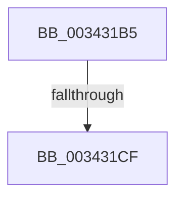

# sub_003431B5

- RVA: `0x003431B5`–`0x003431FE` (길이 `73` bytes)
- VA: `0x00000001403431B5`
- 실행 섹션: `.text`
- PDB 이름 있음: `아니요`; PDB Function 태그: `아니요`
- unwind 정보 RVA: `0x00077AE4`
- 디코드: `16`개 명령, `73/73` bytes 표시
- 미해석 바이트: `0` (있으면 어셈블리에 `.byte`로 보존)

> 이 문서는 커널 이미지의 기계어와 PDB 기호를 분석해 생성했습니다. 4번과 5번은 함수 원형과 자료형을 바이너리 사용 방식에서 추정한 C 해석이며 원본 소스 복구 결과는 아닙니다.

## 1. Dependencies

- 직접 호출 지점: **1**; 고유 호출 대상: **1**
- 직접 호출자로 확인된 함수: **0**
- RIP 상대 이미지 참조: **0**

### Outgoing calls
- `0x003431C2` → [PfSnTraceGetLogEntry](PfSnTraceGetLogEntry_function_003437A0.md) (function, `0x003437A0`)

### Direct callers
- 이 함수 시작 RVA로 연결되는 직접 call은 확인되지 않았습니다. 간접 호출은 완전히 역산할 수 없습니다.

### Static image references
- 디코드된 RIP-relative 메모리 참조가 없습니다.

## 2. Other-region calls and transfers

- 다른 실행 섹션으로 향하는 call: **0**
- call이 아닌 외부 분기/꼬리 이동: **2**
  - `0x003431C9` → [sub_003430D1 + 0x31](Unknown_function_003430D1.md) (`tail-transfer`)
  - `0x003431F9` → [sub_003430D1 + 0x31](Unknown_function_003430D1.md) (`tail-transfer`)

## 3. Assembly (complete function range)

```asm
003431B5  4C 8D 44 24 68                  lea r8, [rsp + 0x68]
003431BA  BA 01 00 00 00                  mov edx, 1
003431BF  48 8B CB                        mov rcx, rbx
003431C2  E8 D9 05 00 00                  call 0x1403437a0
003431C7  85 C0                           test eax, eax
003431C9  0F 88 33 FF FF FF               js 0x140343102
003431CF  48 8B 4C 24 68                  mov rcx, qword ptr [rsp + 0x68]
003431D4  48 8B 01                        mov rax, qword ptr [rcx]
003431D7  48 83 E0 F2                     and rax, 0xfffffffffffffff2
003431DB  48 83 C8 02                     or rax, 2
003431DF  48 89 01                        mov qword ptr [rcx], rax
003431E2  48 8D 83 A0 01 00 00            lea rax, [rbx + 0x1a0]
003431E9  89 69 08                        mov dword ptr [rcx + 8], ebp
003431EC  89 AB 94 01 00 00               mov dword ptr [rbx + 0x194], ebp
003431F2  48 89 83 98 01 00 00            mov qword ptr [rbx + 0x198], rax
003431F9  E9 04 FF FF FF                  jmp 0x140343102
```

## 4. C-style interpretation (structured pseudocode)

```c
__int64 __fastcall sub_003431B5(__int64 a1, __int64 a2, __int64 a3, __int64 a4, __int64 a5, __int64 a6, __int64 a7, __int64 a8, __int64 a9, __int64 a10, __int64 a11, __int64 a12, __int64 a13)
{
    __int64 result;

    result = PfSnTraceGetLogEntry(v_rbx, 1, a13, a4);
    result = (*(unsigned __int64 *)(a13)) & (-14);
    result = (result) | (2);
    *(unsigned __int64 *)(a13) = result;
    *(unsigned int *)(a13 + 8) = (unsigned int)(v_rbp);
    *(unsigned int *)(v_rbx + 404) = (unsigned int)(v_rbp);
    *(unsigned __int64 *)(v_rbx + 408) = v_rbx + 416;
}
```

## 5. (Beta) C Style

```c
int64_t sub_003431B5(int64_t Arg1, int64_t Arg2, int64_t Arg3, int64_t Arg4, uint64_t Arg5, uint64_t Arg6, uint64_t Arg7, uint64_t Arg8, uint64_t Arg9, uint64_t Arg10, uint64_t Arg11, uint64_t Arg12, void *Arg13)
{
    uint8_t *arg13 = (uint8_t *)Arg13;

    int64_t result;

    result = PfSnTraceGetLogEntry(local_rbx, 1, Arg13, Arg4);
    result = (*(uint64_t *)(arg13)) & (-14);
    result = (result) | (2);
    *(uint64_t *)(arg13) = result;
    *(uint32_t *)(arg13 + 0x8) = (uint32_t)(local_rbp);
    *(uint32_t *)(local_rbx + 0x194) = (uint32_t)(local_rbp);
    *(uint64_t *)(local_rbx + 0x198) = local_rbx + 416;
}
```

### 관측된 메모리 오프셋

구조체 형식이 확인되지 않은 접근은 인자 기준의 오프셋으로만 기록했습니다.

| 기준 인자 | 오프셋 표현 | 폭 (bit) | 접근 |
|---|---:|---:|---|
| `Arg13` | `+ 0x0` | `64` | `R` |
| `Arg13` | `+ 0x0` | `64` | `W` |
| `Arg13` | `+ 0x8` | `32` | `W` |

## 6. Execution-region graph

[열기: 2D/3D 그래프와 함수 탐색 컨트롤 패널](../../../control-panel.html?section=text&rva=0x003431B5&view=graph)

- 2D 그래프는 위에서 아래로 흐르고, 3D 그래프는 빈 공간을 드래그해 회전합니다. Shift+드래그는 이동, 휠은 확대·축소, 함수 노드 선택은 대상 보고서 이동입니다.

### Static fallback


