# sub_003439EB

- RVA: `0x003439EB`–`0x00343BF7` (길이 `524` bytes)
- VA: `0x00000001403439EB`
- 실행 섹션: `.text`
- PDB 이름 있음: `아니요`; PDB Function 태그: `아니요`
- unwind 정보 RVA: `0x00077B44`
- 디코드: `111`개 명령, `524/524` bytes 표시
- 미해석 바이트: `0` (있으면 어셈블리에 `.byte`로 보존)

> 이 문서는 커널 이미지의 기계어와 PDB 기호를 분석해 생성했습니다. 4번과 5번은 함수 원형과 자료형을 바이너리 사용 방식에서 추정한 C 해석이며 원본 소스 복구 결과는 아닙니다.

## 1. Dependencies

- 직접 호출 지점: **7**; 고유 호출 대상: **7**
- 직접 호출자로 확인된 함수: **0**
- RIP 상대 이미지 참조: **4**

### Outgoing calls
- `0x00343AAF` → [ExpLeaveWorkerFactoryAwayMode](ExpLeaveWorkerFactoryAwayMode_function_00344350.md) (function, `0x00344350`)
- `0x00343AB9` → [KeReleaseInStackQueuedSpinLock](KeReleaseInStackQueuedSpinLock_function_00342CE0.md) (function, `0x00342CE0`)
- `0x00343B1B` → [KiAcquireKobjectLockSafe](../25/KiAcquireKobjectLockSafe_function_00251C90.md) (function, `0x00251C90`)
- `0x00343B4E` → [KiWakeQueueWaiter](KiWakeQueueWaiter_function_00344C10.md) (function, `0x00344C10`)
- `0x00343B76` → [KiExitDispatcher](../25/KiExitDispatcher_function_00251CF0.md) (function, `0x00251CF0`)
- `0x00343B91` → [ExpWorkerFactoryCheckCreate](ExpWorkerFactoryCheckCreate_function_00344460.md) (function, `0x00344460`)
- `0x00343BB2` → [ObpPushStackInfo](../21/ObpPushStackInfo_function_002109E4.md) (function, `0x002109E4`)

### Direct callers
- 이 함수 시작 RVA로 연결되는 직접 call은 확인되지 않았습니다. 간접 호출은 완전히 역산할 수 없습니다.

### Static image references
- `0x00343A1A` → RVA `0x00FC6D20` (`ALMOSTRO`; read)
- `0x00343A27` → RVA `0x00FC6B06` (`ALMOSTRO`; read)
- `0x00343B04` → RVA `0x00FC6B04` (`ALMOSTRO`; read)
- `0x00343B9A` → RVA `0x00FC5010` (`ALMOSTRO`; read)

## 2. Other-region calls and transfers

- 다른 실행 섹션으로 향하는 call: **0**
- call이 아닌 외부 분기/꼬리 이동: **14**
  - `0x00343A21` → [sub_00343C8B](Unknown_function_00343C8B.md) (`tail-transfer`)
  - `0x00343A33` → [sub_00343C30](Unknown_function_00343C30.md) (`tail-transfer`)
  - `0x00343A44` → [sub_00343D25](Unknown_function_00343D25.md) (`tail-transfer`)
  - `0x00343A74` → [sub_00343D34 + 0xB0](Unknown_function_00343D34.md) (`tail-transfer`)
  - `0x00343A80` → [sub_00343D34 + 0xD1](Unknown_function_00343D34.md) (`tail-transfer`)
  - `0x00343A96` → [sub_00343D34 + 0xB5](Unknown_function_00343D34.md) (`tail-transfer`)
  - `0x00343ACD` → [sub_00343C50](Unknown_function_00343C50.md) (`tail-transfer`)
  - `0x00343AF5` → [sub_00343C9D](Unknown_function_00343C9D.md) (`tail-transfer`)
  - `0x00343B12` → [sub_00343C9D + 0x59](Unknown_function_00343C9D.md) (`tail-transfer`)
  - `0x00343B23` → [sub_00343C50 + 0x1A](Unknown_function_00343C50.md) (`tail-transfer`)
  - `0x00343B2F` → [sub_00343C50 + 0x1A](Unknown_function_00343C50.md) (`tail-transfer`)
  - `0x00343B3F` → [sub_00343C9D + 0x75](Unknown_function_00343C9D.md) (`tail-transfer`)
  - `0x00343B55` → [sub_00343C50 + 0x1A](Unknown_function_00343C50.md) (`tail-transfer`)
  - `0x00343BC7` → [sub_00343BFF](Unknown_function_00343BFF.md) (`tail-transfer`)

## 3. Assembly (complete function range)

```asm
003439EB  48 89 9C 24 80 00 00 00         mov qword ptr [rsp + 0x80], rbx
003439F3  48 89 7C 24 68                  mov qword ptr [rsp + 0x68], rdi
003439F8  4C 89 7C 24 50                  mov qword ptr [rsp + 0x50], r15
003439FD  48 8B 58 10                     mov rbx, qword ptr [rax + 0x10]
00343A01  48 89 5C 24 38                  mov qword ptr [rsp + 0x38], rbx
00343A06  4C 89 6C 24 30                  mov qword ptr [rsp + 0x30], r13
00343A0B  90                              nop
00343A0C  44 0F 20 C7                     mov rdi, cr8
00343A10  41 BF 02 00 00 00               mov r15d, 2
00343A16  45 0F 22 C7                     mov cr8, r15
00343A1A  44 39 2D FF 32 C8 00            cmp dword ptr [rip + 0xc832ff], r13d
00343A21  0F 85 64 02 00 00               jne 0x140343c8b
00343A27  F6 05 D8 30 C8 00 21            test byte ptr [rip + 0xc830d8], 0x21
00343A2E  40 88 7C 24 40                  mov byte ptr [rsp + 0x40], dil
00343A33  0F 85 F7 01 00 00               jne 0x140343c30
00343A39  48 8D 54 24 30                  lea rdx, [rsp + 0x30]
00343A3E  48 87 13                        xchg qword ptr [rbx], rdx
00343A41  48 85 D2                        test rdx, rdx
00343A44  0F 85 DB 02 00 00               jne 0x140343d25
00343A4A  48 8B BC 24 88 00 00 00         mov rdi, qword ptr [rsp + 0x88]
00343A52  48 89 AC 24 90 00 00 00         mov qword ptr [rsp + 0x90], rbp
00343A5A  48 89 B4 24 98 00 00 00         mov qword ptr [rsp + 0x98], rsi
00343A62  4C 89 64 24 60                  mov qword ptr [rsp + 0x60], r12
00343A67  48 8B 4F 10                     mov rcx, qword ptr [rdi + 0x10]
00343A6B  4C 89 74 24 58                  mov qword ptr [rsp + 0x58], r14
00343A70  44 38 69 21                     cmp byte ptr [rcx + 0x21], r13b
00343A74  0F 85 6A 03 00 00               jne 0x140343de4
00343A7A  8B 41 18                        mov eax, dword ptr [rcx + 0x18]
00343A7D  83 F8 FF                        cmp eax, -1
00343A80  0F 84 7F 03 00 00               je 0x140343e05
00343A86  FF C0                           inc eax
00343A88  41 8B ED                        mov ebp, r13d
00343A8B  89 41 18                        mov dword ptr [rcx + 0x18], eax
00343A8E  48 8B 47 10                     mov rax, qword ptr [rdi + 0x10]
00343A92  44 38 68 20                     cmp byte ptr [rax + 0x20], r13b
00343A96  0F 85 4D 03 00 00               jne 0x140343de9
00343A9C  C6 40 20 01                     mov byte ptr [rax + 0x20], 1
00343AA0  F7 87 98 01 00 00 00 02 00 00   test dword ptr [rdi + 0x198], 0x200
00343AAA  74 08                           je 0x140343ab4
00343AAC  48 8B CF                        mov rcx, rdi
00343AAF  E8 9C 08 00 00                  call 0x140344350
00343AB4  48 8D 4C 24 30                  lea rcx, [rsp + 0x30]
00343AB9  E8 22 F2 FF FF                  call 0x140342ce0
00343ABE  48 8B 47 10                     mov rax, qword ptr [rdi + 0x10]
00343AC2  48 8B 58 10                     mov rbx, qword ptr [rax + 0x10]
00343AC6  48 8B 70 08                     mov rsi, qword ptr [rax + 8]
00343ACA  48 85 DB                        test rbx, rbx
00343ACD  0F 84 7D 01 00 00               je 0x140343c50
00343AD3  4C 89 6B 18                     mov qword ptr [rbx + 0x18], r13
00343AD7  4C 8D 76 08                     lea r14, [rsi + 8]
00343ADB  4C 89 6B 20                     mov qword ptr [rbx + 0x20], r13
00343ADF  44 89 6B 28                     mov dword ptr [rbx + 0x28], r13d
00343AE3  4C 89 6B 30                     mov qword ptr [rbx + 0x30], r13
00343AE7  45 0F 20 C4                     mov r12, cr8
00343AEB  45 0F 22 C7                     mov cr8, r15
00343AEF  39 2D 2B 32 C8 00               cmp dword ptr [rip + 0xc8322b], ebp
00343AF5  0F 85 A2 01 00 00               jne 0x140343c9d
00343AFB  65 48 8B 3C 25 20 00 00 00      mov rdi, qword ptr gs:[0x20]
00343B04  F7 05 F6 2F C8 00 00 00 00 01   test dword ptr [rip + 0xc82ff6], 0x1000000
00343B0E  4C 8B 7F 08                     mov r15, qword ptr [rdi + 8]
00343B12  0F 85 DE 01 00 00               jne 0x140343cf6
00343B18  48 8B CE                        mov rcx, rsi
00343B1B  E8 70 E1 F0 FF                  call 0x140251c90
00343B20  4D 39 36                        cmp qword ptr [r14], r14
00343B23  0F 84 41 01 00 00               je 0x140343c6a
00343B29  8B 46 28                        mov eax, dword ptr [rsi + 0x28]
00343B2C  3B 46 2C                        cmp eax, dword ptr [rsi + 0x2c]
00343B2F  0F 83 35 01 00 00               jae 0x140343c6a
00343B35  49 8B 87 E8 00 00 00            mov rax, qword ptr [r15 + 0xe8]
00343B3C  48 3B C6                        cmp rax, rsi
00343B3F  0F 84 CD 01 00 00               je 0x140343d12
00343B45  4C 8B C3                        mov r8, rbx
00343B48  48 8B D6                        mov rdx, rsi
00343B4B  48 8B CF                        mov rcx, rdi
00343B4E  E8 BD 10 00 00                  call 0x140344c10
00343B53  84 C0                           test al, al
00343B55  0F 84 0F 01 00 00               je 0x140343c6a
00343B5B  4C 89 2B                        mov qword ptr [rbx], r13
00343B5E  F0 81 26 7F FF FF FF            lock and dword ptr [rsi], 0xffffff7f
00343B65  45 33 C9                        xor r9d, r9d
00343B68  44 88 64 24 20                  mov byte ptr [rsp + 0x20], r12b
00343B6D  33 D2                           xor edx, edx
00343B6F  48 8B CF                        mov rcx, rdi
00343B72  45 8D 41 01                     lea r8d, [r9 + 1]
00343B76  E8 75 E1 F0 FF                  call 0x140251cf0
00343B7B  48 8B BC 24 88 00 00 00         mov rdi, qword ptr [rsp + 0x88]
00343B83  41 BF 02 00 00 00               mov r15d, 2
00343B89  45 33 C0                        xor r8d, r8d
00343B8C  33 D2                           xor edx, edx
00343B8E  48 8B CF                        mov rcx, rdi
00343B91  E8 CA 08 00 00                  call 0x140344460
00343B96  48 83 C7 D0                     add rdi, -0x30
00343B9A  44 39 2D 6F 14 C8 00            cmp dword ptr [rip + 0xc8146f], r13d
00343BA1  74 14                           je 0x140343bb7
00343BA3  33 D2                           xor edx, edx
00343BA5  41 B9 44 66 6C 74               mov r9d, 0x746c6644
00343BAB  48 8B CF                        mov rcx, rdi
00343BAE  44 8D 42 01                     lea r8d, [rdx + 1]
00343BB2  E8 2D CE EC FF                  call 0x1402109e4
00343BB7  48 C7 C0 FF FF FF FF            mov rax, 0xffffffffffffffff
00343BBE  F0 48 0F C1 07                  lock xadd qword ptr [rdi], rax
00343BC3  48 83 E8 01                     sub rax, 1
00343BC7  7E 36                           jle 0x140343bff
00343BC9  4C 8B 74 24 58                  mov r14, qword ptr [rsp + 0x58]
00343BCE  8B C5                           mov eax, ebp
00343BD0  48 8B AC 24 90 00 00 00         mov rbp, qword ptr [rsp + 0x90]
00343BD8  4C 8B 64 24 60                  mov r12, qword ptr [rsp + 0x60]
00343BDD  48 8B B4 24 98 00 00 00         mov rsi, qword ptr [rsp + 0x98]
00343BE5  48 8B 7C 24 68                  mov rdi, qword ptr [rsp + 0x68]
00343BEA  48 8B 9C 24 80 00 00 00         mov rbx, qword ptr [rsp + 0x80]
00343BF2  4C 8B 7C 24 50                  mov r15, qword ptr [rsp + 0x50]
```

## 4. C-style interpretation (structured pseudocode)

```c
__int64 __fastcall sub_003439EB(__int64 a1, __int64 a2, __int64 a3, int a4, __int64 a5, __int64 a6, __int64 a7, __int64 a8, __int64 a9, __int64 a10, __int64 a11, __int64 a12, __int64 a13, __int64 a14, __int64 a15, __int64 a16, __int64 a17, __int64 a18, __int64 a19)
{
    __int64 result;
    __int64 v_rdi;
    unsigned __int8 v_stack_p20;
    unsigned __int64 v_stack_p30;
    unsigned __int64 v_stack_p38;
    unsigned __int8 v_stack_p40;
    unsigned __int64 v_stack_p50;
    unsigned __int64 v_stack_p58;
    unsigned __int64 v_stack_p60;
    unsigned __int64 v_stack_p68;
    unsigned __int64 v_stack_p80;
    unsigned __int64 v_stack_p90;
    unsigned __int64 v_stack_p98;

    v_stack_p80 = v_rbx;
    v_stack_p68 = v_rdi;
    v_stack_p50 = v_r15;
    v_stack_p38 = *(unsigned __int64 *)(result + 16);
    v_stack_p30 = v_r13;
    v_stack_p40 = (unsigned __int8)(v_cr8);
    v_stack_p90 = v_rbp;
    v_stack_p98 = v_rsi;
    v_stack_p60 = v_r12;
    v_stack_p58 = v_r14;
    result = (unsigned int)(((unsigned int)(*(unsigned int *)(*(unsigned __int64 *)(a17 + 16) + 24))) + 1);
    *(unsigned int *)(*(unsigned __int64 *)(a17 + 16) + 24) = (unsigned int)(result);
    *(unsigned __int8 *)(*(unsigned __int64 *)(a17 + 16) + 32) = 1;
    result = *(unsigned __int64 *)(a17 + 16);
    if (((*(unsigned int *)(a17 + 408)) & (512)) != 0) {
        a1 = a17;
        result = ExpLeaveWorkerFactoryAwayMode(a1, a6, a3, a4);
    }
    result = KeReleaseInStackQueuedSpinLock(a6, a6, a3, a4);
    *(unsigned __int64 *)(*(unsigned __int64 *)(*(unsigned __int64 *)(a17 + 16) + 16) + 24) = v_r13;
    *(unsigned __int64 *)(*(unsigned __int64 *)(*(unsigned __int64 *)(a17 + 16) + 16) + 32) = v_r13;
    *(unsigned int *)(*(unsigned __int64 *)(*(unsigned __int64 *)(a17 + 16) + 16) + 40) = (unsigned int)(v_r13);
    *(unsigned __int64 *)(*(unsigned __int64 *)(*(unsigned __int64 *)(a17 + 16) + 16) + 48) = v_r13;
    result = KiAcquireKobjectLockSafe(*(unsigned __int64 *)(*(unsigned __int64 *)(a17 + 16) + 8), a6, a3, a4);
    result = KiWakeQueueWaiter(*(unsigned __int64 *)(gs_base + (0 + 32)), *(unsigned __int64 *)(*(unsigned __int64 *)(a17 + 16) + 8), *(unsigned __int64 *)(*(unsigned __int64 *)(a17 + 16) + 16), a4);
    *(unsigned __int64 *)(*(unsigned __int64 *)(*(unsigned __int64 *)(a17 + 16) + 16)) = v_r13;
    a4 = 0;
    v_stack_p20 = 2;
    a2 = 0;
    result = KiExitDispatcher(*(unsigned __int64 *)(gs_base + (0 + 32)), a2, a4 + 1, a4);
    a3 = 0;
    a2 = 0;
    result = ExpWorkerFactoryCheckCreate(a17, a2, a3, a4);
    v_rdi = (a17) + (-48);
    if ((*(unsigned int *)(v_rip + 13112431)) != ((unsigned int)(v_r13))) {
        a2 = 0;
        a4 = 0x746C6644ULL;
        a1 = v_rdi;
        a3 = a2 + 1;
        result = ObpPushStackInfo(a1, a2, a3, a4);
    }
    result = (-1) - (1);
    return (unsigned int)((unsigned int)((unsigned int)((unsigned int)(v_r13))));
}
```

## 5. (Beta) C Style

```c
int64_t sub_003439EB(int64_t Arg1, int64_t Arg2, int64_t Arg3, int32_t Arg4, uint64_t Arg5, int64_t Arg6, uint64_t Arg7, uint64_t Arg8, uint64_t Arg9, int64_t Arg10, int64_t Arg11, int64_t Arg12, int64_t Arg13, uint64_t Arg14, uint64_t Arg15, int64_t Arg16, void *Arg17, int64_t Arg18, int64_t Arg19)
{
    uint8_t *arg17 = (uint8_t *)Arg17;

    int64_t result;
    int64_t local_rdi;
    uint8_t v_stack_p20;
    uint64_t v_stack_p30;
    uint64_t v_stack_p38;
    uint8_t v_stack_p40;
    uint64_t v_stack_p50;
    uint64_t v_stack_p58;
    uint64_t v_stack_p60;
    uint64_t v_stack_p68;
    uint64_t v_stack_p80;
    uint64_t v_stack_p90;
    uint64_t v_stack_p98;

    v_stack_p80 = local_rbx;
    v_stack_p68 = local_rdi;
    v_stack_p50 = local_r15;
    v_stack_p38 = *(uint64_t *)(result + 0x10);
    v_stack_p30 = local_r13;
    v_stack_p40 = (uint8_t)(v_cr8);
    v_stack_p90 = local_rbp;
    v_stack_p98 = local_rsi;
    v_stack_p60 = local_r12;
    v_stack_p58 = local_r14;
    result = (uint32_t)(((uint32_t)(*(uint32_t *)(*(uint64_t *)(arg17 + 0x10) + 0x18))) + 1);
    *(uint32_t *)(*(uint64_t *)(arg17 + 0x10) + 0x18) = (uint32_t)(result);
    *(uint8_t *)(*(uint64_t *)(arg17 + 0x10) + 0x20) = 1;
    result = *(uint64_t *)(arg17 + 0x10);
    if (((*(uint32_t *)(arg17 + 0x198)) & (512)) != 0) {
        Arg1 = Arg17;
        result = ExpLeaveWorkerFactoryAwayMode(Arg1, Arg6, Arg3, Arg4);
    }
    result = KeReleaseInStackQueuedSpinLock(Arg6, Arg6, Arg3, Arg4);
    *(uint64_t *)(*(uint64_t *)(*(uint64_t *)(arg17 + 0x10) + 0x10) + 0x18) = local_r13;
    *(uint64_t *)(*(uint64_t *)(*(uint64_t *)(arg17 + 0x10) + 0x10) + 0x20) = local_r13;
    *(uint32_t *)(*(uint64_t *)(*(uint64_t *)(arg17 + 0x10) + 0x10) + 0x28) = (uint32_t)(local_r13);
    *(uint64_t *)(*(uint64_t *)(*(uint64_t *)(arg17 + 0x10) + 0x10) + 0x30) = local_r13;
    result = KiAcquireKobjectLockSafe(*(uint64_t *)(*(uint64_t *)(arg17 + 0x10) + 0x8), Arg6, Arg3, Arg4);
    result = KiWakeQueueWaiter(*(uint64_t *)(gs_base + (0 + 0x20)), *(uint64_t *)(*(uint64_t *)(arg17 + 0x10) + 0x8), *(uint64_t *)(*(uint64_t *)(arg17 + 0x10) + 0x10), Arg4);
    *(uint64_t *)(*(uint64_t *)(*(uint64_t *)(arg17 + 0x10) + 0x10)) = local_r13;
    Arg4 = 0;
    v_stack_p20 = 2;
    Arg2 = 0;
    result = KiExitDispatcher(*(uint64_t *)(gs_base + (0 + 0x20)), Arg2, Arg4 + 1, Arg4);
    Arg3 = 0;
    Arg2 = 0;
    result = ExpWorkerFactoryCheckCreate(Arg17, Arg2, Arg3, Arg4);
    local_rdi = (Arg17) + (-48);
    if ((*(uint32_t *)(v_rip + 0xC8146F)) != ((uint32_t)(local_r13))) {
        Arg2 = 0;
        Arg4 = 0x746C6644ULL;
        Arg1 = local_rdi;
        Arg3 = Arg2 + 1;
        result = ObpPushStackInfo(Arg1, Arg2, Arg3, Arg4);
    }
    result = (-1) - (1);
    return (uint32_t)((uint32_t)((uint32_t)((uint32_t)(local_r13))));
}
```

### 관측된 메모리 오프셋

구조체 형식이 확인되지 않은 접근은 인자 기준의 오프셋으로만 기록했습니다.

| 기준 인자 | 오프셋 표현 | 폭 (bit) | 접근 |
|---|---:|---:|---|
| `Arg17` | `+ 0x0` | `64` | `R/W` |
| `Arg17` | `+ 0x10` | `64` | `R` |
| `Arg17` | `+ 0x198` | `32` | `R` |

## 6. Execution-region graph

[열기: 2D/3D 그래프와 함수 탐색 컨트롤 패널](../../../control-panel.html?section=text&rva=0x003439EB&view=graph)

- 2D 그래프는 위에서 아래로 흐르고, 3D 그래프는 빈 공간을 드래그해 회전합니다. Shift+드래그는 이동, 휠은 확대·축소, 함수 노드 선택은 대상 보고서 이동입니다.

### Static fallback

```mermaid
flowchart TD
  bb_003439EB[BB_003439EB]
  bb_00343A27[BB_00343A27]
  bb_00343A39[BB_00343A39]
  bb_00343A4A[BB_00343A4A]
  bb_00343A7A[BB_00343A7A]
  bb_00343A86[BB_00343A86]
  bb_00343A9C[BB_00343A9C]
  bb_00343AAC[BB_00343AAC]
  bb_00343AB4[BB_00343AB4]
  bb_00343AD3[BB_00343AD3]
  bb_00343AFB[BB_00343AFB]
  bb_00343B18[BB_00343B18]
  bb_00343B29[BB_00343B29]
  bb_00343B35[BB_00343B35]
  bb_00343B45[BB_00343B45]
  bb_00343B5B[BB_00343B5B]
  bb_00343BA3[BB_00343BA3]
  bb_00343BB7[BB_00343BB7]
  bb_00343BC9[BB_00343BC9]
  bb_003439EB -->|fallthrough| bb_00343A27
  bb_00343A27 -->|fallthrough| bb_00343A39
  bb_00343A39 -->|fallthrough| bb_00343A4A
  bb_00343A4A -->|fallthrough| bb_00343A7A
  bb_00343A7A -->|fallthrough| bb_00343A86
  bb_00343A86 -->|fallthrough| bb_00343A9C
  bb_00343A9C -->|branch| bb_00343AB4
  bb_00343A9C -->|fallthrough| bb_00343AAC
  bb_00343AAC -->|flow| bb_00343AB4
  bb_00343AB4 -->|fallthrough| bb_00343AD3
  bb_00343AD3 -->|fallthrough| bb_00343AFB
  bb_00343AFB -->|fallthrough| bb_00343B18
  bb_00343B18 -->|fallthrough| bb_00343B29
  bb_00343B29 -->|fallthrough| bb_00343B35
  bb_00343B35 -->|fallthrough| bb_00343B45
  bb_00343B45 -->|fallthrough| bb_00343B5B
  bb_00343B5B -->|branch| bb_00343BB7
  bb_00343B5B -->|fallthrough| bb_00343BA3
  bb_00343BA3 -->|flow| bb_00343BB7
  bb_00343BB7 -->|fallthrough| bb_00343BC9
```


