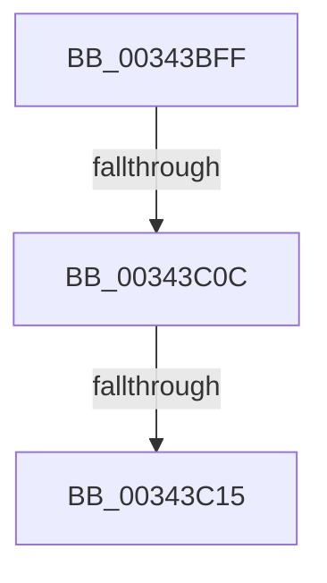

# sub_00343BFF

- RVA: `0x00343BFF`–`0x00343C30` (길이 `49` bytes)
- VA: `0x0000000140343BFF`
- 실행 섹션: `.text`
- PDB 이름 있음: `아니요`; PDB Function 태그: `아니요`
- unwind 정보 RVA: `0x00077B84`
- 디코드: `12`개 명령, `49/49` bytes 표시
- 미해석 바이트: `0` (있으면 어셈블리에 `.byte`로 보존)

> 이 문서는 커널 이미지의 기계어와 PDB 기호를 분석해 생성했습니다. 4번과 5번은 함수 원형과 자료형을 바이너리 사용 방식에서 추정한 C 해석이며 원본 소스 복구 결과는 아닙니다.

## 1. Dependencies

- 직접 호출 지점: **1**; 고유 호출 대상: **1**
- 직접 호출자로 확인된 함수: **0**
- RIP 상대 이미지 참조: **0**

### Outgoing calls
- `0x00343C2A` → [KeBugCheckEx](../4F/KeBugCheckEx_function_004FD660.md) (function, `0x004FD660`)

### Direct callers
- 이 함수 시작 RVA로 연결되는 직접 call은 확인되지 않았습니다. 간접 호출은 완전히 역산할 수 없습니다.

### Static image references
- 디코드된 RIP-relative 메모리 참조가 없습니다.

## 2. Other-region calls and transfers

- 다른 실행 섹션으로 향하는 call: **0**
- call이 아닌 외부 분기/꼬리 이동: **2**
  - `0x00343C06` → [sub_00343C9D + 0x12](Unknown_function_00343C9D.md) (`tail-transfer`)
  - `0x00343C0F` → [sub_00343D34](Unknown_function_00343D34.md) (`tail-transfer`)

## 3. Assembly (complete function range)

```asm
00343BFF  48 8B 4F 08                     mov rcx, qword ptr [rdi + 8]
00343C03  48 85 C9                        test rcx, rcx
00343C06  0F 85 A3 00 00 00               jne 0x140343caf
00343C0C  48 85 C0                        test rax, rax
00343C0F  0F 89 1F 01 00 00               jns 0x140343d34
00343C15  4C 8B 84 24 88 00 00 00         mov r8, qword ptr [rsp + 0x88]
00343C1D  33 D2                           xor edx, edx
00343C1F  4D 8B CF                        mov r9, r15
00343C22  48 89 44 24 20                  mov qword ptr [rsp + 0x20], rax
00343C27  8D 4A 18                        lea ecx, [rdx + 0x18]
00343C2A  E8 31 9A 1B 00                  call 0x1404fd660
00343C2F  CC                              int3
```

## 4. C-style interpretation (structured pseudocode)

```c
__int64 __fastcall sub_00343BFF(__int64 a1, int a2, __int64 a3, __int64 a4, __int64 a5, __int64 a6, __int64 a7, __int64 a8, __int64 a9, __int64 a10, __int64 a11, __int64 a12, __int64 a13, __int64 a14, __int64 a15, __int64 a16, __int64 a17)
{
    __int64 result;
    unsigned __int64 v_stack_p20;

    a2 = 0;
    v_stack_p20 = result;
    result = KeBugCheckEx(a2 + 24, a2, a17, v_r15);
    return result;
}
```

## 5. (Beta) C Style

```c
int64_t sub_00343BFF(int64_t Arg1, int32_t Arg2, int64_t Arg3, int64_t Arg4, uint64_t Arg5, uint64_t Arg6, uint64_t Arg7, uint64_t Arg8, uint64_t Arg9, uint64_t Arg10, uint64_t Arg11, uint64_t Arg12, uint64_t Arg13, uint64_t Arg14, uint64_t Arg15, uint64_t Arg16, int64_t Arg17)
{
    int64_t result;
    uint64_t v_stack_p20;

    Arg2 = 0;
    v_stack_p20 = result;
    result = KeBugCheckEx(Arg2 + 24, Arg2, Arg17, local_r15);
    return result;
}
```

## 6. Execution-region graph

[열기: 2D/3D 그래프와 함수 탐색 컨트롤 패널](../../../control-panel.html?section=text&rva=0x00343BFF&view=graph)

- 2D 그래프는 위에서 아래로 흐르고, 3D 그래프는 빈 공간을 드래그해 회전합니다. Shift+드래그는 이동, 휠은 확대·축소, 함수 노드 선택은 대상 보고서 이동입니다.

### Static fallback


