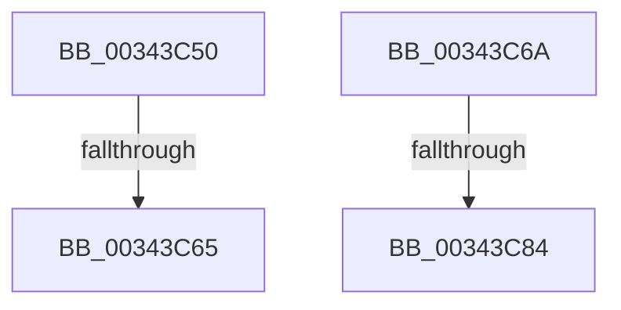

# sub_00343C50

- RVA: `0x00343C50`–`0x00343C8B` (길이 `59` bytes)
- VA: `0x0000000140343C50`
- 실행 섹션: `.text`
- PDB 이름 있음: `아니요`; PDB Function 태그: `아니요`
- unwind 정보 RVA: `0x00077BCC`
- 디코드: `16`개 명령, `59/59` bytes 표시
- 미해석 바이트: `0` (있으면 어셈블리에 `.byte`로 보존)

> 이 문서는 커널 이미지의 기계어와 PDB 기호를 분석해 생성했습니다. 4번과 5번은 함수 원형과 자료형을 바이너리 사용 방식에서 추정한 C 해석이며 원본 소스 복구 결과는 아닙니다.

## 1. Dependencies

- 직접 호출 지점: **1**; 고유 호출 대상: **1**
- 직접 호출자로 확인된 함수: **0**
- RIP 상대 이미지 참조: **0**

### Outgoing calls
- `0x00343C54` → [IopAllocateMiniCompletionPacket](../../page/9D/IopAllocateMiniCompletionPacket_function_009DA2E0.md) (function, `0x009DA2E0`)

### Direct callers
- 이 함수 시작 RVA로 연결되는 직접 call은 확인되지 않았습니다. 간접 호출은 완전히 역산할 수 없습니다.

### Static image references
- 디코드된 RIP-relative 메모리 참조가 없습니다.

## 2. Other-region calls and transfers

- 다른 실행 섹션으로 향하는 call: **1**
  - `0x00343C54` → [IopAllocateMiniCompletionPacket](../../page/9D/IopAllocateMiniCompletionPacket_function_009DA2E0.md) (`.text` → `PAGE`)
- call이 아닌 외부 분기/꼬리 이동: **3**
  - `0x00343C5F` → [sub_003439EB + 0xE8](Unknown_function_003439EB.md) (`tail-transfer`)
  - `0x00343C65` → [sub_003439EB + 0x19E](Unknown_function_003439EB.md) (`tail-transfer`)
  - `0x00343C7E` → [sub_00343D34 + 0x81](Unknown_function_00343D34.md) (`tail-transfer`)

## 3. Assembly (complete function range)

```asm
00343C50  33 D2                           xor edx, edx
00343C52  B1 01                           mov cl, 1
00343C54  E8 87 66 69 00                  call 0x1409da2e0
00343C59  48 8B D8                        mov rbx, rax
00343C5C  48 85 C0                        test rax, rax
00343C5F  0F 85 6E FE FF FF               jne 0x140343ad3
00343C65  E9 1F FF FF FF                  jmp 0x140343b89
00343C6A  8B 56 04                        mov edx, dword ptr [rsi + 4]
00343C6D  8D 42 01                        lea eax, [rdx + 1]
00343C70  89 46 04                        mov dword ptr [rsi + 4], eax
00343C73  48 8D 46 18                     lea rax, [rsi + 0x18]
00343C77  48 8B 48 08                     mov rcx, qword ptr [rax + 8]
00343C7B  48 39 01                        cmp qword ptr [rcx], rax
00343C7E  0F 84 31 01 00 00               je 0x140343db5
00343C84  B9 03 00 00 00                  mov ecx, 3
00343C89  CD 29                           int 0x29
```

## 4. C-style interpretation (structured pseudocode)

```c
__int64 __fastcall sub_00343C50(__int64 a1, int a2)
{
    __int64 result;

    a2 = 0;
    result = IopAllocateMiniCompletionPacket(1, a2, a3, a4);
}
```

## 5. (Beta) C Style

```c
int64_t sub_00343C50(int64_t Arg1, int32_t Arg2)
{
    int64_t result;

    Arg2 = 0;
    result = IopAllocateMiniCompletionPacket(1, Arg2, a3, a4);
}
```

## 6. Execution-region graph

[열기: 2D/3D 그래프와 함수 탐색 컨트롤 패널](../../../control-panel.html?section=text&rva=0x00343C50&view=graph)

- 2D 그래프는 위에서 아래로 흐르고, 3D 그래프는 빈 공간을 드래그해 회전합니다. Shift+드래그는 이동, 휠은 확대·축소, 함수 노드 선택은 대상 보고서 이동입니다.

### Static fallback


