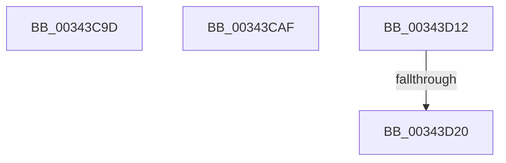

# sub_00343C9D

- RVA: `0x00343C9D`–`0x00343D25` (길이 `136` bytes)
- VA: `0x0000000140343C9D`
- 실행 섹션: `.text`
- PDB 이름 있음: `아니요`; PDB Function 태그: `아니요`
- unwind 정보 RVA: `0x00077C14`
- 디코드: `29`개 명령, `136/136` bytes 표시
- 미해석 바이트: `0` (있으면 어셈블리에 `.byte`로 보존)

> 이 문서는 커널 이미지의 기계어와 PDB 기호를 분석해 생성했습니다. 4번과 5번은 함수 원형과 자료형을 바이너리 사용 방식에서 추정한 C 해석이며 원본 소스 복구 결과는 아닙니다.

## 1. Dependencies

- 직접 호출 지점: **4**; 고유 호출 대상: **4**
- 직접 호출자로 확인된 함수: **0**
- RIP 상대 이미지 참조: **2**

### Outgoing calls
- `0x00343CA5` → [KiRaiseIrqlProcessIrqlFlags](../4F/KiRaiseIrqlProcessIrqlFlags_function_004F56FC.md) (function, `0x004F56FC`)
- `0x00343CF0` → [KeBugCheckEx](../4F/KeBugCheckEx_function_004FD660.md) (function, `0x004FD660`)
- `0x00343CF9` → [KeIsThreadRunning](../39/KeIsThreadRunning_function_00396720.md) (function, `0x00396720`)
- `0x00343D08` → [EtwTraceEnqueueWork](../39/EtwTraceEnqueueWork_function_0039674C.md) (function, `0x0039674C`)

### Direct callers
- 이 함수 시작 RVA로 연결되는 직접 call은 확인되지 않았습니다. 간접 호출은 완전히 역산할 수 없습니다.

### Static image references
- `0x00343CB7` → RVA `0x00000000` (`image boundary/outside`; read)
- `0x00343CDE` → RVA `0x00FC6E4C` (`ALMOSTRO`; read)

## 2. Other-region calls and transfers

- 다른 실행 섹션으로 향하는 call: **0**
- call이 아닌 외부 분기/꼬리 이동: **4**
  - `0x00343CAA` → [sub_003439EB + 0x110](Unknown_function_003439EB.md) (`tail-transfer`)
  - `0x00343D0D` → [sub_003439EB + 0x12D](Unknown_function_003439EB.md) (`tail-transfer`)
  - `0x00343D1A` → [sub_003439EB + 0x15A](Unknown_function_003439EB.md) (`tail-transfer`)
  - `0x00343D20` → [sub_00343C50 + 0x1A](Unknown_function_00343C50.md) (`tail-transfer`)

## 3. Assembly (complete function range)

```asm
00343C9D  41 0F B6 D7                     movzx edx, r15b
00343CA1  41 0F B6 CC                     movzx ecx, r12b
00343CA5  E8 52 1A 1B 00                  call 0x1404f56fc
00343CAA  E9 4C FE FF FF                  jmp 0x140343afb
00343CAF  4C 8B 84 24 88 00 00 00         mov r8, qword ptr [rsp + 0x88]
00343CB7  4C 8D 15 42 C3 CB FF            lea r10, [rip - 0x343cbe]
00343CBE  41 B9 01 00 00 00               mov r9d, 1
00343CC4  48 89 4C 24 20                  mov qword ptr [rsp + 0x20], rcx
00343CC9  48 8B C7                        mov rax, rdi
00343CCC  48 C1 E8 08                     shr rax, 8
00343CD0  0F B6 D0                        movzx edx, al
00343CD3  0F B6 47 18                     movzx eax, byte ptr [rdi + 0x18]
00343CD7  41 8D 49 17                     lea ecx, [r9 + 0x17]
00343CDB  48 33 D0                        xor rdx, rax
00343CDE  0F B6 05 67 31 C8 00            movzx eax, byte ptr [rip + 0xc83167]
00343CE5  48 33 D0                        xor rdx, rax
00343CE8  49 8B 94 D2 00 78 FC 00         mov rdx, qword ptr [r10 + rdx*8 + 0xfc7800]
00343CF0  E8 6B 99 1B 00                  call 0x1404fd660
00343CF5  CC                              int3
00343CF6  49 8B CF                        mov rcx, r15
00343CF9  E8 22 2A 05 00                  call 0x140396720
00343CFE  44 0F B6 C0                     movzx r8d, al
00343D02  49 8B CF                        mov rcx, r15
00343D05  48 8B D3                        mov rdx, rbx
00343D08  E8 3F 2A 05 00                  call 0x14039674c
00343D0D  E9 06 FE FF FF                  jmp 0x140343b18
00343D12  41 80 BF 83 02 00 00 0F         cmp byte ptr [r15 + 0x283], 0xf
00343D1A  0F 85 25 FE FF FF               jne 0x140343b45
00343D20  E9 45 FF FF FF                  jmp 0x140343c6a
```

## 4. C-style interpretation (structured pseudocode)

```c
__int64 __fastcall sub_00343C9D(void)
{
    __int64 result;
    unsigned __int64 v_stack_p20;
    unsigned __int64 v_stack_p88;

    result = KiRaiseIrqlProcessIrqlFlags((unsigned __int8)(v_r12), (unsigned __int8)(v_r15), a3, a4);
}
```

## 5. (Beta) C Style

```c
void sub_00343C9D(void)
{
    int64_t result;
    uint64_t v_stack_p20;
    uint64_t v_stack_p88;

    result = KiRaiseIrqlProcessIrqlFlags((uint8_t)(local_r12), (uint8_t)(local_r15), a3, a4);
}
```

## 6. Execution-region graph

[열기: 2D/3D 그래프와 함수 탐색 컨트롤 패널](../../../control-panel.html?section=text&rva=0x00343C9D&view=graph)

- 2D 그래프는 위에서 아래로 흐르고, 3D 그래프는 빈 공간을 드래그해 회전합니다. Shift+드래그는 이동, 휠은 확대·축소, 함수 노드 선택은 대상 보고서 이동입니다.

### Static fallback


