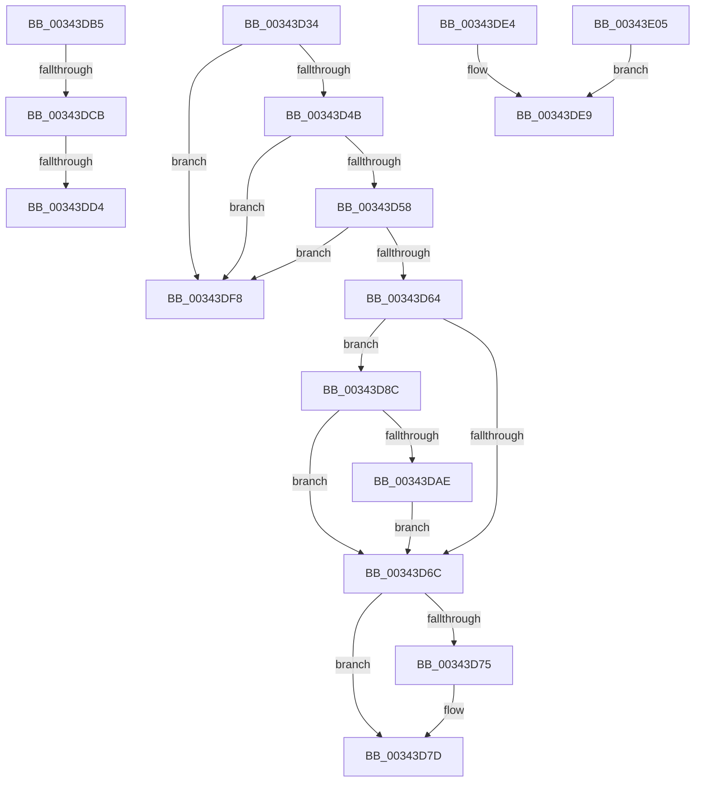

# sub_00343D34

- RVA: `0x00343D34`–`0x00343E0C` (길이 `216` bytes)
- VA: `0x0000000140343D34`
- 실행 섹션: `.text`
- PDB 이름 있음: `아니요`; PDB Function 태그: `아니요`
- unwind 정보 RVA: `0x00077C5C`
- 디코드: `51`개 명령, `216/216` bytes 표시
- 미해석 바이트: `0` (있으면 어셈블리에 `.byte`로 보존)

> 이 문서는 커널 이미지의 기계어와 PDB 기호를 분석해 생성했습니다. 4번과 5번은 함수 원형과 자료형을 바이너리 사용 방식에서 추정한 C 해석이며 원본 소스 복구 결과는 아닙니다.

## 1. Dependencies

- 직접 호출 지점: **7**; 고유 호출 대상: **7**
- 직접 호출자로 확인된 함수: **0**
- RIP 상대 이미지 참조: **2**

### Outgoing calls
- `0x00343D4B` → [KeAreInterruptsEnabled](../2F/KeAreInterruptsEnabled_function_002F8060.md) (function, `0x002F8060`)
- `0x00343D78` → [ObpDeregisterObject](../../page/9D/ObpDeregisterObject_function_009D7F78.md) (function, `0x009D7F78`)
- `0x00343D82` → [ObpRemoveObjectRoutine](../../page/86/ObpRemoveObjectRoutine_function_00864A60.md) (function, `0x00864A60`)
- `0x00343DAE` → [ObpHandleRevocationBlockRemoveObject](../../page/9D/ObpHandleRevocationBlockRemoveObject_function_009D7E30.md) (function, `0x009D7E30`)
- `0x00343DDA` → [KiWakeOtherQueueWaiters](../39/KiWakeOtherQueueWaiters_function_003964D0.md) (function, `0x003964D0`)
- `0x00343DEE` → [KeReleaseInStackQueuedSpinLock](KeReleaseInStackQueuedSpinLock_function_00342CE0.md) (function, `0x00342CE0`)
- `0x00343DFB` → [ObpDeferObjectDeletion](../3A/ObpDeferObjectDeletion_function_003A2394.md) (function, `0x003A2394`)

### Direct callers
- 이 함수 시작 RVA로 연결되는 직접 call은 확인되지 않았습니다. 간접 호출은 완전히 역산할 수 없습니다.

### Static image references
- `0x00343D6C` → RVA `0x00FC5010` (`ALMOSTRO`; read)
- `0x00343D8F` → RVA `0x00000000` (`image boundary/outside`; read)

## 2. Other-region calls and transfers

- 다른 실행 섹션으로 향하는 call: **3**
  - `0x00343D78` → [ObpDeregisterObject](../../page/9D/ObpDeregisterObject_function_009D7F78.md) (`.text` → `PAGE`)
  - `0x00343D82` → [ObpRemoveObjectRoutine](../../page/86/ObpRemoveObjectRoutine_function_00864A60.md) (`.text` → `PAGE`)
  - `0x00343DAE` → [ObpHandleRevocationBlockRemoveObject](../../page/9D/ObpHandleRevocationBlockRemoveObject_function_009D7E30.md) (`.text` → `PAGE`)
- call이 아닌 외부 분기/꼬리 이동: **6**
  - `0x00343D87` → [sub_003439EB + 0x1DE](Unknown_function_003439EB.md) (`tail-transfer`)
  - `0x00343DC5` → [sub_003439EB + 0x173](Unknown_function_003439EB.md) (`tail-transfer`)
  - `0x00343DCE` → [sub_003439EB + 0x173](Unknown_function_003439EB.md) (`tail-transfer`)
  - `0x00343DDF` → [sub_003439EB + 0x173](Unknown_function_003439EB.md) (`tail-transfer`)
  - `0x00343DF3` → [sub_003439EB + 0x1AB](Unknown_function_003439EB.md) (`tail-transfer`)
  - `0x00343E00` → [sub_003439EB + 0x1DE](Unknown_function_003439EB.md) (`tail-transfer`)

## 3. Assembly (complete function range)

```asm
00343D34  65 48 8B 04 25 88 01 00 00      mov rax, qword ptr gs:[0x188]
00343D3D  66 44 39 A8 E6 01 00 00         cmp word ptr [rax + 0x1e6], r13w
00343D45  0F 85 AD 00 00 00               jne 0x140343df8
00343D4B  E8 10 43 FB FF                  call 0x1402f8060
00343D50  84 C0                           test al, al
00343D52  0F 84 A0 00 00 00               je 0x140343df8
00343D58  44 0F 20 C0                     mov rax, cr8
00343D5C  3C 01                           cmp al, 1
00343D5E  0F 83 94 00 00 00               jae 0x140343df8
00343D64  0F B6 47 1A                     movzx eax, byte ptr [rdi + 0x1a]
00343D68  A8 40                           test al, 0x40
00343D6A  75 20                           jne 0x140343d8c
00343D6C  44 39 2D 9D 12 C8 00            cmp dword ptr [rip + 0xc8129d], r13d
00343D73  74 08                           je 0x140343d7d
00343D75  48 8B CF                        mov rcx, rdi
00343D78  E8 FB 41 69 00                  call 0x1409d7f78
00343D7D  33 D2                           xor edx, edx
00343D7F  48 8B CF                        mov rcx, rdi
00343D82  E8 D9 0C 52 00                  call 0x140864a60
00343D87  E9 3D FE FF FF                  jmp 0x140343bc9
00343D8C  83 E0 7F                        and eax, 0x7f
00343D8F  4C 8D 15 6A C2 CB FF            lea r10, [rip - 0x343d96]
00343D96  48 8B CF                        mov rcx, rdi
00343D99  42 0F B6 84 10 80 FF F0 00      movzx eax, byte ptr [rax + r10 + 0xf0ff80]
00343DA2  48 2B C8                        sub rcx, rax
00343DA5  48 8B 09                        mov rcx, qword ptr [rcx]
00343DA8  44 38 69 18                     cmp byte ptr [rcx + 0x18], r13b
00343DAC  74 BE                           je 0x140343d6c
00343DAE  E8 7D 40 69 00                  call 0x1409d7e30
00343DB3  EB B7                           jmp 0x140343d6c
00343DB5  48 89 03                        mov qword ptr [rbx], rax
00343DB8  48 89 4B 08                     mov qword ptr [rbx + 8], rcx
00343DBC  48 89 19                        mov qword ptr [rcx], rbx
00343DBF  48 89 58 08                     mov qword ptr [rax + 8], rbx
00343DC3  85 D2                           test edx, edx
00343DC5  0F 85 93 FD FF FF               jne 0x140343b5e
00343DCB  4D 39 36                        cmp qword ptr [r14], r14
00343DCE  0F 84 8A FD FF FF               je 0x140343b5e
00343DD4  48 8B D6                        mov rdx, rsi
00343DD7  48 8B CF                        mov rcx, rdi
00343DDA  E8 F1 26 05 00                  call 0x1403964d0
00343DDF  E9 7A FD FF FF                  jmp 0x140343b5e
00343DE4  BD 80 00 00 00                  mov ebp, 0x80
00343DE9  48 8D 4C 24 30                  lea rcx, [rsp + 0x30]
00343DEE  E8 ED EE FF FF                  call 0x140342ce0
00343DF3  E9 9E FD FF FF                  jmp 0x140343b96
00343DF8  48 8B CF                        mov rcx, rdi
00343DFB  E8 94 E5 05 00                  call 0x1403a2394
00343E00  E9 C4 FD FF FF                  jmp 0x140343bc9
00343E05  BD 01 00 00 C0                  mov ebp, 0xc0000001
00343E0A  EB DD                           jmp 0x140343de9
```

## 4. C-style interpretation (structured pseudocode)

```c
__int64 __fastcall sub_00343D34(__int64 a1, int a2)
{
    __int64 result;
    unsigned __int64 v_stack_p30;

    if ((*(unsigned __int16 *)(*(unsigned __int64 *)(gs_base + (0 + 392)) + 486)) != ((unsigned __int16)(v_r13))) goto loc_00343DF8;
    result = KeAreInterruptsEnabled(a1, a2, a3, a4);
    if ((unsigned __int8)(result) == 0) goto loc_00343DF8;
    if (((unsigned __int8)(v_cr8)) >= 1) goto loc_00343DF8;
    if ((((unsigned __int8)(*(unsigned __int8 *)(v_rdi + 26))) & (64)) != 0) goto loc_00343D8C;
loc_00343D6C:
    result = *(unsigned __int8 *)(v_rdi + 26);
    if ((*(unsigned int *)(v_rip + 13111965)) != ((unsigned int)(v_r13))) {
        a1 = v_rdi;
        result = ObpDeregisterObject(a1, a2, a3, a4);
    }
    a2 = 0;
    result = ObpRemoveObjectRoutine(v_rdi, a2, a3, a4);
loc_00343D8C:
    result = (unsigned int)((result) & (127));
    a1 = (v_rdi) - (*(unsigned __int8 *)(result + v_rip - 3423638 * 1 + 15794048));
    if ((*(unsigned __int8 *)(*(unsigned __int64 *)(a1) + 24)) == ((unsigned __int8)(v_r13))) goto loc_00343D6C;
    result = ObpHandleRevocationBlockRemoveObject(*(unsigned __int64 *)(a1), a2, a3, a4);
    goto loc_00343D6C;
loc_00343DF8:
    result = ObpDeferObjectDeletion(v_rdi, a2, a3, a4);
}
```

## 5. (Beta) C Style

```c
int64_t sub_00343D34(int64_t Arg1, int32_t Arg2)
{
    int64_t result;
    uint64_t v_stack_p30;

    if ((*(uint16_t *)(*(uint64_t *)(gs_base + (0 + 0x188)) + 0x1E6)) != ((uint16_t)(local_r13))) goto loc_00343DF8;
    result = KeAreInterruptsEnabled(Arg1, Arg2, a3, a4);
    if ((uint8_t)(result) == 0) goto loc_00343DF8;
    if (((uint8_t)(v_cr8)) >= 1) goto loc_00343DF8;
    if ((((uint8_t)(*(uint8_t *)(local_rdi + 0x1A))) & (64)) != 0) goto loc_00343D8C;
loc_00343D6C:
    result = *(uint8_t *)(local_rdi + 0x1A);
    if ((*(uint32_t *)(v_rip + 0xC8129D)) != ((uint32_t)(local_r13))) {
        Arg1 = local_rdi;
        result = ObpDeregisterObject(Arg1, Arg2, a3, a4);
    }
    Arg2 = 0;
    result = ObpRemoveObjectRoutine(local_rdi, Arg2, a3, a4);
loc_00343D8C:
    result = (uint32_t)((result) & (127));
    Arg1 = (local_rdi) - (*(uint8_t *)(result + v_rip - 0x343D96 * 1 + 0xF0FF80));
    if ((*(uint8_t *)(*(uint64_t *)(Arg1) + 0x18)) == ((uint8_t)(local_r13))) goto loc_00343D6C;
    result = ObpHandleRevocationBlockRemoveObject(*(uint64_t *)(Arg1), Arg2, a3, a4);
    goto loc_00343D6C;
loc_00343DF8:
    result = ObpDeferObjectDeletion(local_rdi, Arg2, a3, a4);
}
```

## 6. Execution-region graph

[열기: 2D/3D 그래프와 함수 탐색 컨트롤 패널](../../../control-panel.html?section=text&rva=0x00343D34&view=graph)

- 2D 그래프는 위에서 아래로 흐르고, 3D 그래프는 빈 공간을 드래그해 회전합니다. Shift+드래그는 이동, 휠은 확대·축소, 함수 노드 선택은 대상 보고서 이동입니다.

### Static fallback


