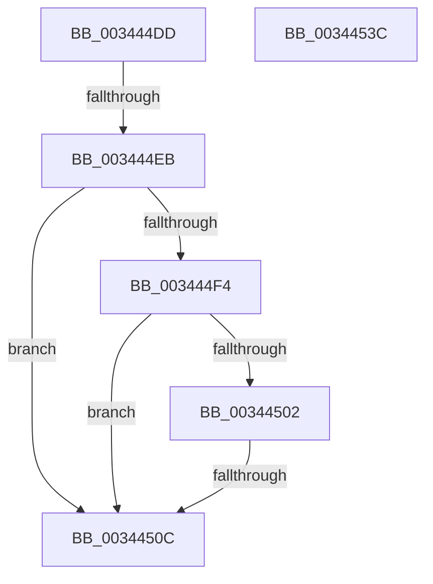

# sub_003444DD

- RVA: `0x003444DD`–`0x0034453D` (길이 `96` bytes)
- VA: `0x00000001403444DD`
- 실행 섹션: `.text`
- PDB 이름 있음: `아니요`; PDB Function 태그: `아니요`
- unwind 정보 RVA: `0x00077CEC`
- 디코드: `24`개 명령, `96/96` bytes 표시
- 미해석 바이트: `0` (있으면 어셈블리에 `.byte`로 보존)

> 이 문서는 커널 이미지의 기계어와 PDB 기호를 분석해 생성했습니다. 4번과 5번은 함수 원형과 자료형을 바이너리 사용 방식에서 추정한 C 해석이며 원본 소스 복구 결과는 아닙니다.

## 1. Dependencies

- 직접 호출 지점: **1**; 고유 호출 대상: **1**
- 직접 호출자로 확인된 함수: **0**
- RIP 상대 이미지 참조: **0**

### Outgoing calls
- `0x00344519` → [KeReleaseInStackQueuedSpinLock](KeReleaseInStackQueuedSpinLock_function_00342CE0.md) (function, `0x00342CE0`)

### Direct callers
- 이 함수 시작 RVA로 연결되는 직접 call은 확인되지 않았습니다. 간접 호출은 완전히 역산할 수 없습니다.

### Static image references
- 디코드된 RIP-relative 메모리 참조가 없습니다.

## 2. Other-region calls and transfers

- 다른 실행 섹션으로 향하는 call: **0**
- call이 아닌 외부 분기/꼬리 이동: **2**
  - `0x003444E5` → [sub_0034466C + 0x11E](Unknown_function_0034466C.md) (`tail-transfer`)
  - `0x0034450A` → [sub_00344568](Unknown_function_00344568.md) (`tail-transfer`)

## 3. Assembly (complete function range)

```asm
003444DD  4C 89 7C 24 60                  mov qword ptr [rsp + 0x60], r15
003444E2  45 84 F6                        test r14b, r14b
003444E5  0F 85 9F 02 00 00               jne 0x14034478a
003444EB  83 BB 90 01 00 00 00            cmp dword ptr [rbx + 0x190], 0
003444F2  75 18                           jne 0x14034450c
003444F4  8B 83 7C 01 00 00               mov eax, dword ptr [rbx + 0x17c]
003444FA  39 83 80 01 00 00               cmp dword ptr [rbx + 0x180], eax
00344500  73 0A                           jae 0x14034450c
00344502  48 8B 43 10                     mov rax, qword ptr [rbx + 0x10]
00344506  83 78 1C 00                     cmp dword ptr [rax + 0x1c], 0
0034450A  76 5C                           jbe 0x140344568
0034450C  81 A3 98 01 00 00 0F CE FF FF   and dword ptr [rbx + 0x198], 0xffffce0f
00344516  48 8B CF                        mov rcx, rdi
00344519  E8 C2 E7 FF FF                  call 0x140342ce0
0034451E  4C 8B 7C 24 60                  mov r15, qword ptr [rsp + 0x60]
00344523  48 8B 5C 24 68                  mov rbx, qword ptr [rsp + 0x68]
00344528  48 8B 6C 24 70                  mov rbp, qword ptr [rsp + 0x70]
0034452D  48 8B 74 24 78                  mov rsi, qword ptr [rsp + 0x78]
00344532  48 83 C4 40                     add rsp, 0x40
00344536  41 5E                           pop r14
00344538  41 5C                           pop r12
0034453A  5F                              pop rdi
0034453B  C3                              ret
0034453C  CC                              int3
```

## 4. C-style interpretation (structured pseudocode)

```c
__int64 __fastcall sub_003444DD(__int64 a1, __int64 a2, __int64 a3, __int64 a4, __int64 a5, __int64 a6, __int64 a7, __int64 a8, __int64 a9, __int64 a10, __int64 a11, __int64 a12, __int64 a13, __int64 a14, __int64 a15)
{
    __int64 result;
    __int64 v_rsp;
    unsigned __int64 v_stack_p60;

    v_stack_p60 = v_r15;
    if ((*(unsigned int *)(v_rbx + 400)) != 0) goto loc_0034450C;
    if ((*(unsigned int *)(v_rbx + 384)) >= ((unsigned int)((unsigned int)(*(unsigned int *)(v_rbx + 380))))) goto loc_0034450C;
loc_0034450C:
    result = KeReleaseInStackQueuedSpinLock(v_rdi, a2, a3, a4);
    v_rsp = (v_rsp) + (64);
    return result;
}
```

## 5. (Beta) C Style

```c
int64_t sub_003444DD(int64_t Arg1, int64_t Arg2, int64_t Arg3, int64_t Arg4, uint64_t Arg5, uint64_t Arg6, uint64_t Arg7, uint64_t Arg8, uint64_t Arg9, uint64_t Arg10, uint64_t Arg11, int64_t Arg12, int64_t Arg13, int64_t Arg14, int64_t Arg15)
{
    int64_t result;
    int64_t local_rsp;
    uint64_t v_stack_p60;

    v_stack_p60 = local_r15;
    if ((*(uint32_t *)(local_rbx + 0x190)) != 0) goto loc_0034450C;
    if ((*(uint32_t *)(local_rbx + 0x180)) >= ((uint32_t)((uint32_t)(*(uint32_t *)(local_rbx + 0x17C))))) goto loc_0034450C;
loc_0034450C:
    result = KeReleaseInStackQueuedSpinLock(local_rdi, Arg2, Arg3, Arg4);
    local_rsp = (local_rsp) + (64);
    return result;
}
```

## 6. Execution-region graph

[열기: 2D/3D 그래프와 함수 탐색 컨트롤 패널](../../../control-panel.html?section=text&rva=0x003444DD&view=graph)

- 2D 그래프는 위에서 아래로 흐르고, 3D 그래프는 빈 공간을 드래그해 회전합니다. Shift+드래그는 이동, 휠은 확대·축소, 함수 노드 선택은 대상 보고서 이동입니다.

### Static fallback


