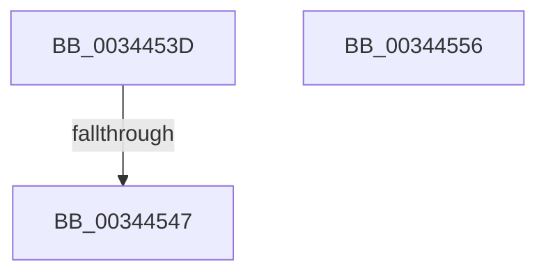

# sub_0034453D

- RVA: `0x0034453D`–`0x00344568` (길이 `43` bytes)
- VA: `0x000000014034453D`
- 실행 섹션: `.text`
- PDB 이름 있음: `아니요`; PDB Function 태그: `아니요`
- unwind 정보 RVA: `0x00077D04`
- 디코드: `11`개 명령, `43/43` bytes 표시
- 미해석 바이트: `0` (있으면 어셈블리에 `.byte`로 보존)

> 이 문서는 커널 이미지의 기계어와 PDB 기호를 분석해 생성했습니다. 4번과 5번은 함수 원형과 자료형을 바이너리 사용 방식에서 추정한 C 해석이며 원본 소스 복구 결과는 아닙니다.

## 1. Dependencies

- 직접 호출 지점: **2**; 고유 호출 대상: **2**
- 직접 호출자로 확인된 함수: **0**
- RIP 상대 이미지 참조: **1**

### Outgoing calls
- `0x0034454F` → [KiAcquireQueuedSpinLockInstrumented](../27/KiAcquireQueuedSpinLockInstrumented_function_00275850.md) (function, `0x00275850`)
- `0x0034455E` → [KiRaiseIrqlProcessIrqlFlags](../4F/KiRaiseIrqlProcessIrqlFlags_function_004F56FC.md) (function, `0x004F56FC`)

### Direct callers
- 이 함수 시작 RVA로 연결되는 직접 call은 확인되지 않았습니다. 간접 호출은 완전히 역산할 수 없습니다.

### Static image references
- `0x0034453D` → RVA `0x00F0DE58` (`.data`; read)

## 2. Other-region calls and transfers

- 다른 실행 섹션으로 향하는 call: **0**
- call이 아닌 외부 분기/꼬리 이동: **3**
  - `0x00344545` → [ExpWorkerFactoryCheckCreate + 0x6C](ExpWorkerFactoryCheckCreate_function_00344460.md) (`tail-transfer`)
  - `0x00344554` → [sub_003444DD](Unknown_function_003444DD.md) (`tail-transfer`)
  - `0x00344563` → [ExpWorkerFactoryCheckCreate + 0x5E](ExpWorkerFactoryCheckCreate_function_00344460.md) (`tail-transfer`)

## 3. Assembly (complete function range)

```asm
0034453D  8B 05 15 99 BC 00               mov eax, dword ptr [rip + 0xbc9915]
00344543  85 C0                           test eax, eax
00344545  75 85                           jne 0x1403444cc
00344547  48 8B D6                        mov rdx, rsi
0034454A  48 8D 4C 24 20                  lea rcx, [rsp + 0x20]
0034454F  E8 FC 12 F3 FF                  call 0x140275850
00344554  EB 87                           jmp 0x1403444dd
00344556  41 0F B6 D4                     movzx edx, r12b
0034455A  40 0F B6 CD                     movzx ecx, bpl
0034455E  E8 99 11 1B 00                  call 0x1404f56fc
00344563  E9 56 FF FF FF                  jmp 0x1403444be
```

## 4. C-style interpretation (structured pseudocode)

```c
__int64 __fastcall sub_0034453D(void)
{
    __int64 result;
    unsigned __int64 v_stack_p20;

    result = KiAcquireQueuedSpinLockInstrumented(v_stack_p20, v_rsi, a3, a4);
}
```

## 5. (Beta) C Style

```c
void sub_0034453D(void)
{
    int64_t result;
    uint64_t v_stack_p20;

    result = KiAcquireQueuedSpinLockInstrumented(v_stack_p20, local_rsi, a3, a4);
}
```

## 6. Execution-region graph

[열기: 2D/3D 그래프와 함수 탐색 컨트롤 패널](../../../control-panel.html?section=text&rva=0x0034453D&view=graph)

- 2D 그래프는 위에서 아래로 흐르고, 3D 그래프는 빈 공간을 드래그해 회전합니다. Shift+드래그는 이동, 휠은 확대·축소, 함수 노드 선택은 대상 보고서 이동입니다.

### Static fallback


