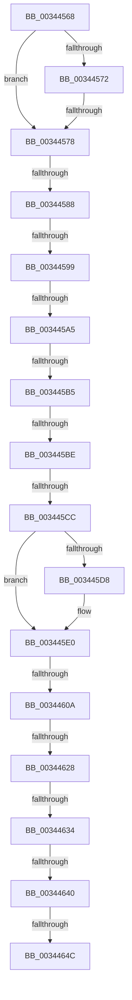

# sub_00344568

- RVA: `0x00344568`–`0x0034465D` (길이 `245` bytes)
- VA: `0x0000000140344568`
- 실행 섹션: `.text`
- PDB 이름 있음: `아니요`; PDB Function 태그: `아니요`
- unwind 정보 RVA: `0x00077D14`
- 디코드: `52`개 명령, `245/245` bytes 표시
- 미해석 바이트: `0` (있으면 어셈블리에 `.byte`로 보존)

> 이 문서는 커널 이미지의 기계어와 PDB 기호를 분석해 생성했습니다. 4번과 5번은 함수 원형과 자료형을 바이너리 사용 방식에서 추정한 C 해석이며 원본 소스 복구 결과는 아닙니다.

## 1. Dependencies

- 직접 호출 지점: **5**; 고유 호출 대상: **5**
- 직접 호출자로 확인된 함수: **0**
- RIP 상대 이미지 참조: **1**

### Outgoing calls
- `0x003445A8` → [ExpCheckThreadHistory](../46/ExpCheckThreadHistory_function_0046E874.md) (function, `0x0046E874`)
- `0x003445DB` → [ExpLeaveWorkerFactoryAwayMode](ExpLeaveWorkerFactoryAwayMode_function_00344350.md) (function, `0x00344350`)
- `0x003445F3` → [KeReleaseInStackQueuedSpinLock](KeReleaseInStackQueuedSpinLock_function_00342CE0.md) (function, `0x00342CE0`)
- `0x003445FB` → [ExpWorkerFactoryCreateThread](ExpWorkerFactoryCreateThread_function_0034B620.md) (function, `0x0034B620`)
- `0x00344611` → [KeAcquireInStackQueuedSpinLock](../27/KeAcquireInStackQueuedSpinLock_function_002757A0.md) (function, `0x002757A0`)

### Direct callers
- 이 함수 시작 RVA로 연결되는 직접 call은 확인되지 않았습니다. 간접 호출은 완전히 역산할 수 없습니다.

### Static image references
- `0x0034458B` → RVA `0x00FC6A80` (`ALMOSTRO`; read)

## 2. Other-region calls and transfers

- 다른 실행 섹션으로 향하는 call: **0**
- call이 아닌 외부 분기/꼬리 이동: **13**
  - `0x00344576` → [sub_003444DD + 0x2F](Unknown_function_003444DD.md) (`tail-transfer`)
  - `0x00344582` → [sub_0034466C + 0xEC](Unknown_function_0034466C.md) (`tail-transfer`)
  - `0x00344593` → [sub_0034466C](Unknown_function_0034466C.md) (`tail-transfer`)
  - `0x0034459F` → [sub_0034466C + 0xD3](Unknown_function_0034466C.md) (`tail-transfer`)
  - `0x003445AF` → [sub_0034466C + 0xFE](Unknown_function_0034466C.md) (`tail-transfer`)
  - `0x003445B8` → [sub_0034466C + 0x167](Unknown_function_0034466C.md) (`tail-transfer`)
  - `0x003445C6` → [sub_0034466C + 0x8B](Unknown_function_0034466C.md) (`tail-transfer`)
  - `0x00344604` → [sub_003444DD + 0x41](Unknown_function_003444DD.md) (`tail-transfer`)
  - `0x00344622` → [sub_003444DD + 0x39](Unknown_function_003444DD.md) (`tail-transfer`)
  - `0x0034462E` → [sub_003444DD + 0x39](Unknown_function_003444DD.md) (`tail-transfer`)
  - `0x0034463A` → [sub_003444DD + 0x39](Unknown_function_003444DD.md) (`tail-transfer`)
  - `0x00344646` → [sub_003444DD + 0x39](Unknown_function_003444DD.md) (`tail-transfer`)
  - `0x0034465B` → [sub_0034466C + 0x41](Unknown_function_0034466C.md) (`tail-transfer`)

## 3. Assembly (complete function range)

```asm
00344568  48 8B 48 08                     mov rcx, qword ptr [rax + 8]
0034456C  83 79 04 00                     cmp dword ptr [rcx + 4], 0
00344570  75 06                           jne 0x140344578
00344572  83 78 18 00                     cmp dword ptr [rax + 0x18], 0
00344576  76 94                           jbe 0x14034450c
00344578  4C 8D BB 98 01 00 00            lea r15, [rbx + 0x198]
0034457F  45 84 F6                        test r14b, r14b
00344582  0F 85 D0 01 00 00               jne 0x140344758
00344588  8B 49 28                        mov ecx, dword ptr [rcx + 0x28]
0034458B  8B 05 EF 24 C8 00               mov eax, dword ptr [rip + 0xc824ef]
00344591  3B C8                           cmp ecx, eax
00344593  0F 83 D3 00 00 00               jae 0x14034466c
00344599  49 8B EF                        mov rbp, r15
0034459C  45 84 F6                        test r14b, r14b
0034459F  0F 85 9A 01 00 00               jne 0x14034473f
003445A5  48 8B CB                        mov rcx, rbx
003445A8  E8 C7 A2 12 00                  call 0x14046e874
003445AD  84 C0                           test al, al
003445AF  0F 85 B5 01 00 00               jne 0x14034476a
003445B5  45 84 F6                        test r14b, r14b
003445B8  0F 85 15 02 00 00               jne 0x1403447d3
003445BE  8B 83 8C 01 00 00               mov eax, dword ptr [rbx + 0x18c]
003445C4  85 C0                           test eax, eax
003445C6  0F 85 2B 01 00 00               jne 0x1403446f7
003445CC  F7 83 98 01 00 00 00 02 00 00   test dword ptr [rbx + 0x198], 0x200
003445D6  74 08                           je 0x1403445e0
003445D8  48 8B CB                        mov rcx, rbx
003445DB  E8 70 FD FF FF                  call 0x140344350
003445E0  FF 83 90 01 00 00               inc dword ptr [rbx + 0x190]
003445E6  48 8B CF                        mov rcx, rdi
003445E9  81 A3 98 01 00 00 0F CE FF FF   and dword ptr [rbx + 0x198], 0xffffce0f
003445F3  E8 E8 E6 FF FF                  call 0x140342ce0
003445F8  48 8B CB                        mov rcx, rbx
003445FB  E8 20 70 00 00                  call 0x14034b620
00344600  8B F0                           mov esi, eax
00344602  85 C0                           test eax, eax
00344604  0F 89 14 FF FF FF               jns 0x14034451e
0034460A  48 8B 4B 10                     mov rcx, qword ptr [rbx + 0x10]
0034460E  48 8B D7                        mov rdx, rdi
00344611  E8 8A 11 F3 FF                  call 0x1402757a0
00344616  FF 8B 90 01 00 00               dec dword ptr [rbx + 0x190]
0034461C  81 FE 0A 00 00 C0               cmp esi, 0xc000000a
00344622  0F 84 EE FE FF FF               je 0x140344516
00344628  81 FE 0A 01 00 C0               cmp esi, 0xc000010a
0034462E  0F 84 E2 FE FF FF               je 0x140344516
00344634  81 FE F2 00 00 C0               cmp esi, 0xc00000f2
0034463A  0F 84 D6 FE FF FF               je 0x140344516
00344640  81 FE 01 00 00 C0               cmp esi, 0xc0000001
00344646  0F 84 CA FE FF FF               je 0x140344516
0034464C  81 8B 98 01 00 00 00 01 00 00   or dword ptr [rbx + 0x198], 0x100
00344656  BE 01 00 00 00                  mov esi, 1
0034465B  EB 50                           jmp 0x1403446ad
```

## 4. C-style interpretation (structured pseudocode)

```c
__int64 __fastcall sub_00344568(void)
{
    __int64 result;

    if ((*(unsigned int *)(*(unsigned __int64 *)(result + 8) + 4)) != 0) goto loc_00344578;
loc_00344578:
    result = ExpCheckThreadHistory(v_rbx, a2, a3, a4);
    result = (unsigned int)(*(unsigned int *)(v_rbx + 396));
    if (((*(unsigned int *)(v_rbx + 408)) & (512)) != 0) {
        a1 = v_rbx;
        result = ExpLeaveWorkerFactoryAwayMode(a1, a2, a3, a4);
    }
    result = KeReleaseInStackQueuedSpinLock(v_rdi, a2, a3, a4);
    result = ExpWorkerFactoryCreateThread(v_rbx, a2, a3, a4);
    result = KeAcquireInStackQueuedSpinLock(*(unsigned __int64 *)(v_rbx + 16), v_rdi, a3, a4);
}
```

## 5. (Beta) C Style

```c
void sub_00344568(void)
{
    int64_t result;

    if ((*(uint32_t *)(*(uint64_t *)(result + 0x8) + 0x4)) != 0) goto loc_00344578;
loc_00344578:
    result = ExpCheckThreadHistory(local_rbx, a2, a3, a4);
    result = (uint32_t)(*(uint32_t *)(local_rbx + 0x18C));
    if (((*(uint32_t *)(local_rbx + 0x198)) & (512)) != 0) {
        a1 = local_rbx;
        result = ExpLeaveWorkerFactoryAwayMode(a1, a2, a3, a4);
    }
    result = KeReleaseInStackQueuedSpinLock(local_rdi, a2, a3, a4);
    result = ExpWorkerFactoryCreateThread(local_rbx, a2, a3, a4);
    result = KeAcquireInStackQueuedSpinLock(*(uint64_t *)(local_rbx + 0x10), local_rdi, a3, a4);
}
```

## 6. Execution-region graph

[열기: 2D/3D 그래프와 함수 탐색 컨트롤 패널](../../../control-panel.html?section=text&rva=0x00344568&view=graph)

- 2D 그래프는 위에서 아래로 흐르고, 3D 그래프는 빈 공간을 드래그해 회전합니다. Shift+드래그는 이동, 휠은 확대·축소, 함수 노드 선택은 대상 보고서 이동입니다.

### Static fallback


